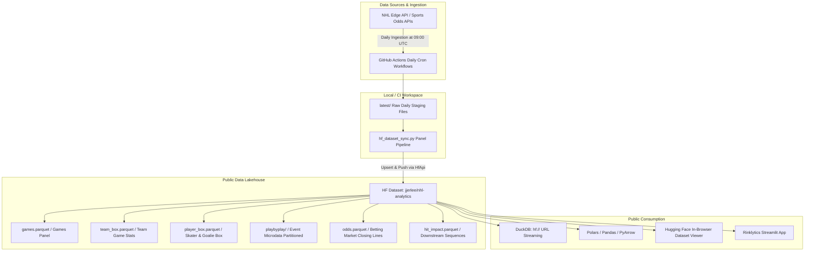
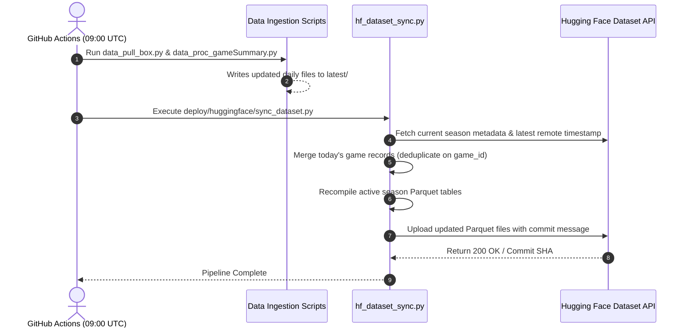

# Architecture & Implementation Plan: Public NHL Panel Dataset on Hugging Face

## Executive Summary
This document outlines the complete architectural design, data modeling, bootstrapping strategy, and automated synchronization pipeline for hosting a **public, multi-season NHL Analytics Panel Dataset** on Hugging Face Datasets (`repo_type="dataset"`).

Currently, raw data in the repository is segmented into disjoint yearly CSV files (e.g., `2013_box.csv`, `2024_box.csv`, `2024_playbyplay.csv`). This initiative transitions the data ecosystem into **clean, unified longitudinal panel datasets organized by analytical data type**, stored in high-performance **Apache Parquet** format. Automated daily GitHub Actions pipelines will incrementally append and update incoming game records directly to the Hugging Face Dataset repository.

---

## 1. High-Level Architecture Overview



---

## 2. Target Data Tables & Panel Specifications

Instead of organizing files by season years, the public dataset is structured **by domain entity and data type**. Each table is structured as a **balanced or unbalanced longitudinal panel** with standardized primary keys and timestamps.

### Table 1: `games` (Game-Level Panel)
* **Description:** Master schedule, game state, venue, and final game outcome.
* **Granularity / Unit of Observation:** One row per NHL game ($i = \text{game\_id}$).
* **Primary Key:** `game_id`
* **Format:** Single Parquet file (`games.parquet`, ~5 MB compressed for 15,000+ games).
* **Schema Specification:**

| Column Name | Data Type | Nullable | Description | Example |
| :--- | :--- | :--- | :--- | :--- |
| `game_id` | `Int64` | No | Official NHL 10-digit game identifier | `2024020120` |
| `season` | `Int32` | No | 8-digit season format | `20242025` |
| `game_type` | `Int8` | No | Game type code: 1=Preseason, 2=Regular, 3=Playoff | `2` |
| `game_date` | `Date32` | No | Calendar date of game (YYYY-MM-DD) | `2024-10-22` |
| `start_time_utc` | `Timestamp(ms)` | Yes | Puck drop timestamp in UTC | `2024-10-22 23:00:00` |
| `home_team` | `String` | No | 3-letter home team tricode | `"MTL"` |
| `away_team` | `String` | No | 3-letter away team tricode | `"BOS"` |
| `home_score` | `Int16` | Yes | Final goals scored by home team | `3` |
| `away_score` | `Int16` | Yes | Final goals scored by away team | `2` |
| `outcome` | `String` | Yes | Regulation, OT, or Shootout outcome | `"REG"`, `"OT"`, `"SO"` |
| `winning_team` | `String` | Yes | Tricode of victorious club | `"MTL"` |
| `venue` | `String` | Yes | Arena name | `"Bell Centre"` |

---

### Table 2: `team_box` (Team-Game Panel)
* **Description:** Team-level game statistics, box scores, shot differentials, and special teams.
* **Granularity:** Two rows per game (one for Home, one for Away: $i = (\text{game\_id}, \text{team})$).
* **Primary Key:** `(game_id, team)`
* **Format:** Single Parquet file (`team_box.parquet`, ~12 MB compressed).
* **Schema Specification:**

| Column Name | Data Type | Description |
| :--- | :--- | :--- |
| `game_id` | `Int64` | Foreign key to `games.game_id` |
| `season` | `Int32` | 8-digit season identifier |
| `team` | `String` | 3-letter team code (`"NYR"`) |
| `opponent` | `String` | Opponent 3-letter team code |
| `is_home` | `Boolean` | `True` if home team, `False` if away |
| `goals` | `Int16` | Goals scored |
| `shots_on_goal` | `Int16` | Shots on goal registered |
| `shot_attempts` | `Int16` | Total Corsi / shot attempts |
| `hits` | `Int16` | Body checks delivered |
| `blocked_shots` | `Int16` | Opponent shots blocked |
| `takeaways` | `Int16` | Stick checks / takeaways won |
| `giveaways` | `Int16` | Turnovers / giveaways committed |
| `penalty_minutes` | `Int16` | Total PIM incurred |
| `powerplay_goals` | `Int16` | Power play goals scored |
| `powerplay_opps` | `Int16` | Power play opportunities |
| `faceoff_win_pct` | `Float32` | Faceoff winning percentage |

---

### Table 3: `player_box` (Skater & Goaltender Game Box Panel)
* **Description:** Individual player performance per game across all seasons.
* **Granularity:** Player-game observations ($i = (\text{game\_id}, \text{player\_id})$).
* **Primary Key:** `(game_id, player_id)`
* **Format:** Single Parquet file (`player_box.parquet`, ~45 MB compressed for ~500k rows).
* **Key Fields:** `game_id`, `season`, `player_id`, `player_name`, `team`, `position` (F/D/G), `toi_seconds`, `goals`, `assists`, `points`, `shots`, `hits`, `blocks`, `plus_minus`, `pim`, `faceoff_pct`, `saves` (goalies), `shots_against`, `goals_against`.

---

### Table 4: `playbyplay` (Granular Event Microdata Panel)
* **Description:** Shot coordinates, physical hits, faceoffs, penalties, and whistles.
* **Granularity:** Discrete play events ($i = (\text{game\_id}, \text{event\_id})$).
* **Format:** Single Parquet file (`playbyplay.parquet`, ~58 MB compressed for ~5.4 million records across 14 seasons).
* **Key Fields:** `game_id`, `season`, `game_date`, `event_id`, `time_in_period`, `time_remaining`, `period`, `period_type`, `event_type`, `owner_team`, `x_coord`, `y_coord`, `zone_code`, `home_defending_side`, `shot_type`, `away_sog`, `home_sog`, `shooting_player_id`, `blocking_player_id`, `goalie_in_net_id`, `scoring_player_id`, `assist1_player_id`, `assist2_player_id`, `hitting_player_id`, `hittee_player_id`, `duration`, `committed_by_player_id`, `drawn_by_player_id`.

---

### Table 5: `odds` (Betting Market Closing Lines Panel)
* **Description:** Consensus and regional bookmaker closing lines, puck lines, moneylines, and totals across US and Canadian markets.
* **Granularity:** Game-country-market observations ($i = (\text{game\_id}, \text{country}, \text{odds\_description})$).
* **Format:** Single Parquet file (`odds.parquet`, ~4 MB compressed).
* **Key Fields:** `game_id`, `country` (`"US"` or `"CAN"`), `game_date`, `home_team`, `away_team`, `odds_description`, `home_odds`, `away_odds`, `betting_partner`, `start_time_utc`, `last_updated_utc`.
* **Country Tagging Rule:**
  - Files matching `*_odds_CA.csv` are tagged with `country = "CAN"`.
  - Files matching `*_odds_US.csv` are tagged with `country = "US"`.
  - Historical data prior to separate market tracking (e.g., `2024_odds.csv`) are tagged with `country = "US"`.
  - Deduplication key: `(game_id, country, odds_description)` to preserve simultaneous US and Canadian closing lines.

---

### Table 6: `hit_impact` (Derived Physicality & Sequence Analytics Panel)
* **Description:** Curated physical collision tracking with subsequent event latency, puck recovery classification, and 30-second downstream net shot differentials.
* **Format:** Single Parquet file (`hit_impact.parquet`, ~18 MB compressed).
* **Key Fields:** `game_id`, `hit_event_id`, `hit_zone`, `x_bin`, `y_bin`, `hitting_team`, `target_team`, `next_event_type`, `next_event_team`, `delta_time_sec`, `puck_recovered_by_hitting_team`, `net_shots_30s`, `net_goals_30s`.

---

### Table 7: `playbyplay_player` (Active Game Rosters & Participants Panel)
* **Description:** Comprehensive official game sheet roster of all participating skaters and goalies per game across 14 seasons (2013–2026).
* **Granularity:** Player-game roster observations ($i = (\text{game\_id}, \text{player\_id})$).
* **Primary Key:** `(game_id, player_id)`
* **Format:** Single Parquet file (`playbyplay_player.parquet`, ~15 MB compressed for ~700k records).
* **Key Fields:** `game_id`, `season`, `player_id`, `team`, `sweater_number`, `position`, `first_name`, `last_name`, `headshot`.

---

### Table 8: `shifts` (Shift-Level Time on Ice Tracking Panel)
* **Description:** Individual player shift tracking with start and end times, duration, shift type codes, and linked event references.
* **Granularity:** Shift-level observations ($i = \text{shift\_id}$).
* **Primary Key:** `(shift_id, game_id, player_id)`
* **Format:** Single Parquet file (`shifts.parquet`).
* **Key Fields:** `shift_id`, `game_id`, `player_id`, `season`, `team`, `player_name`, `period`, `shift_number`, `start_time`, `end_time`, `duration`, `type_code`, `detail_code`, `event_number`, `event_description`, `event_details`.

---

## 3. Dataset Repository Layout on Hugging Face

The public repository structure on Hugging Face (`hf.co/datasets/jjerlee/nhl-analytics`) is organized into two primary tiers: **`data/`** (raw longitudinal panel records) and **`measurement/`** (derived metrics and calculated analytical benchmarks, all indexed with `yr_season`):

```text
nhl-analytics/                     # HF Dataset Repository Root
├── README.md                      # Dataset Card with YAML metadata & table previews
├── data/                          # Tier 1: Raw Longitudinal Panels
│   ├── games.parquet              # All NHL games panel (2013-2026)
│   ├── team_box.parquet           # Team-game stats panel
│   ├── player_box.parquet         # Individual player performance panel
│   ├── playbyplay.parquet         # Consolidated play-by-play events panel (2013-2026)
│   ├── playbyplay_player.parquet  # Active game sheet rosters & participants (2013-2026)
│   ├── shifts.parquet             # Player shift-level tracking panel
│   ├── odds.parquet               # Closing betting market lines panel (US & CAN tagged)
│   └── hit_impact.parquet         # Downstream sequence & turnover panel
├── measurement/                   # Tier 2: Measured & Computed Statistics (with yr_season)
│   ├── box/
│   │   ├── team_season.parquet    # Team season KPIs, win streaks, PE, RPI (14 seasons)
│   │   └── game_stats.parquet     # Game-level momentum, Corsi/Fenwick, rolling metrics (14 seasons)
│   ├── player/
│   │   └── player_season.parquet  # Skater & goaltender season totals & rates (14 seasons)
│   └── action/
│       └── hits/
│           ├── hit_impact.parquet               # Downstream 30s shot differential sequences
│           ├── team_season_hit_kpi.parquet      # Team-level physicality benchmarks (12 seasons)
│           ├── team_season_spatial_hits.parquet # Spatial hit density grid distributions (12 seasons)
│           ├── hit_goal_window_30s.parquet      # Post-hit 30s scoring window telemetry (12 seasons)
│           ├── hit_next_events.parquet          # Subsequent event reaction latency (12 seasons)
│           ├── hit_sequence_transitions.parquet # Transition state Markov sequences (12 seasons)
│           ├── hit_zone_summary_kpi.parquet     # Zone-level hit KPIs and takeaway rates (12 seasons)
│           ├── hit_zone_summary.parquet         # Zone recovery and delta-sec summaries (12 seasons)
│           ├── rink_grid_hit_sequences.parquet  # Normalized rink coordinate sequences (12 seasons)
│           └── tabulated_hit_sequences.parquet  # Multi-step post-hit event progressions (12 seasons)
└── schemas/                       # JSON Schema & metadata definitions
    └── dictionary.json
```

### Dataset Card (`README.md`) YAML Frontmatter

```yaml
---
annotations_creators:
- machine-generated
language:
- en
license:
- mit
multilinguality:
- monolingual
size_categories:
- 1M<n<10M
source_datasets:
- original
task_categories:
- tabular-classification
- tabular-regression
- time-series-forecasting
pretty_name: NHL Analytics - Multi-Season Longitudinal Panel Data (2013 ~ Present, Daily Updated)
configs:
- config_name: games
  data_files: "data/games.parquet"
- config_name: team_box
  data_files: "data/team_box.parquet"
- config_name: player_box
  data_files: "data/player_box.parquet"
- config_name: odds
  data_files: "data/odds.parquet"
- config_name: hit_impact
  data_files: "data/hit_impact.parquet"
- config_name: playbyplay
  data_files: "data/playbyplay.parquet"
- config_name: playbyplay_player
  data_files: "data/playbyplay_player.parquet"
- config_name: shifts
  data_files: "data/shifts.parquet"
- config_name: measurement_team_season
  data_files: "measurement/box/team_season.parquet"
- config_name: measurement_game_stats
  data_files: "measurement/box/game_stats.parquet"
- config_name: measurement_player_season
  data_files: "measurement/player/player_season.parquet"
- config_name: measurement_hit_kpi
  data_files: "measurement/action/hits/team_season_hit_kpi.parquet"
- config_name: measurement_hit_spatial
  data_files: "measurement/action/hits/team_season_spatial_hits.parquet"
- config_name: measurement_hit_impact
  data_files: "measurement/action/hits/hit_impact.parquet"
- config_name: measurement_hit_goal_window
  data_files: "measurement/action/hits/hit_goal_window_30s.parquet"
- config_name: measurement_hit_next_events
  data_files: "measurement/action/hits/hit_next_events.parquet"
- config_name: measurement_hit_transitions
  data_files: "measurement/action/hits/hit_sequence_transitions.parquet"
- config_name: measurement_hit_zone_summary
  data_files: "measurement/action/hits/hit_zone_summary.parquet"
- config_name: measurement_hit_zone_kpi
  data_files: "measurement/action/hits/hit_zone_summary_kpi.parquet"
- config_name: measurement_hit_grid
  data_files: "measurement/action/hits/rink_grid_hit_sequences.parquet"
- config_name: measurement_hit_tabulated
  data_files: "measurement/action/hits/tabulated_hit_sequences.parquet"
---
```

---

## 4. Phase 1: Initial Bootstrap & First-Time Dataset Creation

### Bootstrapping Workflow
The dedicated bootstrap script ([`deploy/huggingface/bootstrap_dataset.py`](https://github.com/justinjjlee/NHL-Analytics/blob/main/deploy/huggingface/bootstrap_dataset.py)) consolidates historical files from `latest/` (2013–2026), builds typed Parquet panel datasets, and publishes them to the Hugging Face Dataset repository:

1. **Scan & Aggregate Historical Data:**
   - Consolidates 14 seasons of game boxes (`latest/box/*_box.csv` $\rightarrow$ 17,233 games).
   - Consolidates team box scores (`latest/box/*_box_team.csv` $\rightarrow$ 34,466 records).
   - Consolidates player game appearances (`latest/box/*_box_player.csv` $\rightarrow$ 633,244 records).
   - Consolidates betting market lines (`latest/box/*_odds*.csv` $\rightarrow$ 12,098 lines).
   - Extracts physicality sequences (`dev/decision_science/impact_of_hits/data/df_master.parquet` $\rightarrow$ 436,024 rows).
   - Partitions over 5.5 million play-by-play events by season into `data/playbyplay/season=YYYYYYYY/pbp_YYYYYYYY.parquet`.
2. **Standardize and Cleanse:**
   - Coerces inconsistent historical column names (`gameid` / `gameId` $\rightarrow$ `game_id`).
   - Normalizes and validates primary keys across all domain entities.
   - Converts DataFrames into Snappy-compressed columnar Parquet tables (reducing storage by ~90% from 700 MB down to ~72 MB).
3. **Generate Dataset Card:**
   - Automatically writes `README.md` with full YAML metadata configs enabling the Hugging Face Dataset Viewer.
4. **Publish to Hugging Face:**
   - Automatically verifies authentication and creates the public dataset repo if it doesn't already exist.
   - Uploads all files in a single atomic Git commit via `HfApi.upload_folder` or Hugging Face CLI.

### Running the Bootstrap Script

#### Option A: One-Liner via `uv` (Recommended)
```bash
# Upload to your public Hugging Face dataset (reads token from HF_TOKEN or .env):
uv run --with huggingface_hub python deploy/huggingface/bootstrap_dataset.py --repo "jjerlee/nhl-analytics"

# Or pass token explicitly via environment variable:
HF_TOKEN="<YOUR_HF_TOKEN>" uv run --with huggingface_hub python deploy/huggingface/bootstrap_dataset.py --repo "jjerlee/nhl-analytics"
```

#### Option B: Convenience Shell Wrapper
```bash
./deploy/huggingface/bootstrap_dataset.sh --repo "jjerlee/nhl-analytics"
```

#### Option C: Dry Run (Compile Locally Without Uploading)
```bash
uv run --with huggingface_hub python deploy/huggingface/bootstrap_dataset.py --skip-upload
# Output Parquet tables and README.md are staged in deploy/huggingface/staging_data/
```

#### Option D: Using `huggingface-cli` Directly
```bash
# 1. Compile dataset locally into staging directory
uv run --with huggingface_hub python deploy/huggingface/bootstrap_dataset.py --skip-upload

# 2. Upload using the Hugging Face CLI tool
huggingface-cli upload jjerlee/nhl-analytics deploy/huggingface/staging_data/ . --repo-type dataset
```

---

## 5. Phase 2: Automated Daily Sync via GitHub Actions

To maintain continuous data currency without manual intervention, GitHub Actions will update the Hugging Face Dataset immediately following the daily NHL API data pulls.

### Incremental Synchronization Strategy



### Key Technical Considerations for Incremental Updates:
1. **Deduplication & Idempotency:**
   - Games that update state from `LIVE` to `FINAL` overwrite existing rows matching the same `game_id` without creating duplicates.
2. **Minimal Network Bandwidth:**
   - Historical static seasons (`2013`–`2024`) remain untouched in Hugging Face storage.
   - Only the active season Parquet partitions and the rolling master tables are pushed.
3. **Commit Grouping:**
   - Use `HfApi.upload_folder` or commit scheduling so all updated tables are written in a **single atomic Git commit** on Hugging Face, avoiding incomplete states.
4. **Betting Odds Harmonization (`US` vs `CAN`):**
   - The NHL API outputs separate partner feeds for the US and Canadian betting markets (`data_pull_box_odds.py` fetches both `US` and `CA`).
   - The unified `odds.parquet` dataset tracks both markets in a single table using the `country` column (`"US"` or `"CAN"`).
   - In daily GitHub Actions runs, new US odds must be tagged as `"US"` and Canadian odds as `"CAN"`. Upserts must deduplicate on `(game_id, country, odds_description)` to ensure lines from both markets are retained without collision.

---

| Milestone | Task Description | Deliverable | Status |
| :--- | :--- | :--- | :--- |
| **M1: Schema Definition** | Standardize data types, primary keys, and tier structuring across all 18 target Parquet panels. | `deploy/huggingface/bootstrap_dataset.py` | ✅ Completed |
| **M2: Bootstrap Script** | Consolidate 14 seasons of historical raw data and measurement statistics with dataset card and push to HF. | `deploy/huggingface/bootstrap_dataset.py` | ✅ Completed |
| **M3: Incremental Sync Script** | Implement idempotent active-season replacement, strict deduplication, and zero-noise diff detection. | `deploy/huggingface/sync_dataset.py` | ✅ Completed |
| **M4: GitHub Action Workflows** | Integrate sync triggers into daily box/play-by-play, betting odds, and player workflows, plus manual dispatch. | `.github/workflows/proc_pull_box.yml`<br>`.github/workflows/proc_pull_odds.yml`<br>`.github/workflows/proc_pull_player.yml`<br>`.github/workflows/sync_hf_dataset.yml` | ✅ Completed |
| **M5: Public Verification** | Validate Hugging Face Dataset Viewer, DuckDB streaming, and no-op idempotent executions. | Public HF Dataset Live ([`jjerlee/nhl-analytics`](https://huggingface.co/datasets/jjerlee/nhl-analytics)) | ✅ Verified |

---

## 7. How Users Will Query the Dataset

Once published, any analyst or machine learning engineer can query the public dataset directly without cloning or downloading raw CSV files:

### A. Via DuckDB (Zero-Install Streaming SQL)
```sql
-- Stream games directly from Hugging Face into DuckDB
SELECT 
    season, 
    home_team, 
    COUNT(*) AS home_games,
    ROUND(AVG(home_score), 2) AS avg_home_goals
FROM 'hf://datasets/jjerlee/nhl-analytics/data/games.parquet'
WHERE season >= 20202021
GROUP BY season, home_team
ORDER BY season DESC, avg_home_goals DESC;
```

### B. Via Python (`polars` or `pandas`)
```python
import polars as pl

# Fast remote query via HTTP/S
df_team = pl.read_parquet("https://huggingface.co/datasets/jjerlee/nhl-analytics/resolve/main/data/team_box.parquet")
print(df_team.filter(pl.col("team") == "MTL").tail())
```

### C. Via Hugging Face `datasets`
```python
from datasets import load_dataset

dataset = load_dataset("jjerlee/nhl-analytics", "games", split="train")
print(dataset[0])
```
