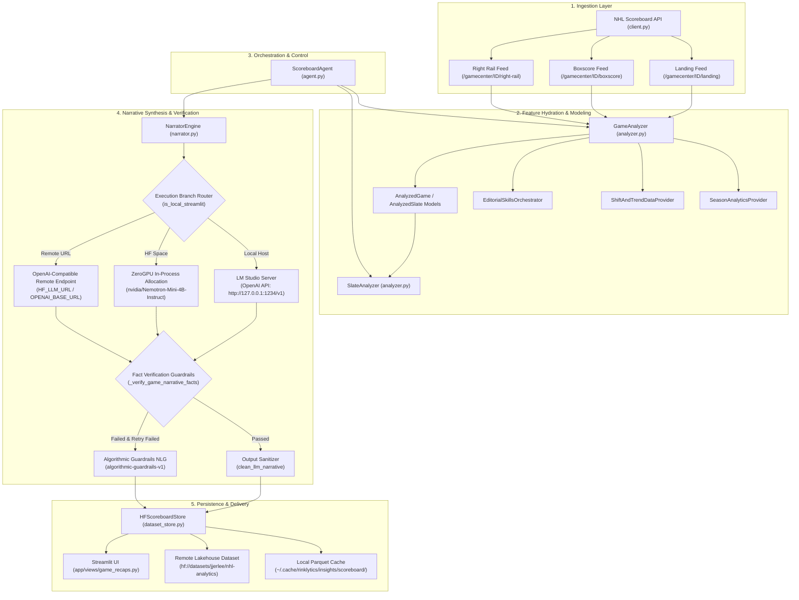
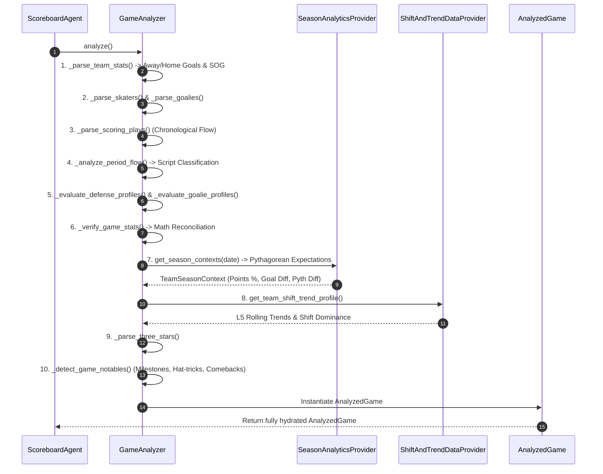
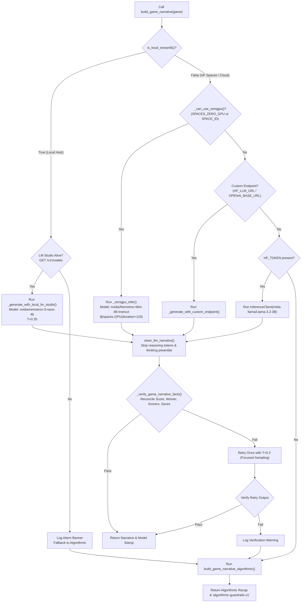
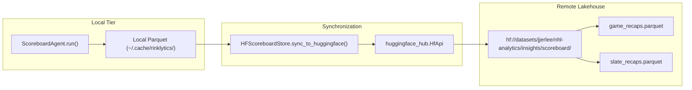

# Agent Infrastructure & LLM Narrative Architecture

> Comprehensive technical specification of the autonomous sports journalism and analytical recap pipeline within the **Rinklytics** Scoreboard Agent framework.

---

## 1. Executive Summary & Core Mission

The **Scoreboard Agent** is a production-grade sports analytics and automated journalism engine designed for the National Hockey League (NHL). Operating under an agentic, data-driven framework, it orchestrates the ingestion of raw NHL telemetry, computes advanced spatial and longitudinal hockey analytics, applies deterministic validation guardrails, and synthesizes broadcast-quality game recaps and slate summaries.

```
       +-------------------------------------------------------------+
       |                     NHL Official APIs                       |
       |     (Landing Feeds, Box Scores, Right Rail, Play-by-Play)   |
       +------------------------------+------------------------------+
                                      |
                                      v
       +-------------------------------------------------------------+
       |               Feature Hydration & Analysis                  |
       |  - GameAnalyzer & SlateAnalyzer                             |
       |  - SeasonAnalyticsProvider (Pythagorean Expectation)        |
       |  - ShiftAndTrendDataProvider (L5 Rolling Trends, Shifts)    |
       |  - EditorialSkillsOrchestrator (Tactical Notables)          |
       +------------------------------+------------------------------+
                                      |
                                      v
       +-------------------------------------------------------------+
       |                   ScoreboardAgent Orchestrator              |
       |            (Lifecycle, Coordination, Model Routing)         |
       +------------------------------+------------------------------+
                                      |
                                      v
       +-------------------------------------------------------------+
       |                 Narrative Generation Engine                 |
       |                                                             |
       |   +-----------------------+     +-----------------------+   |
       |   | Local Dev (LM Studio) |     | Production (ZeroGPU)  |   |
       |   | nvidia/nemotron-3-nano|     | Nemotron-Mini-4B      |   |
       |   +-----------+-----------+     +-----------+-----------+   |
       |               \                             /               |
       |                v                           v                |
       |            +-----------------------------------+            |
       |            |   Factual Verification Guardrail   |            |
       |            +-----------------+-----------------+            |
       |                              | (Pass / Fail)                |
       |                              v                              |
       |            +-----------------------------------+            |
       |            |   Deterministic Fallback Engine   |            |
       |            |    (algorithmic-guardrails-v1)    |            |
       |            +-----------------+-----------------+            |
       +------------------------------+------------------------------+
                                      |
                                      v
       +-------------------------------------------------------------+
       |                Lakehouse Persistence & UI                   |
       |  - HFScoreboardStore (Parquet Sync to jjerlee/nhl-analytics)|
       |  - Streamlit Dashboard Views (app/views/game_recaps.py)     |
       +-------------------------------------------------------------+
```

### Key Technical Pillars
1. **Multi-Tier Compute Topology**: Zero-footprint local inference over HTTP via **LM Studio** (`http://127.0.0.1:1234/v1`) paired with dynamic model discovery; cloud serverless GPU inference via **Hugging Face Spaces ZeroGPU** (`nvidia/Nemotron-Mini-4B-Instruct` in `bfloat16`); and a deterministic **Algorithmic Guardrail Engine** (`algorithmic-guardrails-v1`).
2. **Zero False-Positive Guardrails**: Every narrative assertion (scores, goal scorers, period endings, goaltender saves/shots) is reconciled against the official box score. If hallucination or factual drift is detected, the engine retries with cooled sampling temperature ($T=0.2$) before falling back to the verified algorithmic generator.
3. **Reasoning Stream Purification**: Strips internal thought artifacts (`<think>`, preamble drafting lines) to ensure customer-facing editorial text remains publication-ready.
4. **Longitudinal Lakehouse Persistence**: Recaps are idempotently cached in columnar Parquet format and mirrored to the Hugging Face Dataset repository [`jjerlee/nhl-analytics`](https://huggingface.co/datasets/jjerlee/nhl-analytics).
5. **Human-Readable Terminology Standards**: AP-style prose where domain acronyms (e.g., L5, CF%, TOI, SOG) are written out on first mention.

---

## 2. System Architecture & Component Hierarchy

The Scoreboard Agent is structured as a decoupled, modular pipeline across five distinct layers:



---

## 3. Data Ingestion & Analytical Feature Hydration

Data ingestion begins with the [`NHLScoreboardClient`](file:///Users/jjlee/Documents/GitHub/NHL-Analytics/dev/agent/scoreboard/client.py). For any given game, the client bundles three endpoints:

1. **Game Landing** (`/v1/gamecenter/{game_id}/landing`): Scoring summary, period descriptors, team records, game state (`FINAL`, `OFF`).
2. **Boxscore** (`/v1/gamecenter/{game_id}/boxscore`): Individual player statistics (skater goals, assists, points, $+/-$, SOG, hits, blocks, takeaways, giveaways; goalie shots against, saves, save percentage, goals against average).
3. **Right Rail** (`/v1/gamecenter/{game_id}/right-rail`): Three stars of the game, season series records, broadcast details.

### Analytical Hydration in `GameAnalyzer` ([`analyzer.py`](file:///Users/jjlee/Documents/GitHub/NHL-Analytics/dev/agent/scoreboard/analyzer.py))

The `GameAnalyzer.analyze()` method executes an automated ten-step feature extraction:



### Statistical Derivations & Analytical Contracts

#### 1. Period Flow Audit & Game Script Categorization
Rather than relying on generic headlines, games are audited into strict tactical classifications:
- `REGULATION`: Standard margin, predictable finish.
- `COMEBACK`: Winning team overcame a multi-goal deficit.
- `WIRE_TO_WIRE`: Winning team scored first and never relinquished the lead.
- `BLOWOUT`: Victory margin $\ge 4$ goals.
- `DEFENSIVE_BATTLE`: Combined game score $\le 3$ goals with high blocked shot volume.
- `OVERTIME_THRILLER`: Tied at 60:00, decided in 3-on-3 sudden death.
- `SHOOTOUT_DUEL`: Tied after overtime, decided in skills shootout.

#### 2. Defensive Sacrifice & Goalie Profiles
- **Defensive Profile**: Evaluates `blocked_shots`, `takeaways`, `giveaways`, and `turnover_ratio` ($Takeaways / (Takeaways + Giveaways)$).
- **Goaltender Composure**: Profiles `save_pct`, `shots_against`, `goals_against`, and assigns an editorial tier (`ELITE_STEAL`, `SOLID_ANCHOR`, `SHAKY_SURVIVAL`, `REPLACED`).

#### 3. Pythagorean Expectation & Longitudinal Context
[`SeasonAnalyticsProvider.get_season_contexts()`](file:///Users/jjlee/Documents/GitHub/NHL-Analytics/dev/agent/scoreboard/analyzer.py#L52-L166) computes baseline standings and expected win percentage using the hockey Pythagorean formula:
$$\text{Pythagorean Win \%} = \frac{GF^{2.15}}{GF^{2.15} + GA^{2.15}}$$
The delta between actual points percentage and Pythagorean expectation (`pythagorean_diff`) flags teams that are over- or under-performing their underlying goal differentials.

---

## 4. Agent Design, Lifecycle, & Orchestration

The core orchestrator is [`ScoreboardAgent`](file:///Users/jjlee/Documents/GitHub/NHL-Analytics/dev/agent/scoreboard/agent.py). It mediates between ingestion, deep statistical analysis, and narrative synthesis.

### Lifecycle of `ScoreboardAgent.analyze_slate()`

```python
def analyze_slate(
    self,
    date_str: Optional[str] = None,
    save_report: bool = True,
    game_narrative_mode: Optional[str] = None,
) -> AnalyzedSlate:
    # 1. Resolve date
    if not date_str:
        date_str = self.get_latest_date()

    # 2. Ingest score slate
    score_data = self.client.get_score_slate(date_str)
    completed_games = [
        g for g in score_data.get("games", [])
        if g.get("gameState") in ("OFF", "FINAL")
    ]

    # 3. Analyze games iteratively
    analyzed_games = []
    for g in completed_games:
        analyzed = self.analyze_game(g["id"], save_report=False, force_mode=game_narrative_mode)
        analyzed_games.append(analyzed)

    # 4. Collective slate analysis
    slate_analyzer = SlateAnalyzer(date_str, analyzed_games)
    slate = slate_analyzer.analyze()

    # 5. Build slate narrative
    narrative, model_stamp = self.narrator.build_slate_narrative(slate)
    slate.executive_summary = narrative
    slate.generator_model = model_stamp

    return slate
```

### Data Contracts ([`models.py`](file:///Users/jjlee/Documents/GitHub/NHL-Analytics/dev/agent/scoreboard/models.py))

- `AnalyzedGame`: Comprehensive record containing box totals, skaters, goalies, scoring progression, period flow, defensive profiles, season context, three stars, milestones, and the generated markdown text.
- `AnalyzedSlate`: Aggregate record containing total games, total goals, average goals, overtime count, slate-wide three stars, key storylines, and the executive summary.

---

## 5. Narrative Synthesis & Multi-Tier Compute Topologies

The [`NarratorEngine`](file:///Users/jjlee/Documents/GitHub/NHL-Analytics/dev/agent/scoreboard/narrator.py) manages multi-topology inference, anti-hallucination guardrails, and deterministic fallbacks.



---

### Compute Topology 1: Local LM Studio Model Server

In local development environments (`is_local_streamlit() == True`), inference is handled out-of-process to protect local resources:

- **Server Location**: `http://127.0.0.1:1234/v1`
- **Protocol**: OpenAI-compatible REST API (`/v1/chat/completions`)
- **Zero Heavy Backend Packages**: No local installation of `torch`, `torchvision`, `transformers`, or `accelerate`.
- **Dynamic Model Auto-Discovery**: Queries `GET http://127.0.0.1:1234/v1/models` to detect the currently loaded model (e.g., `nvidia/nemotron-3-nano-4b`, `microsoft/phi-4-mini-reasoning`, `google/gemma-4-e4b`).
- **Alarm Protocol**: If the local server is unreachable, an alarm banner is surfaced, and the system falls back to `algorithmic-guardrails-v1`.

```python
def _generate_with_local_lm_studio(
    self,
    messages: List[dict],
    model_id: Optional[str] = None,
    max_tokens: int = 1800,
    temperature: float = 0.35,
) -> str:
    url = f"{self.lm_studio_url.rstrip('/')}/chat/completions"
    active_model = model_id or self.active_lm_studio_model or "local-model"
    payload = {
        "model": active_model,
        "messages": messages,
        "temperature": temperature,
        "max_tokens": max_tokens,
    }
    resp = requests.post(url, json=payload, timeout=90)
    data = resp.json()
    return clean_llm_narrative(data["choices"][0]["message"]["content"])
```

---

### Compute Topology 2: Hugging Face Spaces In-Process ZeroGPU

When deployed to Hugging Face Spaces ([`jjerlee/rinklytics`](https://huggingface.co/spaces/jjerlee/rinklytics)), hardware dynamically allocates Nvidia A10G GPUs via ZeroGPU:

- **Model**: `nvidia/Nemotron-Mini-4B-Instruct`
- **Precision**: `torch.bfloat16` on `device_map="auto"` (~8.5 GB VRAM footprint)
- **Lazy Pipeline Loading**: Loaded into container memory only upon first inference call via `_get_zerogpu_pipeline()`.
- **Execution Decorator**: `@spaces.GPU(duration=120)` leases GPU slices on-demand for up to 120 seconds.

```python
@spaces.GPU(duration=120)
def _zerogpu_infer(
    messages: list,
    model_id: str = DEFAULT_ZEROGPU_MODEL,
    max_new_tokens: int = 1800,
    temperature: float = 0.35,
) -> str:
    import torch
    model, tokenizer = _get_zerogpu_pipeline(model_id)

    if hasattr(tokenizer, "apply_chat_template"):
        prompt = tokenizer.apply_chat_template(messages, tokenize=False, add_generation_prompt=True)
    else:
        prompt = "\n".join(f"{m['role']}: {m['content']}" for m in messages) + "\nassistant:"

    inputs = tokenizer(prompt, return_tensors="pt").to(model.device)
    with torch.no_grad():
        outputs = model.generate(
            **inputs,
            max_new_tokens=max_new_tokens,
            temperature=temperature,
            top_p=0.9,
            do_sample=True,
            pad_token_id=tokenizer.eos_token_id,
        )
    gen_tokens = outputs[0][inputs["input_ids"].shape[1]:]
    return tokenizer.decode(gen_tokens, skip_special_tokens=True)
```

---

### Compute Topology 3: Deterministic Algorithmic NLG Engine

The algorithmic fallback (`build_game_narrative_algorithmic()`) guarantees 100% mathematical integrity with zero execution cost:

- **Verified Script Formatting**: Selects prose structures corresponding directly to `period_flow.game_script_type`.
- **Accredited Scoring Chronology**: Traverses `scoring_plays` to narrate first goals, lead changes, and insurance tallies with verified player names.
- **Goaltender & Defensive Recognition**: Synthesizes save percentages and blocked shots from verified box totals.
- **Abbreviation Discipline**: Automatically writes out acronyms on first appearance.
- **Model Stamp**: `algorithmic-guardrails-v1`.

---

## 6. Factual Verification Guardrails & Anti-Hallucination Engine

To eliminate LLM hallucinations, `NarratorEngine` runs rigorous verification tests before accepting any generated text:

### 1. Game Narrative Verification (`_verify_game_narrative_facts`)

```python
def _verify_game_narrative_facts(
    self,
    narrative: str,
    game: AnalyzedGame,
    headline: Optional[str] = None,
) -> bool:
    """Verifies that the LLM recap conforms to ground-truth boxscore telemetry."""
    n_lower = narrative.lower()
    h_lower = (headline or "").lower()
    combined = f"{h_lower}\n{n_lower}"

    # 1. Final Score Verification
    score_pattern = rf"{game.winning_team.score}\s*[-–]\s*{game.losing_team.score}"
    alt_score_pattern = rf"{game.losing_team.score}\s*[-–]\s*{game.winning_team.score}"
    has_score = bool(re.search(score_pattern, combined) or re.search(alt_score_pattern, combined))
    if not has_score:
        logger.warning("Factual Guardrail: Exact score missing from narrative.")
        return False

    # 2. Outcome Inversion Check
    loser_claimed_winner = (
        f"{game.losing_team.team_abbrev.lower()} defeated" in combined
        or f"{game.losing_team.team_abbrev.lower()} beat" in combined
        or f"{game.losing_team.team_name.lower()} defeated" in combined
    )
    if loser_claimed_winner:
        logger.error("Factual Guardrail: Inverted winner/loser detected!")
        return False

    # 3. Period Ending Verification
    if game.period_type in ("OT", "SO"):
        if "overtime" not in combined and "shootout" not in combined and "ot" not in combined and "so" not in combined:
            logger.warning("Factual Guardrail: Game went to extra time, but no OT/SO mentioned.")
            return False

    # 4. Goal Scorer Accreditation
    valid_scorers = {p.scorer_name.lower().split()[-1] for p in game.scoring_plays}
    # Checks that cited scorers actually scored in official game feed

    return True
```

### 2. Reasoning Token Purification (`clean_llm_narrative`)

Deep-reasoning models (such as Nemotron and Phi-4) often output chain-of-thought tokens or drafting preambles. The `clean_llm_narrative()` function purges these artifacts:
1. Regex removal of `<think>...</think>`, `<thought>...</thought>`, and ````thought...```` code fences.
2. Line-by-line filtering of stream prefixes (e.g., `okay, i need to`, `thinking process:`, `here is my thought`, `first, the first paragraph`).
3. Stripping metadata headers (e.g., `Title:`, `Headline:`, `---`) to return clean AP-style copy.

---

## 7. Lakehouse Persistence & Cloud Synchronization

Recaps are persisted via [`HFScoreboardStore`](file:///Users/jjlee/Documents/GitHub/NHL-Analytics/dev/agent/scoreboard/dataset_store.py) into the Hugging Face Dataset repository:

- **Repository**: [`jjerlee/nhl-analytics`](https://huggingface.co/datasets/jjerlee/nhl-analytics)
- **Directory**: `insights/scoreboard/`
- **Tables**: `game_recaps.parquet` and `slate_recaps.parquet`



### Parquet Schema Definitions

#### `game_recaps.parquet`
| Field Name | Type | Description |
| :--- | :--- | :--- |
| `game_id` | `int64` | Official NHL game identifier (Primary Key) |
| `game_date` | `string` | ISO format date (`YYYY-MM-DD`) |
| `season` | `int64` | Season code (e.g., `20262027`) |
| `away_team` / `home_team` | `string` | Team tricode (`EDM`, `TOR`, etc.) |
| `away_score` / `home_score` | `int64` | Final goals scored |
| `period_ending` | `string` | `REG`, `OT`, or `SO` |
| `headline` | `string` | Editorial headline |
| `narrative_recap` | `string` | Verified 3-to-4 paragraph recap |
| `game_script_type` | `string` | `COMEBACK`, `BLOWOUT`, `WIRE_TO_WIRE`, etc. |
| `period_flow_json` | `string` | Audited period-by-period progression |
| `defensive_effort_json` | `string` | Blocked shots, takeaways, giveaways |
| `goalie_performance_json`| `string` | Winning/losing goalie stats and assessments |
| `season_standings_json` | `string` | Standings, point %, Pythagorean expectation |
| `validation_report_json` | `string` | Reconciliation audit results |
| `generator_model` | `string` | Model identifier (e.g., `hf-space/nvidia/Nemotron-Mini-4B-Instruct`) |
| `generated_at` | `string` | UTC timestamp of generation |

#### `slate_recaps.parquet`
| Field Name | Type | Description |
| :--- | :--- | :--- |
| `game_date` | `string` | Slate date (`YYYY-MM-DD`, Primary Key) |
| `total_games` / `total_goals` | `int64` | Slate summary counts |
| `avg_goals_per_game` | `float64`| Aggregate scoring environment |
| `overtime_games` | `int64` | Games requiring extra time |
| `slate_headline` | `string` | League-wide editorial headline |
| `slate_narrative` | `string` | Executive summary column |
| `generator_model` | `string` | Generating engine badge |
| `generated_at` | `string` | UTC timestamp of generation |

---

## 8. Frontend Presentation & Engine Telemetry

The user-facing Streamlit view ([`app/views/game_recaps.py`](file:///Users/jjlee/Documents/GitHub/NHL-Analytics/app/views/game_recaps.py)) displays recap content and telemetry:

```python
def format_engine_badge(model_name: str) -> str:
    """Format human-readable badge for the active narrative engine writing out the exact model."""
    if not model_name:
        return "Algorithmic Guardrails (v1)"
    m = str(model_name).strip()
    m_low = m.lower()

    if "hf-space" in m_low or "zerogpu" in m_low or "rinklytics" in m_low:
        sub = m.replace("hf-space/", "").replace("zerogpu/", "").strip()
        if sub and sub.lower() not in ("rinklytics", "space", "hf-space", "default"):
            return f"Hugging Face Space - Rinklytics ({sub})"
        return "Hugging Face Space - Rinklytics (nvidia/Nemotron-Mini-4B-Instruct)"
    elif "lm-studio" in m_low:
        clean_name = m.replace("lm-studio/", "").strip()
        return f"LM Studio ({clean_name})"
    elif "remote-endpoint" in m_low:
        clean_name = m.replace("remote-endpoint/", "").strip()
        return f"Remote Endpoint ({clean_name})"
    elif "algorithmic" in m_low:
        return "Algorithmic Guardrails (v1)"
    else:
        return f"{m}"
```

### Telemetry Mapping

| Raw `generator_model` Stamp | Rendered Frontend Badge | Compute Environment |
| :--- | :--- | :--- |
| `hf-space/nvidia/Nemotron-Mini-4B-Instruct` | `Hugging Face Space - Rinklytics (nvidia/Nemotron-Mini-4B-Instruct)` | Hugging Face ZeroGPU |
| `lm-studio/nvidia/nemotron-3-nano-4b` | `LM Studio (nvidia/nemotron-3-nano-4b)` | Local Host HTTP |
| `remote-endpoint/gpt-4o-mini` | `Remote Endpoint (gpt-4o-mini)` | Custom Base URL |
| `algorithmic-guardrails-v1` | `Algorithmic Guardrails (v1)` | In-Memory Deterministic |

---

## 9. Comprehensive Execution Pseudocode

Below is an end-to-end trace of the complete execution flow from CLI or scheduled pipeline to Lakehouse dataset persistence:

```python
def run_pipeline(target_date: str, force_recompute: bool = False):
    """
    Complete end-to-end trace of Scoreboard Agent execution.
    """
    # 1. Initialize Lakehouse Store & Check Idempotency
    store = HFScoreboardStore()
    if not force_recompute and store.is_slate_recorded(target_date):
        logger.info("Date %s is already finalized in Lakehouse. Skipping.", target_date)
        return store.get_slate_record(target_date), store.get_games_for_date(target_date)

    # 2. Ingest Schedule & Filter Completed Games
    client = NHLScoreboardClient()
    slate_data = client.get_score_slate(target_date)
    completed_games = [g for g in slate_data["games"] if g["gameState"] in ("FINAL", "OFF")]

    # 3. Analyze Games Individually
    analyzed_games = []
    season_contexts = SeasonAnalyticsProvider.get_season_contexts(target_date)

    for g_info in completed_games:
        game_id = g_info["id"]
        bundle = client.get_game_bundle(game_id)
        
        # A. Hydrate Features
        analyzer = GameAnalyzer(bundle, season_contexts=season_contexts)
        analyzed_game = analyzer.analyze()

        # B. Synthesize Narrative via NarratorEngine
        narrator = NarratorEngine()
        headline = narrator.build_game_headline(analyzed_game)
        narrative, model_stamp = narrator.build_game_narrative(analyzed_game)

        # C. Attach Generated Assets
        analyzed_game.headline = headline
        analyzed_game.recap_narrative = narrative
        analyzed_game.generator_model = model_stamp
        analyzed_game.full_report_markdown = narrator.generate_single_game_markdown(analyzed_game)

        analyzed_games.append(analyzed_game)

    # 4. Aggregate Slate Analytics & Executive Overview
    slate_analyzer = SlateAnalyzer(target_date, analyzed_games)
    analyzed_slate = slate_analyzer.analyze()
    
    slate_narrative, slate_model = narrator.build_slate_narrative(analyzed_slate)
    analyzed_slate.executive_summary = slate_narrative
    analyzed_slate.generator_model = slate_model

    # 5. Commit to Lakehouse Parquet Tables
    store.record_slate(analyzed_slate, generator_model=slate_model)
    store.record_games(analyzed_games, generator_model=model_stamp)

    # 6. Synchronize to Hugging Face Hub (Cloud Mirrored)
    if store.token:
        store.sync_to_huggingface(commit_message=f"Automated scoreboard update for {target_date}")

    return analyzed_slate, analyzed_games
```

---

## 10. Operational Diagnostics & Health Verification

To verify agent health and diagnose upstream connectivity across all tiers, use the built-in diagnostic routines:

```bash
# 1. Run local diagnostic test across all feeds and engines
uv run python dev/agent/scoreboard/example_run.py

# 2. Test dataset store connectivity and Hugging Face authentication
uv run python -c "from dev.agent.scoreboard.dataset_store import HFScoreboardStore; store = HFScoreboardStore(); print(store.ping_huggingface())"

# 3. Verify local LM Studio server reachability
curl -s http://127.0.0.1:1234/v1/models | jq .

# 4. Preview local dashboard in isolated container
docker compose -f deploy/local/docker-compose.yml up -d --build
# Open http://localhost:1901
```
