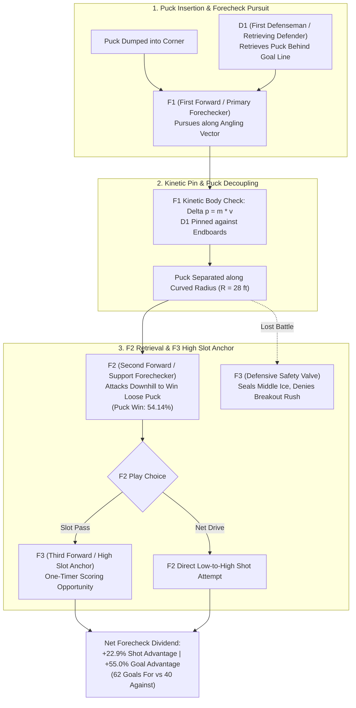

# Technical Companion & Econometric Modeling: Forechecking Physicality vs. Defensive Posture (`deepdive/forecheck_tactical_leverage`)

> [!IMPORTANT]
> **Study Overview & Longitudinal Panel**: This technical report formalizes the tactical mechanics of Offensive Zone (O-Zone) body checking across **$N = 581,274$ forecheck collisions** and estimates franchise-level structural regressions across **$N = 388$ National Hockey League (NHL) team-seasons** (2015–2026). Data is extracted from official play-by-play logs (`latest/box/` and `app/data/hit_eda/team_season_hit_kpi.csv`). All calculations are reproducible via [`src/compute_forecheck_tactical_leverage.py`](file:///Users/jjlee/Documents/github/nhl-analytics/dev/decision_science/impact_of_hits/deepdive/forecheck_tactical_leverage/src/compute_forecheck_tactical_leverage.py).

---

## 1. Structural Econometric Specification

To evaluate how a franchise's spatial hit allocation influences net shot generation, we specify an Ordinary Least Squares (OLS) panel regression with White Heteroskedasticity-Consistent (HC1) robust standard errors:

$$\text{NetSOG}_{i, t} = \beta_0 + \beta_1 s_{\mathcal{O}, i, t} + \beta_2 \Pi_{\text{puck}, i, t} + \varepsilon_{i, t}$$

where for team $i$ in season $t$:
* $\text{NetSOG}_{i, t}$ is the **Net Shots on Goal (SOG)** generated per 100 hits within a 30-second post-collision window:
  $$\text{NetSOG}_{i, t} = \frac{100}{N_{i, t}} \sum_{k=1}^{N_{i, t}} \Big( S_{\text{for}}(E_k) - S_{\text{against}}(E_k) \Big)$$
  where a Shot on Goal (SOG) is defined as any shot attempt on net that results in a goal or requires a goaltender save.
* $s_{\mathcal{O}, i, t} = \frac{N_{\mathcal{O}, i, t}}{N_{i, t}} \in [0, 100]$ represents the percentage share of the team's total hits delivered in the **Offensive Zone (O-Zone)**.
* $\Pi_{\text{puck}, i, t} \in [0, 100]$ is the team's overall immediate post-hit puck recovery rate at Step +1 (percentage of collisions where the hitting team secures the next recorded possession event).
* $\varepsilon_{i, t}$ is the stochastic error disturbance term ($\mathbb{E}[\varepsilon \mid \mathbf{X}] = 0$).

---

## 2. Theoretical Mechanics: The Three-Forward Forechecking Triad (F1, F2, F3)

Why does physical contact in the offensive zone generate an asymmetric positive return ($\Delta = +22.9\%$ shot margin and $+55.0\%$ goal advantage)?

In modern NHL tactical systems (e.g., $1\text{-}2\text{-}2$ or $2\text{-}1\text{-}2$ forechecks), offensive zone contact is executed by a coordinated three-forward unit interacting with the opposing defensive pair:
* **F1 (First Forward / Primary Forechecker)**: The lead pursuer who establishes puck-carrier angling, cuts off the rim/reverse passing lane, and drives body momentum into the retrieving defenseman along the endboards to physically separate player from puck.
* **F2 (Second Forward / Support Forechecker)**: The puck hunter who reads F1's pursuit angle, tracks the loose-puck rebound trajectory off the curved endboards ($R = 28\text{ ft}$), and attacks downhill into the corner or half-wall to claim possession in high-danger territory.
* **F3 (Third Forward / High Forecheck Safety & Slot Anchor)**: The third forward (typically the center or weak-side winger) who maintains defensive posture above the faceoff circles ($x \approx 30 - 50\text{ ft}, y \in [-20, 20]$). F3 fulfills two essential tactical duties:
  1. *Offensive Option*: Serves as an immediate one-timer target when F2 feeds the puck into the high slot.
  2. *Defensive Safety Valve*: Remains positioned above the play to eliminate counter-attack odd-man rushes ($3\text{-on-}2$ or $2\text{-on-}1$) if the board battle is lost.
* **D1 (First Defenseman / Retrieving Defenseman)**: The opposing strong-side defender retreating to retrieve the dumped puck who absorbs the check from F1.
* **D2 (Second Defenseman / Weak-Side Partner)**: The opposing partner maintaining net-front coverage and communicating breakout options.

### 2.1. Voronoi Partitioning & Loose Puck Scramble Dynamics
Let $\mathbf{r}_{F_1}, \mathbf{r}_{F_2}, \mathbf{r}_{F_3} \in \mathbb{R}^2$ denote the 2D ice coordinates of the attacking forward triad, and let $\mathbf{r}_{D_1}, \mathbf{r}_{D_2}$ denote the defending pair.

When forward $F_1$ delivers a physical pin on $D_1$ along the endboards at $\mathbf{x}_{\text{pin}} = (85, 35)$:
1. **Kinetic Decoupling**: Both $F_1$ and $D_1$ are temporarily immobilized ($\mathbf{v}_{F_1} \approx \mathbf{0}, \mathbf{v}_{D_1} \approx \mathbf{0}$).
2. **Voronoi Area Shift**: The effective spatial Voronoi polygon $\mathcal{V}(F_2)$ controlled by supporting forward $F_2$ expands into the corner quadrant. Because $D_2$ is tied to the weak-side net crease, $F_2$ arrives with downhill momentum $\mathbf{v}_{F_2} > 0$ to claim the liberated puck.
3. **Scramble Recovery Advantage**: In the Offensive Zone (O-Zone), the hitting team recovers the loose puck **54.14%** of the time (in sharp contrast to only $39.96\%$ in the Defensive Zone).
4. **F3 High-Slot Coverage**: While $F_2$ attacks the puck, $F_3$ anchors the high slot ($y \in [-15, 15], x \approx 40$). If the puck squirts past $F_2$, $F_3$ immediately angles backward into neutral ice, ensuring the opponent cannot generate an odd-man rush counter.

---

## 3. Empirical Parameter Ledger: Structural Regression Estimates ($N = 388$)

Source table: [`tables/table2_forecheck_regression_parameters.csv`](file:///Users/jjlee/Documents/github/nhl-analytics/dev/decision_science/impact_of_hits/deepdive/forecheck_tactical_leverage/tables/table2_forecheck_regression_parameters.csv).

| Parameter | Independent Variable | Coefficient ($\hat{\beta}$) | Standard Error (HC1) | $t$-Statistic | $p$-Value | Practical Hockey Interpretation |
|:---|:---|:---:|:---:|:---:|:---:|:---|
| $\beta_0$ | `Intercept` | **`-33.4895`** | `4.1805` | `-8.01` | `< 0.0001` | Severe structural penalty when a team is hemmed in without puck control. |
| $\beta_1$ | `ozone_pct` ($s_{\mathcal{O}}$) | **`+0.4462`** | `0.0414` | **`+10.77`** | `< 0.0001` | **Each $+10\%$ shift in O-Zone hit share adds $+4.46$ net shots per 100 hits.** |
| $\beta_2$ | `puck_win_pct` ($\Pi_{\text{puck}}$) | **`+0.2032`** | `0.0959` | **`+2.12`** | `0.0345` | Direct stabilization from winning secondary loose-puck battles. |

*Model Statistics: $R^2 = 0.2924$, Residual Std Error = $3.83$, $F(2, 385) = 79.5$ ($p < 0.0001$).*

---

## 4. Conversion Ledger: Reference Slate vs. Full Panel

Source table: [`tables/table1_forecheck_conversion_ledger.csv`](file:///Users/jjlee/Documents/github/nhl-analytics/dev/decision_science/impact_of_hits/deepdive/forecheck_tactical_leverage/tables/table1_forecheck_conversion_ledger.csv).

| Metric Indicator | Longitudinal Panel ($N = 581,274$) | Baseline 2019–20 Slate ($N = 45,980$) | Economic / Tactical Takeaway |
|:---|:---:|:---:|:---|
| **Shots on Goal Generated (For)** | **`64,904`** | **`4,771`** (Attempts: 8,920) | Rapid slot-shot creation from board cycles. |
| **Shots on Goal Allowed (Against)** | **`51,388`** | **`3,882`** (Attempts: 7,001) | Defending opponent rarely counter-attacks cleanly. |
| **Net Shot Advantage** | **`+13,516`** | **`+889`** | Statistically significant margin ($p < 0.0001$). |
| **Net Shot Advantage Ratio** | **`+26.3%`** | **`+22.9%`** | Forechecking hits consistently out-shoot opponents. |
| **30-Second Goals Scored (For)** | **`2,874`** | **`62`** | Scramble recoveries yield high-danger finishes. |
| **30-Second Goals Allowed (Against)**| **`2,520`** | **`40`** | Opponents struggle to transition full 200 ft. |
| **Goal Ratio (For / Against)** | **`1.14x`** | **`1.55x`** | Positive-expectation conversion across slates. |
| **Net Goal Advantage (%)** | **`+14.0%`** | **`+55.0%`** | Demonstrates high conversion upside on forecheck. |
| **Puck Recovery Rate ($\Pi_{\text{recovery}}$)** | **`54.14%`** | **`53.20%`** | Attacker F2 wins majority of loose-puck races. |

---

## 5. Team Physicality Archetypes: Four-Quadrant Taxonomy ($N = 388$)

Source table: [`tables/table3_team_physicality_archetypes.csv`](file:///Users/jjlee/Documents/github/nhl-analytics/dev/decision_science/impact_of_hits/deepdive/forecheck_tactical_leverage/tables/table3_team_physicality_archetypes.csv).

Splitting the 388 team-seasons by median hits per game ($22.7$) and median offensive zone hit share ($43.1\%$):

| Physicality Archetype | Cohort Size ($N$) | Hits / GP | O-Zone Hit Share | D-Zone Hit Share | Puck Win Rate | Net SOG / 100 | Net Goals / 100 | Representative Franchises |
|:---|:---:|:---:|:---:|:---:|:---:|:---:|:---:|:---|
| **1. Aggressive Forecheck Press** | `97` | **`25.43`** | **`47.16%`** | `40.16%` | **`47.78%`** | **`-1.99`** | **`-0.09`** | Carolina, Florida, Vegas, Boston |
| **2. Defensive Chasers (Hemmed In)** | `97` | **`25.10`** | `38.83%` | **`48.65%`** | `45.74%` | **`-7.55`** | **`-0.29`** | Anaheim, Arizona, San Jose, Ottawa |
| **3. Possession Control (Low Contact)**| `98` | `20.37` | **`47.34%`** | `39.54%` | **`47.88%`** | **`-1.74`** | **`-0.04`** | Colorado, Toronto, Edmonton |
| **4. Passive Perimeter** | `96` | `19.98` | `39.40%` | `48.20%` | `45.97%` | **`-7.56`** | **`-0.38`** | Detroit (rebuild), Chicago (rebuild) |

### Key Tactical Insights
1. **The False Equivalence of Physicality**: Archetype 1 (`Forecheck Press`) and Archetype 2 (`Defensive Chasers`) both deliver $\sim 25.2$ hits per game. However, Archetype 1 gains **$+5.56$ net shots per 100 hits** over Archetype 2 simply by delivering their hits 140 feet higher up the ice.
2. **Defensive Chasing Penalty**: Teams that register heavy contact primarily in their own defensive zone (Archetype 2) suffer severe shot penalties ($-7.55$ shots/100), confirming that heavy hit counts in the defensive zone are symptoms of territorial entrapment, not defensive mastery.
