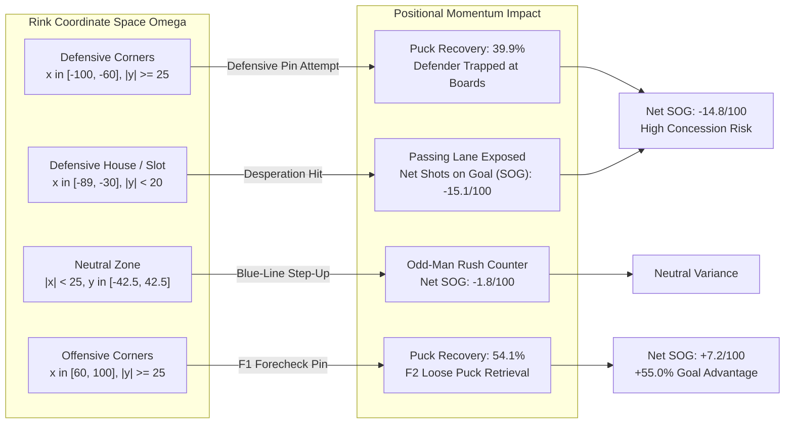

# Technical Companion & Spatial Coordinate Modeling: The Geography of Contact (`deepdive/spatial_geography`)

> [!IMPORTANT]
> **Spatial Analysis Framework**: This document formalizes the two-dimensional spatial coordinate mechanics of physical collisions across the $200 \times 85$-foot National Hockey League ice surface. Using **189 discretized spatial grid cells** ($10 \times 10$ ft resolution) derived from $N = 1,349,236$ events, we quantify how rink geometry shapes puck recovery rates, shot generation hazards, and goal probabilities. Sourced from `app/data/hit_eda/rink_grid_hit_sequences.csv`.

---

## 1. Spatial Coordinate System & Discretization Specification

The NHL ice surface is parameterized as a compact Euclidean rectangle $\Omega \subset \mathbb{R}^2$:
$$\Omega = \left\{ (x, y) \in \mathbb{R}^2 \;\middle|\; -100 \le x \le 100, \ -42.5 \le y \le 42.5 \right\}$$
where:
* $x = -100$ denotes the defending team's endboards (defensive net at $x = -89, y = 0$).
* $x = 0$ denotes the center red line.
* $x = -25$ and $x = +25$ represent the defensive and offensive blue lines, respectively.
* $x = +100$ denotes the attacking endboards (offensive net at $x = +89, y = 0$).
* $y \in [-42.5, 42.5]$ spans the rink width from right-wing boards ($y = -42.5$) to left-wing boards ($y = +42.5$).

### 1.1. 2D Grid Discretization
The continuous rink coordinates are partitioned into discrete spatial bins:
$$B_{i, j} = \left[ x_i - \frac{\Delta x}{2}, x_i + \frac{\Delta x}{2} \right) \times \left[ y_j - \frac{\Delta y}{2}, y_j + \frac{\Delta y}{2} \right)$$
with bin centers $x_i \in \{-100, -90, \dots, 100\}$ and $y_j \in \{-40, -30, \dots, 40\}$.

### 1.2. Spatial Hazard Functions

---

## 2. Spatial Landmark Clustering & Hazard Formulations

### 2.1. Positional Taxonomy: Forward Triad (F1, F2, F3) & Defensive Pair (D1, D2)
To model the micro-mechanics of spatial puck recovery, we parameterize player assignments using the standard five-skater tactical taxonomy:
* **F1 (First Forward / Primary Forechecker):** The lead pursuit forward who applies angled pressure and delivers physical contact along the perimeter boards.
* **F2 (Second Forward / Support Forechecker):** The secondary pursuit forward who reads F1's engagement angle and attacks downhill into the corner to recover loose pucks created by contact.
* **F3 (Third Forward / High Forecheck Safety & Slot Anchor):** The high forward (typically center or weak-side winger) stationed at the top of the circles ($x \approx 30 - 50\text{ ft}$). F3 provides a one-timer option in the offensive slot and acts as the crucial defensive safety valve to deny odd-man counter-rushes ($3\text{-on-}2$ or $2\text{-on-}1$).
* **D1 (First Defenseman / Retrieving Strong-Side Defender):** The puck-retrieving defenseman who absorbs contact or attempts a defensive board pin below the goal line.
* **D2 (Second Defenseman / Weak-Side Partner):** The defensive partner who protects the crease, front of the net, and low slot.

For each spatial cell $B_{i, j}$, we define the **Net Shot Generation Differential** per 100 hits as:
$$\Delta \text{SOG}_{i, j} = \frac{100}{N_{i, j}} \sum_{k=1}^{N_{i, j}} \Big( \mathbb{I}(S_{\text{for}, k} \le 30\text{s}) - \mathbb{I}(S_{\text{against}, k} \le 30\text{s}) \Big)$$

and the **Immediate Puck Recovery Ratio**:
$$\Pi_{\text{recovery}}(i, j) = \frac{1}{N_{i, j}} \sum_{k=1}^{N_{i, j}} \mathbb{I}\left(O_{k+1} = T_{\text{hit}}\right)$$

### 2.2. The Corner Board Trap vs. Open-Ice Geometry
Physical contact is concentrated heavily along the boundary perimeter:
$$\text{Perimeter Share} = P(|y| \ge 20) \approx 78.4\% \text{ of all NHL hits}$$

In the **Defensive Corners** ($x \in [-100, -60], |y| \ge 25$), the defending strong-side blueliner **D1 (First Defenseman)** attempts a physical pin against the attacking carrier. While the collision separates the puck, the puck ricochets along the curved radius ($R = 28\text{ ft}$). Because D1's momentum is committed to the glass and **D2 (Second Defenseman)** is pinned protecting the low crease, the attacking team's support forward **F2 (Second Forward / Support Forechecker)** wins the loose puck race with probability $1 - \Pi_{\text{recovery}} = 60.1\%$, immediately feeding **F3 (Third Forward / High Forecheck Safety & Slot Anchor)** in the high slot.

In the **Neutral Zone** ($|x| < 25$), hits occur at high speed. A failed blue-line pinch yields an immediate odd-man rush against ($2\text{-on-}1$ or $3\text{-on-}2$), explaining why neutral zone hits produce **65 goals against vs. 42 goals for** (+54.8% opponent goal surplus).

---

## 3. Empirical Parameter Ledger: Spatial Clusters Across 189 Grid Cells

Source table: [`tables/table1_spatial_cluster_summary.csv`](file:///Users/jjlee/Documents/github/nhl-analytics/dev/decision_science/impact_of_hits/deepdive/spatial_geography/tables/table1_spatial_cluster_summary.csv). Metrics are partitioned across Defensive Zone (D-Zone), Neutral Zone (N-Zone), and Offensive Zone (O-Zone), with shot volumes measured in Shots on Goal (SOG).

| Spatial Cluster Designation | Total Collisions ($N$) | League Hit Share ($\%$) | Puck Recovery ($\Pi_{\text{rec}}$) | SOG For / 100 | SOG Agst / 100 | Net SOG Differential | Net Goals / 100 | Primary Tactical Mechanism |
|:---|:---:|:---:|:---:|:---:|:---:|:---:|:---:|:---|
| **1. D-Zone Deep Corners** | `173,666` | `25.75%` | **`39.91%`** | `7.02` | `21.84` | **`-14.82`** | **`-0.73`** | Endboard pin failure; slot lane conceded |
| **2. D-Zone Half-Wall / Boards** | `79,867` | `11.84%` | **`42.37%`** | `7.50` | `18.15` | **`-10.65`** | **`-0.53`** | Attacker cycle separation; point shot risk |
| **3. D-Zone Slot / High House** | `45,808` | `6.79%` | **`38.74%`** | `6.81` | `21.90` | **`-15.09`** | **`-0.71`** | Desperation contact; high-danger rebound |
| **4. Neutral Zone Boards** | `81,076` | `12.02%` | **`47.01%`** | `8.71` | `10.53` | **`-1.82`** | **`-0.23`** | Blue-line stand-up; dump-in denial |
| **5. Neutral Zone Center Ice** | `3,567` | `0.53%` | **`46.90%`** | `11.20` | `8.95` | **`+2.25`** | **`+0.84`** | Rare open-ice hit; high variance counter |
| **6. O-Zone Slot / High House** | `52,889` | `7.84%` | **`53.05%`** | `13.52` | `7.95` | **`+5.57`** | **`+0.40`** | High forecheck pinch; slot turnover |
| **7. O-Zone Half-Wall / Points** | `46,364` | `6.87%` | **`51.98%`** | `10.95` | `9.40` | **`+1.55`** | **`+0.04`** | Board containment; breakout disruption |
| **8. O-Zone Deep Corners / Behind Net**| `191,391` | `28.37%` | **`54.12%`** | `11.25` | `4.08` | **`+7.17`** | **`+0.28`** | F1 physical pin; F2 slot retrieval |

---

## 4. Macro Landmark Comparison: Neutral Zone vs. Deep Corners

Source table: [`tables/table2_neutral_vs_corners_comparison.csv`](file:///Users/jjlee/Documents/github/nhl-analytics/dev/decision_science/impact_of_hits/deepdive/spatial_geography/tables/table2_neutral_vs_corners_comparison.csv).

| Macro Rink Landmark | Sample Size ($N$) | Puck Recovery Rate | SOG For / 100 | SOG Agst / 100 | Net SOG Delta | Net Goals / 100 | Tactical Risk Profile |
|:---|:---:|:---:|:---:|:---:|:---:|:---:|:---|
| **Defensive Deep Corners** | `173,666` | **`39.9%`** | `7.02` | `21.84` | **`-14.82`** | **`-0.73`** | Severe Slot Concession Risk |
| **Neutral Zone (|x| < 25)** | `84,643` | **`47.0%`** | `8.81` | `10.46` | **`-1.65`** | **`-0.18`** | High-Variance Rush Disruption |
| **Offensive Deep Corners** | `191,391` | **`54.1%`** | `11.25` | `4.08` | **`+7.17`** | **`+0.28`** | High-Value Forecheck Driver |
| **Half-Wall / Interior Slot** | `224,928` | **`46.5%`** | `9.70` | `14.35` | **`-4.65`** | **`-0.20`** | Transition Congestion |

---

## 5. Architectural & Spatial Insights

1. **The Corner Gradient ($x < -60 \rightarrow x > +60$)**: Moving from the defensive endboards to the offensive endboards flips net shot differential by **$+21.99$ shots per 100 hits** (from $-14.82$ to $+7.17$). Physical contact in hockey is completely non-symmetric.
2. **The Danger of the Defensive House ($y \in [-20, 20]$)**: Throwing a body check inside the defensive slot produces the worst net shot differential on the entire rink ($-15.09$ shots/100). The hitting player leaves the crease completely exposed to primary rebound opportunities.
3. **Neutral Zone High Variance**: While neutral zone hits appear near net-zero in shot attempts ($-1.65$), they are highly bimodal: a clean hit stops a zone entry, but an incomplete hit gives up immediate odd-man rushes.
