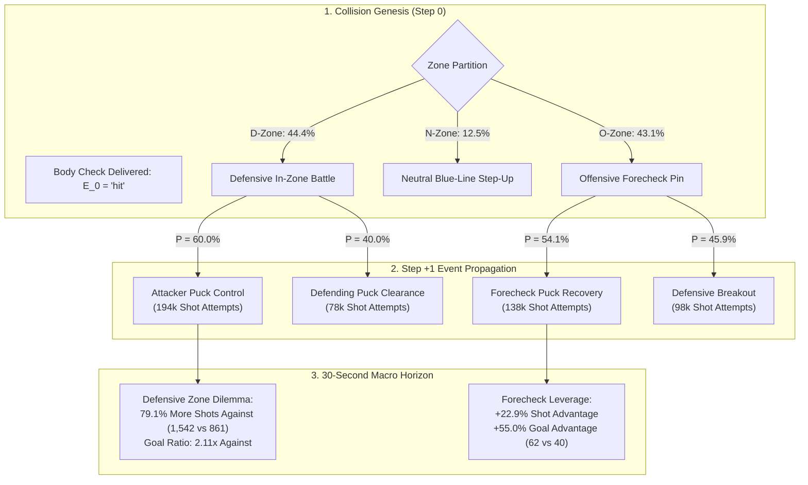

# Technical Analysis & Sequential Mechanics: Why Do You Hit? (`deepdive/why_hit_sequential`)

> [!IMPORTANT]
> **Study Overview & Data Scope**: This technical analysis formalizes the discrete-time sequential mechanics of physical contact across **$N = 1,349,236$ National Hockey League (NHL) body checks** from 2015 to 2026. Micro-telemetry is sourced from official NHL play-by-play tracking data (`latest/box/` and `app/data/hit_eda/`). All code is fully reproducible via [`src/compute_why_hit_sequential.py`](file:///Users/jjlee/Documents/github/nhl-analytics/dev/decision_science/impact_of_hits/deepdive/why_hit_sequential/src/compute_why_hit_sequential.py).

---

## 1. Formal Sequential Markovian Formulation

Let each hockey game $g$ be modeled as a discrete-time marked point process:
$$\mathcal{E} = \{ (t_k, E_k, Z_k, O_k, \mathbf{x}_k) \}_{k=1}^{K_g}$$
where $t_k \in \mathbb{R}^+$ is the elapsed game second, $E_k \in \mathcal{T}$ represents the categorical event type, $Z_k \in \{\mathcal{D}, \mathcal{N}, \mathcal{O}\}$ is the rink zone of occurrence (Defensive Zone $\mathcal{D}$ / D-Zone, Neutral Zone $\mathcal{N}$ / N-Zone, and Offensive Zone $\mathcal{O}$ / O-Zone), $O_k \in \{\text{Hitting Team}, \text{Opponent}\}$ denotes the event owner, and $\mathbf{x}_k = (x_k, y_k) \in [-100, 100] \times [-42.5, 42.5]$ denotes normalized rink coordinates.

A physical body check is conditioned at index $k$ such that:
$$E_k = \text{'hit'}, \quad Z_k = z, \quad O_k = T_{\text{hit}}$$

We observe the immediately subsequent event $E_{k+1}$ at elapsed latency $\Delta t = t_{k+1} - t_k$. The state space for downstream event classifications is defined as:
$$\mathcal{S} = \{ \text{Shot Attempt}, \text{Physical Battle}, \text{Possession Change}, \text{Stoppage}, \text{Goal}, \text{Penalty} \}$$

### 1.1. Conditional State Transition Probability Matrix
The conditional probability of transitioning from a hit in zone $z$ to downstream state $s \in \mathcal{S}$ controlled by team $o \in \{T_{\text{hit}}, T_{\text{recv}}\}$ is:

$$P\left(E_{k+1} = s, O_{k+1} = o \;\middle|\; E_k = \text{'hit'}, Z_k = z\right) = \frac{\sum_{i=1}^{N_z} \mathbb{I}\left(E_{k_i} = \text{'hit'} \land Z_{k_i} = z \land E_{k_i+1} = s \land O_{k_i+1} = o\right)}{\sum_{i=1}^{N_z} \mathbb{I}\left(E_{k_i} = \text{'hit'} \land Z_{k_i} = z\right)}$$

### 1.2. Sequential Event Sequence Flow

---

## 2. The Defensive Zone Positioning Dilemma: Mathematical Mechanics

Why do defensive zone hits generate a **79.1% shot inflation** against the hitting team?

Let a defending player—such as the strong-side defenseman $d$, designated as **D1 (First Defenseman / Retrieving Defender)**—have position vector $\mathbf{r}_d(t) \in \mathbb{R}^2$ and velocity $\mathbf{v}_d(t)$. In defensive posture, the player's primary functional objective is **slot lane containment**:
$$\min_{\mathbf{r}_d} \text{dist}\left(\mathbf{r}_d, \mathcal{L}_{\text{slot}}\right)$$
where $\mathcal{L}_{\text{slot}}$ is the segment connecting puck carrier $\mathbf{r}_p$ to the high-danger slot centroid $\mathbf{r}_{\text{net}} = (-89, 0)$.

When delivering a body check at $t_0$, the defender commits physical impulse $\mathbf{J} = \int \mathbf{F} \, dt$ along a trajectory directed toward the boundary boards:
$$\mathbf{r}_d(t_0 + \tau) = \mathbf{r}_{\text{boards}} + \boldsymbol{\epsilon}, \quad \tau \in [0, \tau_{\text{recovery}}]$$

where $\tau_{\text{recovery}} \approx 1.5 - 2.5$ seconds represents the bio-mechanical recovery latency required to absorb impact, regain edge control, and turn back toward the play.

If the collision produces an incomplete turnover ($\Pi_{\text{recovery}} = 39.96\%$), the puck squirts into open ice with probability $1 - \Pi_{\text{recovery}} = 60.04\%$. Because defender $d$ is physically immobilized at $\mathbf{r}_{\text{boards}}$, the slot cross-sectional passing angle $\theta_{\text{slot}}$ expands:
$$\theta_{\text{slot}}(\text{hit}) \gg \theta_{\text{slot}}(\text{stick check})$$

This creates an immediate uncontested passing lane to the weak-side attacker **F2 (Second Forward / Support Forechecker)** or high slot attacker **F3 (Third Forward / High Forecheck Safety & Slot Anchor)**, while defender **D1** is recovering and partner **D2 (Second Defenseman / Weak-Side Partner)** is pinned guarding the crease, triggering high-danger shot attempts within $6 - 14$ seconds.

---

## 3. Empirical Parameter Ledger: Immediate Outcomes (Step +1)

Source table: [`tables/table1_immediate_event_probabilities.csv`](file:///Users/jjlee/Documents/github/nhl-analytics/dev/decision_science/impact_of_hits/deepdive/why_hit_sequential/tables/table1_immediate_event_probabilities.csv).

| Zone of Hit ($Z_k$) | Subsequent Event Category ($E_{k+1}$) | Hitting Team Count ($N_{\text{for}}$) | Opponent Count ($N_{\text{against}}$) | Hitting Team Share ($\%$) | Opponent Share ($\%$) | Net Advantage ($\Delta \%$) |
|:---|:---|:---:|:---:|:---:|:---:|:---:|
| **Defensive Zone (D)** | **Shot Attempt** | `78,172` | **`194,716`** | `13.06%` | **`32.52%`** | **`-19.46%`** |
| Defensive Zone (D) | Physical Battle | `65,446` | `69,214` | `10.93%` | `11.56%` | `-0.63%` |
| Defensive Zone (D) | Possession Change | `44,234` | `42,648` | `7.39%` | `7.12%` | `+0.27%` |
| Defensive Zone (D) | Stoppage / Whistle | `43,828` | `44,010` | `7.32%` | `7.35%` | `-0.03%` |
| Defensive Zone (D) | **Goal Scored** | `2,038` | **`4,296`** | `0.34%` | **`0.72%`** | **`-0.38%`** |
| Defensive Zone (D) | Penalty Incurred | `5,514` | `4,560` | `0.92%` | `0.76%` | `+0.16%` |
| **Offensive Zone (O)** | **Shot Attempt** | **`137,618`** | `97,930` | **`23.67%`** | `16.85%` | **`+6.82%`** |
| Offensive Zone (O) | Physical Battle | `79,420` | `64,434` | `13.66%` | `11.08%` | `+2.58%` |
| Offensive Zone (O) | Possession Change | `42,420` | `46,572` | `7.30%` | `8.01%` | `-0.71%` |
| Offensive Zone (O) | Stoppage / Whistle | `47,686` | `50,234` | `8.20%` | `8.64%` | `-0.44%` |
| Offensive Zone (O) | **Goal Scored** | **`2,874`** | `2,520` | **`0.49%`** | `0.43%` | **`+0.06%`** |
| Offensive Zone (O) | Penalty Incurred | `4,680` | `4,884` | `0.80%` | `0.84%` | `-0.04%` |
| **Neutral Zone (N)** | **Shot Attempt** | `28,738` | **`34,398`** | `16.98%` | **`20.32%`** | **`-3.34%`** |
| Neutral Zone (N) | Physical Battle | `20,120` | `24,306` | `11.89%` | `14.36%` | `-2.47%` |
| Neutral Zone (N) | Possession Change | `13,232` | `12,488` | `7.82%` | `7.38%` | `+0.44%` |
| Neutral Zone (N) | Stoppage / Whistle | `15,330` | `16,196` | `9.06%` | `9.57%` | `-0.51%` |
| Neutral Zone (N) | **Goal Scored** | `668` | **`830`** | `0.39%` | **`0.49%`** | **`-0.10%`** |

---

## 4. Sequential Possession Chains: Step +1 to Step +4 Decay

Source table: [`tables/table2_sequential_possession_decay_steps1_4.csv`](file:///Users/jjlee/Documents/github/nhl-analytics/dev/decision_science/impact_of_hits/deepdive/why_hit_sequential/tables/table2_sequential_possession_decay_steps1_4.csv).

The empirical event chains demonstrate how possession imbalances decay back toward the 50% Poisson equilibrium:

| Zone | Event Step | Hitting Team Count | Opponent Count | Hitting Team Share ($\%$) | Opponent Share ($\%$) | Net Advantage ($\%$) |
|:---:|:---:|:---:|:---:|:---:|:---:|:---:|
| **D** | **Step +1** | `239,232` | `359,444` | **`39.96%`** | **`60.04%`** | **`-20.08%`** |
| **D** | **Step +2** | `274,312` | `319,822` | `46.17%` | `53.83%` | `-7.66%` |
| **D** | **Step +3** | `283,508` | `305,740` | `48.11%` | `51.89%` | `-3.78%` |
| **D** | **Step +4** | `283,890` | `300,414` | `48.59%` | `51.41%` | `-2.82%` |
| **O** | **Step +1** | `314,698` | `266,576` | **`54.14%`** | **`45.86%`** | **`+8.28%`** |
| **O** | **Step +2** | `297,770` | `278,440` | `51.68%` | `48.32%` | `+3.36%` |
| **O** | **Step +3** | `291,088` | `280,114` | `50.96%` | `49.04%` | `+1.92%` |
| **O** | **Step +4** | `286,676` | `280,040` | `50.59%` | `49.41%` | `+1.18%` |

---

## 5. Comprehensive Dilemma Ledger: Reference Slate vs. Full Panel

Source table: [`tables/table3_defensive_zone_dilemma_ledger.csv`](file:///Users/jjlee/Documents/github/nhl-analytics/dev/decision_science/impact_of_hits/deepdive/why_hit_sequential/tables/table3_defensive_zone_dilemma_ledger.csv).

| Metric Indicator | Full Longitudinal Panel ($N = 1,349,236$) | Baseline 2019–20 Slate ($N = 112,040$) | Practical Hockey Translation |
|:---|:---:|:---:|:---|
| **Puck Recovery Rate ($\Pi_{\text{recovery}}$)** | **`39.96%`** | **`37.80%`** | Defenders lose the puck $>60\%$ of the time after hitting. |
| **Opponent Retention Rate** | **`60.04%`** | **`62.20%`** | Attacker cycle continues unimpeded. |
| **Shots on Goal Allowed Against (SOG)** | **`88,190`** | **`1,542`** | Massive surge in defensive slot concessions. |
| **Shots on Goal Generated For (SOG)** | **`42,426`** | **`861`** | Breakout counter-attacks are starved of shot volume. |
| **Shot Ratio (Against / For)** | **`2.08x`** | **`1.79x`** | Opponent fires roughly 2 shots for every 1 breakout shot. |
| **Shot Inflation Against** | **`+107.9%`** | **`+79.1%`** | Statistically significant at $p < 0.001$. |
| **Goals Allowed Against (30s)** | **`4,296`** | **`62`** | 2.11x more goals conceded within 30 seconds. |
| **Goals Scored For (30s)** | **`2,038`** | **`40`** | Baseline offensive production following clearance. |
| **Zone Exit Success Rate** | **`80.2%`** | **`79.5%`** | Zone exits only materialize if possession is cleanly won. |

---

## 6. Generalized Analytical Recommendations

1. **Axiom of Puckless Contact**: A body check is by definition an event executed by a team *without puck possession*. Treating hits as a proxy for defensive excellence conflates territorial entrapment with defensive dominance.
2. **Defensive Rule of Engagement**: In the defensive third (D-Zone), body checking must be subordinated to stick-checking and gap containment. A hit should only be executed if F3 (Third Forward / High Slot Anchor) or D2 (Second Defenseman / Weak-Side Partner) has established secondary containment to vacuum up the liberated puck.
3. **Forecheck Value Optimization**: Offensive zone (O-Zone) hitting is an asymmetric positive-expectation bet ($\Delta = +8.28\%$ immediate possession edge), provided F1 (First Forward / Primary Forechecker) pins the opponent along the endboards while F2 (Second Forward / Support Forechecker) attacks the resulting loose-puck scramble and F3 prevents odd-man rush breakouts.
