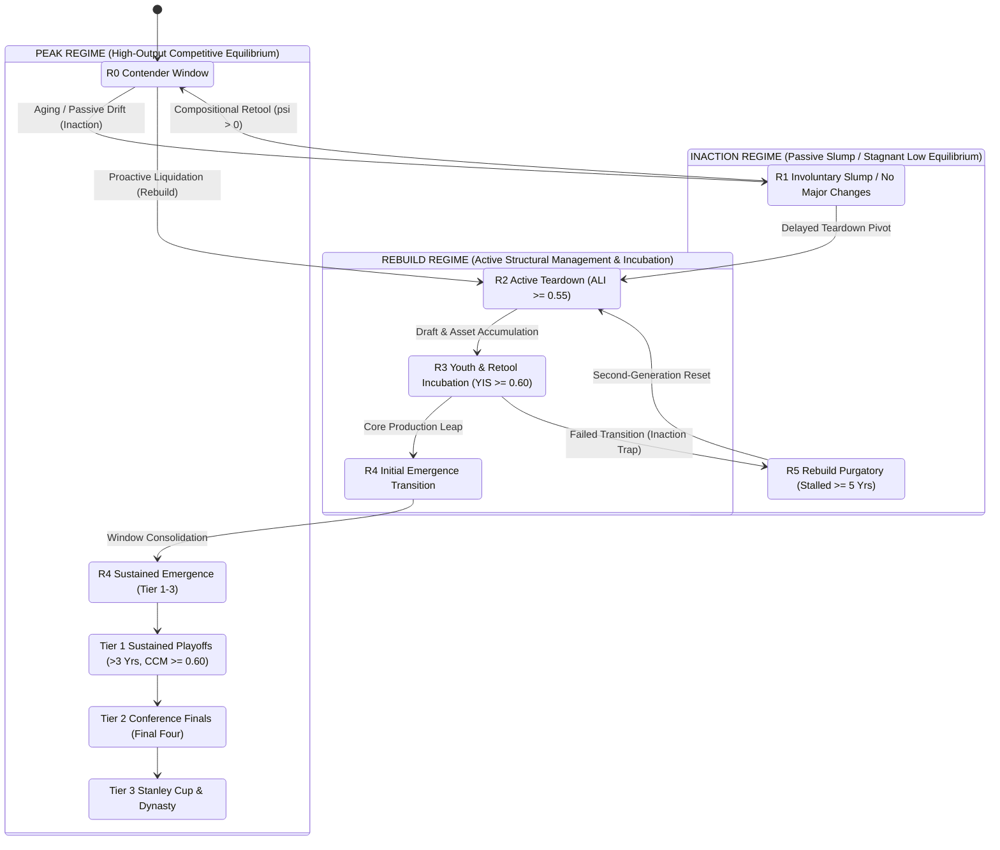
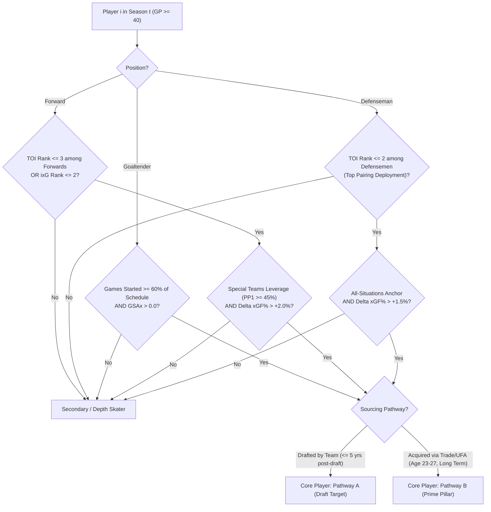

# Franchise Rebuild Analytics: Core Definitions, Ontology & Algorithmic Rules

## Methodological Charter for Quantifying Rebuilding, Core Players, and Franchise Success (2000–2025)

---

> [!IMPORTANT]
> ### Dual-Track Architecture: Philosophy vs. Algorithmic Conditions & Post-Hoc Retrospective Scope
> Every core concept in this research program is defined through two complementary lenses:
> 1. **The Philosophical Definition**: The foundational conceptual doctrine, organizational intent, and economic equilibrium rationale governing the phenomenon. It establishes *what* the concept means in hockey decision-science and time-series econometrics, and *why* it matters.
> 2. **The Operational & Algorithmic Conditions**: The deterministic mathematical formulas, statistical thresholds, data schema mappings, and query logic used to identify and measure the concept empirically against our datasets. It establishes *how* the concept is computed without subjective bias.
> 3. **Post-Hoc Retrospective Epistemology**: All regime classifications (`Inaction`, `Rebuild`, `Peak`) and multi-year episode evaluations in this charter represent a **post-hoc, retrospective historical study (2000–2025)** and are **in no way predictive forecasts or guarantees of future franchise behaviors or trends**. However, the empirical regularities and transition parameters estimated from this historical panel establish general economic laws regarding which front-office actions are effective—or tragically ineffective—in propelling a franchise out of the `Inaction` and `Rebuild` regimes into the `Peak` regime.
>
> **Companion Research Documentation**:
> - [**Project Vision & Strategic Scope (README.md)**](README.md)
> - [**Data Architecture & Panel Construction (METHODOLOGY_DATA.md)**](METHODOLOGY_DATA.md)
> - [**State-Space Structural Model & EDA Strategy (METHODOLOGY_MODEL.md)**](METHODOLOGY_MODEL.md)
> - [**Results Delivery, Publication Exhibits & Synthesis (METHODOLOGY_DELIVERY.md)**](METHODOLOGY_DELIVERY.md)
> - [**Markdown Insights & Streamlit Dashboard Plan (STREAMLIT_AND_INSIGHTS_PLAN.md)**](STREAMLIT_AND_INSIGHTS_PLAN.md)

---

## Table of Contents

- [**Companion Documents: README**](README.md) | [**METHODOLOGY_DATA**](METHODOLOGY_DATA.md) | [**METHODOLOGY_MODEL**](METHODOLOGY_MODEL.md) | [**METHODOLOGY_DELIVERY**](METHODOLOGY_DELIVERY.md) | [**STREAMLIT_AND_INSIGHTS_PLAN**](STREAMLIT_AND_INSIGHTS_PLAN.md)
1. [Taxonomy Overview & Ontological Hierarchy](#1-taxonomy-overview--ontological-hierarchy)
   - [1.1 Ontological State Space & Franchise Trajectories](#11-ontological-state-space--franchise-trajectories)
   - [1.2 The Economic Research & Causal Identification Framework](#12-the-economic-research--causal-identification-framework)
     - [1.2.1 The Endogeneity Challenge in Rebuilding](#121-the-endogeneity-challenge-in-rebuilding)
     - [1.2.2 The Four Quasi-Experimental Identification Shocks](#122-the-four-quasi-experimental-identification-shocks)
     - [1.2.3 Microeconomic & Financial Foundations](#123-microeconomic--financial-foundations)
2. [Definition 1: Rebuild Success — The Ultimate Goal of Franchise Reconstruction](#2-definition-1-rebuild-success--the-ultimate-goal-of-franchise-reconstruction)
   - [2.1 Philosophical Definition](#21-philosophical-definition)
   - [2.2 The Three Hierarchical Tiers of Success](#22-the-three-hierarchical-tiers-of-success)
     - [Tier 1: Sustained Postseason Viability (Core Intact)](#tier-1-sustained-postseason-viability-core-intact)
     - [Tier 2: Championship Contention / Final Four (Conference Finals)](#tier-2-championship-contention--final-four-conference-finals)
     - [Tier 3: The Ultimate Summit (Stanley Cup Championship & Dynasty)](#tier-3-the-ultimate-summit-stanley-cup-championship--dynasty)
   - [2.3 Algorithmic Conditions & Implementation Logic](#23-algorithmic-conditions--implementation-logic)
3. [Definition 2: Franchise Rebuild](#3-definition-2-franchise-rebuild)
   - [3.1 Philosophical Definition](#31-philosophical-definition)
   - [3.2 Operational & Algorithmic Conditions](#32-operational--algorithmic-conditions)
     - [Condition A: Asset Liquidation & Veteran Divestment Index ($\text{ALI}$)](#condition-a-asset-liquidation--veteran-divestment-index-textali)
     - [Condition B: Draft Capital Equity & Youth Infusion Score ($\text{YIS}$)](#condition-b-draft-capital-equity--youth-infusion-score-textyis)
     - [Condition C: Roster Churn & Distributional Divergence ($\text{RCI}$)](#condition-c-roster-churn--distributional-divergence-textrci)
     - [Condition D: Rebuild Phase Classification Algorithm](#condition-d-rebuild-phase-classification-algorithm)
4. [Definition 3: Core Players](#4-definition-3-core-players)
   - [4.1 Philosophical Definition](#41-philosophical-definition)
   - [4.2 The Two Primary Sourcing Pathways](#42-the-two-primary-sourcing-pathways)
     - [Pathway A: In-House Drafted Building Targets](#pathway-a-in-house-drafted-building-targets)
     - [Pathway B: Acquired Prime Pillars (Trade / Free Agency Arbitrage)](#pathway-b-acquired-prime-pillars-trade--free-agency-arbitrage)
   - [4.3 Operational & Algorithmic Conditions for Core Identification](#43-operational--algorithmic-conditions-for-core-identification)
   - [4.4 Core Continuity Metric ($\text{CCM}$) & "Intactness" Evaluation](#44-core-continuity-metric-textccm--intactness-evaluation)
5. [Definition 4: Roster Age/Experience Composition & Tactical Playing Style Balance](#5-definition-4-roster-ageexperience-composition--tactical-playing-style-balance)
   - [5.1 Age & NHL Experience Composition (`Age-Exp` Layer)](#51-age--nhl-experience-composition-age-exp-layer)
   - [5.2 Playing Style & Physical-Offensive Synergy (`Style-Hit` Layer)](#52-playing-style--physical-offensive-synergy-style-hit-layer)
6. [Data Capabilities, Schema Mapping & Query Logic](#6-data-capabilities-schema-mapping--query-logic)
   - [6.1 Project Data Sources Overview](#61-project-data-sources-overview)
   - [6.2 Exact Schema Mappings for Algorithmic Engine](#62-exact-schema-mappings-for-algorithmic-engine)
   - [6.3 Reference Implementation Queries (DuckDB SQL)](#63-reference-implementation-queries-duckdb-sql)
7. [Summary: The Operational Contract](#7-summary-the-operational-contract)

---

## 1. Taxonomy Overview & Ontological Hierarchy

To establish empirical rigor, franchise lifecycles are modeled as a state-space system driven by player talent flows, management decisions, and competitive outcomes.

### 1.1 Ontological State Space & Franchise Trajectories

```
                                  ┌───────────────────────────────┐
                                  │      FRANCHISE LIFECYCLE      │
                                  └───────────────┬───────────────┘
                                                  │
                  ┌───────────────────────────────┴───────────────────────────────┐
                  ▼                                                               ▼
    ┌───────────────────────────┐                                   ┌───────────────────────────┐
    │     OPERATIONAL STATE     │                                   │      OUTCOME STATUS       │
    │  (Rebuild vs. Retool)     │                                   │    (Tiers of Success)     │
    └─────────────┬─────────────┘                                   └─────────────┬─────────────┘
                  │                                                               │
  ┌───────────────┴───────────────┐                               ┌───────────────┴───────────────┐
  ▼                               ▼                               ▼                               ▼
[ Intentional Rebuild ]    [ Retool / Contend ]             [ Tier 1: Sustained ]          [ Tier 2: Final Four ]
• Asset Liquidation (ALI)  • Minimal Churn                  • > 3 Consecutive Berths       • Conference Finals
• Draft Concentration(YIS) • Veteran Stability              • Core Intact                  • Championship Window
• Systemic Churn (RCI)     • Win-Now Posture                              │
                                                                          ▼
                                                            [ Tier 3: Stanley Cup / Dynasty ]
                                                            • Champion with Core Intact
                                                            • Multi-Cup Decade = Dynasty
```



---

### 1.2 The Economic Research & Causal Identification Framework

Franchise lifecycle transitions cannot be understood purely as physical athletic processes; they are economic optimization problems under strict regulatory constraints (the NHL Collective Bargaining Agreement, the hard salary cap, draft eligibility rules, and revenue-sharing mechanisms). 

To ensure our empirical measurements satisfy the standards of peer-reviewed economic literature (e.g., labor economics, corporate governance, and empirical industrial organization), the framework resolves three fundamental methodological challenges:

#### 1.2.1 The Endogeneity Challenge in Rebuilding
In naive observational analysis, measuring the success of rebuilds suffers from severe endogeneity:
1. **Simultaneity & Co-Determination**: Does a management group trade away veterans because they have strategically chosen to enter a rebuild ($\text{ALI} \ge 0.55$), or did unexpected injuries and poor on-ice shooting percentage cause an involuntary collapse that forced their hand?
2. **Omitted Variable Bias**: Unobserved franchise heterogeneity—such as analytics department staffing, player development expenditure, private training facilities, and ownership financial stability—correlates both with the propensity to rebuild and subsequent player performance leaps.
3. **Selection on Unobservables (Management Patience)**: Franchises whose ownership groups grant long multi-year job security to General Managers (e.g., Detroit under Yzerman, Buffalo under Adams) can sustain prolonged rebuilds, whereas market-pressured GMs face high termination hazard and abort rebuilds prematurely.

#### 1.2.2 The Four Quasi-Experimental Identification Shocks
To isolate causal parameters ($\gamma_{\text{draft}}, \gamma_{\text{trade}}, \boldsymbol{\beta}_{\text{pos}}, \kappa_{\text{tank}}$) from endogenous confounders, the empirical architecture establishes four identification strategies detailed in [**METHODOLOGY_MODEL.md**](METHODOLOGY_MODEL.md#37-formal-econometric-identification-strategy--quasi-experimental-shocks):
1. **Draft Lottery Ping-Pong Randomness (LATE)**: The NHL draft lottery randomly assigns draft positions among non-playoff clubs. For teams finishing 30th–32nd, underlying roster quality is statistically indistinguishable, but the lottery draw creates an exogenous instrument $Z_{j, t}^{\text{lottery}}$ assigning draft slots #1 through #4 at random. This isolates the causal return on draft equity ($\gamma_{\text{draft}}$) via a Local Average Treatment Effect (LATE).
2. **Institutional CBA Policy Reforms (Difference-in-Differences)**: The 2005 salary cap implementation, the 2013 CBA term-limit rule (max 7/8 years), and the 2016 & 2021 draft lottery odds flattening represent exogenous policy shocks altering the payoff matrix of intentional bottoming-out.
3. **Macroeconomic Liquidity Freezes (COVID-19 Flat Cap Era)**: The sudden freeze of the salary cap at \$81.5\text{M} from 2020 to 2023 generated severe exogenous liquidity crunches for contending franchises. This forced distressed asset sales (e.g., dumping elite players or packaging 1st-round picks to shed cap commitments), allowing rebuilding clubs to acquire prime talent via trade arbitrage without unobserved talent degradation.
4. **Exogenous Orthopedic Traumatic Shocks**: High-velocity contact injuries (fractures, lacerations, concussions) are orthogonal to player age and conditioning curves, providing an exogenous instrument for talent shocks to identify positional elasticity $\boldsymbol{\beta}_{\text{pos}}$.

#### 1.2.3 Microeconomic & Financial Foundations
The operational definitions in this charter are grounded in four core economic disciplines:
- **Labor Economics (The Surplus Value Window, $\text{SVW}$)**: A player generates positive economic surplus if their Marginal Revenue Product exceeds their cap-regulated wage: $S_{i, t} = \text{MRP}_{i, t} - w_{i, t}$. We track whether rebuilds succeed because of this wage surplus during Entry-Level Contracts (ELCs) or whether modern second-contract escalation (\$8.5\text{M}–\$12\text{M}+) destroys the surplus window before contention is reached.
- **Financial Portfolio Theory (Roster Capital Asset Allocation)**: A hockey roster is an asset portfolio where draft picks operate as high-beta, long-dated call options with high discount rates, prime-age trades operate as private debt/equity with fixed maturities, and UFAs represent overvalued equities suffering from the Winner's Curse.
- **Principal-Agent Theory (The GM Horizon Conflict)**: A rational General Manager facing an empirical tenure hazard (average NHL GM tenure $\approx 3.8$ years) has an investment horizon misaligned with the franchise Owner (infinite horizon), explaining suboptimal mid-cycle trade interventions.
- **Industrial Organization (Parity Compression & Opportunity Cost)**: The salary cap compresses competitive balance while market-size asymmetries impose heterogeneous gate-revenue penalties (\$20\text{M}–\$35\text{M} per season) on intentional losing, explaining franchise sorting into rebuild vs. retool regimes.

---

## 2. Definition 1: Rebuild Success — The Ultimate Goal of Franchise Reconstruction

### 2.1 Philosophical Definition

> **The Philosophical Purpose of a Rebuild**:
> A franchise rebuild is not initiated merely to return to playoff participation; it is an organizational pact that accepts multi-year competitive suffering, revenue depression, and reputational risk **solely in exchange for achieving a durable, high-ceiling championship window**.
>
> Therefore, a single "lucky" wildcard playoff qualification followed by an immediate first-round exit or regression does not constitute rebuild success—it represents an aborted rebuild or a false dawn. Genuine success requires the emergence of a resilient, self-sustaining competitive ecosystem driven by an identified group of cornerstone players who translate regular-season dominance into deep postseason longevity.

---

### 2.2 The Three Hierarchical Tiers of Success

We define three ascending tiers of rebuild success, each requiring the preservation of the rebuilding team's **Core Player Group**:

```
[ Tier 3: Stanley Cup Champion / Dynasty ]
▲  • Ultimate validation: Won Stanley Cup with core group intact
│  • Multi-Cup within 10-year rolling window = "Dynasty" designation
│
[ Tier 2: Championship Contention / Final Four ]
▲  • Reached Conference Finals (Round 3) at least once with core group
│  • Demonstrates legitimate top-4 league-wide championship capability
│
[ Tier 1: Sustained Postseason Viability ]
   • Qualified for Stanley Cup Playoffs > 3 consecutive seasons (>= 4 seasons)
   • Core Player Group remains intact with >= 1 playoff round series victory
```

#### Tier 1: Sustained Postseason Viability (Core Intact)
- **Philosophical Concept**: The franchise has transcended the lottery bracket and established permanent competitive residency. The team is no longer vulnerable to single-season regressions and possesses sufficient depth and tactical stability to make the playoffs year in and year out.
- **Milestone Threshold**: Making the playoffs **more than 3 consecutive seasons** (i.e., $\ge 4$ consecutive seasons, or 3 consecutive seasons featuring at least one second-round series victory) while retaining the primary core that led the ascent.

#### Tier 2: Championship Contention / Final Four (Conference Finals)
- **Philosophical Concept**: The team enters the elite inner circle of legitimate championship contenders. Because 7-game playoff series possess inherent variance (goaltending hot streaks, puck luck, single-goal overtime bounces), reaching the **Conference Finals (Final Four)** proves that the rebuild assembled a roster capable of winning the Stanley Cup under normal variance.
- **Milestone Threshold**: Winning at least two playoff rounds in a single postseason to reach the Conference Finals / NHL Semifinals at least once, with the core player group occupying primary on-ice leverage.

#### Tier 3: The Ultimate Summit (Stanley Cup Championship & Dynasty)
- **Philosophical Concept**: The absolute validation of an organizational lifecycle. The franchise captures the Stanley Cup, proving that the rebuild's drafting, player development, and tactical assembly achieved total supremacy.
- **Dynasty Sub-classification**: If the franchise captures **two or more Stanley Cups within a rolling 10-year window** while keeping the spine of its Core Player Group intact (e.g., Detroit 1997–2002, Pittsburgh 2009–2017, Chicago 2010–2015, Tampa Bay 2020–2021), it is formally classified as a **Dynastic Rebuild**.

---

### 2.3 Algorithmic Conditions & Implementation Logic

Let team $j$ initiate a classified rebuild at season $t_{\text{start}}$ with identified core player set $\mathcal{C}_j$. The outcome tiers are evaluated over a tracking horizon $T \in [t_{\text{start}}, t_{\text{start}} + 10]$:

#### Algorithmic Rule for Tier 1 (Sustained Postseason Viability)
A team satisfies **Tier 1** if and only if:
1. **Consecutive Berths**: There exists a sub-sequence of consecutive seasons $(t, t+1, \dots, t+k)$ such that:

$$
\text{PlayoffBerth}_{j, \tau} == 1 \quad \forall \, \tau \in [t, t+k], \quad \text{where } k \ge 3 \text{ (i.e. } \ge 4 \text{ seasons)}
$$

   *(Or $k = 2$ with total playoff rounds won $\sum \text{SeriesWon} \ge 2$)*.
2. **Core Intactness**: The Core Continuity Metric across this window satisfies:

$$
\text{CCM}_j(t, t+k) \ge 0.60
$$

#### Algorithmic Rule for Tier 2 (Conference Finalist / Final Four)
A team satisfies **Tier 2** if:
1. In any season $\tau \in [t_{\text{start}}, t_{\text{start}} + 10]$:

$$
\text{MaxPlayoffRound}_{j, \tau} \ge 3 \quad (\text{Conference Finals or Stanley Cup Final})
$$

2. **Core Contribution**: At least 3 players from the identified Core Group $\mathcal{C}_j$ appear in $\ge 80\%$ of playoff games in season $\tau$ and account for $\ge 35\%$ of total playoff TOI.

#### Algorithmic Rule for Tier 3 (Stanley Cup Champion & Dynasty)
A team satisfies **Tier 3** if:
1. In season $\tau \in [t_{\text{start}}, t_{\text{start}} + 10]$:

$$
\text{StanleyCupChampion}_{j, \tau} == 1
$$

2. **Core Preservation**: Core Continuity Metric relative to the rebuild maturation phase satisfies $\text{CCM}_j \ge 0.50$.
3. **Dynasty Clause**: If $\sum_{\tau = t}^{t+9} \text{StanleyCupChampion}_{j, \tau} \ge 2$ with mutual core overlap $\ge 3$ players, flag `is_dynasty = True`.

---

## 3. Definition 2: Franchise Rebuild

### 3.1 Philosophical Definition

> **The Philosophical Meaning of a Rebuild**:
> A rebuild is an **intentional strategic choice** to subordinate present competitive performance to future asset accumulation. It is defined by three philosophical pillars:
> 1. **Asset Divestment**: Acknowledging that the existing competitive window is closed, the organization proactively trades productive, prime-age or veteran assets for speculative future equity (draft picks and prospects).
> 2. **Structural Youth Re-allocation**: The team deliberately allocates high-leverage on-ice responsibilities (top-six minutes, top power-play units, #1 goaltending duties) to underdeveloped, young players whose immediate output may be negative or volatile, but whose developmental ceiling is high.
> 3. **Competitive Decoupling**: Management accepts and embraces regular-season losses as a structural mechanism to maximize draft lottery positioning, while actively clearing long-term salary cap commitments to create balance-sheet flexibility for the next competitive cycle.
>
> **What a Rebuild is NOT**:
> A rebuild is **not** a seasonal slump, an injury-decimated campaign, an aging roster slowly decaying without management intervention, or a failed win-now push that accidentally lands in the lottery. A rebuild requires active managerial disruption.

---

### 3.2 Operational & Algorithmic Conditions

A team-season $(j, t)$ is classified as an **Active Rebuild** if it satisfies the quantitative requirements across three formal dimensions:

```
                          [ REBUILD OPERATIONAL MATRIX ]
                                       │
     ┌─────────────────────────────────┼─────────────────────────────────┐
     ▼                                 ▼                                 ▼
[ Condition A: ALI >= 0.55 ]    [ Condition B: YIS >= 0.60 ]      [ Condition C: RCI >= 0.40 ]
Asset Liquidation Index         Youth Influx & Pedigree           Roster Turnover & Churn
• Outgoing Veteran TOI Share    • U-24 TOI Proportion >= 30%      • Jaccard Roster Churn >= 40%
• Outgoing Point/WAR Share      • Top-10 / 1st-Rd Pick Density    • Wasserstein Age Shift
• Futures Capital Received      • Sophomore Production Leap       • Systematic Cap Liquidation
```

#### Condition A: Asset Liquidation & Veteran Divestment Index ($\text{ALI}$)

$$
\text{ALI}_{j, t} = 0.35 \cdot \left(\frac{\text{TOI}_{\text{departed\_vets}}}{\text{TOI}_{\text{total}, t-1}}\right) + 0.35 \cdot \left(\frac{\text{Points}_{\text{departed\_vets}}}{\text{Points}_{\text{total}, t-1}}\right) + 0.30 \cdot \text{DraftEquityAcquired}_{j, t}
$$

- **Departed Veterans Definition**: Any player on roster in year $t-1$ aged $\ge 26$ years who played $\ge 40$ games and ranked in the top 40% of team ice time, who was traded or allowed to walk in free agency without veteran replacement.
- **Draft Equity Acquired**: Pick-value weight $V = \sum \frac{1}{\sqrt{\text{PickOverall}}}$ normalized to $[0, 1]$.
- **Threshold**: $\text{ALI}_{j, t} \ge 0.55$ indicates heavy active liquidation.

#### Condition B: Draft Capital Equity & Youth Infusion Score ($\text{YIS}$)

$$
\text{YIS}_{j, t} = 0.40 \cdot \left(\frac{\text{TOI}_{U24, j, t}}{\text{TOI}_{\text{total}, j, t}}\right) + 0.35 \cdot \text{DraftCapitalIndex}_{j, t}^{(3\text{yr})} + 0.25 \cdot \text{ELC\_Roster\_Share}_{j, t}
$$

- **$\text{TOI}_{U24}$**: Proportion of total 5v5 and all-situations minutes logged by skaters aged $\le 23.99$ years on October 1st of season $t$.
- **$\text{DraftCapitalIndex}^{(3\text{yr})}$**: Rolling 3-year cumulative draft capital across Rounds 1–2, with exponential weighting for top-10 selections.
- **Threshold**: $\text{YIS}_{j, t} \ge 0.60$ and $\frac{\text{TOI}_{U24}}{\text{TOI}_{\text{total}}} \ge 0.30$.

#### Condition C: Roster Churn & Distributional Divergence ($\text{RCI}$)

$$
\text{RCI}_{j, t} = 0.50 \cdot \left(1 - J(\mathcal{R}_{t-1}, \mathcal{R}_t)\right) + 0.50 \cdot \widetilde{W}_1\left(\text{AgeDist}_{t-1}, \text{AgeDist}_t\right)
$$

- **$J(\mathcal{R}_{t-1}, \mathcal{R}_t)$**: Jaccard similarity of the 18 primary skaters logging $\ge 30$ games in consecutive seasons.
- **$\widetilde{W}_1$**: Normalized 1D Wasserstein distance of the TOI-weighted player age distributions between seasons $t-1$ and $t$.
- **Threshold**: $\text{RCI}_{j, t} \ge 0.40$.

---

### Condition D: Hierarchical Regime Classification Algorithm (`R0`–`R5` & Three Macro Equilibrium Regimes: `Inaction`, `Rebuild`, `Peak`)

#### 1. Philosophical Definition of the Three Macro Econometric Equilibrium Regimes
> **The Time-Series Equilibrium Doctrine of `Inaction`, `Rebuild`, and `Peak`**:
> Drawing directly from macroeconomic time-series literature on **Markov-Switching State-Space and Dynamic Equilibrium Models** (Hamilton, 1989; Kim, 1994), franchise performance and management behavior do not evolve along a single homogeneous trajectory. Instead, franchises transition across **three structural macro regimes** ($M_{j, t} \in \{\text{Inaction}, \text{Rebuild}, \text{Peak}\}$):
> 1. **`Inaction` Regime ($M_{j, t} = \text{Inaction}$ — Non-Interventionist Slump & Stagnant Equilibrium)**:
>    Unsuccessful seasons in which a franchise fails to achieve competitive contention and **either makes no major structural changes to improve its roster (and has nothing to show for it)** (`R1_INVOLUNTARY_SLUMP` / `R1_MIDDLE_TIER`) or remains trapped in chronic post-rebuild stagnation (`R5_REBUILD_PURGATORY`) where prior interventions have exhausted their developmental impulse. In the `Inaction` regime, management preserves the status quo or drifts without decisive capital reallocation, leaving the organization stuck in a low-output equilibrium trap.
> 2. **`Rebuild` Regime ($M_{j, t} = \text{Rebuild}$ — Active Structural Intervention & Multi-Year Incubation)**:
>    Unsuccessful or transitional seasons in which a franchise is **actively managing and in the ongoing or post-process of major structural changes across seasons** (`R2_TEARDOWN`, `R3_YOUTH_INCUBATION`, and initial transitional `R4_EMERGENCE`). Here, front-office leadership deliberately liquidates veteran assets, restructures the age/contract distribution, or incubates high-pedigree young/retool capital—enduring short-term competitive deficits in the calculated hope that these multi-year structural investments will propel the franchise into the `Peak` regime in future seasons.
> 3. **`Peak` Regime ($M_{j, t} = \text{Peak}$ — High-Output Competitive Equilibrium)**:
>    Successful seasons (`R0_CONTENDER` and sustained `R4_EMERGENCE` achieving Tier 1, Tier 2, or Tier 3 success) in which the franchise operates in its high-output competitive equilibrium—consistently qualifying for the playoffs with an intact core, advancing to the Conference Finals, or winning the Stanley Cup.
>
> *Retrospective Historical Caveat*: Classification into `Inaction`, `Rebuild`, and `Peak` across the 2000–2025 sample is a **post-hoc retrospective historical evaluation** utilizing full-sample trajectory smoothing ($\mathcal{I}_{j, 1:T}$). It is not a deterministic forecast of future behavior, but a diagnostic framework quantifying which historical decisions effectively moved teams from `Inaction` and `Rebuild` into `Peak`—and which decisions proved tragically ineffective.

#### 2. Operational & Algorithmic Conditions (`R0`–`R5` $\mapsto$ `Inaction`, `Rebuild`, `Peak`)

Using the joint metric vector $\mathbf{M}_{j, t} = (\text{ALI}_{j, t}, \text{YIS}_{j, t}, \text{RCI}_{j, t}, \text{PTS}\%_{j, t}, \text{GoalDiff}_{j, t}, \text{CCM}_{j, t})$, every franchise-season is deterministically assigned to both its granular sub-state $S_{j, t} \in \{\text{R0}, \dots, \text{R5}\}$ and its measured macro equilibrium regime $M_{j, t} \in \{\text{Inaction}, \text{Rebuild}, \text{Peak}\}$:

```python
def classify_rebuild_state_and_macro_regime(row):
    """
    Two-tier deterministic regime classifier:
      - Granular Operational State: R0_CONTENDER .. R5_REBUILD_PURGATORY
      - Measured Macro Econometric Regime: 'Peak', 'Rebuild', or 'Inaction'
    """
    pts_pct = row['pts_pct']
    ali = row['ali']
    yis = row['yis']
    rci = row['rci']
    consecutive_lottery_years = row['consecutive_lottery_years']
    sustained_playoff_streak = row.get('playoff_streak_years', 0)
    playoff_rounds_won = row.get('playoff_rounds_won', 0)
    
    # 1. R0: Contender Window -> PEAK REGIME
    if (pts_pct >= 0.580 and ali < 0.30 and row['u24_toi_share'] < 0.25) or playoff_rounds_won >= 2:
        return "R0_CONTENDER", "Peak"
        
    # 2. R2: Phase I Active Teardown -> REBUILD REGIME
    if ali >= 0.55 and rci >= 0.40 and pts_pct < 0.480:
        return "R2_TEARDOWN", "Rebuild"
        
    # 3. R3 / R5: Phase II Youth Incubation vs. Purgatory Trap
    if yis >= 0.60 and row['u24_toi_share'] >= 0.30 and pts_pct < 0.520:
        if consecutive_lottery_years >= 5 and ali < 0.45:
            # Stalled >= 5 years without new structural pivot -> INACTION REGIME (Purgatory)
            return "R5_REBUILD_PURGATORY", "Inaction"
        return "R3_YOUTH_INCUBATION", "Rebuild"
        
    # 4. R4: Phase III Window Opening / Emergence
    if pts_pct >= 0.550 and yis >= 0.45 and row['delta_pts_pct'] >= 0.060:
        if sustained_playoff_streak >= 2 or playoff_rounds_won >= 1:
            return "R4_EMERGENCE", "Peak"
        # First transitional year exiting incubation -> REBUILD REGIME (Post-process transition)
        return "R4_EMERGENCE", "Rebuild"
        
    # 5. R1: Competitive Slump / Mediocrity without Major Structural Changes -> INACTION REGIME
    if pts_pct < 0.500 and ali < 0.35 and yis < 0.45:
        return "R1_INVOLUNTARY_SLUMP", "Inaction"
        
    return "R1_MIDDLE_TIER", "Inaction"
```

#### 3. Franchise-Level Retrospective Regime Occupancy & Predominance Metrics

Across the $T_j$ measured seasons for franchise $j \in \{1, \dots, 32\}$ in the 2000–2025 sample, we compute the **Retrospective Regime Occupancy Vector** $\widehat{\boldsymbol{\pi}}_j = [\widehat{\text{Share}}_j(\text{Inaction}), \, \widehat{\text{Share}}_j(\text{Rebuild}), \, \widehat{\text{Share}}_j(\text{Peak})]^\top$:

$$
\widehat{\text{Share}}_j(m) = \frac{1}{T_j} \sum_{t=1}^{T_j} \mathbb{I}\left(M_{j, t} = m\right), \quad \widehat{M}_j^{\text{predominant}} = \arg\max_{m \in \{\text{Inaction}, \text{Rebuild}, \text{Peak}\}} \widehat{\text{Share}}_j(m)
$$

Alongside the **Empirical Markov Regime Transition Probability Matrix** $\widehat{\mathbf{\Pi}}_j \in [0, 1]^{3 \times 3}$:

$$
\hat{\pi}_j^{(r \to s)} = \frac{\sum_{t=2}^{T_j} \mathbb{I}\left(M_{j, t-1} = r \land M_{j, t} = s\right)}{\sum_{t=2}^{T_j} \mathbb{I}\left(M_{j, t-1} = r\right)}, \quad r, s \in \{\text{Inaction}, \text{Rebuild}, \text{Peak}\}
$$

This directly quantifies whether a franchise's historical `Rebuild` episodes successfully transitioned into `Peak` ($\hat{\pi}_j^{(\text{Rebuild} \to \text{Peak})}$) or collapsed back into `Inaction` ($\hat{\pi}_j^{(\text{Rebuild} \to \text{Inaction})}$).

---

## 4. Definition 3: Core Players

### 4.1 Philosophical Definition

> **The Philosophical Nature of a Core Player**:
> A Core Player is not simply the leading scorer in a given 82-game sample; they are **the foundational pillars around whom the franchise's entire tactical and strategic system is designed**.
>
> Philosophically, Core Players possess three defining attributes:
> 1. **High Strategic Dependency**: The franchise cannot execute its game model without them. When on the ice, they dictate pace, match up against elite opponent competition, and drive shot differentials. When injured or off the ice, team performance experiences sharp structural decay.
> 2. **Positional Centering**: Core Players traditionally anchor critical structural positions—predominantly **franchise centers**, **top-pairing all-situations defensemen**, or **elite starting goaltenders**—who control the central axis of the ice.
> 3. **Contractual & Organizational Commitment**: The organization has committed top salary-cap equity and term to these individuals, treating them as long-term fixtures rather than transient trade chips.

---

### 4.2 The Two Primary Sourcing Pathways

Historically, successful rebuilding franchises construct their core through two distinct acquisition mechanisms:

```
                            [ CORE PLAYER SOURCING PATHWAYS ]
                                            │
        ┌───────────────────────────────────┴───────────────────────────────────┐
        ▼                                                                       ▼
[ Pathway A: In-House Drafted Targets ]               [ Pathway B: Acquired Prime Pillars ]
"Draft, Incubate, Elevate"                            "Pro Scouting & Trade Arbitrage"
• Drafted by team during/near rebuild trough          • Acquired via trade or targeted UFA
• High draft pedigree (Top-15 / 1st Round)            • Aged 23–27 with proven star metrics elsewhere
• Rapid production leap by Year 2–3                   • Signed to max-term core extensions
• Examples: Crosby, Kane, MacKinnon, Hedman           • Examples: Tkachuk (FLA), Eichel (VGK), O'Reilly (STL)
```

#### Pathway A: In-House Drafted Building Targets
- **Definition**: Players drafted by the franchise during or immediately preceding the teardown/incubation window ($t_{\text{start}} - 1 \le \text{DraftYear} \le t_{\text{start}} + 4$).
- **Characteristics**: High draft equity investment (frequently 1st round, top-10 selections); developed through the franchise's American Hockey League (AHL) affiliate or injected directly into NHL top-six/top-four minutes; demonstrating a demonstrable leap in individual expected goals ($\text{ixG}$) and primary points per 60 between ages 19 and 22.

#### Pathway B: Acquired Prime Pillars (Trade / Free Agency Arbitrage)
- **Definition**: Established star players acquired from outside organizations during the transition from Phase II (Incubation) to Phase III (Emergence).
- **Characteristics**: Acquired during prime performance years (ages 23–27); acquired in exchange for accumulated futures (multiple 1st round picks, secondary prospects); immediately signed to 7-to-8 year cornerstone extensions; assume instant #1 center, #1 defenseman, or #1 winger status.
- **Exemplars**: Matthew Tkachuk to Florida (traded for Huberdeau/Weegar), Jack Eichel to Vegas (traded for Krebs/Tuch/picks), Ryan O'Reilly to St. Louis (traded for Berglund/Sobotka/Thompson/picks).

---

### 4.3 Operational & Algorithmic Conditions for Core Identification



For every franchise $j$ in season $t$, an individual player $i$ is classified as a **Core Player** ($i \in \mathcal{C}_{j, t}$) if they meet the following deterministic criteria across two consecutive seasons:

#### 1. Deployment & Ice Time Dominance
- **Skaters**: All-situations Time On Ice ($\text{TOI}$) ranks in the **top 15th percentile** of team skaters (typically top 3 forwards or top 2 defensemen):

$$
\text{TOI\_Rank}_{i, j, t} \le 3 \text{ for Forwards}, \quad \le 2 \text{ for Defensemen}
$$

- **Special Teams Leverage**: Skater must feature on Power Play Unit 1 ($\text{PP\_TOI\_Share} \ge 45\%$) or Penalty Kill Unit 1 ($\text{PK\_TOI\_Share} \ge 35\%$).
- **Goaltenders**: Games Started ($\text{GS}$) represents $\ge 60\%$ of total team regular-season games, with positive Goals Saved Above Expected ($\text{GSAx} > 0$).

#### 2. Performance & Production Thresholds
- **Primary Scoring Share**: Skater accounts for $\ge 12\%$ of total team 5v5 primary points (goals + primary assists) or ranks in the team top-3 in Individual Expected Goals ($\text{ixG}$).
- **Possession & High-Danger Differential**: When player $i$ is on the ice at 5v5, team high-danger chance share ($\text{HDCF}\%$) and expected goals share ($\text{xGF}\%$) exceed the team off-ice baseline:

$$
\Delta \text{xGF}\% = \text{xGF}\%_{\text{on}} - \text{xGF}\%_{\text{off}} > +2.0\%
$$

#### 3. Acquisition & Tenure Integrity
- Player must satisfy either **Pathway A** (drafted in-house and in year $\ge 2$ of NHL tenure) or **Pathway B** (contract remaining $\ge 3$ seasons or AAV consuming $\ge 10\%$ of team salary cap ceiling).

---

### 4.4 Core Continuity Metric ($\text{CCM}$) & "Intactness" Evaluation

To evaluate whether a team reached Tier 1, 2, or 3 with the **same core intact**, we define the **Core Continuity Metric ($\text{CCM}$)** between two seasons $t_1$ (emergence) and $t_2$ (championship run):

$$
\text{CCM}_j(t_1, t_2) = \frac{\sum_{i \in \mathcal{C}_{j, t_1} \cap \mathcal{C}_{j, t_2}} \frac{1}{2} \left[ \omega_i(t_1) + \omega_i(t_2) \right]}{\max\left( \sum_{i \in \mathcal{C}_{j, t_1}} \omega_i(t_1), \, \sum_{k \in \mathcal{C}_{j, t_2}} \omega_k(t_2) \right)}
$$

Where:
- $\omega_i(t) = \frac{\text{TOI}_{i, t}}{\text{Total\_Team\_TOI}_t}$ is the ice-time weight of core player $i$ in season $t$.
- $\mathcal{C}_{j, t_1} \cap \mathcal{C}_{j, t_2}$ is the set of mutual core players active in both seasons.

#### Intactness Decision Rule:
- $\text{CCM} \ge 0.70$: **Core Fully Intact** (True rebuild ascendancy).
- $0.45 \le \text{CCM} < 0.70$: **Core Partially Intact** (Hybrid transition / tactical supplement).
- $\text{CCM} < 0.45$: **Roster Overhaul** (Success attributable to secondary team reconstruction, not the original rebuild core).

---

## 5. Definition 4: Roster Age/Experience Composition & Tactical Playing Style Balance

A central hypothesis of this research (`Q8`) is that **accumulating young, high-skill draft picks in isolation is structurally insufficient—and often counterproductive—for exiting a rebuild**. To formalize why certain young rosters collapse into `R5_PURGATORY` while balanced contenders ascend to Tiers 2 and 3, we define two compositional layers directly anchored to empirical studies in this repository.

---

### 5.1 Age & NHL Experience Composition (`Age-Exp` Layer)

#### 1. Philosophical Definition
> **The Philosophical Fallacy of the "All-Kids" Roster**:
> While Entry-Level Contract (ELC) players provide essential salary-cap surplus and dynamic skating speed, NHL hockey is a complex spatial-read and situational-leverage game. A roster heavily skewed toward 18-to-22-year-old draftees without veteran structural insulation suffers from **defensive zone coverage breakdowns, late-period lead collapses, penalty-kill fragility, and psychological compounding of losing streaks**.
>
> Philosophically, optimal roster construction is governed by **multi-generational complementarity**: young stars (`0–3 yrs` NHL experience) require on-ice and locker-room insulation from prime battle-tested pillars (`4–6 yrs` and `7–9 yrs` experience) and high-habit veteran anchors (`10+ yrs` experience). Beyond a critical saturation point ($\tau_{\text{youth}}^*$), adding more inexperienced youth yields **negative marginal returns** (**The Youth Overload Trap**).

#### 2. Operational & Algorithmic Conditions (Linked to [`dev/player/player_draft/`](../../player/player_draft/draftee_lifecycle/eda.py))
Following the career progression methodology established in [`dev/player/player_draft/draftee_lifecycle/eda.py`](../../player/player_draft/draftee_lifecycle/eda.py) and [`app/exe/draft_analysis.py`](../../../app/exe/draft_analysis.py), each player $i$ on team $j$ in season $t$ is assigned to one of four discrete NHL experience tenure buckets based on cumulative regular-season NHL years played (`year_inNHL` = dense rank of NHL seasons played):

1. **Bucket $B_1$ (`0–3 yrs`, Entry-Level / Apprenticeship Cohort, typical ages 18–22)**: Players in their first 3 NHL seasons. High developmental variance; steep learning curve in 5v5 defensive assignments.
2. **Bucket $B_2$ (`4–6 yrs`, Prime RFA / Breakout Cohort, typical ages 23–26)**: Players reaching physical and offensive peak efficiency (where the majority of 95th-percentile `exceeded_95th` breakout seasons in [`eda.py`](../../player/player_draft/draftee_lifecycle/eda.py) cluster).
3. **Bucket $B_3$ (`7–9 yrs`, Peak UFA / Structural Leadership Cohort, typical ages 27–30)**: Veteran two-way drivers providing matchup stability and playoff poise.
4. **Bucket $B_4$ (`10+ yrs`, Veteran Mentorship / Insulation Cohort, typical ages 31+)**: High-habit cultural anchors stabilizing defensive pairings, faceoffs, and penalty-kill units.

Let $s_{j, t}^{(b)} = \frac{\sum_{i \in B_b} \text{TOI}_{i, j, t}}{\sum_{k=1}^M \text{TOI}_{k, j, t}}$ denote the share of total team Time On Ice allocated to bucket $b \in \{B_1, B_2, B_3, B_4\}$, such that $\sum_{b=1}^4 s_{j, t}^{(b)} = 1$. We compute three deterministic metrics:

- **Shannon Experience Entropy ($H_{j, t}^{\text{exp}}$)**:

$$
H_{j, t}^{\text{exp}} = -\sum_{b=1}^{4} s_{j, t}^{(b)} \ln\left(s_{j, t}^{(b)} + \epsilon\right), \quad H_{j, t}^{\text{exp}} \in [0, \, \ln 4 \approx 1.386]
$$

- **Youth Overload Excess ($\text{YOE}_{j, t}$)**: Quantifies how far a rebuilding roster exceeds the empirical youth saturation ceiling $\tau_{\text{youth}}^* = 0.30$ ($30\%$ of total team minutes played by `0–3 yr` skaters):

$$
\text{YOE}_{j, t} = \max\left(0, \, s_{j, t}^{(B_1)} - \tau_{\text{youth}}^*\right)^2
$$

- **Veteran Insulation Ratio ($\text{VIR}_{j, t}$)**: Ratio of stabilized veteran minutes ($B_3 \cup B_4$) to rookie/apprentice minutes ($B_1$):

$$
\text{VIR}_{j, t} = \frac{s_{j, t}^{(B_3)} + s_{j, t}^{(B_4)}}{s_{j, t}^{(B_1)} + 0.05}
$$

---

### 5.2 Playing Style & Physical-Offensive Synergy (`Style-Hit` Layer)

#### 1. Philosophical Definition
> **The Philosophical Dichotomy of NHL Physicality: Forecheck Disruption vs. Defensive Chasing**:
> A pure-skill perimeter roster frequently stalls in the Stanley Cup Playoffs when time and space are compressed; conversely, a roster built on slow, one-dimensional "bruisers" who accumulate raw hits while chasing the puck in their own defensive zone gets out-possessed and out-scored.
>
> Grounded in our repository's [**Physical Hits EDA (`dev/decision_science/hit_eda/`)**](../../decision_science/hit_eda/EXPLORATORY.md), [**Continuous-Time Momentum State-Space Model (`dev/decision_science/impact_of_hits/`)**](../../decision_science/impact_of_hits/REVIEW.md), and [**Shot-Blocking Sequence Study (`dev/decision_science/plays_blockingShots/`)**](../../decision_science/plays_blockingShots/readme.md), we establish a fundamental hockey principle: **not all hits are equal**.
> - **Defensive-Zone Hits (`zoneCode == 'D'`) are predominantly a symptom of defending without the puck**: Over $60\%$ of the time after a D-zone hit, the attacking opponent retains possession, and $75.9\%$ of 5v5 D-zone hits fail to produce an immediate clean zone exit.
> - **Offensive-Zone Forecheck Hits (`zoneCode == 'O'`) are an active weapon of puck retrieval and opportunity creation**: Delivering physical contact on the forecheck separates opposing defensemen from the puck, yields $>54\%$ immediate puck recovery for the hitting team, drives positive 30-second shot and goal differentials, and injects the highest physical momentum impulse into the game state.
> - **Championship Style Synergy**: Elite contenders combine **high-danger offensive playmaking** with **relentless offensive-zone forechecking physicality and shot-blocking structure**.

#### 2. Operational & Algorithmic Conditions (Linked to `hit_eda` & `MomentumSSM` Hyperparameters)
We link the exact empirical baselines and pre-trained hyperparameters from [`dev/decision_science/hit_eda/data/hit_zone_summary_kpi.csv`](../../decision_science/hit_eda/data/hit_zone_summary_kpi.csv), [`team_season_hit_kpi.csv`](../../decision_science/hit_eda/data/team_season_hit_kpi.csv), and [`dev/decision_science/impact_of_hits/data/B_samples.npy`](../../decision_science/impact_of_hits/data/B_samples.npy) ($N = 667,961$ multi-season hit sequences):

| Zone / Parameter | Repository Source | Empirical Benchmark / Hyperparameter Value | Tactical & Econometric Interpretation |
|:---|:---|:---:|:---|
| **O-Zone Hit Recovery ($\Pi_{\text{rec}}(O)$)** | `hit_zone_summary_kpi.csv` (`ALL`) | **$54.15\%$** ($53.2\%$ 5v5) | Forecheck hits win immediate puck possession over half the time |
| **D-Zone Hit Recovery ($\Pi_{\text{rec}}(D)$)** | `hit_zone_summary_kpi.csv` (`ALL`) | **$39.98\%$** ($37.8\%$ 5v5) | Opponent retains possession $>60\%$ of the time after D-zone hits |
| **5v5 D-Zone Clean Exit Rate ($\text{ZER}_D$)** | `hit_eda/EXPLORATORY.md` | **$24.10\%$** | $75.9\%$ of 5v5 D-zone hits leave defending team pinned or stopped |
| **30s Net Shots / 100 Hits (O-Zone vs. D-Zone)**| `hit_zone_summary_kpi.csv` (`ALL`) | **$+7.43$ (O)** vs. **$-17.71$ (D)** | Forecheck hits create shot waves; D-zone hits precede opponent barrages |
| **30s Net Goals / 100 Hits (O-Zone vs. D-Zone)**| `hit_zone_summary_kpi.csv` (`ALL`) | **$+0.264$ (O)** vs. **$-0.678$ (D)** | $+0.942$ net goal swing per 100 hits between O-zone and D-zone contact |
| **`MomentumSSM` Decay Rate ($\hat{a}_0$)** | `momentum_ssm.py` / `base_model.pt` | **$\hat{a}_0 = 0.98597$** | Continuous-time state persistence $A_t = \hat{a}_0^{\Delta t_t}$ per second |
| **`MomentumSSM` Event Half-Life ($\tau_{1/2}$)** | `inference.py` (`compute_half_life`) | **$49.1\text{ seconds}$** | $\tau_{1/2} = -\ln(2)/\ln(\hat{a}_0)$; integrated multiplier $\frac{1}{1-\hat{a}_0} = 71.28$ |
| **O-Zone Hit Impulse ($\hat{B}_{\text{hit\_for\_O}}$)**| `B_samples.npy` ($N_{\text{boot}}=200$) | **$+0.4678$** (Boot: $+0.3765$ $[+0.366, +0.386]$) | Highest physical momentum impulse weight across all zones |
| **N-Zone Hit Impulse ($\hat{B}_{\text{hit\_for\_N}}$)**| `B_samples.npy` ($N_{\text{boot}}=200$) | **$+0.4622$** (Boot: $+0.3346$ $[+0.319, +0.352]$) | Neutral-zone rush denial impulse weight |
| **D-Zone Hit Impulse ($\hat{B}_{\text{hit\_for\_D}}$)**| `B_samples.npy` ($N_{\text{boot}}=200$) | **$+0.4521$** (Boot: $+0.2950$ $[+0.285, +0.305]$) | $21.6\%$ lower bootstrap impulse than O-zone hits |
| **Takeaway & Block Impulses ($\hat{B}_{\text{take}}, \hat{B}_{\text{blk}}$)**| `B_samples.npy` ($N_{\text{boot}}=200$) | **$+0.3387$ (Take)**, **$+0.4104$ (Block)** | Complementary active defensive transition drivers |

Using these calibrated constants, we define three team-season style metrics for franchise $j$ in season $t$:

1. **Proactive Forecheck Hit Share ($\text{PFHS}_{j, t}$)**:

$$
\text{PFHS}_{j, t} = \left(\frac{\text{Hits}_{j, t}(O)}{\text{Hits}_{j, t}(O) + \text{Hits}_{j, t}(D)}\right) \times \Pi_{\text{recovery}, j, t}
$$

2. **`MomentumSSM`-Weighted Tactical Impulse Rate ($\text{MTIR}_{j, t}$)**:
   Aggregates a team's per-60 event rates weighted by the empirical `MomentumSSM` bootstrap posterior mean vector $\hat{\mathbf{B}}_{\text{boot}}$ and integrated over the $\tau_{1/2} = 49.1\text{s}$ decay kernel:

$$
\text{MTIR}_{j, t} = \frac{1}{1 - \hat{a}_0} \left( 0.3765 \cdot \text{HitO}_{60} + 0.3346 \cdot \text{HitN}_{60} + 0.3387 \cdot \text{Take}_{60} + 0.4104 \cdot \text{Block}_{60} - 0.2950 \cdot \text{ChasingHitD}_{60}^{\text{no\_exit}} \right)
$$

3. **Skill-Physicality Style Synergy Index ($\text{SPSI}_{j, t}$)**:
   Quantifies the joint balance between High-Danger Offensive Skill ($z(\text{xGF}_{60}) + z(\text{HDCF}\%)$) and Forecheck Opportunity Generation ($z(\text{PFHS}_{j, t}) + z(\text{NetShotsPer100Hits}_{30\text{s}})$):

$$
\text{SPSI}_{j, t} = \Phi\left(z\left(\text{OffSkill}_{j, t}\right)\right) \times \Phi\left(z\left(\text{ForecheckOpp}_{j, t}\right)\right) \in (0, 1)
$$

---

## 6. Data Capabilities, Schema Mapping & Query Logic

### 6.1 Project Data Sources Overview

The metrics defined above are backed by data tables stored in local Parquet/CSV formats and mirrored in the Hugging Face Dataset (`jjerlee/nhl-analytics`):

```
                                  [ REBUILD DATA ECOSYSTEM ]
                                               │
      ┌───────────────────────────┬────────────┴────────────┬───────────────────────────┐
      ▼                           ▼                         ▼                           ▼
[ Game & Standings ]   [ Player Box Scores ]     [ Draft & Tenure Logs ]   [ Hit & MomentumSSM Telemetry ]
• latest/box/*_box.csv • *_box_player.csv        • all_drafted_players.csv • hit_zone_summary_kpi.csv
• games.parquet (HF)   • player_box.parquet (HF) • chronicle.csv (Buckets) • team_season_hit_kpi.csv
  - gameid, score, win   - toi, ixg, gsax, pts     - year_inNHL, 95th_pct  • B_samples.npy (a0=0.98597)
```

---

### 6.2 Exact Schema Mappings for Algorithmic Engine

| Analytical Dimension | Required Variables | Source Table & Column Mapping |
|:---|:---|:---|
| **Team Performance & Standings** | Points %, Goal Diff, Playoff Status | `team_season.csv` $\rightarrow$ `wp` (Points %), `rwin` (Wins), `rpe` (Pythagorean Win Exp), `Final` |
| **Playoff Depth & Series Wins** | Round Reached, Series Won, Cup Winner | `box.csv` $\rightarrow$ `gameid` (digit 5-6: `02`=Reg, `03`=Playoffs), `tricode_winteam` |
| **Player Deployment & Leverage** | TOI per game, Special Teams, Start % | `box_player.csv` $\rightarrow$ `toi` (MM:SS string to seconds), `starter`, `decision` |
| **Individual Production & xG** | Goals, Assists, ixg, HD shots | `box_player.csv` $\rightarrow$ `goals`, `assists`, `points`, `ixg`, `hd_shots`, `g_minus_ixg` |
| **Goaltending Performance** | Goals Saved Above Expected, Save % | `box_player.csv` $\rightarrow$ `xga`, `gsax`, `xsave_pct`, `shotsAgainst`, `goalsAgainst` |
| **Draft Pedigree & Experience Buckets**| Draft Year, Slot, `year_inNHL`, 95th-Pct | `all_drafted_players.csv` & `all_drafted_players_chronicle.csv` $\rightarrow$ `year`, `overallPick`, `year_inNHL` |
| **Hit Sequence & Style Telemetry** | O/D/N Hit Share, Puck Win %, 30s Net SOG/Goals | `dev/decision_science/hit_eda/data/team_season_hit_kpi.csv` $\rightarrow$ `ozone_pct`, `dzone_pct`, `puck_win_pct`, `net_shots_per_100`, `net_goals_per_100` |
| **`MomentumSSM` Hyperparameters** | Event Impulses $\hat{\mathbf{B}}$, Decay $\hat{a}_0$, Half-life $\tau_{1/2}$ | `dev/decision_science/impact_of_hits/data/B_samples.npy` & `base_model.pt` $\rightarrow$ $\hat{a}_0 = 0.98597$, $\tau_{1/2} = 49.1\text{s}$ |

---

### 6.3 Reference Implementation Queries (DuckDB SQL)

The following operational SQL queries demonstrate how the algorithmic conditions directly query the project's data engine.

#### Query 1: Extracting Team Playoff Progression and Success Tiers
```sql
-- Evaluates maximum playoff round reached per franchise-season
WITH playoff_games AS (
    SELECT 
        CAST(SUBSTR(CAST(gameid AS VARCHAR), 1, 4) AS INT) AS season,
        CAST(SUBSTR(CAST(gameid AS VARCHAR), 5, 2) AS INT) AS season_type,
        CAST(SUBSTR(CAST(gameid AS VARCHAR), 7, 2) AS INT) AS playoff_round,
        tricode_for,
        metric_score_for,
        metric_score_against,
        tricode_winteam
    FROM 'latest/box/*_box.csv'
    WHERE CAST(SUBSTR(CAST(gameid AS VARCHAR), 5, 2) AS INT) = 3 -- Playoff games
)
SELECT 
    season,
    tricode_for AS team,
    MAX(playoff_round) AS max_round_reached,
    CASE 
        WHEN MAX(playoff_round) = 4 AND tricode_winteam = tricode_for THEN 'TIER_3_STANLEY_CUP_CHAMPION'
        WHEN MAX(playoff_round) >= 3 THEN 'TIER_2_FINAL_FOUR'
        WHEN MAX(playoff_round) >= 1 THEN 'TIER_1_PLAYOFF_BERTH'
        ELSE 'LOTTERY_NON_PLAYOFF'
    END AS success_tier
FROM playoff_games
GROUP BY season, tricode_for, tricode_winteam;
```

#### Query 2: Identifying Core Player Candidates via Deployment & xG Share
```sql
-- Identifies top-leverage skaters on roster based on TOI and Individual Expected Goals
WITH parsed_box AS (
    SELECT 
        seasonIdx AS season,
        abbrev AS team,
        playerId,
        position,
        name_default AS player_name,
        -- Convert MM:SS to total minutes
        (CAST(SPLIT_PART(toi, ':', 1) AS DOUBLE) + CAST(SPLIT_PART(toi, ':', 2) AS DOUBLE)/60.0) AS toi_minutes,
        goals,
        assists,
        points,
        COALESCE(ixg, 0.0) AS ixg,
        COALESCE(gsax, 0.0) AS gsax
    FROM 'latest/box/*_box_player.csv'
),
season_aggregates AS (
    SELECT 
        season,
        team,
        playerId,
        player_name,
        position,
        COUNT(*) AS games_played,
        SUM(toi_minutes) AS total_toi,
        AVG(toi_minutes) AS toi_per_game,
        SUM(points) AS total_points,
        SUM(ixg) AS total_ixg,
        SUM(gsax) AS total_gsax,
        DENSE_RANK() OVER (PARTITION BY season, team, position = 'D' ORDER BY SUM(toi_minutes) DESC) AS toi_team_rank
    FROM parsed_box
    GROUP BY season, team, playerId, player_name, position
)
SELECT 
    season,
    team,
    playerId,
    player_name,
    position,
    games_played,
    ROUND(toi_per_game, 2) AS toi_per_game,
    total_points,
    ROUND(total_ixg, 2) AS total_ixg,
    toi_team_rank,
    CASE 
        WHEN position != 'G' AND toi_team_rank <= 3 AND games_played >= 50 THEN 1
        WHEN position = 'G' AND games_played >= 45 AND total_gsax > 0 THEN 1
        ELSE 0
    END AS is_core_candidate
FROM season_aggregates
WHERE games_played >= 40
ORDER BY season DESC, team, toi_per_game DESC;
```

#### Query 3: Computing Youth Influx Score (U-24 Ice Time Proportion)
```sql
-- Measures percentage of team ice time given to players under age 24
WITH player_ages AS (
    SELECT 
        bp.seasonIdx AS season,
        bp.abbrev AS team,
        bp.playerId,
        (CAST(SPLIT_PART(bp.toi, ':', 1) AS DOUBLE) + CAST(SPLIT_PART(bp.toi, ':', 2) AS DOUBLE)/60.0) AS toi_minutes,
        -- Join draft database to determine draft year and age proxy
        d.year AS draft_year,
        (bp.seasonIdx - d.year + 18) AS estimated_age
    FROM 'latest/box/*_box_player.csv' bp
    LEFT JOIN 'dev/player/player_draft/data/all_drafted_players.csv' d
        ON bp.playerId = d.playerId
)
SELECT 
    season,
    team,
    ROUND(SUM(CASE WHEN estimated_age <= 23 THEN toi_minutes ELSE 0 END) / SUM(toi_minutes), 4) AS u24_toi_share,
    ROUND(SUM(toi_minutes), 1) AS total_team_toi,
    CASE 
        WHEN (SUM(CASE WHEN estimated_age <= 23 THEN toi_minutes ELSE 0 END) / SUM(toi_minutes)) >= 0.32 THEN 1
        ELSE 0 
    END AS high_youth_influx_flag
FROM player_ages
GROUP BY season, team
ORDER BY season DESC, u24_toi_share DESC;
```

#### Query 4: Joining NHL Experience Tenure Buckets (`Age-Exp`) & Hit Sequence Telemetry (`Style-Hit`)
```sql
-- Combines NHL experience tenure buckets (B1..B4) with team-season forechecking hit KPIs
WITH player_tenure AS (
    SELECT 
        bp.seasonIdx AS season,
        bp.abbrev AS team,
        bp.playerId,
        (CAST(SPLIT_PART(bp.toi, ':', 1) AS DOUBLE) + CAST(SPLIT_PART(bp.toi, ':', 2) AS DOUBLE)/60.0) AS toi_min,
        DENSE_RANK() OVER (PARTITION BY bp.playerId ORDER BY bp.seasonIdx ASC) AS year_in_nhl
    FROM 'latest/box/*_box_player.csv' bp
),
team_exp_shares AS (
    SELECT 
        season,
        team,
        SUM(CASE WHEN year_in_nhl <= 3 THEN toi_min ELSE 0 END) / SUM(toi_min) AS s_b1_elc_0_3,
        SUM(CASE WHEN year_in_nhl BETWEEN 4 AND 6 THEN toi_min ELSE 0 END) / SUM(toi_min) AS s_b2_prime_4_6,
        SUM(CASE WHEN year_in_nhl BETWEEN 7 AND 9 THEN toi_min ELSE 0 END) / SUM(toi_min) AS s_b3_peak_7_9,
        SUM(CASE WHEN year_in_nhl >= 10 THEN toi_min ELSE 0 END) / SUM(toi_min) AS s_b4_vet_10_plus
    FROM player_tenure
    GROUP BY season, team
)
SELECT 
    e.*,
    GREATEST(0.0, e.s_b1_elc_0_3 - 0.30) * GREATEST(0.0, e.s_b1_elc_0_3 - 0.30) AS youth_overload_excess,
    (e.s_b3_peak_7_9 + e.s_b4_vet_10_plus) / (e.s_b1_elc_0_3 + 0.05) AS vet_insulation_ratio,
    h.hits_per_game,
    h.ozone_pct,
    h.dzone_pct,
    h.puck_win_pct,
    h.net_shots_per_100,
    h.net_goals_per_100,
    (h.ozone_pct / NULLIF(h.ozone_pct + h.dzone_pct, 0)) * (h.puck_win_pct / 100.0) AS proactive_forecheck_hit_share
FROM team_exp_shares e
LEFT JOIN 'dev/decision_science/hit_eda/data/team_season_hit_kpi.csv' h
    ON CAST(SUBSTR(CAST(h.season AS VARCHAR), 1, 4) AS INT) = e.season
    AND h.team = e.team
ORDER BY e.season DESC, proactive_forecheck_hit_share DESC;
```

---

## 7. Summary: The Operational Contract

By grounding this research in the dual-track definitions above:
1. **No Retrospective Bias**: Teams cannot be labeled "smart rebuilders" after they win; their status as an *Active Rebuild* is deterministically established during their teardown years ($t_{\text{start}}$) using the $\text{ALI}$, $\text{YIS}$, and $\text{RCI}$ vector.
2. **True Rebuild Success Demarcation**: Success is strictly held to the standard of **Tiers 1, 2, and 3 with Core Group Intactness ($\text{CCM} \ge 0.60$)**, separating genuine franchise ascendancy from random single-year playoff anomalies.
3. **Demographic & Tactical Realism**: By integrating the `Age-Exp` experience tenure buckets (`year_inNHL` from [`dev/player/player_draft/`](../../player/player_draft/draftee_lifecycle/eda.py)) and the `Style-Hit` telemetry & `MomentumSSM` priors ([`dev/decision_science/hit_eda/`](../../decision_science/hit_eda/EXPLORATORY.md) and [`dev/decision_science/impact_of_hits/`](../../decision_science/impact_of_hits/REVIEW.md)), our definitions distinguish balanced, forechecking contenders from uninsulated, chasing lottery rosters.
4. **Reproducibility**: All calculations link directly to explicit table schemas and DuckDB operations in the [`NHL-Analytics`](file:///Users/jjlee/Documents/github/nhl-analytics) project.
