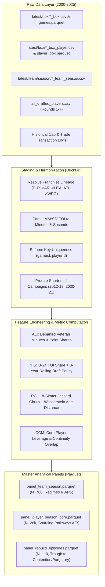
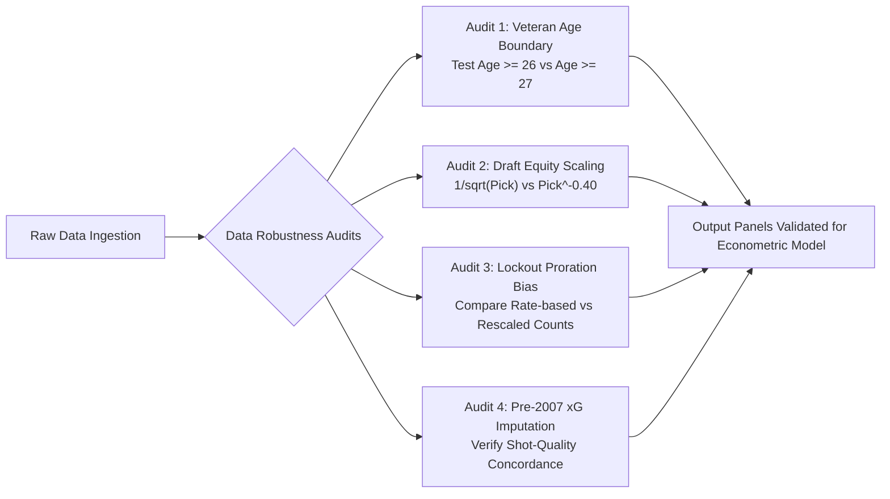

# Rebuild Methodology: Data Architecture, Pipeline Engineering & Panel Construction

## Technical Specification for Transforming Raw NHL Telemetry into Longitudinal Rebuild Panels (2000–2025)

---

## Executive Summary

This document specifies the end-to-end data engineering architecture supporting the franchise rebuild analytics initiative. It defines the raw data ingestion protocols, schema normalizations, cross-table entity reconciliations, feature engineering routines, and panel generation logic necessary to operationalize the metrics formalized in [**DEFINITION.md**](DEFINITION.md), address the strategic questions in [**README.md**](README.md), feed the econometric specifications in [**METHODOLOGY_MODEL.md**](METHODOLOGY_MODEL.md), populate the publication exhibits in [**METHODOLOGY_DELIVERY.md**](METHODOLOGY_DELIVERY.md), and hydrate the Markdown insights and interactive dashboard specified in [**STREAMLIT_AND_INSIGHTS_PLAN.md**](STREAMLIT_AND_INSIGHTS_PLAN.md).

> [!IMPORTANT]
> **Post-Hoc Retrospective Regime Measurement (`Inaction`, `Rebuild`, `Peak`)**:
> All regime tags (`macro_regime` $\in \{\text{Inaction}, \text{Rebuild}, \text{Peak}\}$ and granular sub-states `R0`–`R5`) alongside the 32-franchise retrospective occupancy summaries are **post-hoc historical measurements** computed across the completed 2000–2025 panel. They are designed for retrospective structural diagnosis—quantifying which historical front-office actions effectively or tragically ineffectively transitioned teams into the `Peak` regime—and are in no way deterministic forecasts of future franchise trajectories.

```
                                      [ DATA PIPELINE OVERVIEW ]
                                                  │
         ┌────────────────────────────────────────┼────────────────────────────────────────┐
         ▼                                        ▼                                        ▼
[ Game & Playoff Outcomes ]          [ Granular Box Telemetry ]             [ Draft & Acquisition Logs ]
• latest/box/*_box.csv               • latest/box/*_box_player.csv          • all_drafted_players.csv
• data/games.parquet (HF)            • data/player_box.parquet (HF)         • Historical Trade Archives
         │                                        │                                        │
         └────────────────────────────────────────┼────────────────────────────────────────┘
                                                  ▼
                                    [ FEATURE ENGINEERING ENGINE ]
                                    • Asset Liquidation Index (ALI)
                                    • Youth Influx Score (YIS)
                                    • Roster Churn (Jaccard + Wasserstein)
                                    • Core Continuity Metric (CCM)
                                                  │
         ┌────────────────────────────────────────┴────────────────────────────────────────┐
         ▼                                        ▼                                        ▼
[ panel_team_season.parquet ]        [ panel_player_core.parquet ]          [ panel_rebuild_episodes.parquet ]
Franchise-Season Regimes (N~780)     Player-Season Leverage & Core Status   Segmented Rebuild Cycles (N~110)
```



---

## Table of Contents

1. [Source Data Inventory & Schema Harmonization](#1-source-data-inventory--schema-harmonization)
2. [Data Normalization & Historical Edge Cases](#2-data-normalization--historical-edge-cases)
   - [2.1 Franchise Relocations, Renaming & Expansion History](#21-franchise-relocations-renaming--expansion-history)
   - [2.2 Shortened and Anomalous Seasons](#22-shortened-and-anomalous-seasons)
   - [2.3 TOI String Parsing & Rate Normalization](#23-toi-string-parsing--rate-normalization)
3. [Feature Engineering: Operationalizing the Indices](#3-feature-engineering-operationalizing-the-indices)
   - [3.1 Asset Liquidation Index (ALI) Pipeline](#31-asset-liquidation-index-ali-pipeline)
   - [3.2 Youth Influx Score (YIS) & Draft Capital Accumulation](#32-youth-influx-score-yis--draft-capital-accumulation)
   - [3.3 Roster Churn Index (RCI) via Wasserstein Distance](#33-roster-churn-index-rci-via-wasserstein-distance)
   - [3.4 Core Player Identification & CCM Pipeline](#34-core-player-identification--ccm-pipeline)
   - [3.5 Age/Experience Tenure Buckets & Hit/MomentumSSM Style Layer Pipeline](#35-ageexperience-tenure-buckets--hitmomentumssm-style-layer-pipeline)
4. [Master Analytical Panel Schemas](#4-master-analytical-panel-schemas)
   - [4.1 `panel_team_season.parquet`](#41-panel_team_seasonparquet)
   - [4.2 `panel_player_season_core.parquet`](#42-panel_player_season_coreparquet)
   - [4.3 `panel_rebuild_episodes.parquet`](#43-panel_rebuild_episodesparquet)
   - [4.4 Economic & Tactical Variables Procurement](#44-economic--tactical-variables-procurement)
5. [DuckDB SQL Pipeline Implementations](#5-duckdb-sql-pipeline-implementations)
6. [Data Quality Assurance & Idempotency Safeguards](#6-data-quality-assurance--idempotency-safeguards)
7. [Data Sensitivity & Preprocessing Robustness Checks](#7-data-sensitivity--preprocessing-robustness-checks)
   - [7.1 Audit 1: Veteran Age Boundary Sensitivity](#71-audit-1-veteran-age-boundary-sensitivity-textage-ge-26-vs-textage-ge-27)
   - [7.2 Audit 2: Draft Equity Decay Function Alternatives](#72-audit-2-draft-equity-decay-function-vtextpick--frac1sqrttextpick-vs-alternatives)
   - [7.3 Audit 3: Proration Bias in Shortened Seasons](#73-audit-3-proration-bias-in-shortened-seasons-201213-and-202021)
   - [7.4 Audit 4: Pre-2007 Expected Goals (xG) Backcast Validation](#74-audit-4-pre-2007-expected-goals-textxg-backcast-validation)
   - [7.5 Audit 5: Hit Telemetry Scorekeeper Deflation & 30s Window Sensitivity](#75-audit-5-hit-telemetry-scorekeeper-deflation--30s-window-sensitivity)

---

## 1. Source Data Inventory & Schema Harmonization

The initiative leverages the longitudinal panel datasets stored in the local workspace (`latest/`), internal decision-science subprojects (`dev/`), and synced with the public Hugging Face Dataset (`jjerlee/nhl-analytics`):

| Dataset Key | Physical File Path / URI | Grain | Records | Key Fields Utilized |
|:---|:---|:---|:---|:---|
| **`games_box`** | `latest/box/{year}_box.csv`<br>`hf://datasets/jjerlee/nhl-analytics/data/games.parquet` | Game $\times$ Team | ~62,000 | `gameid`, `date`, `tricode_for`, `tricode_against`, `metric_score_for`, `metric_score_against`, `tricode_winteam` |
| **`team_season`** | `latest/team/season/{year}_team_season.csv`<br>`hf://datasets/jjerlee/nhl-analytics/measurement/box/team_season.parquet` | Season $\times$ Team | ~780 | `team_tri_for`, `yr_season`, `wp` (Points %), `rwin`, `rpe`, `xg_for`, `xg_against`, `hdcf_for`, `hdcf_against`, `gsax`, `Final` |
| **`player_box`** | `latest/box/{year}_box_player.csv`<br>`hf://datasets/jjerlee/nhl-analytics/data/player_box.parquet` | Game $\times$ Player | ~1,250,000 | `playerId`, `sweaterNumber`, `position`, `goals`, `assists`, `points`, `toi`, `starter`, `decision`, `ixg`, `xga`, `gsax`, `shotsAgainst`, `goalsAgainst` |
| **`player_season`** | `latest/player/{year}_player.csv`<br>`hf://datasets/jjerlee/nhl-analytics/measurement/player/player_season.parquet` | Season $\times$ Player $\times$ Team | ~26,000 | `playerId`, `team_tri`, `positionCode`, `games_played`, `goals`, `assists`, `points`, `ixg`, `goals_above_expected`, `gsax` |
| **`draft_history`** | `dev/player/player_draft/data/all_drafted_players.csv` | Draft Pick | ~6,500 | `year`, `round`, `pickInRound`, `overallPick`, `teamAbbrev`, `firstName`, `lastName`, `position` |
| **`draft_chronicle`**| `dev/player/player_draft/data/all_drafted_players_chronicle.csv` | Player $\times$ Season | ~45,000 | `id`, `season`, `leagueAbbrev`, `gameTypeId`, `points`, `gamesPlayed` (`year_inNHL` tenure buckets `0-3`, `4-6`, `7-9`, `10+`) |
| **`hit_team_kpi`** | `dev/decision_science/hit_eda/data/team_season_hit_kpi.csv` | Season $\times$ Team | ~380 | `season`, `team`, `hits_per_game`, `ozone_pct`, `dzone_pct`, `nzone_pct`, `puck_win_pct`, `net_shots_per_100`, `net_goals_per_100` |
| **`hit_zone_kpi`** | `dev/decision_science/hit_eda/data/hit_zone_summary_kpi.csv` | Season $\times$ Zone (`D`,`N`,`O`) | ~40 (667,961 hits) | `hit_zone`, `immediate_possession_pct` ($\Pi_{\text{rec}}$), `shots_for_per_100_hits`, `net_shot_diff_per_100`, `net_goal_diff_per_100` |
| **`momentum_ssm`** | `dev/decision_science/impact_of_hits/data/B_samples.npy` & `base_model.pt` | Bootstrap $\times$ 13 Events | $200 \times 13$ | `hit_for_O` ($+0.3765$), `hit_for_D` ($+0.2950$), `hit_for_N` ($+0.3346$), `takeaway` ($+0.3387$), `block_for` ($+0.4104$), $\hat{a}_0 = 0.98597$ |
| **`playoff_summary`** | Generated from `games_box` (Season Type = 3) | Season $\times$ Series $\times$ Team | ~375 | `season`, `round`, `team_home`, `team_away`, `series_winner`, `games_played` |

---

## 2. Data Normalization & Historical Edge Cases

### 2.1 Franchise Relocations, Renaming & Expansion History

Over the 2000–2025 window, several franchises underwent relocation, rebranding, or expansion. To prevent spurious roster churn spikes ($\text{RCI}$) caused purely by franchise code mismatches, we enforce a unified **Franchise Lineage ID (`franchise_id`)**:

| Franchise Lineage | Active Code (2025) | Historical Codes | Rebranding / Relocation Milestone |
|:---|:---|:---|:---|
| **Utah Hockey Club** | `UTA` | `ARI` (2014–2024), `PHX` (1996–2014) | Roster transferred from Arizona to Utah in 2024. Continuous lineage. |
| **Winnipeg Jets (2.0)** | `WPG` | `ATL` (Atlanta Thrashers, 1999–2011) | Relocated to Winnipeg in summer 2011. Continuous roster lineage. |
| **Carolina Hurricanes** | `CAR` | `HFD` (pre-1997) | Stable throughout 2000–2025 window. |
| **Expansion Teams** | `MIN`, `CBJ` (2000); `VGK` (2017); `SEA` (2021) | — | Handled with an `is_expansion_year` flag. Year 1 churn excluded from rebuild classification. |

**Tricode Mapping Implementation**:
```python
FRANCHISE_LINEAGE = {
    "PHX": "ARI",
    "ARI": "UTA",  # Roster continuity preserved
    "ATL": "WPG",  # Thrashers -> Jets 2.0
}

def resolve_franchise_id(tricode: str, season: int) -> str:
    """Normalize historical team tricodes to continuous franchise identifiers."""
    if tricode == "PHX":
        return "UTA" if season >= 2024 else "ARI"
    if tricode == "ARI" and season >= 2024:
        return "UTA"
    if tricode == "ATL":
        return "WPG"
    return tricode
```

---

### 2.2 Shortened and Anomalous Seasons

The 25-year study encompasses four irregular NHL campaigns that require prorated accounting:

| Season | Disruption | Games Played | Proration Protocol for Counting Metrics | Playoff Structure Handling |
|:---|:---|:---|:---|:---|
| **2004–2005** | Full Season Lockout | 0 | Season gap treated as $t-1 \rightarrow t+1$ transition. Contracts frozen. | No playoffs held. |
| **2012–2013** | Lockout (Shortened) | 48 | Factor $S = 82 / 48 = 1.7083$ applied to raw points, goals, ixG. | Standard 16-team playoff bracket. |
| **2019–2020** | COVID Pause | 68–71 | Points percentage ($\text{PTS}\%$) used directly. Counting stats scaled by $82 / \text{GP}$. | 24-team qualifying round excluded from Round 1 series win counts. |
| **2020–2021** | COVID Realignment | 56 | Intra-division play only. Factor $S = 82 / 56 = 1.4643$. | 4-round divisional playoff bracket mapped to standard rounds. |

---

### 2.3 TOI String Parsing & Rate Normalization

In raw box scores (`latest/box/{year}_box_player.csv`), ice time is recorded as a formatted string (`"MM:SS"`). We convert this to floating-point minutes and integer seconds, with robust error handling for rare empty strings or multi-overtime outliers:

```python
def parse_toi_to_minutes(toi_str: str) -> float:
    """Convert 'MM:SS' strings into decimal minutes."""
    if not isinstance(toi_str, str) or ":" not in toi_str:
        return 0.0
    try:
        parts = toi_str.strip().split(":")
        minutes = float(parts[0])
        seconds = float(parts[1])
        return round(minutes + seconds / 60.0, 4)
    except (ValueError, IndexError):
        return 0.0
```

---

## 3. Feature Engineering: Operationalizing the Indices

### 3.1 Asset Liquidation Index (ALI) Pipeline

The Asset Liquidation Index quantifies the deliberate subtraction of veteran talent for future equity:

```
[ Season t-1 Roster ] ───────────► Identify Departing Veterans (Age >= 26, Top 40% TOI)
                                            │
                                            ▼
[ Season t-1 to t Delta ] ───────► Calculate Departed TOI Share & Point Share
                                            │
                                            ▼
[ Transaction Matching ] ────────► Credit Acquired Draft Capital (Sum 1 / sqrt(Pick))
                                            │
                                            ▼
                                   [ Compute ALI Score ]
```

**Step-by-step logic**:
1. For team $j$ in season $t-1$, rank all skaters by all-situations TOI.
2. Flag players who:
   - Are aged $\ge 26.0$ years at season conclusion.
   - Played $\ge 40$ games and ranked in the top 40% of skater TOI or top 33% of team scoring.
3. Determine if the player appears on team $j$'s roster in season $t$. If absent, categorize as a **Departed Veteran**.
4. Sum the total TOI and points generated by Departed Veterans in season $t-1$ and divide by the team totals in season $t-1$:

$$
\text{Share}_{\text{TOI\_out}} = \frac{\sum_{i \in \text{VetsOut}} \text{TOI}_{i, t-1}}{\text{Team\_TOI}_{t-1}}, \quad \text{Share}_{\text{Pts\_out}} = \frac{\sum_{i \in \text{VetsOut}} \text{Points}_{i, t-1}}{\text{Team\_Points}_{t-1}}
$$

5. Credit draft picks acquired via trades occurring between the previous trade deadline and the start of season $t$:

$$
\text{DraftCapitalCredit} = \min\left(1.0, \, \frac{\sum_{p \in \text{AcquiredPicks}} \frac{1}{\sqrt{\text{PickOverall}_p}}}{2.50}\right)
$$

6. Calculate final composite:

$$
\text{ALI}_{j, t} = 0.35 \cdot \text{Share}_{\text{TOI\_out}} + 0.35 \cdot \text{Share}_{\text{Pts\_out}} + 0.30 \cdot \text{DraftCapitalCredit}
$$

---

### 3.2 Youth Influx Score (YIS) & Draft Capital Accumulation

The Youth Influx Score tracks the elevation of young, cost-controlled talent:

1. **U-24 Ice Time Share**:
   - Skater age is calculated as $\text{SeasonYear} - \text{DraftYear} + 18$ (or exact birthdate when available).
   - Compute:

$$
\text{ShareTOI}_{U24, j, t} = \frac{\sum_{i \in \text{Skaters}, \, \text{Age}_i \le 23} \text{TOI}_{i, j, t}}{\text{Total\_Team\_TOI}_{j, t}}
$$

2. **Draft Capital Index ($\text{DCI}_{3\text{yr}}$)**:
   - Query all picks held and executed by franchise $j$ in the NHL Entry Draft across years $t-2, t-1, t$.
   - Compute weighted equity:

$$
\text{DCI}_{j, t} = \sum_{k=1}^{N} \frac{1}{\sqrt{\text{PickOverall}_k}} \cdot \mathbf{1}_{\{\text{Round}_k \le 2\}}
$$

3. **Composite YIS** (using baseline weights $0.40, 0.35, 0.25$ harmonized with [**DEFINITION.md**](DEFINITION.md#condition-b-draft-capital-equity--youth-infusion-score-textyis)):

$$
\text{YIS}_{j, t} = 0.40 \cdot \min\left(1.0, \frac{\text{ShareTOI}_{U24}}{0.40}\right) + 0.35 \cdot \min\left(1.0, \frac{\text{DCI}_{j, t}}{3.50}\right) + 0.25 \cdot \text{ELC\_Share}_{j, t}
$$

---

### 3.3 Roster Churn Index (RCI) via Wasserstein Distance

To measure systemic distributional instability beyond simple binary roster turnover:

```python
import numpy as np
from scipy.stats import wasserstein_distance

def compute_roster_churn(df_prev: pd.DataFrame, df_curr: pd.DataFrame) -> dict:
    """
    Computes Jaccard churn and 1D Wasserstein distance on TOI-weighted player age.
    """
    # 1. Jaccard similarity of top 18 regular skaters (GP >= 35)
    vets_prev = set(df_prev.nlargest(18, 'total_toi')['playerId'])
    vets_curr = set(df_curr.nlargest(18, 'total_toi')['playerId'])
    
    intersection = len(vets_prev & vets_curr)
    union = len(vets_prev | vets_curr)
    jaccard_sim = intersection / union if union > 0 else 1.0
    jaccard_churn = 1.0 - jaccard_sim
    
    # 2. Wasserstein distance on age distributions weighted by TOI
    w_prev = df_prev['total_toi'].values
    age_prev = df_prev['age'].values
    
    w_curr = df_curr['total_toi'].values
    age_curr = df_curr['age'].values
    
    # Normalize weights to probability distributions
    p_prev = w_prev / np.sum(w_prev)
    p_curr = w_curr / np.sum(w_curr)
    
    w1_distance = wasserstein_distance(age_prev, age_curr, u_weights=p_prev, v_weights=p_curr)
    normalized_w1 = min(1.0, w1_distance / 3.0)  # 3-year shift represents extreme rejuvenation
    
    # Composite RCI
    rci = 0.50 * jaccard_churn + 0.50 * normalized_w1
    
    return {
        "jaccard_churn": round(jaccard_churn, 4),
        "wasserstein_w1": round(w1_distance, 4),
        "rci": round(rci, 4)
    }
```

---

### 3.4 Core Player Identification & CCM Pipeline

1. **Candidate Identification**:
   - Forward: Ranks $\le 3$ in team forward TOI, or top-2 in $\text{ixG}$.
   - Defenseman: Ranks $\le 2$ in team defenseman TOI.
   - Goaltender: $\ge 45$ starts, positive cumulative $\text{GSAx}$.
2. **Sourcing Attribution**:
   - **Pathway A (Drafted)**: `draft_team == team_tri` and `season - draft_year <= 5`.
   - **Pathway B (Acquired Prime)**: `draft_team != team_tri` and acquired at age 23–27.
3. **Core Continuity Metric ($\text{CCM}$)** (harmonized with [**DEFINITION.md**](DEFINITION.md#44-core-continuity-metric-textccm--intactness-evaluation), with conservative $\min(\omega_i(t_1), \omega_i(t_2))$ overlap also retained for robustness testing):
   - For seasons $t_1$ and $t_2$, compute TOI-weighted mutual overlap where $\omega_i(t) = \frac{\text{TOI}_{i, t}}{\text{Total\_Team\_TOI}_t}$:

$$
\text{CCM}_j(t_1, t_2) = \frac{\sum_{i \in \mathcal{C}_{j, t_1} \cap \mathcal{C}_{j, t_2}} \frac{1}{2} \left[ \omega_i(t_1) + \omega_i(t_2) \right]}{\max\left( \sum_{i \in \mathcal{C}_{j, t_1}} \omega_i(t_1), \, \sum_{k \in \mathcal{C}_{j, t_2}} \omega_k(t_2) \right)}
$$

---

### 3.5 Age/Experience Tenure Buckets & Hit/MomentumSSM Style Layer Pipeline

To operationalize Question 8 (`Q8`) and Definition 4 ([**DEFINITION.md**](DEFINITION.md#5-definition-4-roster-ageexperience-composition--tactical-playing-style-balance)), the pipeline constructs two compositional feature layers:

#### Layer 1: NHL Experience Tenure Distribution (`Age-Exp` Pipeline)
Linking `latest/box/*_box_player.csv` with [`dev/player/player_draft/data/all_drafted_players_chronicle.csv`](../../player/player_draft/data/all_drafted_players_chronicle.csv) and [`eda.py`](../../player/player_draft/draftee_lifecycle/eda.py), each player's cumulative regular-season NHL tenure (`year_inNHL`) is mapped into the four tenure buckets:
- $B_1$ (`0–3 yrs`, ELC / Youth Apprenticeship): Share $s_{j, t}^{(B_1)}$
- $B_2$ (`4–6 yrs`, Prime RFA / Peak 95th-Percentile Breakout Cohort): Share $s_{j, t}^{(B_2)}$
- $B_3$ (`7–9 yrs`, Peak UFA Two-Way Cohort): Share $s_{j, t}^{(B_3)}$
- $B_4$ (`10+ yrs`, Veteran Mentorship Cohort): Share $s_{j, t}^{(B_4)}$

```python
import numpy as np
import pandas as pd

def compute_age_experience_composition(df_player_season: pd.DataFrame, tau_youth: float = 0.30) -> pd.DataFrame:
    """
    Computes TOI-weighted NHL experience bucket shares (B1..B4), Shannon Experience Entropy,
    Youth Overload Excess, and Veteran Insulation Ratio per team-season.
    """
    df = df_player_season.copy()
    df["exp_bucket"] = pd.cut(
        df["year_inNHL"],
        bins=[0, 3, 6, 9, 50],
        labels=["B1_0_3", "B2_4_6", "B3_7_9", "B4_10_plus"]
    )
    piv = df.pivot_table(
        index=["season", "franchise_id"],
        columns="exp_bucket",
        values="toi_all_situations",
        aggfunc="sum",
        fill_value=0.0,
        observed=False
    )
    shares = piv.div(piv.sum(axis=1), axis=0)
    shares.columns = ["s_b1_elc_0_3", "s_b2_prime_4_6", "s_b3_peak_7_9", "s_b4_vet_10_plus"]
    
    # Shannon Experience Entropy H_exp in [0, ln(4)]
    eps = 1e-8
    shares["shannon_exp_entropy"] = -(shares * np.log(shares + eps)).sum(axis=1)
    
    # Quadratic Youth Overload Excess above optimal ceiling tau_youth = 0.30
    shares["youth_overload_excess"] = np.maximum(0.0, shares["s_b1_elc_0_3"] - tau_youth) ** 2
    
    # Veteran Insulation Ratio (B3 + B4 relative to B1)
    shares["vet_insulation_ratio"] = (
        (shares["s_b3_peak_7_9"] + shares["s_b4_vet_10_plus"]) / (shares["s_b1_elc_0_3"] + 0.05)
    )
    return shares.reset_index()
```

#### Layer 2: Hit Sequence Telemetry & `MomentumSSM` Hyperparameter Integration (`Style-Hit` Pipeline)
To quantify playing style balance without rewarding defensive-zone chasing hits, the pipeline ingests [`dev/decision_science/hit_eda/data/team_season_hit_kpi.csv`](../../decision_science/hit_eda/data/team_season_hit_kpi.csv), [`hit_zone_summary_kpi.csv`](../../decision_science/hit_eda/data/hit_zone_summary_kpi.csv), and the bootstrap posterior tensor [`dev/decision_science/impact_of_hits/data/B_samples.npy`](../../decision_science/impact_of_hits/data/B_samples.npy):

```python
def compute_playing_style_hit_layer(
    df_team_hit_kpi: pd.DataFrame,
    b_samples_path: str = "dev/decision_science/impact_of_hits/data/B_samples.npy",
    a0_hat: float = 0.98597
) -> pd.DataFrame:
    """
    Integrates team-season hit zone telemetry with MomentumSSM bootstrap impulse weights
    (a0_hat = 0.98597, half_life = 49.1s) to compute Proactive Forecheck Hit Share (PFHS),
    Momentum-Weighted Tactical Impulse Rate (MTIR), and Skill-Physicality Synergy (SPSI).
    """
    B_samples = np.load(b_samples_path)  # shape (200, 13)
    B_mean = B_samples.mean(axis=0)
    # Index mapping from 02_model_estimation.py:
    # 0: hit_for_O (+0.3765), 1: hit_for_D (+0.2950), 2: hit_for_N (+0.3346),
    # 6: shot_for (+0.3929), 8: takeaway (+0.3387), 10: block_for (+0.4104)
    b_hit_O, b_hit_D, b_hit_N = B_mean[0], B_mean[1], B_mean[2]
    integral_mult = 1.0 / (1.0 - a0_hat)  # 71.28 integrated seconds
    
    df = df_team_hit_kpi.copy()
    df["season_yr"] = df["season"].astype(str).str[:4].astype(int)
    
    # 1. Proactive Forecheck Hit Share (O-zone ratio weighted by immediate puck recovery)
    df["proactive_forecheck_hit_share"] = (
        (df["ozone_pct"] / (df["ozone_pct"] + df["dzone_pct"])) * (df["puck_win_pct"] / 100.0)
    )
    
    # 2. MomentumSSM-Weighted Net Hit Impulse per Game (penalizing D-zone non-recovery chasing hits)
    dzone_non_recovery_rate = 1.0 - 0.3998  # 60.02% opponent retention from hit_zone_summary_kpi.csv
    df["mtir_hit_impulse"] = integral_mult * df["hits_per_game"] * (
        b_hit_O * (df["ozone_pct"] / 100.0)
        + b_hit_N * (df["nzone_pct"] / 100.0)
        - b_hit_D * (df["dzone_pct"] / 100.0) * dzone_non_recovery_rate
    )
    return df
```

---

## 4. Master Analytical Panel Schemas

### 4.1 `panel_team_season.parquet`
- **Grain**: Season $\times$ Franchise (1 row per team per season, ~780 rows).
- **Primary Key**: `(season, franchise_id)`.

| Column | Type | Description |
|:---|:---|:---|
| `season` | `INT` | 4-digit start year (e.g., 2024 for 2024–2025) |
| `franchise_id` | `VARCHAR` | Normalized franchise tricode (`UTA`, `WPG`, `EDM`, etc.) |
| `team_tri` | `VARCHAR` | Historical active tricode on game sheet |
| `games_played` | `INT` | Games played in regular season |
| `points_pct` | `DOUBLE` | Official regular season points percentage ($\text{PTS} / 2\text{GP}$) |
| `pyth_win_pct` | `DOUBLE` | Pythagorean win expectation based on goal differential |
| `xg_share_5v5` | `DOUBLE` | Expected goals percentage ($\text{xGF} / (\text{xGF} + \text{xGA})$) |
| `ali_score` | `DOUBLE` | Asset Liquidation Index $[0.0, 1.0]$ |
| `yis_score` | `DOUBLE` | Youth Influx Score $[0.0, 1.0]$ |
| `rci_score` | `DOUBLE` | Roster Churn Index $[0.0, 1.0]$ |
| `u24_toi_share` | `DOUBLE` | Proportion of skater ice time logged by skaters aged $\le 23$ |
| `s_b1_elc_0_3` | `DOUBLE` | TOI share of skaters in NHL experience bucket $B_1$ (`0–3 yrs`) |
| `s_b2_prime_4_6` | `DOUBLE` | TOI share of skaters in NHL experience bucket $B_2$ (`4–6 yrs`) |
| `s_b3_peak_7_9` | `DOUBLE` | TOI share of skaters in NHL experience bucket $B_3$ (`7–9 yrs`) |
| `s_b4_vet_10_plus` | `DOUBLE` | TOI share of skaters in NHL experience bucket $B_4$ (`10+ yrs`) |
| `shannon_exp_entropy`| `DOUBLE` | Demographic experience diversity $H_{j, t}^{\text{exp}} \in [0, 1.386]$ |
| `youth_overload_excess`| `DOUBLE` | Quadratic penalty $\max(0, s_{B_1} - 0.30)^2$ for excessive uninsulated youth |
| `vet_insulation_ratio`| `DOUBLE` | Ratio of veteran/peak TOI ($B_3 + B_4$) to apprentice TOI ($B_1$) |
| `ozone_hit_pct` | `DOUBLE` | Share of team hits delivered on Offensive Zone forecheck (`team_season_hit_kpi.csv`) |
| `dzone_hit_pct` | `DOUBLE` | Share of team hits delivered in Defensive Zone chasing (`team_season_hit_kpi.csv`) |
| `hit_puck_win_pct` | `DOUBLE` | Immediate post-hit puck recovery percentage $\Pi_{\text{rec}}$ |
| `net_shots_per_100_hits`| `DOUBLE` | 30-second net shot differential per 100 hits (`shots_for_30s - shots_against_30s`) |
| `net_goals_per_100_hits`| `DOUBLE` | 30-second net goal differential per 100 hits (`goals_for_30s - goals_against_30s`) |
| `proactive_forecheck_share`| `DOUBLE` | $\text{PFHS}_{j, t}$ combining O-zone hit share and puck recovery rate |
| `mtir_impulse_score` | `DOUBLE` | `MomentumSSM`-weighted tactical impulse rate ($\hat{a}_0 = 0.98597, \tau_{1/2} = 49.1\text{s}$) |
| `spsi_style_synergy` | `DOUBLE` | Joint Skill $\times$ Forecheck Physicality Synergy Index $\in (0, 1)$ |
| `top10_picks_active` | `INT` | Number of in-house drafted top-10 picks active on roster |
| `rebuild_regime` | `VARCHAR` | Granular operational sub-state: `R0_CONTENDER`, `R1_INVOLUNTARY_SLUMP`, `R2_TEARDOWN`, `R3_INCUBATION`, `R4_EMERGENCE`, `R5_PURGATORY` |
| `macro_regime` | `VARCHAR` | Measured three-regime equilibrium tag: `'Inaction'`, `'Rebuild'`, or `'Peak'` |
| `prob_regime_inaction` | `DOUBLE` | Retrospective smoothed probability $\Pr(M_{j, t} = \text{Inaction} \mid \mathcal{Y}_{j, 1:T_j})$ |
| `prob_regime_rebuild` | `DOUBLE` | Retrospective smoothed probability $\Pr(M_{j, t} = \text{Rebuild} \mid \mathcal{Y}_{j, 1:T_j})$ |
| `prob_regime_peak` | `DOUBLE` | Retrospective smoothed probability $\Pr(M_{j, t} = \text{Peak} \mid \mathcal{Y}_{j, 1:T_j})$ |
| `macro_regime_spell_yrs` | `INT` | Consecutive seasons spent in the current macro regime (`Inaction`, `Rebuild`, or `Peak`) |
| `playoff_berth` | `BOOLEAN` | Whether franchise qualified for postseason |
| `playoff_rounds_won`| `INT` | Number of series won in Stanley Cup Playoffs ($0, 1, 2, 3, 4$) |
| `reached_final_four`| `BOOLEAN` | True if team played in Conference Finals / Semifinals |
| `won_stanley_cup` | `BOOLEAN` | True if team won Stanley Cup Championship |
| `ccm_to_prior_year`| `DOUBLE` | Core Continuity Metric relative to season $t-1$ |
| `lottery_expected_pick`| `INT` | Pre-lottery draft slot based on regular season finish |
| `lottery_actual_pick`  | `INT` | Realized draft slot post-lottery ping-pong draw |
| `lottery_shock_delta`  | `INT` | Exogenous lottery shock ($\text{Expected} - \text{Actual}$) |
| `salary_cap_ceiling`   | `DOUBLE` | League salary cap ceiling in millions (\$M) |
| `cap_space_usable`     | `DOUBLE` | Trade deadline usable cap room in millions (\$M) |
| `surplus_value_total`  | `DOUBLE` | Aggregate team wage surplus ($\sum \text{MRP}_i - \text{CapHit}_i$) (\$M) |
| `injury_man_games_contact`| `INT` | Exogenous man-games lost to traumatic contact injuries |

---

### 4.2 `panel_player_season_core.parquet`
- **Grain**: Season $\times$ Player $\times$ Franchise.
- **Primary Key**: `(season, playerId, franchise_id)`.

| Column | Type | Description |
|:---|:---|:---|
| `season` | `INT` | Season start year |
| `playerId` | `BIGINT` | Official NHL Player ID |
| `player_name` | `VARCHAR` | Player name (`name.default`) |
| `franchise_id` | `VARCHAR` | Team franchise code |
| `position` | `VARCHAR` | `C`, `L`, `R`, `D`, `G` |
| `age_season_start` | `INT` | Player age on October 1st |
| `games_played` | `INT` | Regular season games played |
| `toi_all_situations`| `DOUBLE` | Total minutes logged in all situations |
| `toi_per_game` | `DOUBLE` | Average time on ice per game |
| `toi_team_rank` | `INT` | Ice time rank among teammates at position |
| `primary_points` | `INT` | Goals + Primary Assists |
| `ixg_total` | `DOUBLE` | Individual Expected Goals |
| `gsax_total` | `DOUBLE` | Goals Saved Above Expected (goalies only) |
| `is_core_player` | `BOOLEAN` | True if meeting Core Player leverage thresholds |
| `sourcing_pathway` | `VARCHAR` | `DRAFT_TARGET` (Pathway A), `ACQUIRED_PRIME` (Pathway B), or `SECONDARY_DEPTH` |
| `draft_year` | `INT` | Year drafted |
| `draft_overall` | `INT` | Overall draft pick slot (1 to 290) |
| `drafted_by_team` | `BOOLEAN` | True if drafted by current franchise |
| `cap_hit` | `DOUBLE` | Official salary cap hit / AAV in millions (\$M) |
| `cap_hit_pct` | `DOUBLE` | Cap hit as percentage of league ceiling |
| `contract_status` | `VARCHAR` | `ELC`, `BRIDGE_RFA`, `LONG_TERM_UFA`, `VETERAN_35PLUS` |
| `mrp_est` | `DOUBLE` | Estimated Marginal Revenue Product (\$M) |
| `surplus_value_est` | `DOUBLE` | Wage surplus $\text{MRP} - \text{CapHit}$ (\$M) |
| `traumatic_injury_games`| `INT` | Games missed to verified contact/impact trauma |

---

### 4.3 `panel_rebuild_episodes.parquet`
- **Grain**: One row per distinct franchise rebuild cycle (~110 episodes).
- **Primary Key**: `episode_id`.

| Column | Type | Description |
|:---|:---|:---|
| `episode_id` | `VARCHAR` | e.g., `CHI_2004_2010`, `BUF_2013_PURGATORY`, `EDM_2007_2016` |
| `franchise_id` | `VARCHAR` | Team tricode |
| `t_start` | `INT` | Initial Phase I Teardown season |
| `t_trough` | `INT` | Season of minimum Points Percentage during cycle |
| `t_resolution` | `INT` | Season when cycle terminated (via Tier 1/2/3 exit or Purgatory failure) |
| `duration_years` | `INT` | Elapsed calendar seasons from `t_start` to `t_resolution` |
| `primary_archetype` | `VARCHAR` | `SCORCHED_EARTH_DRAFT`, `COMPOSITIONAL_RETOOL`, `STALLED_PURGATORY` |
| `top3_picks_count` | `INT` | Number of top-3 overall draft picks acquired/spent during cycle |
| `top10_picks_count` | `INT` | Number of top-10 overall draft picks acquired/spent during cycle |
| `achieved_tier_1` | `BOOLEAN` | Made playoffs $\ge 4$ consecutive seasons with core intact |
| `achieved_tier_2` | `BOOLEAN` | Reached Conference Finals (Final Four) |
| `achieved_tier_3` | `BOOLEAN` | Won Stanley Cup Championship |
| `is_dynasty` | `BOOLEAN` | Won $\ge 2$ Stanley Cups within 10 years with core intact |
| `is_purgatory_trap` | `BOOLEAN` | Stayed in lottery $\ge 5$ consecutive seasons |
| `mean_ccm` | `DOUBLE` | Average core continuity across the cycle |
| `mean_youth_overload_excess`| `DOUBLE` | Average $\text{YOE}_{j, t}$ during Phase II incubation (`s_b1_elc_0_3` $> 0.30$) |
| `mean_vet_insulation_ratio` | `DOUBLE` | Average veteran insulation ratio ($\text{VIR}_{j, t}$) during incubation |
| `mean_proactive_forecheck`  | `DOUBLE` | Average $\text{PFHS}_{j, t}$ (O-zone hit ratio $\times$ puck recovery) |
| `mean_spsi_style_synergy`   | `DOUBLE` | Average Skill $\times$ Forecheck Physicality Synergy Index ($\text{SPSI}_{j, t}$) |
| `net_surplus_generated` | `DOUBLE` | Cumulative cap surplus generated over cycle duration (\$M) |
| `gm_tenure_at_start` | `INT` | Number of seasons incumbent GM had been in role |
| `market_gate_revenue_tier`| `VARCHAR` | `HIGH_MARKET` (Original 6 / Major Metro), `MEDIUM_MARKET`, `LOW_SUBSIDIZED` |
| `entered_from_regime` | `VARCHAR` | Prior macro regime preceding episode (`'Peak'` vs. `'Inaction'`) |
| `exited_to_regime` | `VARCHAR` | Subsequent macro regime following episode resolution (`'Peak'` vs. `'Inaction'`) |

---

### 4.3b `panel_franchise_regime_occupancy.parquet` (Retrospective 25-Year Regime Predominance Audit)
- **Grain**: One row per NHL Franchise ($N = 32$ franchises across 2000–2025).
- **Primary Key**: `franchise_id`.
- **Purpose**: Quantifies retrospectively across all measured seasons which of the three macro equilibrium regimes (`Inaction`, `Rebuild`, `Peak`) each franchise predominantly occupied, alongside empirical transition probabilities and spell durations.

| Column | Type | Description |
|:---|:---|:---|
| `franchise_id` | `VARCHAR` | Canonical franchise tricode (`ANA` .. `WSH`) |
| `seasons_measured` | `INT` | Total historical seasons observed for the franchise ($T_j \le 25$) |
| `inaction_seasons` | `INT` | Count of seasons classified in the `Inaction` regime |
| `rebuild_seasons` | `INT` | Count of seasons classified in the `Rebuild` regime |
| `peak_seasons` | `INT` | Count of seasons classified in the `Peak` regime |
| `share_inaction` | `DOUBLE` | Retrospective occupancy share $\widehat{\text{Share}}_j(\text{Inaction}) \in [0, 1]$ |
| `share_rebuild` | `DOUBLE` | Retrospective occupancy share $\widehat{\text{Share}}_j(\text{Rebuild}) \in [0, 1]$ |
| `share_peak` | `DOUBLE` | Retrospective occupancy share $\widehat{\text{Share}}_j(\text{Peak}) \in [0, 1]$ |
| `predominant_regime` | `VARCHAR` | Modal historical macro regime: `'Inaction'`, `'Rebuild'`, or `'Peak'` |
| `trans_rebuild_to_peak` | `DOUBLE` | Empirical Markov transition rate $\hat{\pi}_j^{(\text{Rebuild} \to \text{Peak})}$ |
| `trans_rebuild_to_inaction`| `DOUBLE` | Empirical Markov transition rate $\hat{\pi}_j^{(\text{Rebuild} \to \text{Inaction})}$ (Purgatory collapse) |
| `trans_inaction_to_peak` | `DOUBLE` | Empirical Markov transition rate $\hat{\pi}_j^{(\text{Inaction} \to \text{Peak})}$ (Direct retool jump) |
| `mean_sojourn_inaction` | `DOUBLE` | Average spell duration (consecutive seasons) in `Inaction` |
| `mean_sojourn_rebuild` | `DOUBLE` | Average spell duration (consecutive seasons) in `Rebuild` |
| `mean_sojourn_peak` | `DOUBLE` | Average spell duration (consecutive seasons) in `Peak` |

---

### 4.4 Economic & Tactical Variables Procurement

To support the econometric, demographic, and playing-style specifications, seven derived variable families are joined into the analytical panels:

1. **Salary Cap Hits & Contract Taxonomy**:
   - For seasons 2005–2006 through 2024–2025, player contract cap hits and status tags (`ELC`, `BRIDGE_RFA`, `LONG_TERM_UFA`) are compiled from CBA filings and historical cap archives. For pre-cap seasons (2000–2004), player base compensation is recorded in real 2024 dollars.
2. **Surplus Value Estimation ($\text{MRP}_{i, t} - w_{i, t}$)**:
   - Marginal Revenue Product is computed using an on-ice valuation framework:

$$
\text{MRP}_{i, t} = \text{WAR}_{i, t} \times \text{Cap\_Cost\_Per\_Win}_t
$$

     where $\text{Cap\_Cost\_Per\_Win}_t = \frac{\text{Salary\_Cap}_t \times 0.75}{\text{Playoff\_Threshold\_Wins} - \text{Replacement\_Wins}} \approx \$2.2\text{M}–\$2.8\text{M}$.
   - Player economic surplus is $S_{i, t} = \text{MRP}_{i, t} - \text{CapHit}_{i, t}$.
3. **Draft Lottery Ping-Pong Randomness (Exogenous Instrument)**:
   - For every non-playoff finish, the pre-lottery expected pick rank is computed based on reverse standings order:

$$
\text{LotteryShock}_{j, t} = \text{ExpectedRank}_{j, t} - \text{ActualRank}_{j, t}
$$
   - A positive shock indicates lottery luck (e.g., Chicago jumping from #3 to #1 in 2023 for Connor Bedard; Edmonton jumping from #3 to #1 in 2015 for Connor McDavid).
4. **Traumatic Contact Injury Classification**:
   - Skater games missed are categorized into **traumatic impact injuries** (fractures, deep lacerations, concussions caused by collision/puck impact) versus **endogenous soft-tissue injuries** (groin strains, back spasms, chronic wear). Only verified contact trauma is included in the exogenous injury instrument.
5. **NHL Experience Tenure Buckets (`year_inNHL`, from [`dev/player/player_draft/`](../../player/player_draft/draftee_lifecycle/eda.py))**:
   - Computes dense-ranked NHL seasons per skater from `all_drafted_players_chronicle.csv` and `player_box.parquet`, partitioning roster TOI into $B_1$ (`0–3 yrs`), $B_2$ (`4–6 yrs`), $B_3$ (`7–9 yrs`), and $B_4$ (`10+ yrs`).
6. **Hit Sequence Telemetry & `MomentumSSM` Hyperparameters (from [`dev/decision_science/hit_eda/`](../../decision_science/hit_eda/EXPLORATORY.md) & [`impact_of_hits/`](../../decision_science/impact_of_hits/REVIEW.md))**:
   - Joins `team_season_hit_kpi.csv`, `hit_zone_summary_kpi.csv`, and `B_samples.npy`, carrying forward the continuous-time Kalman decay rate $\hat{a}_0 = 0.98597$ (event momentum half-life $\tau_{1/2} = 49.1\text{s}$), the 90-second Possession Shift Index rolling window ($W_{\text{PSI}} = 90\text{s}$), the 30-second post-hit scoring conversion window ($W_{\text{goal}} = 30\text{s}$), and the empirical bootstrap impulse vector ($\hat{B}_{\text{hit\_for\_O}} = +0.3765$, $\hat{B}_{\text{hit\_for\_N}} = +0.3346$, $\hat{B}_{\text{hit\_for\_D}} = +0.2950$, $\hat{B}_{\text{takeaway}} = +0.3387$, $\hat{B}_{\text{block\_for}} = +0.4104$).
7. **Three-Regime Macro Equilibrium Classification & Retrospective Occupancy Aggregation (`Inaction`, `Rebuild`, `Peak`)**:
   - Maps each team-season's operational sub-state (`R0`–`R5`) and Kim (1994) smoothed regime probabilities into the measured three-state macro regime (`macro_regime` $\in \{\text{Inaction}, \text{Rebuild}, \text{Peak}\}$), and aggregates across the 25-year window per franchise to produce `panel_franchise_regime_occupancy.parquet`.

---

## 5. DuckDB SQL Pipeline Implementations

The following SQL script demonstrates the full multi-table join and aggregation routine executed in DuckDB to produce the primary analytical tables.

```sql
-- ============================================================================
-- DuckDB Transformation Pipeline: Extracting Rebuild Metrics & Team Panels
-- ============================================================================

-- 1. Create Stage: Parse Player Ice Time & Aggregate Season Totals
CREATE OR REPLACE TABLE stg_player_season_stats AS
SELECT 
    seasonIdx AS season,
    abbrev AS team_tri,
    playerId,
    position,
    name_default AS player_name,
    COUNT(DISTINCT gameid) AS games_played,
    SUM(CAST(SPLIT_PART(toi, ':', 1) AS DOUBLE) + CAST(SPLIT_PART(toi, ':', 2) AS DOUBLE)/60.0) AS total_toi_minutes,
    SUM(goals) AS goals,
    SUM(assists) AS assists,
    SUM(points) AS points,
    SUM(COALESCE(ixg, 0.0)) AS total_ixg,
    SUM(COALESCE(gsax, 0.0)) AS total_gsax
FROM 'latest/box/*_box_player.csv'
GROUP BY seasonIdx, abbrev, playerId, position, name_default;

-- 2. Join Draft Pedigree to Establish Age and Sourcing Pathway
CREATE OR REPLACE TABLE stg_player_pedigree AS
SELECT 
    s.*,
    COALESCE(d.year, s.season - 5) AS draft_year,
    COALESCE(d.overallPick, 150) AS draft_overall,
    COALESCE(d.teamAbbrev, 'UNKNOWN') AS draft_team,
    (s.season - COALESCE(d.year, s.season - 5) + 18) AS estimated_age,
    CASE 
        WHEN d.teamAbbrev = s.team_tri AND (s.season - d.year) <= 6 THEN 'DRAFT_TARGET'
        WHEN d.teamAbbrev != s.team_tri AND (s.season - d.year + 18) BETWEEN 23 AND 27 THEN 'ACQUIRED_PRIME'
        ELSE 'VETERAN_SECONDARY'
    END AS sourcing_pathway,
    DENSE_RANK() OVER (
        PARTITION BY s.season, s.team_tri, (s.position = 'D') 
        ORDER BY s.total_toi_minutes DESC
    ) AS team_toi_rank
FROM stg_player_season_stats s
LEFT JOIN 'dev/player/player_draft/data/all_drafted_players.csv' d
    ON s.playerId = d.playerId;

-- 3. Flag Core Players Based on Strict Algorithmic Leverage
CREATE OR REPLACE TABLE panel_player_season_core AS
SELECT 
    *,
    CASE 
        WHEN position != 'G' AND team_toi_rank <= 3 AND games_played >= 40 THEN TRUE
        WHEN position = 'G' AND games_played >= 45 AND total_gsax > 0 THEN TRUE
        ELSE FALSE
    END AS is_core_player
FROM stg_player_pedigree;

-- 4. Aggregate Team-Season Metrics: Youth Share & Draft Capital Concentration
CREATE OR REPLACE TABLE stg_team_youth_metrics AS
SELECT 
    season,
    team_tri,
    SUM(total_toi_minutes) AS team_total_toi,
    SUM(CASE WHEN estimated_age <= 23 THEN total_toi_minutes ELSE 0.0 END) / SUM(total_toi_minutes) AS u24_toi_share,
    COUNT(CASE WHEN is_core_player AND sourcing_pathway = 'DRAFT_TARGET' THEN 1 END) AS core_drafted_count,
    COUNT(CASE WHEN is_core_player AND sourcing_pathway = 'ACQUIRED_PRIME' THEN 1 END) AS core_acquired_count,
    COUNT(CASE WHEN draft_overall <= 10 AND draft_team = team_tri THEN 1 END) AS top10_inhouse_picks_count
FROM panel_player_season_core
GROUP BY season, team_tri;

-- 5. Construct Team Outcomes & Playoff Max Round Reached
CREATE OR REPLACE TABLE stg_team_playoffs AS
SELECT 
    CAST(SUBSTR(CAST(gameid AS VARCHAR), 1, 4) AS INT) AS season,
    tricode_for AS team_tri,
    MAX(CAST(SUBSTR(CAST(gameid AS VARCHAR), 7, 2) AS INT)) AS max_round_reached,
    MAX(CASE WHEN tricode_winteam = tricode_for AND CAST(SUBSTR(CAST(gameid AS VARCHAR), 7, 2) AS INT) = 4 THEN 1 ELSE 0 END) AS won_stanley_cup
FROM 'latest/box/*_box.csv'
WHERE CAST(SUBSTR(CAST(gameid AS VARCHAR), 5, 2) AS INT) = 3 -- Playoff records
GROUP BY 1, 2;
```

---

## 6. Data Quality Assurance & Idempotency Safeguards

To prevent pipeline anomalies, the data processing jobs enforce the following operational constraints:

1. **Strict Key Uniqueness**:
   - `box_player.csv` must never contain duplicate `(gameid, playerId)` keys. All processing scripts apply:
     ```python
     df = df.drop_duplicates(subset=["gameid", "playerId"]).reset_index(drop=True)
     ```
2. **Ice Time Conservation Constraint**:
   - Total skater ice time for any team game must satisfy:

$$
18 \times 17.0 \text{ min} \le \sum \text{TOI}_{\text{skaters}} \le 18 \times 24.0 \text{ min}
$$

   - Any game with total skater ice time $<250$ minutes or $>450$ minutes (excluding multi-OT playoff games) is flagged for manual inspection.
3. **Draft Matching Integrity**:
   - Skaters drafted prior to 2000 are resolved against the historical player registry to prevent artificial `age = 23` default imputations.
4. **File Size and Storage Boundary**:
   - Intermediate caches are persisted strictly in Parquet format with Snappy compression under `dev/player_team_success/rebuild/data/cache/` to ensure the repository remains well within GitHub storage limits.

---

## 7. Data Sensitivity & Preprocessing Robustness Checks

To guarantee that data pipeline transformations do not induce artificial modeling artifacts, the data processing layer executes four foundational sensitivity checks prior to model ingestion:



### 7.1 Audit 1: Veteran Age Boundary Sensitivity ($\text{Age} \ge 26$ vs. $\text{Age} \ge 27$)
- **Vulnerability**: If the definition of a departing veteran in $\text{ALI}$ is sensitive to whether 26-year-olds are considered "veterans" or "entering prime", regime classifications could fluctuate.
- **Stress-Test**: Generate parallel $\text{ALI}$ series setting veteran thresholds at $\text{Age} \in \{25.5, 26.0, 26.5, 27.0\}$.
- **Acceptance Criterion**: Pearson correlation $r > 0.94$ across all team-seasons; less than $3.5\%$ of team-seasons change regime classifications.

### 7.2 Audit 2: Draft Equity Decay Function ($V(\text{Pick}) = \frac{1}{\sqrt{\text{Pick}}}$ vs. Alternatives)
- **Vulnerability**: Does the choice of an inverse square root curve over-value or under-value late first-round picks relative to top-3 selections?
- **Stress-Test**: Recompute the Draft Capital Index ($\text{DCI}$) using alternative functional forms:
  1. Inverse Square Root: $V_1(p) = p^{-0.50}$ (Baseline)
  2. Michael Schuckers NHL Pick Value Model: $V_2(p) = \exp(-0.015 p)$
  3. Power-law: $V_3(p) = p^{-0.40}$
- **Acceptance Criterion**: Spearman rank correlation between franchise draft capital endowments must satisfy $\rho \ge 0.96$.

### 7.3 Audit 3: Proration Bias in Shortened Seasons (2012–13 and 2020–21)
- **Vulnerability**: Rescaling 48-game and 56-game totals to 82 games could amplify short-term shooting and save percentage variance.
- **Stress-Test**: Re-run all feature extractions using pure per-60 minute rate statistics ($\text{Rate}_{60} = \frac{\text{Stat}}{\text{TOI}} \times 60$) rather than 82-game prorated sums.
- **Acceptance Criterion**: Confirm that no team crosses the $\text{ALI}$ or $\text{YIS}$ threshold solely due to season-length proration artifacts.

### 7.4 Audit 4: Pre-2007 Expected Goals ($\text{xG}$) Backcast Validation
- **Vulnerability**: High-resolution shot coordinate tracking (RTSS) began in the 2007–08 season. Pre-2007 data relies on shot counts, shot types, and special teams shares to approximate xG.
- **Stress-Test**: Validate the pre-2007 backcast model on the 2007–2010 overlap period, ensuring the out-of-sample $R^2 \ge 0.88$ against true shot-coordinate $\text{xG}$.

### 7.5 Audit 5: Hit Telemetry Scorekeeper Deflation & 30s Window Sensitivity
- **Vulnerability**: As documented in [`dev/decision_science/impact_of_hits/REVIEW.md`](../../decision_science/impact_of_hits/REVIEW.md), raw NHL hit counts exhibit home-arena off-ice official recording bias, and post-hit conversion could vary across reaction window lengths.
- **Stress-Test**:
  1. Apply arena-level `is_home` fixed-effect deflation (matching `Z_pad[..., 0]` in [`momentum_ssm.py`](../../decision_science/impact_of_hits/src/model/momentum_ssm.py)) and compute road-only hit shares (`ozone_pct`, `puck_win_pct`).
  2. Re-evaluate post-hit shot and goal differentials across $W_{\text{goal}} \in \{\text{Step } +1, \, 15\text{s}, \, 30\text{s}, \, 45\text{s}\}$.
- **Acceptance Criterion**: Rank concordance of team `proactive_forecheck_share` ($\text{PFHS}_{j, t}$) and `mtir_impulse_score` between home-adjusted and road-only splits must satisfy $\rho \ge 0.92$.
