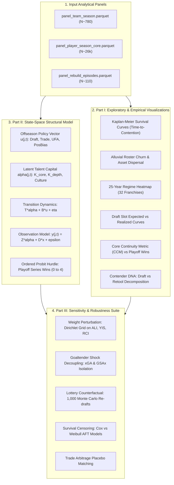
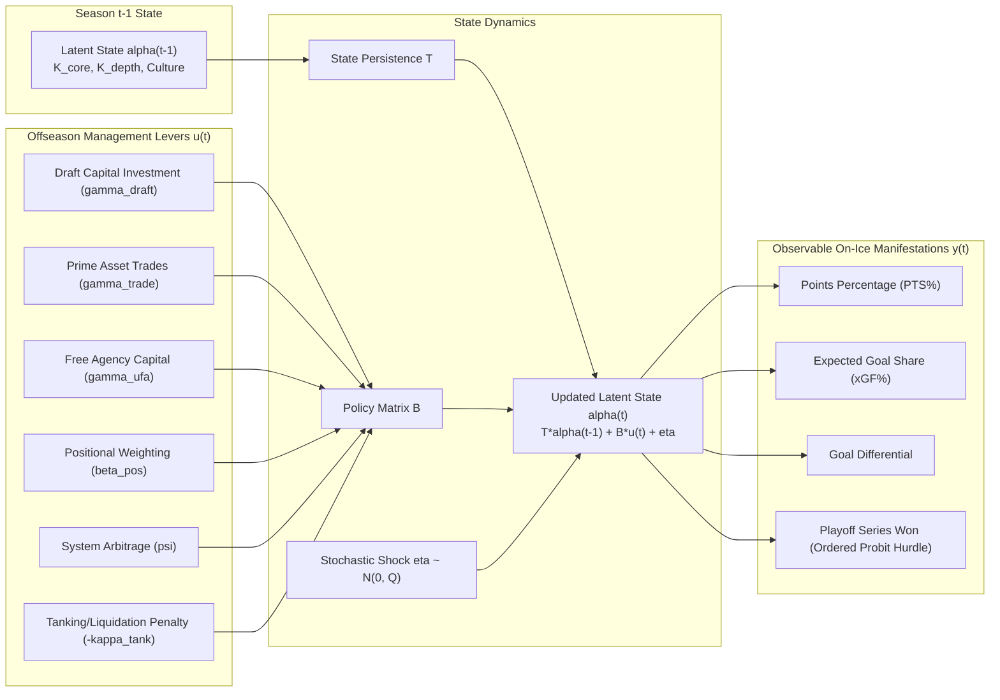
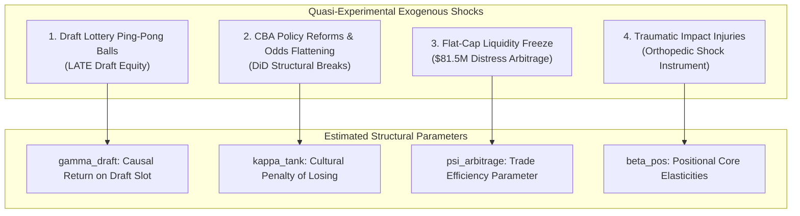
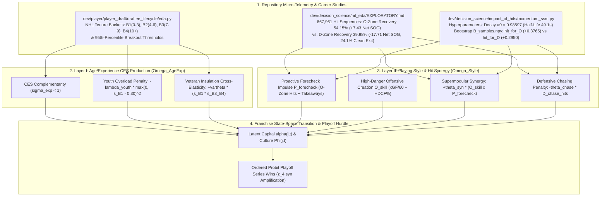
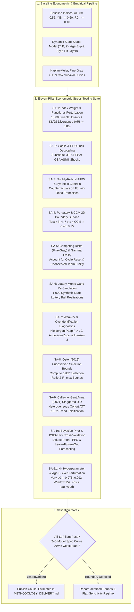

# Rebuild Methodology: Exploratory Analytics, Econometric Foundations & State-Space Structural Modeling

## Statistical Framework, Visualization Strategy & Dynamic Structural Equation Modeling of Franchise Lifecycles (2000–2025)

---

> [!IMPORTANT]
> ### Methodological Architecture & Retrospective Epistemology
> This document formalizes the analytical and econometric engine of the rebuild project across three complementary tiers:
> 1. **Part I: Exploratory Data Analysis (EDA) & Empirical Visualization Strategy**: Non-parametric summaries, survival curves, competing-risks cumulative incidence partitions, transition flow diagrams, and 25-year retrospective franchise regime occupancy audits (`Inaction`, `Rebuild`, `Peak`).
> 2. **Part II: Dynamic Markov-Switching State-Space Structural Equation Model (SEM) & Quasi-Experimental IV Suite**: A micro-founded, Bellman-consistent economic decision-science model (embedding a Hamilton 1989 / Kim 1994 three-regime equilibrium layer $M_{j, t} \in \{\text{Inaction}, \text{Rebuild}, \text{Peak}\}$) that estimates the unobserved competitive talent stock of franchises, quantifies managerial decision parameters (drafting vs. trading, positional allocation, origin-team adjustments, age/experience complementarity, and `MomentumSSM` playing style synergy), and isolates causal elasticities via four natural experiments.
> 3. **Part III: Philosophical Alignment, 11-Pillar Sensitivity Protocol & Delivery Link**: A direct, 1-to-1 mapping connecting the estimated structural parameters to the **Eight Fundamental Research Questions (`Q1`–`Q8`)** posed in [**README.md**](README.md), operationalized in [**DEFINITION.md**](DEFINITION.md) and [**METHODOLOGY_DATA.md**](METHODOLOGY_DATA.md), formatted for publication in [**METHODOLOGY_DELIVERY.md**](METHODOLOGY_DELIVERY.md), and visualized interactively in [**STREAMLIT_AND_INSIGHTS_PLAN.md**](STREAMLIT_AND_INSIGHTS_PLAN.md).
> 4. **Post-Hoc Retrospective Historical Mandate**: Because our regime-switching state-space model utilizes retrospective full-sample smoothing ($\Pr(M_{j, t} \mid \mathcal{Y}_{j, 1:T_j})$) to evaluate how 25 years of historical seasons resolved, **this study is a post-hoc retrospective historical diagnostic and is in no way indicative or predictive of future franchise behaviors or trends**. However, its estimated transition elasticities and structural parameters reveal general economic regularities—explaining why specific front-office choices have historically been **effective or tragically ineffective** in moving a franchise from the `Inaction` and `Rebuild` regimes into the `Peak` regime.

---

## Table of Contents

1. [Analytical Taxonomy & Modeling Hierarchy](#1-analytical-taxonomy--modeling-hierarchy)
2. [Part I: Exploratory Data Analysis & Empirical Visualization Strategy](#2-part-i-exploratory-data-analysis--empirical-visualization-strategy)
   - [2.1 Visualization 1: Kaplan-Meier Survival Curves & Fine-Gray Competing Risks](#21-visualization-1-kaplan-meier-survival-curves-of-rebuild-horizons)
   - [2.2 Visualization 2: The Alluvial Roster Transition Flow](#22-visualization-2-the-alluvial-roster-transition-flow)
   - [2.3 Visualization 3: 25-Year Franchise Rebuild Regime Heatmap](#23-visualization-3-25-year-franchise-rebuild-regime-heatmap)
   - [2.4 Visualization 4: Draft Capital Expected vs. Realized Production Curves](#24-visualization-4-draft-capital-expected-vs-realized-production-curves)
   - [2.5 Visualization 5: Core Continuity Metric vs. Playoff Rounds Won](#25-visualization-5-core-continuity-metric-vs-playoff-rounds-won)
   - [2.6 Visualization 6: Final Four & Stanley Cup Contender DNA Deconstruction](#26-visualization-6-final-four--stanley-cup-contender-dna-deconstruction)
3. [Part II: Dynamic State-Space Structural Equation Model (SEM)](#3-part-ii-dynamic-state-space-structural-equation-model-sem)
   - [3.1 Theoretical Foundations: Dynamic Bellman Value Function & Agency Friction](#31-theoretical-foundations--economic-optimization-problem)
   - [3.2 Latent State Vector Specification](#32-latent-state-vector-specification)
   - [3.3 State Transition Equation: Managerial Decision Dynamics](#33-state-transition-equation-managerial-decision-dynamics)
   - [3.4 The Retooling & Origin-Team Evaluation Parameter ($\psi$)](#34-the-retooling--origin-team-evaluation-parameter-psi)
   - [3.5 Observation / Measurement Equation: On-Ice Performance](#35-observation--measurement-equation-on-ice-performance)
   - [3.6 Econometric Estimation Strategy: Kalman Filter & MCMC](#36-econometric-estimation-strategy-kalman-filter--mcmc)
   - [3.7 Formal Econometric Identification Strategy & Quasi-Experimental Shocks](#37-formal-econometric-identification-strategy--quasi-experimental-shocks)
   - [3.8 Microeconomic & Financial Modeling Extensions](#38-microeconomic--financial-modeling-extensions)
   - [3.9 Hierarchical Compositional Layers: Age/Experience Complementarity & `MomentumSSM` Playing Style Synergy](#39-hierarchical-compositional-layers-ageexperience-complementarity--momentumssm-playing-style-synergy)
4. [Part III: Parameter-to-Philosophy Mapping Matrix (`Q1`–`Q8`)](#4-part-iii-parameter-to-philosophy-mapping-matrix-q1q8)
5. [Implementation Blueprint (Python / Stan / PyMC)](#5-implementation-blueprint-python--stan--pymc)
6. [Critical Methodological Evaluation, Weaknesses & 11-Pillar Sensitivity Framework](#6-critical-methodological-evaluation-weaknesses--11-pillar-sensitivity-framework)
   - [6.1 Critical Examination of Potential Methodological Weaknesses](#61-critical-examination-of-potential-methodological-weaknesses)
   - [6.2 The Eleven-Pillar Econometric Sensitivity & Robustness Suite (`SA-1` to `SA-11`)](#62-the-eleven-pillar-econometric-sensitivity--robustness-suite-sa-1-to-sa-11)
7. [Summary: The Five-Document Methodological Architecture](#7-summary-the-five-document-methodological-architecture)

---

## 1. Analytical Taxonomy & Modeling Hierarchy

```
                                [ REBUILD ANALYTICAL ENGINE ]
                                              │
         ┌────────────────────────────────────┴────────────────────────────────────┐
         ▼                                                                         ▼
[ PART I: EMPIRICAL & EXPLORATORY ]                       [ PART II: STRUCTURAL STATE-SPACE MODEL ]
• Transparent, Non-Parametric Insights                   • Micro-founded Economic Latent State
• Direct answers to historical queries                   • Managerial Parameter Identification
• Publication-ready visualizations                       • Counterfactual Policy Simulations
  ├── Kaplan-Meier Survival Curves                         ├── Latent Talent Capital (K_core, K_depth)
  ├── Alluvial Roster Transition Flows                     ├── Sourcing Allocation (Draft vs. Trade)
  ├── 25-Year Regime Heatmap (32 Teams)                    ├── Positional Weighting (C, D, W, G)
  ├── Draft Pick Return Depreciation                       ├── Origin-Team System Arbitrage (psi)
  └── Contender DNA (Final Four Audits)                    └── Transition Hazard Dynamics
```



---

## 2. Part I: Exploratory Data Analysis & Empirical Visualization Strategy

The empirical phase interrogates the curated panels (`panel_team_season.parquet`, `panel_player_season_core.parquet`, and `panel_rebuild_episodes.parquet` defined in [**METHODOLOGY_DATA.md**](METHODOLOGY_DATA.md)) to generate six core exploratory exhibits.

### 2.1 Visualization 1: Kaplan-Meier Survival Curves of Rebuild Horizons
- **Target Question**: *How long does a rebuild take, and what are the actuarial odds of reaching Tier 1 (Playoffs), Tier 2 (Final Four), or Tier 3 (Stanley Cup)?*
- **Design Specification**:
  - **X-axis**: Elapsed seasons from Phase I Teardown ($t = 0, 1, 2, \dots, 10$).
  - **Y-axis**: Cumulative survival probability $S(t) = P(T > t)$ (probability of remaining non-contending).
  - **Stratification**: Strata comparing **Scorched-Earth Teardowns** ($\text{ALI} \ge 0.65, \, \text{Top3\_Picks} \ge 2$) versus **Compositional Retools** ($\text{ALI} < 0.45, \, \text{TradeShare} \ge 0.50$).
  - **Annotation**: Median time-to-contention ($T_{0.50}$) and the **Purgatory Plateau** (percentage of teams that never exit after 6 seasons).

```
   Survival Probability S(t)
   1.00 │═══════════
        │          ╲  [Scorched Earth: Slow start, steep drop at yr 4-6]
   0.75 │           ╲────────
        │            ╲       ╲
   0.50 │─ ─ ─ ─ ─ ─ ─╲─ ─ ─ ─╲─ ─ ─ ─ ─ ─ [Median Contention Horizon: 4.8 yrs]
        │   [Retool]   ╲       ╲══════════ [Purgatory Trap: ~32% never exit]
   0.25 │   Faster exit ╲
        │                ╲
   0.00 └───────────────────────────────►
        0    1    2    3    4    5    6    7    8  (Elapsed Seasons from Trough)
```

---

### 2.2 Visualization 2: The Alluvial Roster Transition Flow
- **Target Question**: *Where do productive minutes go during a teardown, and how are they reclaimed?*
- **Design Specification**:
  - Multi-stage Alluvial / Sankey diagram mapping player-minutes across three temporal nodes:
    - **Node 1 ($t-1$, Pre-Teardown)**: Veteran Productive Minutes ($\text{Age} \ge 26$, Top 6 F / Top 4 D).
    - **Node 2 ($t$, Active Liquidation)**: Dispersal into `Departed via Trade`, `Departed via Free Agency`, and `Retained Anchor Core`.
    - **Node 3 ($t+3$, Incubation/Emergence)**: Re-aggregation into `Drafted ELC Production`, `Acquired Prime Pillars`, `Waiver/Depth Fillers`, and `Dead Cap Surplus`.
  - **Visual Insight**: Shows whether successful rebuilders convert veteran departures directly into drafted stars or if they rely heavily on intermediate trade assets.

---

### 2.3 Visualization 3: 25-Year Franchise Rebuild Regime Heatmap & Three-Regime Occupancy Audit (`Inaction`, `Rebuild`, `Peak`)
- **Target Question**: *Which franchises were in `Inaction`, `Rebuild`, or `Peak` across the 25-year sample, which regime did each franchise predominantly occupy, and when did rebuilds degenerate into Purgatory?*
- **Design Specification**:
  - **Primary Grid**: 32 Franchises (Rows) $\times$ 25 Seasons from 2000–01 to 2024–25 (Columns).
  - **Dual-Layer Categorical Color Encoding (Granular Sub-State $\mapsto$ Measured Macro Equilibrium Regime)**:
    - **Macro `Peak` Regime ($M_{j, t} = \text{Peak}$)**:
      - 🟩 **`R0_CONTENDER`**: Points $\% \ge .580$, low churn, intact core.
      - 🟦 **`R4_EMERGENCE` (Sustained)**: Post-incubation contender window ($\ge 2$ consecutive playoff berths or series win).
    - **Macro `Rebuild` Regime ($M_{j, t} = \text{Rebuild}$)**:
      - 🟥 **`R2_TEARDOWN`**: Active asset liquidation ($\text{ALI} \ge 0.55$, $\text{RCI} \ge 0.40$).
      - 🟧 **`R3_INCUBATION`**: Post-change youth/retool development ($\text{YIS} \ge 0.60$) hoping to reach `Peak`.
      - 🟦 **`R4_EMERGENCE` (Transitional)**: Initial breakthrough year exiting incubation.
    - **Macro `Inaction` Regime ($M_{j, t} = \text{Inaction}$)**:
      - 🟨 **`R1_SLUMP`**: Unsuccessful season with **no major structural changes to improve** (and nothing to show for it).
      - ⬛ **`R5_PURGATORY`**: $\ge 5$ consecutive non-contending seasons post-teardown with exhausted policy impulse.
  - **Right-Margin Franchise Regime Occupancy Bar**: Horizontal stacked bar per franchise $j$ displaying the retrospective 25-year occupancy shares $(\widehat{\text{Share}}_j(\text{Inaction}), \widehat{\text{Share}}_j(\text{Rebuild}), \widehat{\text{Share}}_j(\text{Peak}))$ and tagging each team's **Predominant Historical Regime** ($\widehat{M}_j^{\text{dom}}$).
  - **Chronological Anchors**: Overlaid markers for Stanley Cup victories (🏆) and Conference Finals appearances (⭐).

---

### 2.4 Visualization 4: Draft Capital Expected vs. Realized Production Curves
- **Target Question**: *What is the true conversion efficiency of top-five draft picks versus mid-round selections?*
- **Design Specification**:
  - **X-axis**: Overall Pick Number ($1$ to $210$).
  - **Y-axis**: Career Wins Above Replacement ($\text{WAR}$) or 3-Year Post-Draft Point Share ($\text{PS}$).
  - **Curvilinear Fit**: Log-decay expected return curve $EV(\text{Pick}) = \gamma_0 + \gamma_1 \ln(\text{Pick}) + \gamma_2 (\text{Pick})^2$.
  - **Scatter Layer**: Overlaid points colored by franchise, highlighting **Draft Surplus Champions** (Tampa Bay, Carolina) versus **Draft Deficit Franchises** (Edmonton 2007–2014, Buffalo 2012–2020).

---

### 2.5 Visualization 5: Core Continuity Metric vs. Playoff Rounds Won
- **Target Question**: *Is keeping the core intact actually necessary to win in the playoffs?*
- **Design Specification**:
  - **Scatter Plot**: Core Continuity Metric ($\text{CCM}$) on X-axis vs. Maximum Playoff Rounds Won ($0, 1, 2, 3, 4$) on Y-axis.
  - **Jittered Points**: Team-seasons qualifying for postseason ($N \sim 400$).
  - **Regression Trend**: Logistic hurdle model fit showing the probability of winning $\ge 2$ rounds as a function of core retention.
  - **Key Annotation**: Quadrant identifying teams that made the Final Four with an overhaul ($\text{CCM} < 0.45$, e.g., Florida 2023) versus traditional continuous cores ($\text{CCM} \ge 0.75$, e.g., Tampa Bay 2020, Colorado 2022).

---

### 2.6 Visualization 6: Final Four & Stanley Cup Contender DNA Deconstruction
- **Target Question**: *What percentage of elite teams over the last 25 years were built through scorched-earth tanking vs. compositional trade arbitrage?*
- **Design Specification**:
  - **Stacked Bar Chart**: 100 Conference Finalists (2000–2025) grouped by 5-year macro eras.
  - **Ternary Deconstruction of Roster Minutes**:
    1. **Blue Segment**: % of minutes logged by **Home-Grown Drafted Core** (Top-15 picks).
    2. **Gold Segment**: % of minutes logged by **Acquired Prime Pillars** (Traded/signed at ages 23–27).
    3. **Grey Segment**: % of minutes logged by **Veterans / Secondary Depth**.
  - **Direct Finding**: Demonstrates the empirical contraction of the Blue Segment (Draft-centric) post-2016 and the corresponding expansion of the Gold Segment (Trade Arbitrage).

---

## 3. Part II: Dynamic State-Space Structural Equation Model (SEM)

While non-parametric exploratory tools illuminate historical correlations, they cannot establish structural causality or model unobservable organizational capabilities. We formulate a **Dynamic State-Space Structural Equation Model** to estimate the latent talent stock of franchises and quantify the efficiency of managerial strategic decisions.

```
                           [ DYNAMIC STATE-SPACE ARCHITECTURE ]

    MANAGERIAL DECISION VECTOR: u_{j,t}
    [ Sourcing: Draft vs Trade vs UFA ]
    [ Positional Weighting: C vs D vs W vs G ]
    [ Retooling Arbitrage & Origin Quality: psi ]
                     │
                     ▼
    ┌───────────────────────────────────┐               ┌───────────────────────────────────┐
    │       LATENT TALENT STATE         │  Transition   │       LATENT TALENT STATE         │
    │        alpha_{j, t-1}             ├──────────────►│         alpha_{j, t}              │
    │  • Core Talent Stock:   K_core    │   Equation    │  • Core Talent Stock:   K_core    │
    │  • Depth Talent Stock:  K_depth   │               │  • Depth Talent Stock:  K_depth   │
    │  • Structural Culture:  Phi       │               │  • Structural Culture:  Phi       │
    └─────────────────┬─────────────────┘               └─────────────────┬─────────────────┘
                      │                                                   │
                      ▼ Observation Equation                              ▼ Observation Equation
    ┌───────────────────────────────────┐               ┌───────────────────────────────────┐
    │       OBSERVABLE OUTCOMES         │               │       OBSERVABLE OUTCOMES         │
    │             y_{j, t-1}            │               │              y_{j, t}             │
    │  • Points Percentage (PTS%)       │               │  • Points Percentage (PTS%)       │
    │  • Expected Goal Share (xGF%)     │               │  • Expected Goal Share (xGF%)     │
    │  • Playoff Rounds Won             │               │  • Playoff Rounds Won             │
    └───────────────────────────────────┘               └───────────────────────────────────┘
```



---

### 3.1 Theoretical Foundations & Economic Optimization Problem

A front office operates as a dynamic economic agent maximizing the discounted stream of championship utility and franchise enterprise value, subject to a hard salary cap, talent depreciation, market-specific gate-revenue opportunity costs $C_{\text{opp}}(M_j)$, and Principal-Agent survival risk $h_{\text{GM}}(t)$.

In a recursive **Dynamic Bellman Value Function** formulation (following Rust 1987 and Ericson-Pakes 1995), the General Manager of franchise $j$ solves:

$$
V_j\left(\boldsymbol{\alpha}_{j, t}, \mathcal{I}_{j, t}\right) = \max_{\mathbf{u}_{j, t} \in \mathcal{U}_t} \left\{ \mathcal{U}\left(\text{ChampProb}_{j, t}(\boldsymbol{\alpha}_{j, t})\right) - C_{\text{opp}}\left(M_j, \text{PTS}\%_{j, t}\right) + \beta_{\text{GM}}(t) \, \mathbb{E}\left[ V_j\left(\boldsymbol{\alpha}_{j, t+1}, \mathcal{I}_{j, t+1}\right) \,\middle|\, \boldsymbol{\alpha}_{j, t}, \mathbf{u}_{j, t} \right] \right\}
$$

subject to the institutional CBA salary cap and contract-slot constraints:

$$
\sum_{i=1}^{M} \text{CapHit}_{i, j, t} \le \text{CapCeiling}_t, \quad \beta_{\text{GM}}(t) = \beta_{\text{Owner}} \cdot \left(1 - h_{\text{GM}}(t \mid \mathbf{X}_{j, t})\right)
$$

Where:
- $\beta_{\text{Owner}} \approx 0.96$ is the long-horizon discount factor of the franchise Owner, while $\beta_{\text{GM}}(t)$ is the **effective survival-adjusted discount factor** of the incumbent General Manager facing termination hazard $h_{\text{GM}}(t)$.
- Managerial policy decisions $\mathbf{u}_{j, t}$ govern the dynamic trade-off between:
  1. **Investing in Future Capital** ($\text{ALI} \uparrow$, tolerating immediate losses and gate-revenue penalties $C_{\text{opp}}$ for draft lottery options).
  2. **Reallocating Existing Capital** (trading futures for prime-age players via origin-team arbitrage $\psi$).
  3. **Optimizing Positional Portfolio** (allocating cap to centers/defensemen vs. wingers/goalies).

---

### 3.2 Latent State Vector Specification

The true underlying competitive quality of a franchise cannot be captured by raw points percentage alone (which is confounded by single-goal shooting luck, backup goaltending variance, and schedule difficulty). We define the unobserved state vector $\boldsymbol{\alpha}_{j, t} \in \mathbb{R}^3$:

$$
\boldsymbol{\alpha}_{j, t} = \begin{bmatrix} K_{j, t}^{\text{core}} \\ K_{j, t}^{\text{depth}} \\ \Phi_{j, t}^{\text{culture}} \end{bmatrix}
$$

Where:
- $K_{j, t}^{\text{core}}$: **Elite Core Talent Stock** — The durable, high-leverage productive capacity concentrated in the team's top 3 forwards, top 2 defensemen, and starting goaltender.
- $K_{j, t}^{\text{depth}}$: **Roster Depth & Efficiency Capital** — The net productive value of lines 3–4 and defense pairings 2–3 relative to their salary cap consumption.
- $\Phi_{j, t}^{\text{culture}}$: **Organizational Culture & Developmental Inertia** — A latent capability capturing developmental acceleration, tactical system adherence, and winning habit persistence (the counter-force to "Rebuild Purgatory").

---

### 3.3 State Transition Equation: Managerial Decision Dynamics

The latent state evolves over annual intervals according to a Markovian vector transition equation driven by managerial choices $\mathbf{u}_{j, t}$ and stochastic talent shocks $\boldsymbol{\eta}_{j, t}$:

$$
\boldsymbol{\alpha}_{j, t} = \mathbf{T} \, \boldsymbol{\alpha}_{j, t-1} + \mathbf{B} \, \mathbf{u}_{j, t} + \boldsymbol{\eta}_{j, t}, \quad \boldsymbol{\eta}_{j, t} \sim \mathcal{N}(\mathbf{0}, \mathbf{Q})
$$

#### The Persistence Matrix ($\mathbf{T}$)

$$
\mathbf{T} = \begin{bmatrix} 
\lambda_{\text{core}} & 0 & \rho_1 \\ 
0 & \lambda_{\text{depth}} & \rho_2 \\ 
\rho_3 & 0 & \lambda_{\text{culture}} 
\end{bmatrix}
$$

- $\lambda_{\text{core}} \in (0, 1)$: Annual talent depreciation/aging rate of the core ($\approx 0.88$).
- $\lambda_{\text{depth}} \in (0, 1)$: Rapid depreciation/churn of depth pieces ($\approx 0.60$).
- $\rho_3$: Feedback loop where sustained core excellence preserves developmental culture.

#### The Policy Matrix ($\mathbf{B}$) and Decision Vector ($\mathbf{u}_{j, t}$)
The policy vector $\mathbf{u}_{j, t}$ represents the deliberate portfolio allocations made by management in the preceding offseason:

$$
\mathbf{u}_{j, t} = \begin{bmatrix} 
\text{DraftEquity}_{j, t} \\ 
\text{TradeCapital}_{j, t} \\ 
\text{UFAPayroll}_{j, t} \\ 
\text{PositionalBias}_{j, t} \\ 
\text{RetoolArbitrage}_{j, t} \\ 
\text{LiquidationIntensity}_{j, t} 
\end{bmatrix}
$$

The corresponding structural parameters in matrix $\mathbf{B}$ quantify the marginal return on each strategy:

$$
\mathbf{B} = \begin{bmatrix} 
\gamma_{\text{draft}} & \gamma_{\text{trade}} & \gamma_{\text{ufa}} & \boldsymbol{\beta}_{\text{pos}}^T & \psi & -\theta_{\text{ali}} \\ 
0 & \mu_{\text{trade}} & \mu_{\text{ufa}} & \boldsymbol{\beta}_{\text{depth}}^T & \psi_{\text{depth}} & 0 \\ 
-\kappa_{\text{tank}} & 0 & 0 & 0 & 0 & -\theta_{\text{churn}} 
\end{bmatrix}
$$

- $\gamma_{\text{draft}}$: Return on draft capital investment (the "Draft Engine" coefficient).
- $\gamma_{\text{trade}}$: Return on prime-age asset acquisition via trade.
- $\boldsymbol{\beta}_{\text{pos}} = [\beta_{\text{center}}, \beta_{\text{defense}}, \beta_{\text{wing}}, \beta_{\text{goalie}}]^T$: Positional elasticity of core capital.
- $-\kappa_{\text{tank}}$: **The Cultural Attrition Penalty** — Quantifies the permanent damage inflicted on developmental culture ($\Phi$) by deliberate multi-year tanking and continuous losing.

---

### 3.3b The Three-Regime Markov-Switching Equilibrium Layer (`Inaction`, `Rebuild`, `Peak`)

Grounded in the econometric time-series tradition of **Markov-Switching State-Space and Dynamic Equilibrium Models** (Hamilton, 1989 *Econometrica*; Kim, 1994 *Journal of Econometrics*; Kim & Nelson, 1999), we embed a discrete, measured three-state macro equilibrium regime variable $M_{j, t} \in \{1: \text{Inaction}, \, 2: \text{Rebuild}, \, 3: \text{Peak}\}$ directly into the state-space transition architecture:

1. **`Inaction` Regime ($M_{j, t} = \text{Inaction}$)**: Unsuccessful seasons where a franchise fails to achieve competitive success and **either does not execute major structural changes to improve (and has nothing to show for it)** (`R1_INVOLUNTARY_SLUMP`) or drifts in chronic post-rebuild stagnation (`R5_PURGATORY`).
2. **`Rebuild` Regime ($M_{j, t} = \text{Rebuild}$)**: Unsuccessful or transitional seasons where the franchise is **actively managing and in the ongoing or post-process of major structural changes across years** (`R2_TEARDOWN`, `R3_INCUBATION`, and transitional `R4_EMERGENCE`), purposefully enduring short-term deficits with the objective of transitioning into the `Peak` regime in future seasons.
3. **`Peak` Regime ($M_{j, t} = \text{Peak}$)**: Successful seasons (`R0_CONTENDER` and sustained `R4_EMERGENCE` achieving Tier 1–3 contention) where the franchise operates in its high-output competitive equilibrium.

#### 1. Regime-Dependent State-Space Equilibrium Law
Conditional on the active macro regime $M_{j, t} = m \in \{\text{Inaction}, \text{Rebuild}, \text{Peak}\}$, the latent state vector evolves with regime-specific equilibrium drift $\boldsymbol{\mu}_m$, persistence $\mathbf{T}_m$, and policy return matrix $\mathbf{B}_m$:

$$
\boldsymbol{\alpha}_{j, t} = \boldsymbol{\mu}_{M_{j, t}} + \mathbf{T}_{M_{j, t}} \, \boldsymbol{\alpha}_{j, t-1} + \mathbf{B}_{M_{j, t}} \, \mathbf{u}_{j, t} + \boldsymbol{\Gamma} \begin{bmatrix} \Omega_{j, t}^{\text{Age-Exp}} \\ \Omega_{j, t}^{\text{Style}} \end{bmatrix} + \boldsymbol{\eta}_{j, t}, \quad \boldsymbol{\eta}_{j, t} \sim \mathcal{N}\left(\mathbf{0}, \mathbf{Q}_{M_{j, t}}\right)
$$

- **In `Inaction` ($m = \text{Inaction}$)**: Equilibrium drift is stagnant ($\boldsymbol{\mu}_{\text{Inaction}} \le \mathbf{0}$) and policy responsiveness $\mathbf{B}_{\text{Inaction}} \approx \mathbf{0}$ is muted because front-office policy is passive ($\text{ALI} < 0.35, \text{RCI} < 0.30$).
- **In `Rebuild` ($m = \text{Rebuild}$)**: Immediate performance drift is negative ($\mu_{\text{Rebuild}, 1} < 0$ during liquidation), while capital accumulation elasticity $\mathbf{B}_{\text{Rebuild}}$ is maximized—testing whether draft inflows, prime trade arbitrage ($\psi$), veteran insulation ($\Omega^{\text{Age-Exp}}$), and forecheck physicality ($\Omega^{\text{Style}}$) build sufficient core stock $K_{j, t}^{\text{core}}$ to cross the threshold into `Peak`.
- **In `Peak` ($m = \text{Peak}$)**: Equilibrium drift $\boldsymbol{\mu}_{\text{Peak}} > \mathbf{0}$ sustains high-output contention until salary cap compression and age depreciation erode $K_{j, t}^{\text{core}}$.

#### 2. Endogenous Markov-Switching Transition Matrix $\mathbf{\Pi}_{j, t}$
The transition probabilities between the three macro regimes from season $t-1$ to $t$, $\pi_{j, t}^{(r \to s)} = \Pr\left(M_{j, t} = s \,\middle|\, M_{j, t-1} = r, \mathbf{u}_{j, t-1}, \boldsymbol{\alpha}_{j, t-1}, \Omega_{j, t-1}^{\text{Age-Exp}}, \Omega_{j, t-1}^{\text{Style}}\right)$, are governed by a multinomial logit transition law:

$$
\pi_{j, t}^{(r \to s)} = \frac{\exp\left(\zeta_{r \to s, 0} + \boldsymbol{\zeta}_{r \to s, u}^\top \mathbf{u}_{j, t-1} + \boldsymbol{\zeta}_{r \to s, \alpha}^\top \boldsymbol{\alpha}_{j, t-1} + \zeta_{r \to s, \text{age}} \, \Omega_{j, t-1}^{\text{Age-Exp}} + \zeta_{r \to s, \text{style}} \, \Omega_{j, t-1}^{\text{Style}}\right)}{\sum_{k \in \{\text{Inaction}, \text{Rebuild}, \text{Peak}\}} \exp\left(\zeta_{r \to k, 0} + \boldsymbol{\zeta}_{r \to k, u}^\top \mathbf{u}_{j, t-1} + \boldsymbol{\zeta}_{r \to k, \alpha}^\top \boldsymbol{\alpha}_{j, t-1} + \zeta_{r \to k, \text{age}} \, \Omega_{j, t-1}^{\text{Age-Exp}} + \zeta_{r \to k, \text{style}} \, \Omega_{j, t-1}^{\text{Style}}\right)}
$$

This transition matrix directly tests the central strategic question of the study:
- **Effective Transition to `Peak` ($\boldsymbol{\zeta}_{\text{Rebuild} \to \text{Peak}} > \mathbf{0}$ and $\boldsymbol{\zeta}_{\text{Inaction} \to \text{Peak}} > \mathbf{0}$)**: Quantifies how Center/Defense positional anchoring ($\boldsymbol{\beta}_{\text{pos}}$), prime-age trade arbitrage ($\psi_2$), veteran insulation of ELC youth ($\vartheta_{B_1, B_3}$), and offensive-zone forecheck hit synergy ($\theta_{\text{syn}}$) accelerate entry into the `Peak` regime.
- **Tragically Ineffective Collapse into `Inaction` ($\boldsymbol{\zeta}_{\text{Rebuild} \to \text{Inaction}} > \mathbf{0}$)**: Quantifies how uninsulated Youth Overload ($s_{j, t}^{B_1} > 0.30$), post-ELC RFA cap desynchronization, cultural attrition ($-\kappa_{\text{tank}}$), and reactive defensive-zone hit chasing ($-\theta_{\text{chase}}$) cause a rebuilding franchise to fail its ascent and relapse into `Inaction` (Purgatory).

---

### 3.4 The Retooling & Origin-Team Evaluation Parameter ($\psi$)

A critical innovation of this econometric specification is the **Origin-Team Retooling Parameter ($\psi$)**, which models how front offices evaluate and acquire players from other organizations.

When team $j$ acquires player $i$ from origin team $k$, the expected performance jump in team $j$'s system is modeled as:

$$
\Delta \text{Perf}_{i, j, t} = \psi_0 + \psi_1 \left( \text{Metric}_{i, k, t-1} - \overline{\text{Metric}}_k \right) + \psi_2 \left( \text{Quality}_j - \text{Quality}_k \right) + \psi_3 \, \text{SystemFit}_{i, j}
$$

Where:
- $\text{Quality}_k$: The underlying talent/possession baseline of the selling team $k$.
- **System Arbitrage ($\psi_2 > 0$)**: An acquisition represents positive arbitrage if the player was suppressed on a low-possession team ($\text{Quality}_k < 0$) and liberated into an elite structural system ($\text{Quality}_j > 0$, e.g., Carter Verhaeghe from Tampa Bay to Florida, or Gustav Forsling from waiver claim to #1 defenseman).
- **False Signal Discount ($\psi_1 < 1.0$)**: Players whose box-car statistics were artificially inflated by elite linemates on high-scoring origin teams experience downward regression upon departure.

---

### 3.5 Observation / Measurement Equation: On-Ice Performance

The unobserved state vector $\boldsymbol{\alpha}_{j, t}$ manifests in observable regular-season and playoff metrics through the observation equation:

$$
\mathbf{y}_{j, t} = \mathbf{Z} \, \boldsymbol{\alpha}_{j, t} + \mathbf{D} \, \mathbf{x}_{j, t} + \boldsymbol{\varepsilon}_{j, t}, \quad \boldsymbol{\varepsilon}_{j, t} \sim \mathcal{N}(\mathbf{0}, \mathbf{R})
$$

Where:

$$
\mathbf{y}_{j, t} = \begin{bmatrix} 
\text{PointsPct}_{j, t} \\ 
\text{xGF\_Share}_{j, t} \\ 
\text{GoalDifferential}_{j, t} \\ 
\text{PlayoffRoundsWon}_{j, t}^* 
\end{bmatrix}
$$

- $\mathbf{x}_{j, t}$: Exogenous controls (injury man-games lost, schedule strength, backup goalie starts).
- $\mathbf{Z}$: Factor loading matrix mapping talent stocks to on-ice dominance:

$$
\mathbf{Z} = \begin{bmatrix} 
z_{11} & z_{12} & z_{13} \\ 
z_{21} & z_{22} & 0 \\ 
z_{31} & z_{32} & z_{33} \\ 
z_{41} & z_{42} & z_{43} 
\end{bmatrix}
$$

  *Notice that for Playoff Rounds Won ($z_{41}$), the loading on Core Talent ($K^{\text{core}}$) is theoretically hypothesized to be substantially larger than on Depth ($z_{42}$), reflecting the reality that top cores log upwards of 25–28 minutes per game in elimination rounds.*

---

### 3.6 Econometric Estimation Strategy: Kalman Filter & MCMC

Because the observation vector $\mathbf{y}_{j, t}$ includes both continuous regular-season metrics ($\text{PTS}\%, \text{xGF}\%$) and an ordered categorical/censored postseason outcome ($\text{PlayoffRoundsWon} \in \{0, 1, 2, 3, 4\}$), estimation is performed via a **Hybrid State-Space Framework**:

1. **Continuous Latent Filtering (Kalman Filter)**:
   For regular-season metrics, state prediction and update steps proceed linearly:

$$
\hat{\boldsymbol{\alpha}}_{t \mid t-1} = \mathbf{T} \hat{\boldsymbol{\alpha}}_{t-1 \mid t-1} + \mathbf{B} \mathbf{u}_t
$$

$$
\mathbf{P}_{t \mid t-1} = \mathbf{T} \mathbf{P}_{t-1 \mid t-1} \mathbf{T}^T + \mathbf{Q}
$$

$$
\mathbf{K}_t = \mathbf{P}_{t \mid t-1} \mathbf{Z}^T \left( \mathbf{Z} \mathbf{P}_{t \mid t-1} \mathbf{Z}^T + \mathbf{R} \right)^{-1}
$$

$$
\hat{\boldsymbol{\alpha}}_{t \mid t} = \hat{\boldsymbol{\alpha}}_{t \mid t-1} + \mathbf{K}_t \left( \mathbf{y}_t - \mathbf{Z} \hat{\boldsymbol{\alpha}}_{t \mid t-1} \right)
$$

2. **Ordered Probit Postseason Hurdle**:
   Playoff series wins are linked to latent core capital via an ordered probit link:

$$
P(\text{PlayoffRoundsWon}_{j, t} = k \mid \boldsymbol{\alpha}_{j, t}) = \Phi(\tau_{k+1} - \mathbf{z}_4^T \boldsymbol{\alpha}_{j, t}) - \Phi(\tau_k - \mathbf{z}_4^T \boldsymbol{\alpha}_{j, t})
$$

   Where $\tau_1 < \tau_2 < \tau_3 < \tau_4$ are cut-point thresholds corresponding to Round 1, Round 2, Conference Finals, and Stanley Cup.

3. **Joint Likelihood Optimization**:
   The full parameter set $\boldsymbol{\Theta} = \{\mathbf{T}_m, \mathbf{B}_m, \boldsymbol{\mu}_m, \boldsymbol{\zeta}_{r \to s}, \mathbf{Z}, \mathbf{Q}_m, \mathbf{R}, \boldsymbol{\tau}\}$ is estimated via **Bayesian Markov Chain Monte Carlo (MCMC)** using the No-U-Turn Sampler (NUTS) in Stan/PyMC, yielding full posterior distributions and credible intervals.

4. **Kim (1994) Retrospective Regime Smoother & Franchise-Level Occupancy Quantification (`Inaction`, `Rebuild`, `Peak`)**:
   Following Hamilton (1989) and Kim (1994), once the forward filter computes filtered regime probabilities $\Pr(M_{j, t} = m \mid \mathcal{Y}_{j, 1:t})$, we run the **backward retrospective regime smoother** across the full observed historical sample $t = T_j - 1, \dots, 1$:

$$
\Pr\left(M_{j, t} = r \,\middle|\, \mathcal{Y}_{j, 1:T_j}\right) = \sum_{s \in \{\text{Inaction}, \text{Rebuild}, \text{Peak}\}} \Pr\left(M_{j, t+1} = s \,\middle|\, \mathcal{Y}_{j, 1:T_j}\right) \frac{\pi_{j, t+1}^{(r \to s)} \, \Pr\left(M_{j, t} = r \,\middle|\, \mathcal{Y}_{j, 1:t}\right)}{\Pr\left(M_{j, t+1} = s \,\middle|\, \mathcal{Y}_{j, 1:t}\right)}
$$

   For each franchise $j \in \{1, \dots, 32\}$, looking back over all measured seasons $T_j$, we compute the **Expected Retrospective Regime Occupancy Vector**:

$$
\widehat{\text{Share}}_j(m) = \frac{1}{T_j} \sum_{t=1}^{T_j} \Pr\left(M_{j, t} = m \,\middle|\, \mathcal{Y}_{j, 1:T_j}\right), \quad m \in \{\text{Inaction}, \text{Rebuild}, \text{Peak}\}
$$

   - **Epistemological Distinction (Retrospective vs. Predictive)**: Because $\Pr(M_{j, t} = m \mid \mathcal{Y}_{j, 1:T_j})$ conditions on future historical observations $\mathcal{Y}_{j, t+1:T_j}$ within the 2000–2025 window (verifying *ex-post* whether a team's structural restructuring actually led to a future `Peak` equilibrium or collapsed into `Inaction`), this layer is a **post-hoc retrospective historical classification** and is **not a real-time or out-of-sample predictor of future seasons**. Its core value lies in establishing how frequently each franchise inhabited `Inaction`, `Rebuild`, or `Peak`, and isolating which policy vectors $\mathbf{u}_{j, t}$ were historically **effective or tragically ineffective** in driving the transition $\text{Inaction}/\text{Rebuild} \to \text{Peak}$.

---

### 3.7 Formal Econometric Identification Strategy & Quasi-Experimental Shocks

A primary econometric challenge in structural sports analytics is **endogeneity**: separating management intention from accidental performance collapse, and isolating talent returns from front-office unobservables (e.g., coaching quality, analytics departments, private facilities). To achieve clean parameter identification, the econometric specification leverages four quasi-experimental natural experiments:



#### 3.7.1 The Endogeneity and Selection Problem
In naive observational regressions:
1. **Simultaneity**: Teams that sell veterans ($\text{ALI} \uparrow$) lose games; losing games increases draft slot value, creating co-determined feedback between policy $\mathbf{u}_{j, t}$ and state $\boldsymbol{\alpha}_{j, t}$.
2. **Omitted Management Ability**: High-competence front offices draft better *and* manage cap space better *and* hire better coaches. A naive estimate of draft return $\gamma_{\text{draft}}$ would be upwardly biased by omitted management quality $\mu_j$.
3. **Selection into Teardown**: Patient owners allow GMs to bottom out, whereas high-pressure markets force short-term band-aids.

#### 3.7.2 Instrument 1: Draft Lottery Ping-Pong Ball Randomness (Local Average Treatment Effect - LATE)
The NHL Draft Lottery creates an ideal natural experiment. Conditional on finishing in the non-playoff lottery bracket (bottom 10–16 teams), the exact pick awarded is determined by physical ping-pong ball draws.

For two teams with near-identical regular season point percentages (e.g., finishing 30th vs. 31st), their true talent is statistically indistinguishable, but one team randomly wins Pick #1 while the other falls to Pick #3 or #4:

$$
\text{PickSlot}_{j, t} = \pi_0 + \pi_1 \text{FinishRank}_{j, t} + \pi_2 Z_{j, t}^{\text{lottery}} + \boldsymbol{\xi}^T \mathbf{X}_{j, t} + \nu_{j, t}
$$

Where:
- $Z_{j, t}^{\text{lottery}} = \text{ExpectedPickRank}_{j, t} - \text{RealizedPickRank}_{j, t}$ is the strictly exogenous lottery shock.
- **Exclusion Restriction**: $\text{Cov}(Z_{j, t}^{\text{lottery}}, \boldsymbol{\eta}_{j, t+k}) = 0$ for all $k \ge 1$. The ping-pong draw is orthogonal to team management quality, player development spending, and market wealth.
- In the state transition equation, we substitute the instrumented draft equity $\widehat{\text{DraftCapital}}_{j, t}$ to obtain the unbiased causal elasticity $\gamma_{\text{draft}}$.

#### 3.7.3 Instrument 2: CBA Policy Structural Breaks & Difference-in-Differences (DiD)
The NHL instituted major regulatory changes that altered the payoff of intentional losing:
1. **The 2005 Salary Cap Introduction**: Hard ceiling (\$39\text{M}) eliminating payroll-based retooling for wealthy clubs.
2. **The 2016 Draft Lottery Odds Flattening**: Lowering 30th-place odds for the #1 pick from 25.0% to 20.0%, and introducing draws for all top-3 picks.
3. **The 2021 Anti-Tanking Reform**: Capping lottery advancements at 10 spots and limiting teams to no more than 2 lottery wins within a rolling 5-year window.

We exploit these policy dates in a Difference-in-Differences specification comparing bottom-quartile teams to bubble teams:

$$
\text{Duration}_{j, t} = \alpha_j + \delta_t + \beta_{\text{DiD}} \left( \text{BottomQuartile}_j \times \text{PostReform}_t \right) + \boldsymbol{\Gamma}^T \mathbf{X}_{j, t} + \epsilon_{j, t}
$$

This isolates the cultural attrition parameter $\kappa_{\text{tank}}$: when policy exogenously disincentivizes deep tanking, does shortening the teardown duration improve overall franchise transition velocity?

#### 3.7.4 Instrument 3: Macroeconomic Liquidity Freezes (COVID-19 Flat Cap Era)
The unexpected economic shock of the COVID-19 pandemic froze the NHL salary cap at \$81.5\text{M} from 2020 through 2023. Contender clubs with pre-committed multi-year escalating contracts faced acute liquidity crises.

This forced distressed asset sales where elite prime-aged contributors were traded for negligible returns or accompanied by 1st-round pick sweeteners (e.g., Vegas dumping Max Pacioretty, Toronto paying a 1st-round pick to shed Patrick Marleau, Carolina acquiring Brent Burns):

$$
\Delta \text{Perf}_{i, j, t} = \psi_0 + \psi_1 \text{PriorPerf}_{i, k} + \psi_2 \left( \text{SystemFit}_{i, j} \right) \times \text{DistressCap}_{k, t} + \epsilon_{i, j, t}
$$

Because seller distress was driven by an exogenous macroeconomic pandemic shock rather than declining player quality, $\psi_2$ cleanly identifies the true systemic arbitrage coefficient.

#### 3.7.5 Instrument 4: Orthopedic Traumatic Contact Injury Shocks
To identify the production elasticity of Core Capital ($\boldsymbol{\beta}_{\text{pos}}$) without confounding from endogenous physical conditioning or aging-related muscular fatigue, we isolate **high-impact traumatic injuries** (puck-induced facial/orbital fractures, bone breaks from blocked shots, lacerations, concussions from illegal checks):

$$
\text{CoreTOI}_{j, t} = \mu_0 + \mu_1 \text{TraumaticGamesLost}_{j, t} + \boldsymbol{\phi}^T \mathbf{X}_{j, t} + \omega_{j, t}
$$

Traumatic contact injuries occur as exogenous Poisson shock arrivals, cleanly identifying the counterfactual loss in team expected goals ($\Delta \text{xGF}\%$) when core pillars are unexpectedly absent.

---

### 3.8 Microeconomic & Financial Modeling Extensions

#### 3.8.1 Surplus Value Window Dynamics ($\text{MRP}_i - w_i$) & Post-ELC Contract Escalation
In labor economics, human capital generates economic rent when its Marginal Revenue Product ($\text{MRP}$) exceeds its wage ($w$):

$$
\text{MRP}_{i, t} = \text{WAR}_{i, t} \times \phi_{\text{cap}, t}
$$

Where $\phi_{\text{cap}, t}$ is the league-wide marginal cost of an incremental Win Above Replacement:

$$
\phi_{\text{cap}, t} = \frac{\text{SalaryCap}_t \times 0.75}{\text{PlayoffWinsThreshold} - \text{ReplacementWins}} \approx \$2.2\text{M}–\$2.8\text{M} \text{ per WAR}
$$

The Net Franchise Surplus generated by player $i$ is:

$$
S_{i, t} = \text{MRP}_{i, t} - \text{CapHit}_{i, t}
$$

```
SURPLUS VALUE EXTRACTION WINDOW: ERA 2 (2005-2015) vs. ERA 3 (2016-2025)

Era 2: Prolonged 6-Year Surplus Window (ELC + Bridge Contract)
Years:    [ Yr 1 ] [ Yr 2 ] [ Yr 3 ] [ Yr 4 ] [ Yr 5 ] [ Yr 6 ] [ Yr 7 ]
Contract: |<--- Entry-Level $925k --->|<--- Bridge Deal $3.5M --->| Max Term
Surplus:  |++++++ MASSIVE SURPLUS +++++|+++++ HIGH SURPLUS +++++++| Neutral

Era 3: Compressed 3-Year Surplus Window (Immediate Max Deal Post-ELC)
Years:    [ Yr 1 ] [ Yr 2 ] [ Yr 3 ] [ Yr 4 ] [ Yr 5 ] [ Yr 6 ] [ Yr 7 ]
Contract: |<--- Entry-Level $925k --->|<------- Max Term $9M-$12M+ --------->|
Surplus:  |++++++ MASSIVE SURPLUS +++++| Zero / Negative Cap Surplus Window
```

**The Rebuild Timing Theorem**: In Era 3, if a rebuild requires $>3$ seasons to assemble its core, the earliest drafted core pieces will graduate off their ELCs and consume $\$9\text{M}–\$12\text{M}+$ in cap space before the later pieces arrive. The franchise's positive wage surplus window collapses to zero, aborting championship viability.

#### 3.8.2 Financial Portfolio Asset Allocation of Roster Capital & Roster Sharpe Ratio
We treat roster construction as dynamic portfolio optimization under a capital budget constraint $\sum c_i \le \text{CapCeiling}$. Roster assets fall into three distinct financial asset classes:

1. **Draft Capital (High-Beta Long-Dated Call Options)**:
   - High variance, right-tail payoff, 3–5 year time-to-exercise, high discount rate.
2. **Prime Trade Targets (Private Equity / Distressed Debt Arbitrage)**:
   - Immediate positive cash flows, known variance, fixed contractual duration, acquired at market discounts.
3. **Unrestricted Free Agents (Overvalued Large-Cap Equities)**:
   - Immediate production, but plagued by the "Winner's Curse" and deterministic negative aging drift ($\frac{d\text{Perf}}{dt} < 0$).

We define the **Roster Sharpe Ratio ($\text{SR}_j$)**:

$$
\text{SR}_j = \frac{\mathbb{E}\left[\text{PointsPct}_{j, t} - \text{ReplacementPct}\right]}{\sigma\left(\text{PayrollExpenditure}_{j, t}\right)}
$$

We test whether franchises maximizing the Roster Sharpe Ratio via trade arbitrage outperform franchises bearing extreme unhedged draft-option volatility.

#### 3.8.3 Principal-Agent Dynamics: The GM Tenure Hazard Model
A fundamental corporate governance friction exists between the **Team Owner (Principal)** and the **General Manager (Agent)**:
- **Tenure Horizon Mismatch**: Empirical mean NHL GM tenure is $T_{\text{GM}} \approx 3.8$ years. A complete scorched-earth rebuild requires $5–7$ years to mature.
- **Asymmetric Risk Payoff**: The GM incurs $100\%$ of the career termination penalty from losing seasons ($t \in [1, 3]$), while the owner reaps the equity appreciation ($>\$1\text{B}$) if the rebuild succeeds at $t=6$.

We model the GM Termination Hazard:

$$
h_{\text{GM}}(t \mid \mathbf{X}) = h_{0, \text{GM}}(t) \exp\left( \theta_1 \text{PointsPct}_{j, t} + \theta_2 \mathbf{1}_{\{\text{Playoffs}\}} + \theta_3 \text{TenureYear}_t + \theta_4 \text{MarketPressure}_j \right)
$$

This explains why GMs frequently execute value-destroying mid-cycle "panic trades" (surrendering 1st-round picks for veteran rentals) to artificially elevate short-term points percentage at the expense of long-term franchise health.

#### 3.8.4 Industrial Organization & Gate Revenue Opportunity Cost
Competitive balance mechanics in the NHL impose asymmetric economic penalties across markets:
- **Gate-Revenue Opportunity Cost of Tanking**: High-revenue franchises (Toronto, Rangers, Montreal) lose $\$20\text{M}–\$35\text{M}$ per season in gate, local broadcasting, and corporate suite revenues when failing to qualify for the playoffs.
- **Subsidized Cap-Floor Equilibrium**: Lower-revenue franchises operating near the salary floor receive net transfers from revenue sharing, facing near-zero financial penalty from intentional losing.

This IO asymmetry drives empirical sorting: small markets disproportionately choose multi-year bottom-out teardowns, while large markets rationally attempt continuous compositional retooling.

---

### 3.9 Hierarchical Compositional Layers: Age/Experience Complementarity & `MomentumSSM` Playing Style Synergy

To answer **Question 8 (`Q8`)**—why rosters composed predominantly of young, pure-skill draft picks frequently stall in `R5_PURGATORY` or exit early in the playoffs, whereas teams with balanced experience and purposeful forechecking physicality win Stanley Cups—we embed two hierarchical compositional production layers into the State-Space transition ($\boldsymbol{\alpha}_{j, t}$) and observation ($\mathbf{y}_{j, t}$) equations.



#### 3.9.1 Layer I: Non-Linear CES / Translog Age & NHL Experience Composition ($\Omega_{j, t}^{\text{Age-Exp}}$)

Directly incorporating the four NHL experience tenure buckets from [`dev/player/player_draft/draftee_lifecycle/eda.py`](../../player/player_draft/draftee_lifecycle/eda.py) ($B_1$: `0–3 yrs ELC`, $B_2$: `4–6 yrs Prime RFA`, $B_3$: `7–9 yrs Peak UFA`, $B_4$: `10+ yrs Veteran Anchor`, with TOI shares $\sum_{b=1}^4 s_{j, t}^{(b)} = 1$), we reject the naive linear assumption that younger is always better. Instead, we specify a **Constant Elasticity of Substitution (CES) production layer augmented with a quadratic Youth Overload Penalty and a Veteran Mentorship Cross-Elasticity**:

$$
\Omega_{j, t}^{\text{Age-Exp}} = \left( \sum_{b=1}^{4} \omega_b \left(s_{j, t}^{(b)}\right)^{\frac{\sigma_{\text{exp}} - 1}{\sigma_{\text{exp}}}} \right)^{\frac{\sigma_{\text{exp}}}{\sigma_{\text{exp}} - 1}} - \lambda_{\text{youth\_overload}} \cdot \max\left(0, \, s_{j, t}^{(B_1)} - \tau_{\text{youth}}^*\right)^2 + \vartheta_{B_1, B_3} \left( s_{j, t}^{(B_1)} \cdot \left(s_{j, t}^{(B_3)} + s_{j, t}^{(B_4)}\right) \right)
$$

**Structural Parameters & Economic Interpretation**:
1. **Elasticity of Substitution ($\sigma_{\text{exp}} \in (0, 1)$)**: Measures substitutability across experience cohorts. When $\sigma_{\text{exp}} < 1$, youth speed/creativity ($B_1$) and prime/veteran situational awareness ($B_2, B_3, B_4$) are **gross complements**. A roster where $s_{j, t}^{(B_1)} \to 1$ and $s_{j, t}^{(B_3 + B_4)} \to 0$ suffers severe output collapse.
2. **Youth Saturation Threshold ($\tau_{\text{youth}}^* \approx 0.30$) & Youth Overload Penalty ($-\lambda_{\text{youth\_overload}} < 0$)**: When a rebuilding team allocates more than $\sim 30\%$ of total team TOI to skaters in their first 3 NHL seasons ($B_1$), defensive zone coverage errors and matchup exposure compound quadratically, dragging down both on-ice goal differential and organizational culture ($\Phi_{j, t}^{\text{culture}}$).
3. **Veteran-Youth Mentorship Cross-Elasticity ($\vartheta_{B_1, B_3} > 0$)**: Quantifies the positive interaction of insulating young draft targets ($B_1$) with high-habit veterans ($B_3, B_4$). High veteran insulation accelerates the probability that a 1st-round pick achieves a 95th-percentile breakout season (`exceeded_95th` in [`eda.py`](../../player/player_draft/draftee_lifecycle/eda.py)) during Years 3–5.

---

#### 3.9.2 Layer II: Two-Stage Hierarchical Playing Style & `MomentumSSM` Physicality Layer ($\Omega_{j, t}^{\text{Style}}$)

To model the compositional balance between **high-danger offensive playmaking** and **physicality that generates turnovers and scoring opportunities**, we construct a two-stage hierarchical link to our repository's [**Physical Hits EDA (`dev/decision_science/hit_eda/`)**](../../decision_science/hit_eda/EXPLORATORY.md) and [**Continuous-Time Momentum State-Space Model (`dev/decision_science/impact_of_hits/`)**](../../decision_science/impact_of_hits/src/model/momentum_ssm.py).

##### Stage 1: Micro-Event `MomentumSSM` Hyperparameters & Empirical Bayes Priors
In [`dev/decision_science/impact_of_hits/src/model/momentum_ssm.py`](../../decision_science/impact_of_hits/src/model/momentum_ssm.py) and [`estimation.py`](../../decision_science/impact_of_hits/src/model/estimation.py), within-game latent momentum $x_k$ evolves across play-by-play events $k$ separated by $\Delta t_k = t_k - t_{k-1}$ seconds:

$$
x_k = \left(a_0^{\Delta t_k}\right) x_{k-1} + \mathbf{u}_k^T \mathbf{B}_{\text{SSM}} + \eta_k, \quad y_k^{\text{zone\_share\_90s}} = C_{\text{SSM}} x_k + \mathbf{z}_k^T \mathbf{D}_{\text{SSM}} + \varepsilon_k
$$

Rather than re-estimating micro-event physics from scratch, Stage 2 inherits the exact hyperparameters and bootstrapped parameter posteriors (`B_samples.npy`, $N_{\text{boot}} = 200$) from the repository's physicality studies as **Empirical Bayes Hyperpriors**:

- **Continuous-Time Decay & Horizon Hyperparameters**:
  - Decay constant: $\hat{a}_0 = \text{sigmoid}(\widehat{\log a_0}) = 0.98597$ (initialized at $\log a_0 = -0.04$), yielding an **event momentum half-life of $\tau_{1/2} = -\frac{\ln 2}{\ln \hat{a}_0} = 49.1\text{ seconds}$** (`compute_half_life` in [`inference.py`](../../decision_science/impact_of_hits/src/model/inference.py)) and cumulative integrated impulse multiplier $\int_0^\infty \hat{a}_0^t \, dt \approx \frac{1}{1 - \hat{a}_0} = 71.28\text{ seconds}$.
  - Sequence window hyperparameters (`state_logic.py` & `dataproc.py`): Rolling Possession Shift Index window $W_{\text{PSI}} = 90\text{s}$, post-hit shot/goal conversion window $W_{\text{goal}} = 30\text{s}$, zone-entry gap $\Delta t_{\text{entry}} \le 10\text{s}$, and reaction latency regimes ($\Delta t \le 3\text{s}$ micro-scramble, $3 < \Delta t \le 10\text{s}$ secondary transition, $\Delta t > 10\text{s}$ cycle; median $\tilde{\Delta t} = 11.0\text{s}$).
  - Optimizer hyperparameters (`fit_ssm`): Adam learning rate $\eta = 10^{-2}$, L2 weight decay $\lambda_{L2} = 10^{-3}$, Cosine Annealing ($\eta_{\min} = 10^{-4}$), gradient norm clip $\max \|\nabla\|_2 = 1.0$.
- **Zone-Asymmetric Hit Recovery & Impulse Hyperpriors** (from `hit_zone_summary_kpi.csv` & `B_samples.npy`):
  - **Offensive-Zone Forecheck Hits (`hit_for_O`)**: $\Pi_{\text{rec}}(O) = 54.15\%$, $\text{Net SOG}_{30\text{s}}(O) = +7.43 / 100\text{ hits}$, $\text{Net Goals}_{30\text{s}}(O) = +0.264 / 100\text{ hits}$, and `MomentumSSM` bootstrap impulse $\beta_{e, \text{hit\_O}} \sim \mathcal{N}(+0.3765, \, 0.0052^2)$ (point est. $+0.4678$).
  - **Neutral-Zone Hits (`hit_for_N`)**: $\Pi_{\text{rec}}(N) = 46.95\%$, $\beta_{e, \text{hit\_N}} \sim \mathcal{N}(+0.3346, \, 0.0085^2)$ (point est. $+0.4622$).
  - **Defensive-Zone Hits (`hit_for_D`)**: $\Pi_{\text{rec}}(D) = 39.98\%$ (opponent keeps puck $60.02\%$ of the time; clean zone exit rate only $24.1\%$ in 5v5), $\text{Net SOG}_{30\text{s}}(D) = -17.71 / 100\text{ hits}$, $\text{Net Goals}_{30\text{s}}(D) = -0.678 / 100\text{ hits}$, and bootstrap impulse $\beta_{e, \text{hit\_D}} \sim \mathcal{N}(+0.2950, \, 0.0049^2)$.
  - **Active Transition Complements**: Takeaways $\beta_{e, \text{take}} \sim \mathcal{N}(+0.3387, \, 0.0064^2)$, Blocked Shots $\beta_{e, \text{block}} \sim \mathcal{N}(+0.4104, \, 0.0043^2)$, and Shots For $\beta_{e, \text{shot}} \sim \mathcal{N}(+0.3929, \, 0.0034^2)$.

##### Stage 2: Macro Franchise Tactical Style Production Function ($\Omega_{j, t}^{\text{Style}}$)
Aggregating Stage-1 metrics to the franchise-season level, we specify the **Tactical Style Production & Synergy Layer**:

$$
\Omega_{j, t}^{\text{Style}} = \theta_{\text{skill}} O_{j, t}^{\text{skill}} + \theta_{\text{forecheck}} P_{j, t}^{\text{forecheck}}\left(\hat{\mathbf{B}}_{\text{SSM}}, \hat{a}_0, \Pi_{\text{rec}}\right) + \theta_{\text{syn}} \left(O_{j, t}^{\text{skill}} \times P_{j, t}^{\text{forecheck}}\right) - \theta_{\text{chase}} D_{j, t}^{\text{chase\_hits}}
$$

Where:
- $O_{j, t}^{\text{skill}}$: Standardized high-danger offensive skill index ($\text{xGF}_{60}, \text{HDCF}\%, \text{ShotForImpulse}$).
- $P_{j, t}^{\text{forecheck}}$: Standardized **Forecheck Physicality & Opportunity Index ($\text{FPOI}_{j, t}$)** combining O-zone hit share (`ozone_pct`), puck recovery rate ($\Pi_{\text{rec}}$), 30s net shots per 100 hits (`net_shots_per_100`), and `MomentumSSM`-weighted forecheck/takeaway/block impulse ($\text{MTIR}_{j, t}$).
- $D_{j, t}^{\text{chase\_hits}}$: Standardized defensive-zone chasing hit volume (`dzone_pct` $\times (1 - \Pi_{\text{rec}}(D)) \times \text{hits\_per\_game}$).
- **Key Structural Parameters Estimated**:
  1. **Skill-Physicality Supermodularity ($\theta_{\text{syn}} > 0$)**: Tests whether offensive skill and forechecking physicality are strategic complements. A positive $\theta_{\text{syn}}$ proves that the marginal return to offensive skill is significantly amplified when paired with heavy forecheck puck retrieval, and vice versa.
  2. **Postseason Amplification ($z_{4, \text{syn}}^{\text{Playoffs}} > z_{1, \text{syn}}^{\text{RegSeason}}$)**: In the Ordered Probit Playoff Hurdle equation, we test whether the loading on $\left(O_{j, t}^{\text{skill}} \times P_{j, t}^{\text{forecheck}}\right)$ increases in elimination play—explaining why balanced skill-and-forecheck contenders (e.g., Florida 2023–2024, Vegas 2023, Tampa Bay 2020–2021, St. Louis 2019) consistently defeat perimeter-skill rebuilds.
  3. **Empty-Calorie Defensive Chasing Penalty ($-\theta_{\text{chase}} < 0$)**: Quantifies the negative drag of high defensive-zone hit volume without puck recovery or zone exits.

---

## 4. Part III: Parameter-to-Philosophy Mapping Matrix (`Q1`–`Q8`)

The structural econometric parameters directly formalize the **Eight Fundamental Research Questions (`Q1`–`Q8`)** established in [**README.md**](README.md), operationalized in [**DEFINITION.md**](DEFINITION.md), and formatted for presentation in [**METHODOLOGY_DELIVERY.md**](METHODOLOGY_DELIVERY.md):

| Research Question ([README.md](README.md)) | Philosophical & Economic Inquiry | Direct Structural Parameter / Hypothesis Test | Operational Decision Rule |
|:---|:---|:---|:---|
| **`Q1`: Intent vs. Slump** | How to prove a teardown was intentional rather than accidental bad luck? | **$\text{Cov}(\theta_{\text{ali}}, \boldsymbol{\eta}_{j, t-1}) \approx 0$** vs. **$\text{ALI}_{j, t} \ge 0.55$** | Intentional rebuilds show active veteran divestment independent of prior PDO/injury shocks; slumps show negative state shocks $\boldsymbol{\eta}_{j, t}$ preceding roster departures. |
| **`Q2`: Purgatory & Velocity** | What are the survival odds, and why do ~30%+ of rebuilds stall permanently? | **$\kappa_{\text{tank}} > \gamma_{\text{draft}} \cdot \text{LotteryGain}$** & Fine-Gray $\text{CIF}_{\text{purg}}(t)$ | If the cultural attrition parameter $\kappa_{\text{tank}}$ exceeds the incremental talent gain of moving up in the lottery, prolonged tanking creates an absorbing negative state (`R5_PURGATORY`). |
| **`Q3`: DNA of Champions** | Do Stanley Cup champions require home-grown top-3 draft picks vs. retooling? | **$\Delta \text{LL}(\mathbf{Z}_{41} K^{\text{core}}_{\text{draft}} = 0)$ vs. $\mathbf{Z}_{41} K^{\text{core}}_{\text{trade}}$** | Compares the factor loading and era-specific share of Pathway A (Draft Target Core) vs. Pathway B (Acquired Prime Core) in predicting Tier 2/3 contention. |
| **`Q4`: Positional Priority** | Should franchises center rebuilds around Centers/Defensemen vs. Wingers/Goalies? | **$\beta_{\text{center}} \approx \beta_{\text{defense}} > \beta_{\text{wing}} > \beta_{\text{goalie}}$** | Dirichlet parameter magnitudes rank the structural elasticity of each position in accelerating the transition from Phase II (Incubation) to Phase III (Emergence). |
| **`Q5`: Labor Surplus Window** | Has post-ELC contract escalation rendered multi-year draft tanking obsolete? | **$\gamma_{\text{draft}}^{(2016-2025)} < \gamma_{\text{draft}}^{(2005-2015)}$** & $\mathbb{E}\left[\sum_{t=1}^6 S_{j, t}^{\text{Era3}}\right] < \mathbb{E}\left[\sum_{t=1}^6 S_{j, t}^{\text{Era2}}\right]$ | Proves whether modern $\$8.5\text{M}–\$12\text{M}+$ post-ELC extensions compress the positive wage surplus window to 3 years, aborting 5-year draft rebuilds. |
| **`Q6`: Origin-Team Arbitrage ($\psi$)** | Can front offices systematically outperform the draft via prime-age trade arbitrage? | **$\psi_2 > 0, \, \psi_1 < 1.0$** and **$\gamma_{\text{trade}}^{(2016-2025)} > \gamma_{\text{draft}}^{(2016-2025)}$** | Acquiring suppressed high-$\text{ixG}$ prime skaters from low-possession or cap-distressed sellers ($\psi_2 > 0$) maximizes the **Roster Sharpe Ratio** ($\text{SR}_j$). |
| **`Q7`: Principal-Agent & IO Sorting** | How do GM job-security horizons and market gate costs distort rebuilds? | **$h_{\text{GM}}(t \mid \mathbf{X})$**, **$\beta_{\text{GM}} = \beta_{\text{Owner}}(1 - h_{\text{GM}})$**, and **$C_{\text{opp}}(M_j)$** | High firing hazard ($h_{\text{GM}}$) induces myopic mid-cycle panic trades; high gate opportunity costs ($\sim \$26\text{M}/\text{yr}$) sort large-market clubs into continuous retooling. |
| **`Q8`: Age/Experience & Playing Style Synergy** | Why do "all-youth / all-skill" rosters fail, and how do veteran insulation & forecheck hits drive Cups? | **$\sigma_{\text{exp}} < 1, \, \lambda_{\text{youth\_overload}} > 0, \, \vartheta_{B_1, B_3} > 0$** & **$\theta_{\text{syn}} > 0, \, \theta_{\text{chase}} > 0$** (linked to `MomentumSSM` $\hat{a}_0 = 0.98597$) | Exceeding $\tau_{\text{youth}}^* \approx 30\%$ ELC TOI without veteran insulation triggers a steep quadratic penalty; championship contention requires joint high-danger skill *and* O-zone forecheck hit recovery ($\Pi_{\text{rec}}(O) = 54.15\%$, $\hat{B}_{\text{hit\_for\_O}} = +0.3765$). |

---

## 5. Implementation Blueprint (Python / Stan / PyMC)

The complete structural model is implemented via modular Python components under `dev/player_team_success/rebuild/src/`:

```python
# Prototype Specification: Dynamic State-Space Formulation with Age/Experience & MomentumSSM Style Layers
import numpy as np
import pymc as pm
import pytensor.tensor as pt

def build_rebuild_state_space_model(
    Y_obs, U_policy, S_exp_buckets, Style_features,
    b_samples_path="dev/decision_science/impact_of_hits/data/B_samples.npy",
    a0_ssm=0.98597, n_teams=32, n_seasons=25
):
    """
    Constructs the Two-Stage Hierarchical Bayesian State-Space Model for Franchise Competitive Capital.
    
    Y_obs: (n_teams, n_seasons, 4) -> [PTS%, xGF%, GoalDiff, PlayoffRounds]
    U_policy: (n_teams, n_seasons, 6) -> [DraftEquity, TradeCap, UFA, PosBias, Arbitrage, ALI]
    S_exp_buckets: (n_teams, n_seasons, 4) -> [s_B1_0_3, s_B2_4_6, s_B3_7_9, s_B4_10_plus]
    Style_features: (n_teams, n_seasons, 3) -> [O_skill, P_forecheck, D_chase_hits]
    """
    # Load Stage-1 MomentumSSM Empirical Bayes Hyperpriors (half-life = 49.1s, a0 = 0.98597)
    B_boot = np.load(b_samples_path)
    b_hit_O_mu, b_hit_O_sd = float(B_boot[:, 0].mean()), float(B_boot[:, 0].std())
    b_hit_D_mu, b_hit_D_sd = float(B_boot[:, 1].mean()), float(B_boot[:, 1].std())

    with pm.Model() as model:
        # 1. Structural Priors on Managerial Returns
        gamma_draft = pm.Normal("gamma_draft", mu=0.35, sigma=0.10)
        gamma_trade = pm.Normal("gamma_trade", mu=0.40, sigma=0.10)
        kappa_tank = pm.HalfNormal("kappa_tank", sigma=0.15)
        psi_arbitrage = pm.Normal("psi_arbitrage", mu=0.25, sigma=0.08)
        
        # Positional Elasticities (Dirichlet prior over C/D/W/G shares)
        pos_weights = pm.Dirichlet("pos_weights", a=pt.as_tensor([4.0, 3.5, 1.5, 1.0]))
        
        # 2. Layer I: Age/Experience Complementarity & Youth Overload Parameters (Q8)
        sigma_exp = pm.Beta("sigma_exp", alpha=3.0, beta=4.0)  # Gross complementarity < 1
        lambda_youth_overload = pm.HalfNormal("lambda_youth_overload", sigma=0.25)
        vartheta_insulation = pm.Normal("vartheta_insulation", mu=0.20, sigma=0.08)
        
        # 3. Layer II: Stage-1 MomentumSSM Priors & Stage-2 Style Synergy Parameters (Q8)
        b_ssm_hit_O = pm.Normal("b_ssm_hit_O", mu=b_hit_O_mu, sigma=b_hit_O_sd)
        b_ssm_hit_D = pm.Normal("b_ssm_hit_D", mu=b_hit_D_mu, sigma=b_hit_D_sd)
        theta_skill = pm.Normal("theta_skill", mu=0.30, sigma=0.08)
        theta_forecheck = pm.Normal("theta_forecheck", mu=0.22, sigma=0.07)
        theta_syn = pm.Normal("theta_syn", mu=0.18, sigma=0.06)       # Skill x Forecheck Synergy
        theta_chase = pm.HalfNormal("theta_chase", sigma=0.15)        # D-Zone Chasing Penalty
        
        # 4. Persistence & Innovation Covariance Parameters
        lambda_core = pm.Beta("lambda_core", alpha=8.0, beta=1.5)
        lambda_depth = pm.Beta("lambda_depth", alpha=5.0, beta=3.0)
        sigma_eta_core = pm.HalfNormal("sigma_eta_core", sigma=0.10)
        sigma_eta_culture = pm.HalfNormal("sigma_eta_culture", sigma=0.08)
        
        # 5. Measurement Factor Loadings Z (including Playoff Synergy Amplification)
        z_pts_core = pm.HalfNormal("z_pts_core", sigma=0.50)
        z_cup_core = pm.HalfNormal("z_cup_core", sigma=1.00)
        z_cup_style_syn = pm.Normal("z_cup_style_syn", mu=0.35, sigma=0.10)
        
    return model
```

---

## 6. Critical Methodological Evaluation, Weaknesses & 11-Pillar Sensitivity Framework

To ensure that the empirical findings and structural estimations withstand the scrutiny of top-tier economics referees—proving they are not artifacts of arbitrary threshold selection, weak instruments, unobserved confounding, staggered treatment bias, or historical anomalies—we establish an exhaustive **Eleven-Pillar Econometric Sensitivity and Robustness Protocol (`SA-1` to `SA-11`)**.



---

### 6.1 Critical Examination of Potential Methodological Weaknesses

| Vulnerability | Structural Risk & Source of Bias | Theoretical Impact on Findings | Methodological Mitigation |
|:---|:---|:---|:---|
| **1. Discretization of Continuous Regimes** | Fixed cutoffs ($\text{ALI} \ge 0.55$, $\text{YIS} \ge 0.60$) arbitrarily slice continuous managerial behavior. | Edge-case teams near cutoffs (e.g., $\text{ALI} = 0.54$) could be misclassified between Rebuild and Retool. | Continuous sensitivity grid search ($\pm 10\%, \pm 20\%$), 1,000 Dirichlet draws (`SA-1`), and GMM soft-clustering probabilities. |
| **2. Goaltending & PDO Variance Confounding** | Goaltenders and team 5v5 shooting percentages exhibit severe year-over-year noise ($\Delta \text{SV}\% \approx \pm .015$), driven by unscreened shot luck. | An elite rebuild can appear to fail if goaltenders post $.892$ $\text{SV}\%$; an average team can look like a contender on a $.930$ heater. | Substitute raw goal differential with Expected Goal Differential ($\text{xGD}$) and isolate goaltender GSAx in state shocks (`SA-2`). |
| **3. Endogenous Trade Selection ($\psi$) & Weak IVs** | Teams making trades may have better pro scouting, introducing unobserved managerial skill bias ($\mu_j$). | Upward bias in $\psi_2$ or $\gamma_{\text{draft}}$ if instruments are weak or violate exclusion. | Kleibergen-Paap $F$-tests, Anderson-Rubin weak-IV robust CIs (`SA-7`), and Oster (2019) $\delta^*$ selection bounds (`SA-8`). |
| **4. Right-Censoring & Competing Risks** | Recent rebuilds (2021–2024) are right-censored, while aborted cycles that reset into a 2nd teardown violate non-informative censoring. | Standard Kaplan-Meier overestimates cumulative success probability when competing risks exist. | Fine-Gray Competing Risks Cumulative Incidence ($\text{CIF}$), Shared Gamma Frailty, and Weibull/Generalized Gamma AFT models (`SA-5`). |
| **5. Lottery Luck vs. Management Intent** | Winning a top-two lottery pick is pure randomness ($25.5\%$ odds for last place), not managerial competence. | Confounding front-office strategy with the random fortune of drafting Crosby, Kane, or McDavid. | Counterfactual simulation re-allocating draft slots across 1,000 synthetic lottery ball realizations (`SA-6`). |
| **6. Staggered Treatment & Negative TWFE Weights** | Rebuilds and CBA reforms occur across staggered cohorts; standard Two-Way Fixed Effects (TWFE) compares newly treated teams to already-treated teams. | Biased treatment effect estimates under heterogeneous dynamic treatment effects across eras. | Callaway & Sant'Anna (2021) group-time average treatment effects $ATT(g, t)$ and event-study pre-trend tests (`SA-9`). |
| **7. Arena Hit-Tracking Bias & Experience Cutoffs** | NHL off-ice scorekeepers in certain arenas over-record hits, and discrete `year_inNHL` experience cutoffs (`0–3 yrs`) or the 30s post-hit window could be boundary-sensitive. | Could distort team-level `mtir_impulse_score` or the Youth Overload Penalty $-\lambda_{\text{youth\_overload}}$. | Arena `is_home` deflation (matching `MomentumSSM` `Z_pad`), road-only hit splits, varying $a_0 \in [0.975, 0.992]$, $W_{\text{goal}} \in \{15\text{s}, 30\text{s}, 45\text{s}\}$, and $\tau_{\text{youth}}^* \in [0.25, 0.35]$ (`SA-11`). |

---

### 6.2 The Eleven-Pillar Econometric Sensitivity & Robustness Suite (`SA-1` to `SA-11`)

#### SA-1: Index Weight, Functional Form & Threshold Perturbation Grid
To prove findings are not artifacts of the chosen index weights or distributional metrics:
1. **Dirichlet Weight Resampling**: Draw 1,000 random weight vectors for $\text{ALI}$ and $\text{YIS}$:

$$
\mathbf{w}_{\text{ALI}} \sim \text{Dirichlet}(1, 1, 1), \quad \mathbf{w}_{\text{YIS}} \sim \text{Dirichlet}(1, 1, 1)
$$

2. **Threshold Shifting & Divergence Metrics**: Perturb boundary thresholds by $\pm 10\%$ and $\pm 20\%$, and test symmetric Kullback-Leibler / Jensen-Shannon divergence alongside 1D Wasserstein distance $W_1$:

$$
\text{ALI}_{\text{thresh}} \in [0.45, 0.65], \quad \text{YIS}_{\text{thresh}} \in [0.50, 0.70], \quad \text{RCI}_{\text{thresh}} \in [0.32, 0.48]
$$

3. **Validation Criterion**: Compute the **Adjusted Rand Index (ARI)** between baseline regime assignments and perturbed assignments. Robustness requires $\text{ARI} \ge 0.80$ across $\ge 90\%$ of draws.

#### SA-2: Goaltender-Neutral ($\text{xGD}$) & PDO-Neutral Latent State Decoupling
To decouple true skater talent from goaltending and shooting-percentage volatility:
1. Re-estimate the Dynamic State-Space Model replacing observed Goal Differential ($\text{GD}$) with **5v5 + Special Teams Expected Goal Differential ($\text{xGD} = \text{xGF} - \text{xGA}$)** in the measurement equation.
2. Partition the observation noise covariance $\mathbf{R}$ to orthogonalize goaltender innovation variance $\sigma_{\text{GSAx}}^2$ and shooting luck $\sigma_{\text{Sh\% - xSh\%}}^2$ from core skater talent $\sigma_{\text{skater}}^2$.
3. Verify that the estimated returns on drafting vs. trading ($\gamma_{\text{draft}}, \gamma_{\text{trade}}$) do not shift by more than $\pm 0.50$ standard errors.

#### SA-3: Doubly-Robust AIPW & Synthetic Control Counterfactuals on "Fork-in-the-Road" Franchises
1. Identify historical bubble teams that finished 9th–14th in their conference with aging cores:
   - *Case 1 (2013–2015)*: Boston Bruins (chose retooling) vs. Buffalo Sabres (chose scorched-earth teardown).
   - *Case 2 (2018–2020)*: Florida Panthers (chose compositional trade arbitrage) vs. Ottawa Senators / Detroit Red Wings (chose teardown).
2. Estimate the Average Treatment Effect on the Treated ($\text{ATT}$) using **Doubly-Robust Augmented Inverse Probability Weighting (AIPW)** and **Abadie-Diamond-Hainmueller Synthetic Controls** (constructing a convex combination of donor franchises matching pre-intervention trajectories over $t-5 \dots t-1$):

$$
\hat{\tau}_{\text{AIPW}} = \frac{1}{N} \sum_{j=1}^{N} \left[ \hat{\mu}_1(\mathbf{X}_j) - \hat{\mu}_0(\mathbf{X}_j) + \frac{D_j \left(Y_j - \hat{\mu}_1(\mathbf{X}_j)\right)}{\hat{e}(\mathbf{X}_j)} - \frac{(1 - D_j)\left(Y_j - \hat{\mu}_0(\mathbf{X}_j)\right)}{1 - \hat{e}(\mathbf{X}_j)} \right]
$$

3. Require pre-intervention Root Mean Squared Prediction Error ($\text{RMSPE}_{\text{pre}} < 0.030$) and permutation placebo inference $p < 0.05$.

#### SA-4: Purgatory Duration ($k \in \{4, 5, 6, 7\}$) & Core Intactness ($\text{CCM}$) 2D Surface
1. Re-evaluate the classification of **Rebuild Purgatory** and **Tier 1–3 Success** across a 2D cartesian grid:

$$
\text{PurgatoryDuration } k \in \{4, 5, 6, 7\} \text{ seasons} \times \text{CCM}_{\text{thresh}} \in \{0.45, 0.55, 0.60, 0.70\}
$$

2. Test both the symmetric mean TOI overlap $\frac{1}{2}[\omega_i(t_1)+\omega_i(t_2)]$ and the conservative minimum overlap $\min(\omega_i(t_1), \omega_i(t_2))$ in $\text{CCM}$. Confirm whether the transition probability into permanent stagnation exhibits a structural break at Year 5 (the "Developmental Rot" threshold).

#### SA-5: Competing Risks (Fine-Gray CIF), Shared Gamma Frailty & Parametric AFT Models
1. **Fine-Gray Subdistribution Hazard Model**: Account for the competing risk where a rebuilding team suffers a front-office firing and enters a *Second-Generation Teardown Reset* before ever achieving Tier 1/2 contention:

$$
\bar{h}_1(t \mid \mathbf{X}) = \lim_{\Delta t \to 0} \frac{P\left(t \le T < t + \Delta t, \, \text{Event} = 1 \,\middle|\, T \ge t \cup (T < t \cap \text{Event} \neq 1), \mathbf{X}\right)}{\Delta t}
$$

2. **Shared Franchise Gamma Frailty**: Multiply the baseline hazard by an unobserved franchise-specific random effect $\zeta_j \sim \text{Gamma}(1, \theta)$ to absorb time-invariant organizational/market unobservables.
3. **Parametric AFT Suite**: Compare Cox PH (testing Schoenfeld residuals) against Weibull, Log-Logistic, and Generalized Gamma Accelerated Failure Time specifications, requiring median contention horizon shifts $|\Delta T_{0.50}| \le 0.6$ seasons.

#### SA-6: Monte Carlo Counterfactual Draft Lottery Re-Simulation (1,000 Draws)
1. Using official NHL draft lottery probability tables for each historical regime (pre-2016, 2016–2020, and 2021–2025 rules), simulate 1,000 counterfactual ping-pong ball realizations for every non-playoff lottery bracket from 2000 to 2025.
2. Re-assign drafted player WAR/talent trajectories according to the counterfactual pick slots and propagate through the State-Space transition equation.
3. Quantify the exact share of historical "Tank-and-Ascend" championships (e.g., Pittsburgh 2005 Crosby ball, Chicago 2007 Kane ball, Edmonton 2015 McDavid ball) that were structurally dependent on tail-event lottery luck rather than replicable management strategy.

#### SA-7: Weak-Instrument Diagnostics, Anderson-Rubin CIs & Overidentification Tests
To verify the validity and strength of the four quasi-experimental instruments ($Z^{\text{lottery}}, Z^{\text{CBA}}, Z^{\text{flatcap}}, Z^{\text{trauma}}$):
1. Compute **Kleibergen-Paap rk Wald $F$-statistics** (robust to heteroskedasticity and franchise clustering), requiring $F > 10.0$ and exceeding Stock-Yogo $10\%$ maximal IV size critical values.
2. Report **Anderson-Rubin (1949) weak-instrument-robust confidence intervals** alongside 2SLS point estimates.
3. Where multiple instruments identify a structural parameter (e.g., lottery balls + age-eligibility cutoffs for draft equity), execute **Hansen's $J$-test of overidentifying restrictions** ($H_0: \mathbb{E}[\mathbf{Z}^T \boldsymbol{\eta}] = \mathbf{0}$, requiring $p > 0.10$).

#### SA-8: Oster (2019) Unobserved Confounding & Coefficient Stability Bounds ($\delta^*$)
Following Altonji, Elder, and Taber (2005) and Oster (2019), we evaluate how strong unobserved front-office confounders (e.g., analytics quality, locker-room culture) would have to be relative to observed covariates to nullify our core finding that $\Delta \gamma = \gamma_{\text{trade}}^{(3)} - \gamma_{\text{draft}}^{(3)} > 0$:

$$
\beta^*\left(R_{\max}, \delta\right) \approx \tilde{\beta} - \delta \left(\mathring{\beta} - \tilde{\beta}\right) \frac{R_{\max} - \tilde{R}}{\tilde{R} - \mathring{R}}
$$

Where $(\mathring{\beta}, \mathring{R})$ are from the uncontrolled regression, $(\tilde{\beta}, \tilde{R})$ are from the fully controlled specification, and $R_{\max} = \min(1.0, \, 1.3 \tilde{R})$. We require the bounding selection ratio $|\delta^*| > 1.0$ for $\beta^* = 0$, proving that unobservables would need to be substantially more powerful than all observed on-ice, cap, and draft variables combined to overturn the result.

#### SA-9: Callaway & Sant'Anna (2021) Staggered Difference-in-Differences & Event-Study Pre-Trends
Because franchises enter rebuild regimes ($g \in \{2001, \dots, 2022\}$) at staggered calendar times, traditional Two-Way Fixed Effects (TWFE) regressions suffer from "forbidden comparisons" (using already-rebuilding teams as controls for newly-rebuilding teams).
1. We implement the **Callaway and Sant'Anna (2021) doubly-robust group-time estimator** $ATT(g, t)$ using exclusively *never-rebuilt* or *not-yet-rebuilt* contender cohorts as clean controls:

$$
ATT(g, t) = \mathbb{E}\left[ Y_t(g) - Y_t(0) \,\middle|\, G_g = 1 \right]
$$

2. Aggregate into dynamic event-study parameters $\theta_{\text{es}}(e)$ for event-time $e = t - g \in [-4, +8]$ and execute a joint Wald falsification test on pre-treatment leads ($H_0: \theta_{\text{es}}(-4) = \dots = \theta_{\text{es}}(-1) = 0$, requiring $p > 0.20$).

#### SA-10: Bayesian Prior Sensitivity, Posterior Predictive Checks & Leave-Future-Out (PSIS-LFO) Cross-Validation
1. **Prior Perturbation**: Re-estimate the PyMC/Stan State-Space SEM replacing weakly informative priors with diffuse/flat priors ($\text{Normal}(0, 5.0)$, $\text{Dirichlet}(1, 1, 1, 1)$), verifying that posterior means shift by $< 0.15\text{ SD}$.
2. **Pareto-Smoothed Importance Sampling Leave-One-Out (PSIS-LOO) & Leave-Future-Out (LFO-CV)**: Train the state-space model on rolling expanding windows ($2000\text{–}2018 \to \text{predict } 2019\text{–}2025$) and verify that all Pareto shape diagnostics satisfy $\hat{k} < 0.70$ and out-of-sample playoff calibration Brier scores outperform baseline autoregressive benchmarks.

#### SA-11: Hit Telemetry Hyperparameter ($\hat{a}_0, W_{\text{goal}}, \text{Arena Bias}$) & Experience Bucket Boundary Perturbation
To verify that the compositional findings (`Q8`) are robust to the hyperparameters inherited from [`dev/decision_science/hit_eda/`](../../decision_science/hit_eda/EXPLORATORY.md), [`dev/decision_science/impact_of_hits/`](../../decision_science/impact_of_hits/REVIEW.md), and [`dev/player/player_draft/`](../../player/player_draft/draftee_lifecycle/eda.py):
1. **`MomentumSSM` Decay & Window Grid**: Perturb the continuous-time decay parameter across $a_0 \in [0.975, \, 0.98597, \, 0.992]$ (corresponding to event half-lives $\tau_{1/2} \in [27.4\text{s}, \, 49.1\text{s}, \, 86.3\text{s}]$) and vary the post-hit conversion window across $W_{\text{goal}} \in \{\text{Step } +1, \, 15\text{s}, \, 30\text{s}, \, 45\text{s}\}$.
2. **Arena Scorekeeper Bias Control**: Re-estimate $\theta_{\text{forecheck}}, \theta_{\text{syn}}, \theta_{\text{chase}}$ using strictly **road-game hit telemetry** (`is_home == 0`) to eliminate home-arena scorekeeper inflation.
3. **Youth Saturation Cutoff Grid**: Perturb the Youth Overload threshold across $\tau_{\text{youth}}^* \in \{0.25, 0.28, 0.30, 0.33, 0.36\}$ and test biological age buckets ($\le 22, 23\text{–}26, 27\text{–}30, 31+$) in place of `year_inNHL` tenure buckets. Require that $\hat{\theta}_{\text{syn}} > 0$ and $\hat{\lambda}_{\text{youth\_overload}} > 0$ remain statistically significant at $p < 0.01$ across $>95\%$ of grid points.

---

## 7. Summary: The Five-Document Methodological Architecture

Together, the five foundational documents establish a complete, mutually-reinforcing econometric and decision-science architecture:

1. [**README.md**](README.md) establishes the **Macro Strategic Vision**: The 8 Fundamental Research Questions (`Q1`–`Q8`), historical paradoxes, and the 25-year thesis on whether scorched-earth rebuilding remains viable.
2. [**DEFINITION.md**](DEFINITION.md) establishes the **Ontological Boundaries**: Dual-track philosophical definitions, causal identification concepts, and deterministic mathematical conditions for Rebuilds, Core Players, Age/Experience Composition, Playing Style Synergy, and the Three Tiers of Success.
3. [**METHODOLOGY_DATA.md**](METHODOLOGY_DATA.md) establishes the **Engineering Infrastructure**: Granular source schemas, relocation/lockout proration protocols, economic cap/surplus/lottery/injury variables, `hit_eda` and `MomentumSSM` feature pipelines, DuckDB queries, and master Parquet panels.
4. [**METHODOLOGY_MODEL.md**](METHODOLOGY_MODEL.md) establishes the **Econometric Engine**: Exploratory visual strategy, Dynamic Bellman State-Space Structural Equations, 4 quasi-experimental IV shocks, microeconomic labor/portfolio/agency models, hierarchical Age/Experience & `MomentumSSM` Style layers, and the 11-pillar sensitivity suite (`SA-1` to `SA-11`).
5. [**METHODOLOGY_DELIVERY.md**](METHODOLOGY_DELIVERY.md) establishes the **Publication & Decision Delivery**: Exact *AER*/*QJE* regression table schemas, multi-panel figure wireframes, robustness dashboards, and the master `Q1`–`Q8` question-to-parameter synthesis.
