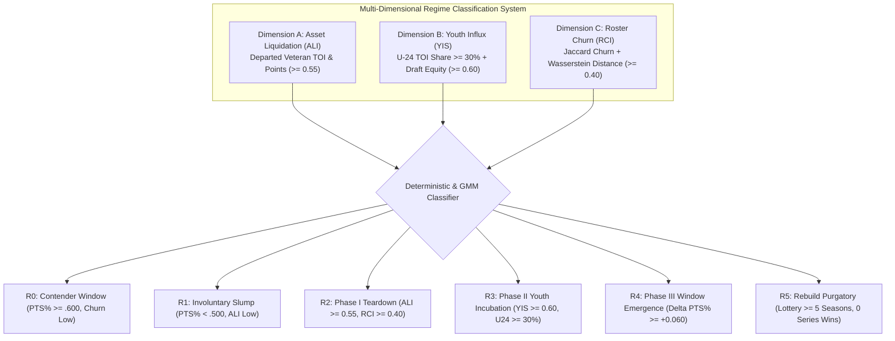
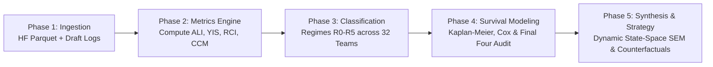

# Franchise Rebuild Analytics: Quantifying Success, Duration, and Strategy (2000–2025)

## Measuring the Efficacy of Rebuilding after Failed Seasons in the Modern NHL

---

## Executive Summary

In professional sports, particularly the National Hockey League (NHL), the term **"rebuild"** is frequently invoked by front offices, media, and fans as an axiomatic necessity following a competitive collapse. Under traditional management doctrine, a failing franchise must dismantle its veteran roster, trade productive assets for draft capital, bottom out in the standings to secure high lottery picks, and construct a new competitive core through young drafted talent.

However, an empirical assessment of the last 25 NHL seasons (2000–2025) challenges this orthodoxy:
- **High Variance & Attrition**: For every Pittsburgh Penguins (2003–2009) or Colorado Avalanche (2012–2022) that successfully rode top-three draft picks to Stanley Cup championships, there are franchises that descended into **"Rebuild Purgatory"** (e.g., Buffalo Sabres 2012–present, Edmonton Oilers 2007–2015, Ottawa Senators 2018–present), remaining uncompetitive for a decade despite numerous top-five picks.
- **The Rise of Compositional Retooling**: Several recent Stanley Cup champions and perennial Conference Finalists (e.g., Vegas Golden Knights, Florida Panthers, Boston Bruins, St. Louis Blues, Carolina Hurricanes) achieved elite status **without** engaging in a prolonged, multi-year scorched-earth teardown. Instead, they leveraged pro scouting arbitrage, aggressive trade acquisitions for prime-aged talent (24–28), tactical forechecking archetypes, and optimal salary cap structuring.
- **The Altered Economic & Lottery Landscape**: Flattened draft lottery odds (introduced in 2016 and expanded in 2021) and the modern contract paradigm—where star young players command market-clearing extensions (\$8\text{M}–\$12\text{M}+\text{ AAV}) immediately coming off Entry-Level Contracts (ELCs)—have severely compressed the surplus-value window of building exclusively through the draft.

This research project develops a rigorous, quantitative framework to:
1. **Define and Identify Rebuilds via Three Macro Equilibrium Regimes (`Inaction`, `Rebuild`, `Peak`)**: Formulate objective, multi-dimensional indicators (veteran asset liquidation, draft capital concentration, and roster turnover distributions) embedded within an econometric **Markov-Switching State-Space & Dynamic Equilibrium Framework** (Hamilton, 1989; Kim, 1994). Every franchise-season from 2000–2001 to 2024–2025 is classified into both granular operational sub-states (`R0`–`R5`) and a measured three-state macro regime layer:
   - **`Inaction` Regime**: Unsuccessful seasons where a team fails to contend and **does not make major structural changes to improve (and has nothing to show for it)**, drifting in passive slumps or stagnant mediocrity.
   - **`Rebuild` Regime**: Unsuccessful or transitional seasons where a franchise is **actively managing and in the ongoing/post-process of major structural changes across years**, enduring short-term deficits in hopes of transitioning to a future `Peak` regime.
   - **`Peak` Regime**: Successful competitive seasons where the franchise achieves sustained playoff contention, Conference Finals appearances, or Stanley Cup championships.
2. **Quantify Franchise-Level Regime Occupancy Across 25 Seasons**: Look back retrospectively across the 2000–2025 sample to quantify for every NHL franchise the exact proportion of seasons spent in `Inaction`, `Rebuild`, and `Peak`, identifying each organization's predominant historical regime and transition efficacy.
3. **Measure Historical Success Rates & Time-to-Contention**: Use survival analysis (Kaplan-Meier, Fine-Gray Competing Risks, and Cox Proportional Hazards) to track the elapsed time, success probability, and decay curves of moving from `Inaction` and `Rebuild` into `Peak` (Tier 1 Playoffs, Tier 2 Final Four, and Tier 3 Stanley Cup).
4. **Deconstruct the DNA of Contenders & Evaluate Strategic Trade-offs**: Audit every Conference Finalist and Stanley Cup Champion over the past quarter-century to determine whether front offices should pursue high-risk, multi-year developmental rebuilds centered on teenage draft picks, or prioritize **compositional depth, veteran insulation, physical-offensive playing style synergy, and prime-age asset acquisition**.

> [!IMPORTANT]
> ### Epistemological Scope: Post-Hoc Retrospective Historical Evaluation
> This study is strictly a **post-hoc, retrospective historical investigation** of the 2000–2001 through 2024–2025 NHL seasons. Because regime classification (`Inaction`, `Rebuild`, `Peak`) and multi-year episode adjudication utilize full-sample retrospective econometric smoothing ($\mathcal{I}_{j, 1:T}$) to observe how structural roster changes ultimately resolved over time, **these findings are in no way deterministic forecasts or guarantees of future franchise behaviors, trajectories, or outcomes**.
>
> **Why It Matters**: While past regime occupancy does not deterministically dictate a franchise's future, the structural parameters estimated from 25 years of history speak directly to **general economic regularities and organizational laws**—revealing why specific managerial actions (such as prime-age trade arbitrage, Center/Defense core anchoring, veteran insulation of young talent, and proactive offensive-zone forecheck physicality) have proven **systematically effective**, and why rival choices (passive `Inaction`, uninsulated youth overload, post-ELC cap desynchronization, and reactive defensive-zone hit chasing) have proven **tragically ineffective** in propelling a team from the `Inaction` and `Rebuild` regimes into the `Peak` regime.

> [!NOTE]
> **Research Documentation Suite**:
> This initiative is formally specified across six synchronized foundational documents:
> 1. 👉 **[DEFINITION.md](DEFINITION.md)** — *Core Definitions, Ontology, Philosophy vs. Algorithmic Conditions, Three-Tier Success Criteria & Core Player Identification*.
> 2. 👉 **[METHODOLOGY_DATA.md](METHODOLOGY_DATA.md)** — *Tactical Data Architecture, Entity Normalization (relocations/lockouts), DuckDB Aggregations & Master Analytical Panels*.
> 3. 👉 **[METHODOLOGY_MODEL.md](METHODOLOGY_MODEL.md)** — *Exploratory Visualizations, Dynamic State-Space Structural Equation Model (SEM), Quasi-Experimental IV Identification & 11-Pillar Sensitivity Protocol*.
> 4. 👉 **[METHODOLOGY_DELIVERY.md](METHODOLOGY_DELIVERY.md)** — *Publication Table Schemas, Visual Wireframes, Econometric Output Formatting & Master Question-to-Parameter Synthesis (`Q1`–`Q8`)*.
> 5. 👉 **[STREAMLIT_AND_INSIGHTS_PLAN.md](STREAMLIT_AND_INSIGHTS_PLAN.md)** — *Markdown Insights Pipeline (Executive Briefings, 32 Franchise Dossiers, Failure Autopsies) & Interactive Streamlit Dashboard Specifications (`rebuild_tracker.py`)*.

---

## Table of Contents

- [**Methodological Charter: Core Definitions (DEFINITION.md)**](DEFINITION.md)
- [**Data Architecture & Pipeline Specification (METHODOLOGY_DATA.md)**](METHODOLOGY_DATA.md)
- [**Econometric State-Space Model & Robustness Suite (METHODOLOGY_MODEL.md)**](METHODOLOGY_MODEL.md)
- [**Results Delivery & Question-to-Parameter Synthesis (METHODOLOGY_DELIVERY.md)**](METHODOLOGY_DELIVERY.md)
- [**Markdown Insights & Streamlit Dashboard Plan (STREAMLIT_AND_INSIGHTS_PLAN.md)**](STREAMLIT_AND_INSIGHTS_PLAN.md)
1. [The Eight Fundamental Research Questions (`Q1`–`Q8`)](#1-the-eight-fundamental-research-questions-q1q8)
2. [Formalizing the Rebuild: Multi-Dimensional Definitions](#2-formalizing-the-rebuild-multi-dimensional-definitions)
   - [2.1 Dimension A: Asset Liquidation Index (ALI)](#21-dimension-a-asset-liquidation-index-ali)
   - [2.2 Dimension B: Draft Capital & Youth Influx Score (YIS)](#22-dimension-b-draft-capital--youth-influx-score-yis)
   - [2.3 Dimension C: Roster Churn & Year-over-Year Turnover (RCI)](#23-dimension-c-roster-churn--year-over-year-turnover-rci)
   - [2.4 Dimension D: Age/Experience Complementarity & Playing Style Balance (FPOI)](#24-dimension-d-ageexperience-complementarity--playing-style-balance-fpoi)
   - [2.5 Composite Rebuild Regime Classifier](#25-composite-rebuild-regime-classifier)
3. [Benchmark Criteria for Rebuild "Success"](#3-benchmark-criteria-for-rebuild-success)
4. [The 25-Year Empirical Scope (2000–2025)](#4-the-25-year-empirical-scope-20002025)
   - [4.1 Archetype Taxonomy](#41-archetype-taxonomy)
   - [4.2 The Macro Paradigm Shifts: Pre-Cap, Post-Cap, and Flattened Lottery](#42-the-macro-paradigm-shifts-pre-cap-post-cap-and-flattened-lottery)
5. [Analytical Framework & Statistical Methodologies](#5-analytical-framework--statistical-methodologies)
   - [5.1 Survival Analysis, Competing Risks & Time-to-Contention](#51-survival-analysis-competing-risks--time-to-contention)
   - [5.2 Roster Turnover Distribution (Wasserstein Distance)](#52-roster-turnover-distribution-wasserstein-distance)
   - [5.3 Draft Pick Realized Value & Production Jump Curves](#53-draft-pick-realized-value--production-jump-curves)
   - [5.4 Counterfactual Analysis: Teardown vs. Compositional Re-engineering](#54-counterfactual-analysis-teardown-vs-compositional-re-engineering)
6. [Economic Research Scoping & Theoretical Foundations](#6-economic-research-scoping--theoretical-foundations)
7. [Data Schema & Pipeline Requirements](#7-data-schema--pipeline-requirements)
8. [Directory Structure & Execution Roadmap](#8-directory-structure--execution-roadmap)
9. [Step-by-Step Implementation Roadmap](#9-step-by-step-implementation-roadmap)

---

## 1. The Eight Fundamental Research Questions (`Q1`–`Q8`)

### Question 1 (`Q1`): Strategic Intent vs. Stochastic Collapse — How do we distinguish an intentional rebuild from an involuntary competitive slump?
A bad team is not necessarily a rebuilding team. Involuntary failure occurs when a roster built to win underperforms due to goaltending collapse, injury epidemics, shooting percentage slumps ($\text{PDO}$), or aging curves. An **intentional rebuild** involves explicit management intervention: trading high-minute/high-WAR veterans for future considerations (picks and prospects), intentionally tolerating on-ice deficits, allocating disproportionate ice time to underdeveloped skaters, and preserving future salary cap flexibility. How can we mathematically and econometrically separate strategic intent ($\text{ALI} \ge 0.55$) from accidental incompetence?

### Question 2 (`Q2`): Actuarial Odds, Velocity & The Purgatory Trap — What is the empirical success rate and duration of an NHL rebuild?
When a franchise enters an intentional rebuild, what are the actuarial odds (under both standard survival and Fine-Gray competing risks) of reaching:
- **Tier 1**: Sustained postseason viability ($>3$ consecutive playoff seasons with the core intact, $\text{CCM} \ge 0.60$)?
- **Tier 2**: Championship contention in the Conference Finals (Final Four)?
- **Tier 3**: Winning the Stanley Cup Championship (and achieving a multi-Cup **Dynasty** within a 10-year window)?
What is the median duration from the "trough" ($\min \text{PTS}\%$) to competitive viability, and what structural mechanisms cause $\sim 30\%+$ of rebuilds to stall permanently in **Rebuild Purgatory** ($\ge 5$ consecutive lottery seasons) where cultural attrition ($-\kappa_{\text{tank}}$) overwhelms incoming draft talent?

### Question 3 (`Q3`): Contender DNA & Sourcing Pathways — Among the elite franchises of the last 25 years, what percentage actually executed a scorched-earth rebuild?
Of the 50 Stanley Cup Finalists, 25 Stanley Cup Champions, and 100 Conference Finalists between 2000 and 2025:
- What percentage had a core roster consisting primarily of top-10 franchise draft picks developed in-house after a multi-year teardown (**Pathway A: Draft Target Core**)?
- What percentage were assembled via aggressive trade arbitrage, unrestricted free agency (UFA) efficiency, pro scouting acquisitions, and tactical retooling (**Pathway B: Acquired Prime Pillars**, ages 23–27)?
- Has the share of "tank-and-ascend" contenders significantly contracted in the post-2016 flattened-lottery era compared to the 2005–2015 early hard-cap era?

### Question 4 (`Q4`): Positional Hierarchy & Capital Elasticity — Should franchises center rebuilds around Centers and Defensemen rather than Wingers or Goaltenders?
When constructing a championship core, positional scarcity and on-ice spatial control are not equal. What are the structural elasticities ($\boldsymbol{\beta}_{\text{pos}} = [\beta_{\text{center}}, \beta_{\text{defense}}, \beta_{\text{wing}}, \beta_{\text{goalie}}]^T$) governing transition from incubation to postseason series victories? Does anchoring a rebuild around an elite #1 Center and top-pair all-situations Defenseman yield a statistically superior hazard rate of reaching Tier 2/3 contention compared to wing-heavy or goalie-dependent reconstructions?

### Question 5 (`Q5`): Labor Market Surplus Compression — Has post-ELC contract escalation rendered multi-year draft tanking mathematically obsolete?
Given the inherent developmental variance of 18-year-old prospects, does the modern collective bargaining environment still support bottom-out tanking?
- **Lottery Smoothing**: With the 32nd-place team having only a $25.5\%$ chance at the #1 pick, bottoming out no longer guarantees generational talent.
- **Collapse of the RFA Bridge Deal**: In Era 2 (2005–2015), teams extracted a 6-year wage surplus ($S_{i, t} = \text{MRP}_{i, t} - w_{i, t} > 0$) via 3-year Entry-Level Contracts (ELCs) followed by \$3\text{M}–\$4\text{M} RFA bridge deals. In Era 3 (2016–2025), elite young stars bypass bridge deals for immediate \$8.5\text{M}–\$12\text{M}+ max-term extensions directly off their ELCs, compressing the positive surplus window to **3 years**. If a rebuild takes 5 years to assemble its core, do the earliest drafted stars consume all cap surplus before the roster matures?

### Question 6 (`Q6`): Origin-Team Scouting & Trade Arbitrage ($\psi$) — Can front offices systematically outperform the draft via prime-age compositional retooling?
When evaluating external players for retooling trades, how can front offices separate genuine underlying talent from origin-team contextual distortion? Can teams generate superior risk-adjusted returns (**Roster Sharpe Ratio**, $\text{SR}_j$) by targeting prime-age (23–27) players whose underlying expected-goal and possession metrics ($\text{ixG}_{60}, \Delta \text{xGF}\%$) were suppressed on low-possession or cap-distressed origin teams ($\psi_2 > 0$), while avoiding players whose box-score points were artificially inflated by elite teammates ($\psi_1 < 1.0$)?

### Question 7 (`Q7`): Principal-Agent Frictions & Industrial Organization Sorting — How do GM career horizons and market-size gate revenues distort rebuild strategy?
Why do certain franchises perpetually retool while others repeatedly tank, and why do many rebuilds self-destruct mid-cycle via premature "panic trades"?
- **Principal-Agent Horizon Conflict**: How does the mismatch between the empirical General Manager tenure hazard ($T_{\text{GM}} \approx 3.8\text{ years}$, effective discount factor $\beta_{\text{GM}}$) and the Team Owner's long-term valuation horizon ($T_{\text{Owner}} \to \infty$, $\beta_{\text{Owner}}$) incentivize GMs to prematurely trade away draft capital for short-term playoff pushes?
- **Asymmetric Gate-Revenue Opportunity Cost**: How does the \$20\text{M}–\$35\text{M} annual gate and local media penalty suffered by high-revenue Original Six / major metro markets during losing seasons drive rational sorting into retooling versus subsidized cap-floor tanking?

### Question 8 (`Q8`): Age/Experience Complementarity & Playing Style Synergy — Why do "all-youth/all-skill" rebuilds fail, and how do veteran insulation and purposeful forechecking physicality drive championship contention?
A recurring pathology of failed rebuilds (e.g., 2010–2015 Edmonton, 2014–2023 Buffalo) is assuming that accumulating young, high-skill draft picks is sufficient to win. We interrogate two compositional layers directly linked to empirical studies in this repository:
1. **Non-Linear Age & NHL Experience Composition (`Age-Exp` Layer, linked to [`dev/player/player_draft/`](../../player/player_draft/draftee_lifecycle/eda.py))**: What is the optimal demographic mix across NHL experience tenure buckets ($B_1$: `0–3 yrs ELC`, $B_2$: `4–6 yrs Prime RFA`, $B_3$: `7–9 yrs Peak UFA`, $B_4$: `10+ yrs Veteran Anchor`)? At what threshold ($\tau_{\text{youth}}^* \approx 28\%\text{–}32\%$ of team TOI) does an over-concentration of uninsulated ELC youth trigger a **Youth Overload Penalty** ($-\lambda_{\text{youth\_overload}}$), and what is the cross-elasticity of pairing young stars with veteran anchors ($\vartheta_{B_1, B_3} > 0$)?
2. **Playing Style Balance & Forecheck Physicality (`Style-Hit` Layer, linked to [`dev/decision_science/hit_eda/`](../../decision_science/hit_eda/EXPLORATORY.md) & [`dev/decision_science/impact_of_hits/`](../../decision_science/impact_of_hits/REVIEW.md))**: Using our repository's $N = 667,961$ hit-sequence telemetry (`hit_zone_summary_kpi.csv`, `team_season_hit_kpi.csv`) and continuous-time `MomentumSSM` hyperparameters ($\hat{a}_0 = 0.98597$, half-life $\tau_{1/2} = 49.1\text{s}$, $\hat{B}_{\text{hit\_for\_O}} = +0.3765$ vs. $\hat{B}_{\text{hit\_for\_D}} = +0.2950$), how do we separate **empty-calorie defensive-zone chasing hits** ($\Pi_{\text{rec}}(D) = 39.98\%$, $\text{Net SOG}_{30\text{s}} = -17.71 / 100\text{ hits}$) from **purposeful offensive-zone forechecking physicality** ($\Pi_{\text{rec}}(O) = 54.15\%$, $\text{Net SOG}_{30\text{s}} = +7.43 / 100\text{ hits}$)? Does championship contention require a positive structural interaction ($\theta_{\text{syn}} > 0$) between high-danger offensive skill and forechecking physicality?

---

## 2. Formalizing the Rebuild: Multi-Dimensional Definitions

To avoid subjective narrative bias (e.g., retroactively labeling successful teams as "smart rebuilds" and unsuccessful ones as "failed slumps"), we establish a **tri-axial quantitative framework** to define and detect franchise rebuild regimes.

```
                            [ REBUILD REGIME DETECTION ]
                                         │
        ┌────────────────────────────────┼────────────────────────────────┐
        ▼                                ▼                                ▼
[ Dimension A: ALI ]            [ Dimension B: YIS ]            [ Dimension C: RCI ]
Asset Liquidation Index         Youth Influx & Production       Roster Churn & TOI
• Veteran TOI Departures        • Top-10 / 1st-Rd Pick Share    • Wasserstein Distance (Age/TOI)
• Points/xG Exported            • U-24 Ice Time Proportion      • Year-over-Year Roster Jaccard
• Trade Return Capital          • Sophomore/Rookie Jumps        • Cap Space Liquidation
```



### 2.1 Dimension A: Asset Liquidation Index (ALI)

The Asset Liquidation Index measures the rate at which an organization actively sheds established, prime-age or veteran productive capacity in exchange for future-oriented assets (draft picks, unproven prospects, or cap relief).

For team $j$ transitioning from season $t-1$ to $t$ (with baseline weights $w_1 = 0.35, w_2 = 0.35, w_3 = 0.30$ as formalized in [**DEFINITION.md**](DEFINITION.md#condition-a-asset-liquidation--veteran-divestment-index-textali)):

$$
\text{ALI}_{j, t} = 0.35 \cdot \left(\frac{\text{TOI}_{\text{departed\_vets}}}{\text{TOI}_{\text{total}, t-1}}\right) + 0.35 \cdot \left(\frac{\text{Points}_{\text{departed\_vets}}}{\text{Points}_{\text{total}, t-1}}\right) + 0.30 \cdot \text{DraftEquityAcquired}_{j, t}
$$

Where:
- $\text{departed\_vets}$ denotes departing players aged $\ge 26$ who played $\ge 40$ games and ranked in the top 40% of team ice time or top 33% of team scoring in year $t-1$.
- $\text{DraftEquityAcquired}_{j, t}$ is the normalized draft-capital credit ($V = \sum \frac{1}{\sqrt{\text{PickOverall}}}$) received via trades.

**Interpretation**: A high ALI ($\ge 0.55$) indicates deliberate roster subtraction and asset liquidation rather than passive retirement or injury attrition.

---

### 2.2 Dimension B: Draft Capital & Youth Influx Score (YIS)

Rebuilding franchises allocate extraordinary on-ice leverage to developing assets. The Youth Influx Score quantifies the volume, capital pedigree, and Entry-Level Contract concentration of young players (with baseline weights $\alpha_1 = 0.40, \alpha_2 = 0.35, \alpha_3 = 0.25$ as formalized in [**DEFINITION.md**](DEFINITION.md#condition-b-draft-capital-equity--youth-infusion-score-textyis)):

$$
\text{YIS}_{j, t} = 0.40 \cdot \left(\frac{\text{TOI}_{U24, j, t}}{\text{TOI}_{\text{total}, j, t}}\right) + 0.35 \cdot \text{DraftCapitalIndex}_{j, t}^{(3\text{yr})} + 0.25 \cdot \text{ELC\_Roster\_Share}_{j, t}
$$

Where:
- $\text{TOI}_{U24}$: Proportion of total all-situations ice time consumed by skaters under age 24 ($\ge 30\%$ during peak incubation).
- $\text{DraftCapitalIndex}^{(3\text{yr})}$: Sum of draft pick equity held and utilized by team $j$ across Rounds 1–2 over a rolling 3-year window:

$$
\text{DraftCapitalIndex}_{j, t}^{(3\text{yr})} = \sum_{k=1}^{N} \frac{1}{\sqrt{\text{PickOverall}_k}} \cdot \mathbf{1}_{\{\text{Round}_k \le 2\}}
$$

- $\text{ELC\_Roster\_Share}_{j, t}$: Share of active roster skaters on Entry-Level Contracts, supplemented by tracking rookie-to-sophomore production leaps ($\Delta \text{Prod}_{i, t}$).

**Interpretation**: High YIS ($\ge 0.60$) identifies teams that have shifted primary operational responsibility to players on Entry-Level Contracts or early RFA status.

---

### 2.3 Dimension C: Roster Churn & Year-over-Year Turnover (RCI)

To quantify the sheer instability of a rebuilding roster versus a stable contender, we evaluate the statistical divergence of roster distributions between consecutive seasons.

#### 1. Jaccard Index of Active Rosters
Measures the identity persistence of the regular 20-man game-sheet roster:

$$
J(\mathcal{R}_{t-1}, \mathcal{R}_t) = \frac{|\mathcal{R}_{t-1} \cap \mathcal{R}_t|}{|\mathcal{R}_{t-1} \cup \mathcal{R}_t|}, \quad \text{Churn} = 1 - J(\mathcal{R}_{t-1}, \mathcal{R}_t)
$$

#### 2. Wasserstein (Earth Mover's) Distance on Age-TOI Profiles
Rather than simply looking at average roster age, we calculate the 1D Wasserstein metric $W_1(P_{t-1}, P_t)$ between the TOI-weighted age distributions of the roster across years:

$$
W_1(P_{t-1}, P_t) = \int_{-\infty}^{\infty} |F_{t-1}(x) - F_t(x)| \, dx
$$

Where $F(x)$ is the cumulative distribution function of player age weighted by minutes played. A sharp leftward shift in $W_1$ signifies rapid systemic rejuvenation ($\text{RCI} \ge 0.40$).

---

### 2.4 Dimension D: Age/Experience Complementarity & Playing Style Balance (FPOI)

To evaluate why certain rebuilding rosters stall in Purgatory despite elite young draft picks, we introduce two structural composition metrics grounded directly in our repository's empirical studies:

#### 1. NHL Experience Tenure Distribution & Youth Overload Penalty (`Age-Exp` Layer)
Following the career progression taxonomy in [`dev/player/player_draft/draftee_lifecycle/eda.py`](../../player/player_draft/draftee_lifecycle/eda.py), every roster's TOI is partitioned across four NHL experience tenure buckets ($b \in \{B_1: \text{0–3 yrs ELC}, B_2: \text{4–6 yrs Prime RFA}, B_3: \text{7–9 yrs Peak UFA}, B_4: \text{10+ yrs Veteran Anchor}\}$, $\sum_{b=1}^4 s_{j, t}^{(b)} = 1$). Rather than assuming younger is monotonically better, we quantify **Shannon Experience Entropy** $H_{j, t}^{\text{exp}} = -\sum_{b=1}^4 s_{j, t}^{(b)} \ln s_{j, t}^{(b)}$ and the quadratic **Youth Overload Penalty** when $s_{j, t}^{(B_1)} > \tau_{\text{youth}}^* \approx 0.30$ without veteran insulation ($s_{j, t}^{(B_3 + B_4)}$).

#### 2. Forecheck Physicality & Opportunity Index ($\text{FPOI}$) Linked to Hit Telemetry & `MomentumSSM`
Drawing directly from our repository's $N = 667,961$ hit-sequence database ([`dev/decision_science/hit_eda/EXPLORATORY.md`](../../decision_science/hit_eda/EXPLORATORY.md)) and continuous-time **Momentum State-Space Model (`MomentumSSM`)** ([`dev/decision_science/impact_of_hits/src/model/momentum_ssm.py`](../../decision_science/impact_of_hits/src/model/momentum_ssm.py)), we separate **Proactive Offensive-Zone Forechecking Physicality** from **Reactive Defensive-Zone Chasing Hits**:
- **Offensive-Zone Forecheck Hits (`zoneCode == 'O'`)**: Generate $54.15\%$ immediate puck recovery ($\Pi_{\text{rec}}(O)$), $+7.43$ net shots on goal per 100 hits within a $30\text{s}$ window, $+0.264$ net goals per 100 hits, and the highest physical impulse weight in `MomentumSSM` ($\hat{B}_{\text{hit\_for\_O}} = +0.4678$, bootstrap mean $+0.3765$, decaying with half-life $\tau_{1/2} = 49.1\text{s}$ under $\hat{a}_0 = 0.98597$).
- **Defensive-Zone Chasing Hits (`zoneCode == 'D'`)**: Yield only $39.98\%$ puck recovery ($\Pi_{\text{rec}}(D)$), fail to clear the zone $75.9\%$ of the time in 5v5 cycle play, and suffer $-17.71$ net shots and $-0.678$ net goals per 100 hits within $30\text{s}$ ($\hat{B}_{\text{hit\_for\_D}}$ bootstrap mean $+0.2950$, $21.6\%$ lower than O-zone hits).

$$
\text{FPOI}_{j, t} = z\left(\frac{\text{Hits}_{j, t}(O)}{\text{Hits}_{j, t}(O) + \text{Hits}_{j, t}(D)} \cdot \Pi_{\text{rec}, j, t}\right) + z\left(\text{NetShotsPer100Hits}_{30\text{s}, j, t}\right) + z\left(\frac{\sum_{e} \hat{B}_{e, \text{SSM}} \cdot \text{Events}_{e, j, t}}{1 - \hat{a}_0}\right)
$$

---

### 2.5 Composite Rebuild Regime Classifier & Three-State Macro Equilibrium Layer (`Inaction`, `Rebuild`, `Peak`)

Using dimensions $(\text{ALI}, \text{YIS}, \text{RCI}, \text{FPOI})$ alongside team performance metrics (Points Percentage $\text{PTS}\%$, Goal Differential, and Pythagorean Win Expectancy), our framework classifies every franchise-season from 2000 to 2025 across a **hierarchical two-tier regime taxonomy** grounded in time-series regime-switching state-space econometrics (Hamilton, 1989; Kim, 1994):

1. **Tier A — Granular Operational Sub-States (`R0`–`R5`)**: Six specific organizational states identified via deterministic boundary rules and Gaussian Mixture Model (GMM) clustering.
2. **Tier B — Measured Three-Regime Macro Equilibrium Layer ($M_{j, t} \in \{\text{Inaction}, \text{Rebuild}, \text{Peak}\}$)**: The fundamental econometric regime layer embedded in our state-space equilibrium model, grouping every franchise-season into three structural macro regimes:
   - **`Inaction` Regime ($M_{j, t} = \text{Inaction}$)**: Unsuccessful seasons where a franchise fails to achieve competitive contention and **either does not execute major structural changes to improve (and has nothing to show for it)** (`R1` Slump/Plateau) or remains trapped in chronic post-intervention stagnation (`R5` Purgatory without active capital restructuring).
   - **`Rebuild` Regime ($M_{j, t} = \text{Rebuild}$)**: Unsuccessful or transitional seasons where a franchise is **actively managing and in the ongoing or post-process of major structural changes across years** (`R2` Active Teardown, `R3` Youth Incubation, and early transitional `R4`), purposefully liquidating veteran capital or incubating young/retool assets with the strategic expectation of transitioning into the `Peak` regime in future seasons.
   - **`Peak` Regime ($M_{j, t} = \text{Peak}$)**: Successful seasons (`R0` Contender and sustained `R4` Emergence achieving Tier 1–3 contention) where the franchise operates in its high-output competitive equilibrium with an established core.

| Macro Equilibrium Regime ($M_{j, t}$) | Granular Sub-State (`R0`–`R5`) | Key Economic & Operational Characteristics | Typical Algorithmic Thresholds |
|:---|:---|:---|:---|
| **`Peak`** | **R0: Championship Contender** | High-output competitive equilibrium; low churn, intact core, sustained postseason success | $\text{PTS}\% \ge .580$, $\text{ALI} < .30$, $\text{CCM} \ge .60$ |
| **`Peak` / `Rebuild`** *(Transitional)* | **R4: Phase III Emergence** | Young/retool core achieves production leap; classified as `Rebuild` in initial transition year, `Peak` once sustained ($\ge 2\text{ yrs}$) | $\Delta \text{PTS}\% \ge +.060$, $\text{YIS} \ge .45$, $\text{PTS}\% \ge .550$ |
| **`Rebuild`** | **R2: Phase I Active Teardown** | Deliberate structural intervention; high veteran liquidation, sharp roster turnover, asset accumulation | $\text{ALI} \ge .55$, $\text{RCI} \ge .40$, $\text{PTS}\% < .480$ |
| **`Rebuild`** | **R3: Phase II Youth Incubation** | Post-change developmental process; high concentration of drafted/acquired youth TOI hoping to reach `Peak` | $\text{YIS} \ge .60$, $\text{ShareTOI}_{U24} \ge .30$, $\text{PTS}\% < .520$ |
| **`Inaction`** | **R1: Competitive Plateau / Slump** | Unsuccessful season with **no major structural changes to improve** (and nothing to show for it); passive management | $\text{PTS}\% < .520$, $\text{ALI} < .35$, $\text{RCI} < .30$, $\text{YIS} < .45$ |
| **`Inaction`** | **R5: Rebuild Purgatory / Stagnant Trap** | Failed rebuild degenerating into chronic stagnation ($\ge 5\text{ yrs}$ without reaching `Peak`) with exhausted policy impulse | Duration $\ge 5\text{ yrs}$, Playoff Series Wins $= 0$ |

#### Retrospective Franchise Regime Occupancy Audit (2000–2025)
Looking back across all measured seasons ($t = 1, \dots, T_j$), the model quantifies for every franchise $j \in \{1, \dots, 32\}$:
- **Regime Occupancy Shares**: $\widehat{\text{Share}}_j(\text{Inaction})$, $\widehat{\text{Share}}_j(\text{Rebuild})$, and $\widehat{\text{Share}}_j(\text{Peak})$, establishing which regime each team predominantly inhabited over the quarter-century.
- **Empirical Regime Transition Matrix ($\widehat{\mathbf{\Pi}}_j$)**: The historical transition probabilities $\hat{\pi}_{r \to s} = \Pr(M_{j, t} = s \mid M_{j, t-1} = r)$, measuring how effectively or tragically ineffectively specific front-office decisions moved teams from `Inaction` and `Rebuild` into `Peak`.

---

## 3. Benchmark Criteria for Rebuild "Success"

A fundamental flaw in public discourse is treating a single wildcard playoff appearance as proof of a successful rebuild. A true rebuild sacrifices 3 to 7 years of competitive relevance; its justification is achieving an elite, sustainable window. As formalized in [**DEFINITION.md**](DEFINITION.md#2-definition-1-rebuild-success--the-ultimate-goal-of-franchise-reconstruction), we categorize rebuild outcomes into three ascending tiers of achievement—each conditional upon preserving the **Core Player Group**:

```
[ Tier 3: Stanley Cup Champion / Dynasty ]
▲  • Ultimate Summit: Won Stanley Cup with core group intact
│  • Won >= 2 Stanley Cups within 10-year rolling window = "Dynasty"
│
[ Tier 2: Championship Contention / Final Four ]
▲  • Reached Conference Finals (Round 3) at least once with core group
│  • Demonstrates legitimate top-4 league-wide championship capability
│
[ Tier 1: Sustained Postseason Viability ]
   • Qualified for Stanley Cup Playoffs > 3 consecutive seasons (>= 4 seasons)
   • Major core of players remains intact with >= 1 playoff round series victory
```

### The Three Tiers of Rebuild Success

1. **Tier 1: Sustained Postseason Viability (Core Intact)**
   - Making the playoffs consistently (**more than 3 consecutive seasons**, i.e. $\ge 4$ consecutive seasons, or 3 consecutive seasons with a series victory).
   - Major core of players remains intact ($\text{CCM} \ge 0.60$). Demonstrates that the team is structurally stable and immune to single-season regression.

2. **Tier 2: Championship Contention / Final Four (Conference Finals)**
   - Reaching the Conference Finals at least once with the identified core player group.
   - Proves the rebuild constructed a legitimate top-4 contender capable of competing for the championship under normal postseason variance.

3. **Tier 3: The Ultimate Summit (Stanley Cup Championship & Dynasty)**
   - Winning the Stanley Cup with the core player group intact.
   - **Dynasty Classification**: If the franchise wins **two or more Stanley Cups within a rolling 10-year window** with the core group intact (e.g., Pittsburgh, Chicago, Tampa Bay), it achieves Dynastic validation.

4. **Counter-Outcome: Rebuild Purgatory (Failed Transition)**
   - Franchise remains in the lottery bracket for $\ge 5$ consecutive seasons post-teardown, or experiences a brief wildcard appearance followed by an immediate multi-year relapse. Detailed mathematical conditions are provided in [**DEFINITION.md**](DEFINITION.md#32-operational--algorithmic-conditions).

### Secondary Evaluation Metrics: Velocity and ROI
- **Velocity (Years to Trough-to-Peak)**: Number of seasons elapsed from the initial teardown season ($\min \text{PTS}\%$) to the first Tier 1/2 outcome.
- **Window Sustainability**: Number of consecutive seasons the reconstructed team maintains a Points $\% \ge .580$.
- **Draft Capital Conversion Rate ($\text{DCR}$)**: Total career WAR or Game Score generated by draft picks acquired during the rebuild relative to expected value of draft slots.

---

## 4. The 25-Year Empirical Scope (2000–2025)

The study spans the 2000–2001 through 2024–2025 seasons, encompassing approximately 31,000 regular-season games, 2,100 playoff games, and over 6,000 drafted players across three distinct regulatory eras.

### 4.1 Archetype Taxonomy

```
                               ┌─────────────────────────┐
                               │ NHL Franchise Strategies│
                               └────────────┬────────────┘
                     ┌──────────────────────┴──────────────────────┐
                     ▼                                             ▼
       [ The Classical Teardown ]                    [ Compositional Retooling ]
       "Scorched-Earth Tank & Ascend"               "Aggressive Roster Arbitrage"
       • Multi-year bottom-out                      • Protect competitive baseline
       • Liquidation for high picks                 • Trade prime assets (24–28 yrs)
       • Center around teenage picks                • Prioritize archetype fit & depth
       • Examples: PIT, CHI, COL, TBL               • Examples: VGK, FLA, BOS, CAR, STL
```

#### Archetype A: The Classical "Tank & Ascend" Dynasties
- **Pittsburgh Penguins (2002–2009)**: Bottomed out from 2002 to 2006; acquired Fleury (1st overall, 2003), Malkin (2nd overall, 2004), Crosby (1st overall, 2005), and Staal (2nd overall, 2006). Reached Cup Final in 2008, won Cup in 2009.
- **Chicago Blackhawks (2004–2010)**: Consecutive high lottery selections: Barker (3rd, 2004), Toews (3rd, 2006), Kane (1st, 2007). Won Cups in 2010, 2013, 2015.
- **Colorado Avalanche (2012–2022)**: Prolonged trough culminating in a 48-point disaster in 2016–17; secured MacKinnon (1st, 2013), Rantanen (10th, 2015), Makar (4th, 2017), Byram (4th, 2019). Won Cup in 2022.
- **Tampa Bay Lightning (2008–2015/2020)**: Stamkos (1st, 2008), Hedman (2nd, 2009); supplemented by mid-to-late round draft masteries (Kucherov, Point, Palat).

#### Archetype B: The Modern "Compositional Retool & Trade Arbitrage"
- **Vegas Golden Knights (2017–2023)**: **Zero traditional rebuild years**. Built through expansion draft asset accumulation, weaponizing cap space, and executing blockbuster trades for prime-age elite contributors (Stone, Eichel, Stephenson, Pietrangelo). Won Cup in Year 6.
- **Florida Panthers (2021–2024)**: Transitioned from mediocre wildcard team to back-to-back Stanley Cup Finalist (Champion in 2024) by radically altering roster identity: trading former #3 overall pick Huberdeau and top-pairing D Weegar for Matthew Tkachuk, adding Sam Reinhart, Carter Verhaeghe (UFA depth), and defensive specialists.
- **Boston Bruins (2015–2023)**: Missed playoffs in 2015 and 2016; never tore down the roster. Retained core veterans (Bergeron, Marchand, Chara) while drafting Pastrnak (25th, 2014) and McAvoy (14th, 2016), remaining a perennial top-5 contender for another decade.
- **Carolina Hurricanes (2018–2024)**: Post-2018 resurgence driven by an analytically structured possession system, pro scouting pickups, balanced two-way defense, and depth rather than tanking for top-3 picks.
- **St. Louis Blues (2019)**: Built through methodical trade additions (O'Reilly, Schenn) and veteran depth; won Cup in 2019 without ever bottoming out for top-3 draft capital.

#### Archetype C: The "Rebuild Purgatory / Trap"
- **Buffalo Sabres (2012–2024)**: Intentional scorched-earth tank in 2013–2015 for McDavid/Eichel sweepstakes. Despite selecting Reinhart (2nd, 2014), Eichel (2nd, 2015), Dahlin (1st, 2018), and Power (1st, 2021), the franchise set an NHL record by missing the postseason for 13+ consecutive seasons.
- **Edmonton Oilers (2007–2015 pre-McDavid)**: Selected Hall (1st, 2010), Nugent-Hopkins (1st, 2011), Yakupov (1st, 2012), and Draisaitl (3rd, 2014); suffered from complete lack of veteran insulation, blueline depth, and goaltending, failing to make the playoffs in 10 consecutive seasons until Connor McDavid's emergence.
- **Ottawa Senators (2018–present)**: High-profile asset teardown (trading Karlsson, Stone, Duchene) for draft picks; despite elite young talent (Tkachuk, Stützle, Sanderson), struggle to exit the non-playoff quadrant.

---

### 4.2 The Macro Paradigm Shifts: Pre-Cap, Post-Cap, and Flattened Lottery

| Era | Timeline | Key Structural Rules | Strategic Implications for Rebuilding |
|:---|:---|:---|:---|
| **Era 1: Pre-Salary Cap** | 2000–2004 | No salary ceiling; unrestricted payrolls; high draft pick certainty | Wealthy teams retool via free agency; poor teams forced to liquidate assets permanently. |
| **Era 2: Early Hard Cap** | 2005–2015 | \$39\text{M}–\$69\text{M} hard cap; bridge deals common; worst team had high odds for top pick | Golden age of scorched earth. Cheap ELC surplus allowed top picks to win before massive extensions. |
| **Era 3: Modern Parity & Flattened Lottery** | 2016–2025 | Flattened lottery odds; 32 teams; ELC stars bypass bridge deals for \$9\text{M}+ contracts | High risk of tanking: 32nd place has only 25.5% shot at #1 pick; compressed ELC surplus window. |

---

## 5. Analytical Framework & Statistical Methodologies

### 5.1 Survival Analysis, Competing Risks & Time-to-Contention

To model the duration and probability of exiting a rebuild into competitive status, we employ non-parametric, semi-parametric, and competing-risks **Survival Analysis**:

```
Time-to-Event Metric (T): Number of seasons from Phase I Teardown until Event E.
Events of Interest:
  - E_1: Achieving Tier 1 Sustained Playoffs (>3 consecutive berths, CCM >= 0.60)
  - E_2: Reaching Tier 2 Conference Finals (Final Four)
  - E_3: Winning Tier 3 Stanley Cup Championship
Competing Event (E_comp): Absorbed into Rebuild Purgatory / Second-Generation Regime Reset.
Censoring (C): Franchises still in active early incubation (<5 yrs) at end of sample (2025).
```

#### Kaplan-Meier & Fine-Gray Competing Risks Cumulative Incidence
We fit survival curves $S(t) = P(T > t)$ alongside the **Fine-Gray Competing Risks Cumulative Incidence Function** $\text{CIF}_k(t) = P(T \le t, \text{Event} = k)$ stratified by rebuild depth (Scorched-Earth Teardown vs. Compositional Retool):

$$
\hat{S}(t) = \prod_{t_i \le t} \left(1 - \frac{d_i}{n_i}\right), \quad \widehat{\text{CIF}}_k(t) = \sum_{t_i \le t} \hat{S}(t_{i-1}) \frac{d_{i, k}}{n_i}
$$

Where $d_{i, k}$ is the number of franchises experiencing event $k$ (Contention vs. Purgatory Reset) at season $t_i$, and $n_i$ is the number of rebuilding franchises at risk.

#### Cox Proportional Hazards & Shared Frailty Model
To understand what structural variables accelerate or derail a rebuild, we estimate the hazard rate:

$$
h(t \mid \mathbf{X}) = h_0(t) \exp\left( \beta_1 \text{ALI} + \beta_2 \text{LotteryPicks} + \beta_3 \text{VetRetentionTOI} + \beta_4 \text{GoalieQuality} + \beta_5 \text{CapFlexibility} \right)
$$

**Key Covariates Tested**:
- Number of top-3 draft picks acquired vs. Pathway B prime trade acquisitions.
- Percentage of veteran ice time retained during teardown (veteran insulation).
- Positional centering share (#1 Center and Top-Pair Defenseman leverage).
- Goaltending baseline GSAx during Phase II incubation.
- Net wage surplus ($\sum \text{MRP}_i - w_i$) and cap efficiency.

---

### 5.2 Roster Turnover Distribution (Wasserstein Distance)

To test the hypothesis that **excessive roster churn destroys developmental culture and prolongs rebuilds**, we compute the Wasserstein divergence between year-to-year team distributions:

1. **TOI-Weighted Age Distribution**: Does a sudden drop in mean age ($>3.5$ years in a single season) correlate with higher failure rates?
2. **Cap Allocation by Position**: Tracking shift from forward star dominance to defensive depth.
3. **Turnover Volatility**:

$$
\sigma_{\text{Roster}}^2 = \frac{1}{T} \sum_{t=1}^T \left[ 1 - J(\mathcal{R}_{t-1}, \mathcal{R}_t) \right]^2
$$

We correlate $\sigma_{\text{Roster}}$ against the hazard rate of achieving Tier 2 contention.

---

### 5.3 Draft Pick Realized Value & Production Jump Curves

A core tenet of the rebuild philosophy is that top draft picks provide superior value. We construct empirical **Draft Depreciation and Jump Curves**:

1. **Expected Value Curve ($EV$)**:
   Using all 2000–2025 draft selections, model expected Career Game Score, Point Share, and ELC WAR as a function of draft slot:

$$
EV(\text{Pick}) = \gamma_0 + \gamma_1 \ln(\text{Pick}) + \gamma_2 (\text{Pick})^2
$$

2. **Realized Value ($RV$) and Production Jumps**:
   For each rebuilding team, compute the delta between realized player production and expected draft slot return:

$$
\text{DraftSurplus}_{j} = \sum_{k \in \text{Picks}_j} \left( RV_k - EV_k \right)
$$

3. **Year 2-to-3 Leap Indicator**:
   Assess whether top-5 picks who experience a jump of $\ge +0.35$ Points/Game from Year 1 to Year 3 reliably transition their teams out of Phase II Incubation.

---

### 5.4 Counterfactual Analysis: Teardown vs. Compositional Re-engineering

To address the core strategic dilemma—**Should teams still rebuild by tearing down?**—we perform a doubly-robust matched-pair and synthetic control counterfactual analysis:

- Identify historical "Fork-in-the-Road" team seasons where two franchises sat in the 10th–14th seed bracket with aging rosters (e.g., Boston in 2015 vs. Buffalo in 2013; Florida in 2019 vs. Ottawa in 2018).
- Match teams on baseline roster talent, market size, and payroll using Augmented Inverse Probability Weighting (AIPW) and Synthetic Controls.
- Compare the 5-year and 8-year cumulative outcomes of the **Teardown Pathway** versus the **Compositional Retool Pathway**:
  - Net Points Percentage over 8-year horizon.
  - Total playoff rounds won.
  - Expected Economic Value (franchise playoff gate revenue and asset portfolio valuation).

---

## 6. Economic Research Scoping & Theoretical Foundations

Franchise rebuilding is fundamentally an exercise in **dynamic corporate restructuring, multi-period human capital investment, and risk-return asset optimization under institutional constraints**. To elevate this study into a rigorous economic research contribution, the analysis integrates five core economic paradigms:

### 6.1 Causal Identification via Natural Experiments
A central challenge in sports econometrics is **endogeneity**: separating management intention from accidental performance collapse, and isolating talent returns from front-office unobservables. As formalized in [**METHODOLOGY_MODEL.md**](METHODOLOGY_MODEL.md#37-formal-econometric-identification-strategy--quasi-experimental-shocks), our identification strategy exploits four quasi-experimental natural shocks:
1. **Draft Lottery Ping-Pong Ball Randomness (LATE)**: Random assignment of draft order among bottom-finishing clubs isolates pure draft equity gains from front-office competence.
2. **Institutional CBA Policy Reforms**: Exogenous shifts in draft lottery odds (2016, 2021) and contract limits (2013 CBA) serve as Difference-in-Differences (DiD) structural break instruments.
3. **Macroeconomic Liquidity Squeezes (COVID-19 Flat Cap Era)**: The sudden \$81.5M ceiling freeze forced distressed-asset dump trades, cleanly identifying trade market arbitrage parameters ($\psi$).
4. **Exogenous Orthopedic Traumatic Shocks**: High-impact injuries isolate on-ice talent elasticity ($\boldsymbol{\beta}$) from endogenous roster quality.

### 6.2 Labor Economics & The Compressed Surplus-Value Window
The economic return of drafting elite teenage players is determined by **wage regulation**:
- **Entry-Level Surplus**: An elite rookie produces high Marginal Revenue Product ($\text{MRP}_i$) while receiving a wage capped at \$925,000 (plus bonuses).
- **Contract Escalation Shock**: In the 2005–2014 era, teams extracted a 5–6 year surplus via below-market bridge deals (\$3\text{M}–\$4\text{M}). In the post-2016 era, elite stars jump directly to \$8.5\text{M}–\$12\text{M}+ max-term deals immediately following their ELCs.
- **The 3-Year Rebuild Window Trap**: If a rebuild takes 5 years to assemble its core, the earliest drafted star reaches market compensation before the later drafted stars enter their prime, destroying franchise cap surplus.

### 6.3 Portfolio Theory & Asset Pricing of Roster Capital
Front offices allocate finite cap capital across three distinct financial asset classes:
1. **Draft Picks (High-Beta Growth Options)**: High variance, right-skewed fat tails, 3–5 year time-to-maturity, and high discount rates.
2. **Prime Trade Targets (Private Equity / M&A Debt)**: Immediate cash flow, established variance, zero development lag, purchased through asset arbitrage.
3. **Unrestricted Free Agents (Overvalued Equities)**: Immediate production burdened by the "Winner's Curse" and negative aging drift.
We evaluate roster construction using the **Roster Sharpe Ratio**: maximizing expected wins per unit of payroll volatility.

### 6.4 Principal-Agent Dynamics & The GM Horizon Conflict
Rebuilding creates an agency dilemma between the **Team Owner (Principal)** and the **General Manager (Agent)**:
- **Tenure Horizon Mismatch**: Average NHL GM tenure is ~3.8 seasons. A complete scorched-earth teardown requires 5–7 seasons.
- **Asymmetric Risk Exposure**: The GM bears immediate career termination risk during losing years, while the owner captures 100% of the long-term enterprise valuation appreciation ($>\$1\text{B}$) if the rebuild succeeds.
- This friction drives either premature, ill-fated retools (GMs trading future draft picks to save their jobs) or protracted, non-committal stagnation.

### 6.5 Industrial Organization & Gate Revenue Opportunity Cost
Competitive balance mechanics in the NHL impose asymmetric economic incentives across markets:
- **Gate-Revenue Opportunity Cost of Tanking**: Original Six and large-market franchises (Toronto, New York, Montreal) forfeit \$20\text{M}–\$35\text{M} annually in gate, concession, and luxury suite revenues during non-playoff seasons.
- **Revenue-Sharing Equilibrium**: Small-market or subsidized clubs operating near the salary floor incur minimal gate penalty from losing, explaining why scorched-earth tanking is disproportionately concentrated in lower-revenue franchises.

### 6.6 Time-Series Regime-Switching Econometrics & Retrospective Epistemology
In macroeconomic and financial econometrics (Hamilton, 1989; Kim, 1994), dynamic systems that experience structural shifts between low-output stagnation, active transition, and high-output growth are modeled via **Markov-Switching State-Space & Dynamic Equilibrium Regime Models**:
- **Three-Regime Equilibrium Embedding (`Inaction`, `Rebuild`, `Peak`)**: Rather than treating franchise performance as a single linear process, our model embeds a classified regime layer $M_{j, t} \in \{\text{Inaction}, \text{Rebuild}, \text{Peak}\}$ with endogenous transition probabilities $\pi_{j, t}^{(r \to s)}$. Each regime possesses distinct state persistence $\mathbf{T}_{M_{j, t}}$ and equilibrium drifts $\boldsymbol{\mu}_{M_{j, t}}$, capturing why teams in `Inaction` remain trapped in low-level equilibrium unless a structural policy shock triggers a transition, and why `Rebuild` teams either ascend to `Peak` or degenerate back into `Inaction` (Purgatory).
- **Post-Hoc Retrospective Historical Evaluation**: Because regime classification and multi-season rebuild adjudication look backward across the completed 2000–2025 historical trajectory (Kim's retrospective smoother $\Pr(M_{j, t} \mid \mathcal{Y}_{j, 1:T})$), this study is strictly a **retrospective diagnostic audit** and **not a predictive forecast of future franchise behavior**. However, the estimated transition elasticities rigorously reveal the general economic mechanisms governing why certain managerial strategies are **effective** and others **tragically ineffective** in moving a franchise from `Inaction` and `Rebuild` into `Peak`.

---

## 7. Data Schema & Pipeline Requirements

The analysis leverages both repository-local datasets, the public Hugging Face dataset mirror (`jjerlee/nhl-analytics`), and external historical transaction logs.

```
                           [ DATA INGESTION ENGINE ]
                                       │
        ┌──────────────────────────────┼──────────────────────────────┐
        ▼                              ▼                              ▼
[ Game & Box Panels ]        [ Player Game Records ]         [ Historical Drafts ]
games.parquet                player_box.parquet              all_drafted_players.csv
team_box.parquet             team_season.parquet             (2000–2025 rounds 1–7)
(2000–2025 Historical)       (Advanced xG / GSAx)            (Draft Capital Tables)
```

### Core Tables Utilized

| Table Identifier | Source Location | Key Fields Extracted | Analytical Purpose |
|:---|:---|:---|:---|
| **`games.parquet`** | `hf://datasets/jjerlee/nhl-analytics/data/games.parquet` | `game_id`, `season`, `game_type`, `home_team`, `away_team`, `home_score`, `away_score` | Regular season & playoff standings, series progression, win shares |
| **`team_season.parquet`** | `hf://datasets/jjerlee/nhl-analytics/measurement/box/team_season.parquet` | `team_tri`, `season`, `pts_pct`, `rpe`, `xg_pct`, `hdcf_pct`, `rpi` | Team performance metrics, Pythagorean expectations, underlying quality |
| **`player_box.parquet`** | `hf://datasets/jjerlee/nhl-analytics/data/player_box.parquet` | `game_id`, `player_id`, `season`, `toi`, `goals`, `assists`, `ixg`, `plusMinus` | Player ice time share, production, turnover, aging curves |
| **`all_drafted_players.csv`** | `dev/player/player_draft/data/all_drafted_players.csv` | `year`, `round`, `overallPick`, `teamAbbrev`, `playerId`, `position` | Draft capital tracking, high-pick concentration, draft return curves |
| **`all_drafted_players_chronicle.csv`** | `dev/player/player_draft/data/all_drafted_players_chronicle.csv` | `id`, `season`, `year_inNHL`, `year_sincedraft_bucket`, `exceeded_95th` | NHL experience tenure buckets (`0-3`, `4-6`, `7-9`, `10+`) & 95th-pct career jumps |
| **`team_season_hit_kpi.csv`** | `dev/decision_science/hit_eda/data/team_season_hit_kpi.csv` | `season`, `team`, `ozone_pct`, `dzone_pct`, `puck_win_pct`, `net_shots_per_100`, `net_goals_per_100` | Team-season forechecking physicality vs. defensive chasing hits & 30s conversion |
| **`hit_zone_summary_kpi.csv`** | `dev/decision_science/hit_eda/data/hit_zone_summary_kpi.csv` | `hit_zone`, `immediate_possession_pct`, `net_shot_diff_per_100`, `net_goal_diff_per_100` | Zone-asymmetric puck recovery ($\Pi_{\text{rec}}$) & 30s shot/goal baselines |
| **`B_samples.npy` & `base_model.pt`** | `dev/decision_science/impact_of_hits/data/` | `hit_for_O`, `hit_for_D`, `hit_for_N`, `takeaway`, `block_for`, `log_a0` ($\hat{a}_0 = 0.98597$) | Pre-trained `MomentumSSM` event impulse hyperpriors ($\tau_{1/2} = 49.1\text{s}$) |
| **`playoff_brackets.csv`** | Generated in pipeline | `season`, `round`, `winner`, `loser`, `games_played` | Classification of Tier 1 (Cup), Tier 2 (Final Four), Tier 3 outcomes |
| **`cap_transactions.parquet`** | Ingested via PuckPedia / CapFriendly archives | `player_id`, `season`, `cap_hit`, `cap_pct`, `clause`, `contract_type` | Financial asset liquidation, ELC surplus, dead money tracking |

---

## 8. Directory Structure & Execution Roadmap

The research workspace is isolated within `dev/player_team_success/rebuild/`:

```
dev/player_team_success/rebuild/
├── README.md                                  # [THIS FILE] Project Charter & 8 Fundamental Questions
├── DEFINITION.md                              # Methodological Charter: Dual-Track Core Definitions & 3-Tier Success
├── METHODOLOGY_DATA.md                        # Data Architecture, Pipeline Engineering & Analytical Panel Specs
├── METHODOLOGY_MODEL.md                       # Dynamic State-Space SEM Econometric Model & 11-Pillar Robustness
├── METHODOLOGY_DELIVERY.md                    # Publication Exhibits, Table Schemas & Question-to-Parameter Matrix
├── data/
│   ├── raw/                                   # Downloaded draft lists & historical transaction logs
│   ├── processed/                             # Franchise season-regime classifications & master panels
│   └── cache/                                 # DuckDB local database & interim calculations
├── src/
│   ├── __init__.py
│   ├── config.py                              # Season boundaries (2000–2025), weight constants
│   ├── data_loader.py                         # Hugging Face & local parquet hydration
│   ├── metrics_liquidation.py                 # Asset Liquidation Index (ALI) computation
│   ├── metrics_youth.py                       # Youth Influx Score (YIS) & Draft Capital Index
│   ├── metrics_turnover.py                    # Roster Churn, Jaccard, Wasserstein distance
│   ├── classifier.py                          # Multi-dimensional Rebuild Regime Classifier
│   └── survival_models.py                     # Kaplan-Meier, Fine-Gray CIF & Cox PH modeling
├── notebooks/
│   ├── 01_rebuild_classification_eda.ipynb     # Exploration of regime assignments across 25 years
│   ├── 02_historical_contender_audit.ipynb    # Deconstruction of Final Four & Cup teams
│   ├── 03_survival_time_to_contention.ipynb   # Time-to-event curves & purgatory analysis
│   └── 04_teardown_vs_retool_synthesis.ipynb  # Matched-pair counterfactual & strategic debate
└── results/
    ├── figures/                               # Published charts, survival curves, heatmaps
    ├── tables/                                # Latex / Markdown summary tables for publication
    └── rebuild_franchise_database.csv         # Master historical classifications (2000–2025)
```

---

## 9. Step-by-Step Implementation Roadmap

```
                                  [ EXECUTION PHASES ]
                                           │
  ┌────────────────────────────────────────┼────────────────────────────────────────┐
  ▼                                        ▼                                        ▼
[ Phase 1: Data Ingestion ]      [ Phase 2: Metrics Engine ]      [ Phase 3: Classification ]
• Hydrate HF parquet panels      • Compute ALI, YIS, RCI          • Run GMM & threshold model
• Merge 2000–2025 draft logs     • Calculate Wasserstein churn    • Classify 32 teams x 25 yrs
• Build playoff bracket database • Aggregate ELC production leaps • Validate edge cases
  │                                        │                                        │
  └────────────────────────────────────────┼────────────────────────────────────────┘
                                           │
  ┌────────────────────────────────────────┴────────────────────────────────────────┐
  ▼                                                                                 ▼
[ Phase 4: Contender Audit & Survival Analysis ]                 [ Phase 5: Synthesis & Strategy ]
• Audit 100 Final Four teams (2000–2025)                         • Matched-pair counterfactuals
• Fit Kaplan-Meier & Cox models for time-to-contention           • Modern cap / flattened lottery analysis
• Quantify Rebuild Purgatory probability                         • Publish definitive report & charts
```



### Phase 1: Data Aggregation & Panel Construction
- Stream historical game outcomes, team standings, and player box scores from Hugging Face datasets (`games.parquet`, `team_box.parquet`, `player_box.parquet`) spanning 2000–2025.
- Load historical Entry Draft selections (rounds 1–7) from [`dev/player/player_draft/data/all_drafted_players.csv`](file:///Users/jjlee/Documents/github/nhl-analytics/dev/player/player_draft/data/all_drafted_players.csv).
- Build a structured playoff tournament outcome panel indexing the champion, runner-up, and conference finalists for every season from 1999–2000 to 2024–2025.

### Phase 2: Metrics Formulation & Computation Engine
- Implement [`metrics_liquidation.py`](file:///Users/jjlee/Documents/github/nhl-analytics/dev/player_team_success/rebuild/src/metrics_liquidation.py) to measure outgoing veteran TOI and point shares.
- Implement [`metrics_youth.py`](file:///Users/jjlee/Documents/github/nhl-analytics/dev/player_team_success/rebuild/src/metrics_youth.py) to calculate draft capital concentrations and U-24 ice time allocation.
- Implement [`metrics_turnover.py`](file:///Users/jjlee/Documents/github/nhl-analytics/dev/player_team_success/rebuild/src/metrics_turnover.py) to compute Wasserstein age-TOI distances and Jaccard roster churn.

### Phase 3: Historical Regime Classification (2000–2025)
- Run the classifier over all 32 franchise trajectories across 25 seasons.
- Isolate every historical rebuild episode with exact start dates (Phase I Teardown), bottom troughs, and resolution years.
- Flag and catalog all instances of **Rebuild Purgatory** ($\ge 5$ consecutive lottery seasons).

### Phase 4: Contender Audit & Survival Modeling
- Perform a complete deconstruction of all 100 Conference Finalists (Final Four teams) between 2000 and 2025:
  - What percentage were home-grown rebuild cores?
  - What percentage were constructed via aggressive trades and pro scouting acquisitions?
- Estimate Kaplan-Meier survival curves and Cox Proportional Hazards for time-to-playoffs, time-to-Final-Four, and time-to-Stanley-Cup.

### Phase 5: Strategic Synthesis & Publication
- Contrast the survival probability of the scorched-earth teardown against the aggressive compositional retool.
- Model the economic and developmental impact of modern flattened lottery odds and early RFA max contracts.
- Produce final publication-ready figures, tables, and a comprehensive analytical essay ready for blog / Medium release.
