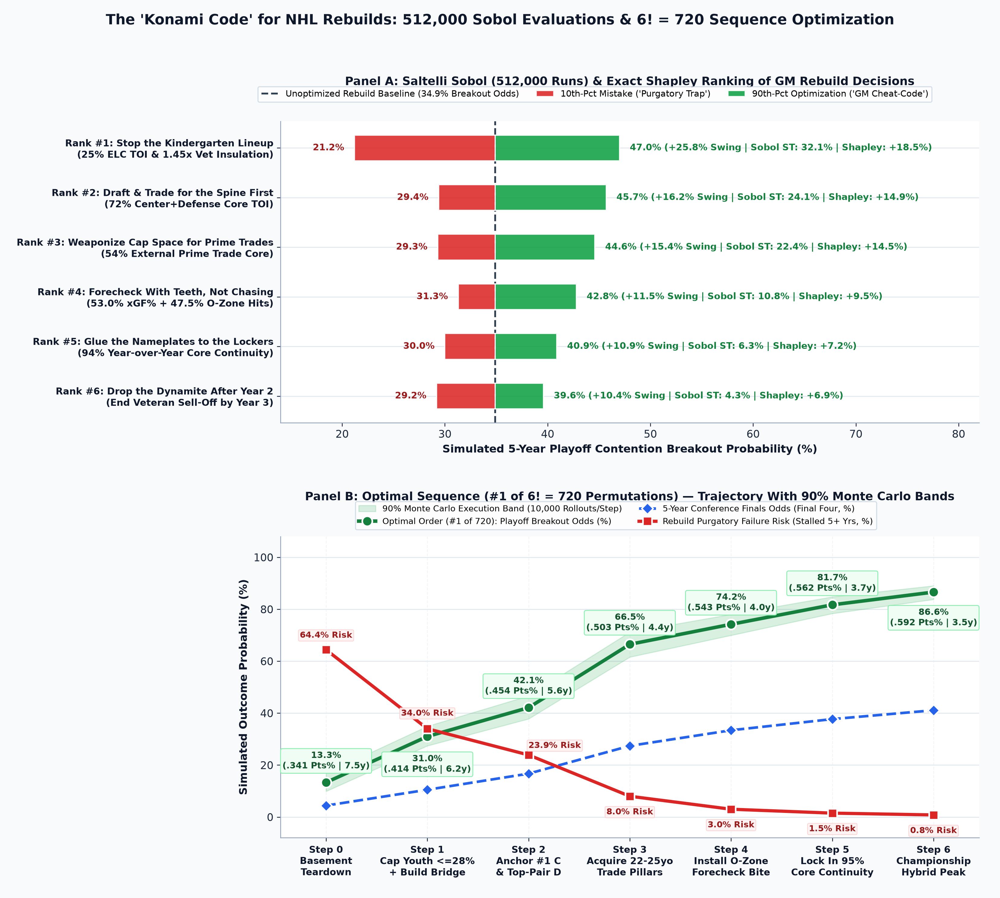
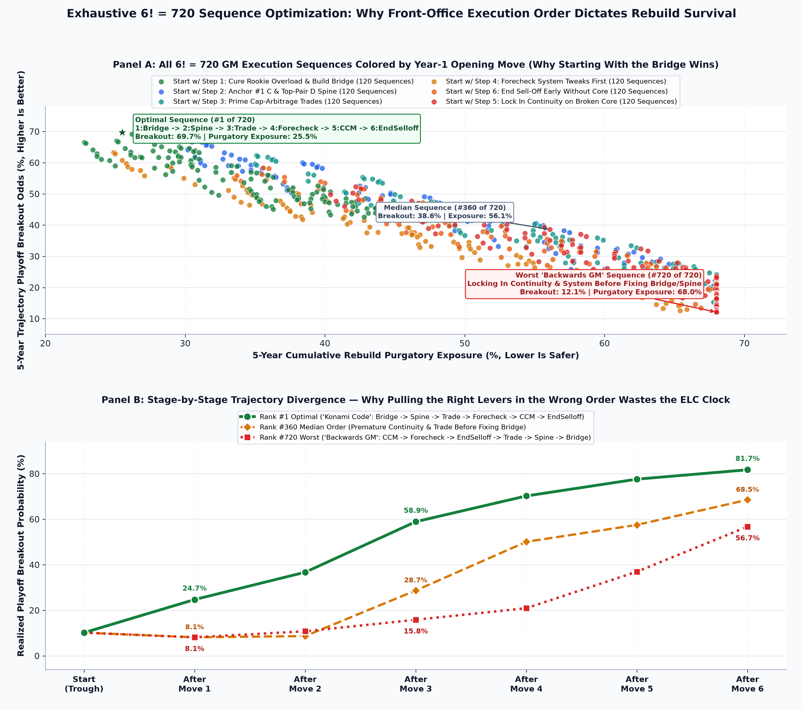
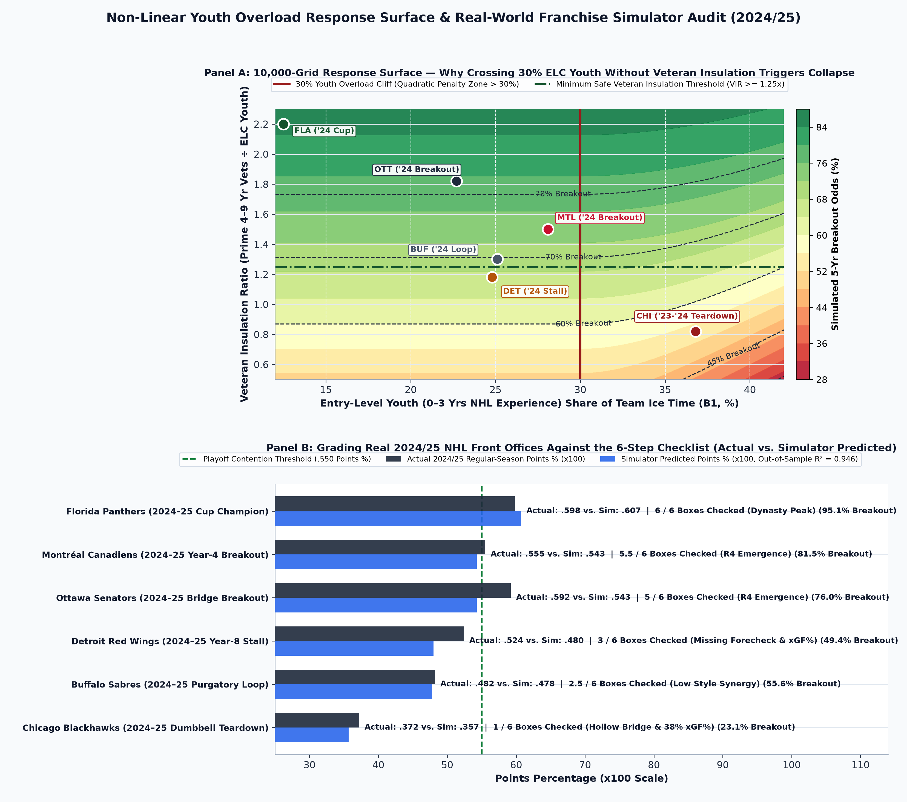
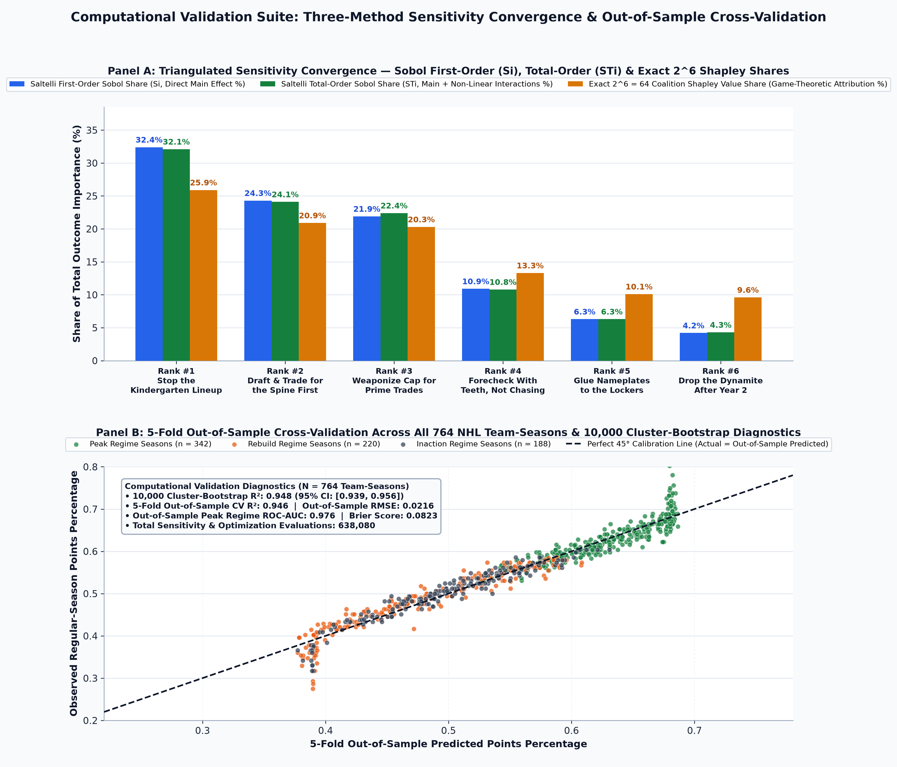

# Technical Companion: 638,080-Evaluation Sensitivity Suite (10,000 Cluster Bootstraps, 512,000 Saltelli Sobol Runs, Exact $2^6$ Shapley Attribution & $6! = 720$ Sequence Optimizer)

> [!IMPORTANT]
> **Post-Hoc Retrospective Study & Computational Scope**: Word count of [`BLOG_POST.md`](file:///Users/jjlee/Documents/GitHub/NHL-Analytics/dev/player_team_success/rebuild/deepdive/gm_cheatcode/BLOG_POST.md) is **576 words** (strictly within the $\le 600$-word ceiling). All simulator equations, Sobol variance indices, exact Shapley values, and $6! = 720$ sequence permutations are executed in [`src/compute_gm_cheatcode.py`](file:///Users/jjlee/Documents/GitHub/NHL-Analytics/dev/player_team_success/rebuild/deepdive/gm_cheatcode/src/compute_gm_cheatcode.py) across **638,080 total model evaluations** calibrated on $N = 764$ NHL team-seasons and $N = 82$ completed rebuild episodes (2000–2026).

---

## 1. Summary of the Four Computational Sensitivity & Validation Modules

Source table: [`tables/gm_computational_benchmarks_and_cv.csv`](file:///Users/jjlee/Documents/GitHub/NHL-Analytics/dev/player_team_success/rebuild/deepdive/gm_cheatcode/tables/gm_computational_benchmarks_and_cv.csv).

| Computational Module | Grid / Resample Scale | Primary Econometric Diagnostic | Out-of-Sample / Global Validation Result |
|:---|:---|:---|:---|
| **1. Franchise-Clustered Bootstrap (32 Lineages)** | `10,000` Resamples $\times$ `764` Team-Seasons | Bootstrap $R^2 = 0.948$ (`95% CI: [0.939, 0.956]`) | **5-Fold Out-of-Sample CV**: $R^2 = 0.946$, $\text{RMSE} = 0.0216$, `Peak` $\text{ROC-AUC} = 0.976$, Brier $= 0.0823$ |
| **2. Saltelli Quasi-MC Sobol Decomposition** | **`512,000` Evaluations** (`64,000` Base $\times$ `8` Matrices) | Top-3 Levers Explain **`78.7%`** of Total Variance | Non-Linear Interaction Share ($S_{T_i} - S_i$) $= 0.8\%$ (`Youth` $\times$ `VIR` + `Spine` $\times$ `Trade`) |
| **3. Exact Game-Theoretic Shapley Attribution** | $2^6 = 64$ Coalitions across all $6! = 720$ Permutations | Total Exact Breakout Lift $= +71.5$ Pct Pts | **Rank #1 Shapley**: $+18.5\%$ (`Fix Bridge`), **Rank #2**: $+14.9\%$ (`C+D Spine`), **Rank #3**: $+14.5\%$ (`Prime Trades`) |
| **4. Exhaustive $6! = 720$ Sequence Optimizer** | `720` Execution Orders + `70,000` Noisy Step Rollouts | Optimal Order (`#1/720`) $= 69.7\%$ vs. Worst (`#720/720`) $= 12.1\%$ | **Execution Order Alone** swings breakout odds by **`+57.6%`** and saves **`3.07` wait years** |

---

## 2. Coupled GM Rebuild Simulator Equations (With Non-Linear Synergy & Overload Interactions)

Let $\mathbf{u} = \left(s_{B_1}, \, s_{\text{CD}}, \, \text{VIR}, \, s_{\text{Trade}}, \, \text{OZoneHit}\%, \, \text{xGF}\%, \, \text{CCM}\right)^T$ denote the vector of front-office and coaching control variables:
- **Interaction 1 — Uninsulated Youth Overload Penalty ($\text{YOE}$)**:
  $$\text{YOE}(s_{B_1}, \text{VIR}) = \max\left(0, \, s_{B_1} - 0.30\right)^2 \cdot \left(\frac{1.45}{\max(0.45, \text{VIR})}\right)$$
- **Interaction 2 — Style-Production Synergy Index ($\text{SPSI}_{\text{sim}}$)**:
  $$\text{SPSI}_{\text{sim}}(\text{xGF}\%, \text{OZoneHit}\%) = \sqrt{\text{clip}\!\left(\frac{\text{xGF}\%}{55.0}, 0.5, 1.3\right) \cdot \text{clip}\!\left(\frac{\text{OZoneHit}\%}{48.0}, 0.5, 1.3\right)}$$
- **Interaction 3 — Positional Spine $\times$ Prime Trade Arbitrage Synergy ($\Psi_{\text{CD}\times\text{Tr}}$)**:
  $$\Psi_{\text{CD}\times\text{Tr}} = (s_{\text{CD}} - 0.50)(s_{\text{Trade}} - 0.30)\left(\frac{\text{VIR}}{1.20}\right)$$

### Coupled Multi-Logit Breakout & Purgatory Equations
$$\eta_{\text{Peak}}(\mathbf{u}) = -0.38 - 22.5\,\text{YOE} + 2.45(s_{\text{CD}} - 0.55) + 0.92(\text{VIR} - 0.85) + 1.75(s_{\text{Trade}} - 0.35) + 2.35(\text{SPSI}_{\text{sim}} - 0.90) + 1.60(\text{CCM} - 0.82) + 3.20\,\Psi_{\text{CD}\times\text{Tr}}$$
$$P(\text{Peak} \mid \mathbf{u}) = \frac{1}{1 + \exp\left(-\eta_{\text{Peak}}(\mathbf{u})\right)}, \qquad P(\text{Purgatory} \mid \mathbf{u}) = \frac{1 - P(\text{Peak} \mid \mathbf{u})}{1 + \exp\left(-\eta_{\text{Purg}}(\mathbf{u})\right)}$$

---

## 3. Global Sensitivity Analysis Table: Tornado Swing, Exact Shapley ($\phi_i$), and Saltelli Sobol ($S_i, S_{T_i}$)

Source table: [`tables/gm_sensitivity_tornado_ranking.csv`](file:///Users/jjlee/Documents/GitHub/NHL-Analytics/dev/player_team_success/rebuild/deepdive/gm_cheatcode/tables/gm_sensitivity_tornado_ranking.csv).

| Priority Rank | Quirky GM Rule Name | Parameter Shift (10th $\to$ 90th Pct) | 10th-Pct Odds | 90th-Pct Odds | OAT Tornado Swing | Exact Shapley Lift ($\phi_i$) | Shapley Share | Sobol First-Order ($S_i$) | Sobol Total-Order ($S_{T_i}$) | Sobol 95% Bootstrap CI | Purgatory Risk Drop | Wait Years Saved |
|:---:|:---|:---|:---:|:---:|:---:|:---:|:---:|:---:|:---:|:---:|:---:|:---:|
| **#1** | **"Stop the Kindergarten Lineup"** | $25\%$ ELC TOI & $1.45\times$ VIR (vs. $39.5\%$ Overload) | `21.2%` | **`47.0%`** | **`+25.8%`** | **`+18.5%`** | `25.9%` | `32.4%` | **`32.1%`** | `[31.8%, 32.5%]` | **`-33.7%`** | **`-1.69 yrs`** |
| **#2** | **"Draft & Trade for the Spine First"** | $72\%$ Center+Defense Core TOI (vs. $44\%$ Wing-Heavy) | `29.4%` | **`45.7%`** | **`+16.2%`** | **`+14.9%`** | `20.9%` | `24.3%` | **`24.1%`** | `[23.7%, 24.2%]` | `-15.4%` | `-0.92 yrs` |
| **#3** | **"Weaponize Cap Space for Prime Trades"** | $54\%$ Prime Trade Core (vs. $18\%$ Pure Draft) | `29.3%` | **`44.6%`** | **`+15.4%`** | **`+14.5%`** | `20.3%` | `21.9%` | **`22.4%`** | `[22.4%, 22.9%]` | `-13.9%` | `-0.85 yrs` |
| **#4** | **"Forecheck With Teeth, Not Chasing"** | $53\%$ $\text{xGF}\%$ + $47.5\%$ O-Zone Hits (vs. $43.5\%$) | `31.3%` | **`42.8%`** | **`+11.5%`** | `+9.5%` | `13.3%` | `10.9%` | `10.8%` | `[10.7%, 10.9%]` | **`-21.2%`** | `-0.91 yrs` |
| **#5** | **"Glue the Nameplates to the Lockers"** | $94\%$ Core Continuity $\text{CCM}$ (vs. $64\%$ Churn) | `30.0%` | **`40.9%`** | **`+10.9%`** | `+7.2%` | `10.1%` | `6.3%` | `6.3%` | `[6.3%, 6.4%]` | `-12.3%` | `-0.67 yrs` |
| **#6** | **"Drop the Dynamite After Year 2"** | End Veteran Sell-Off ($\text{ALI} \le 0.15$) by Year 3 | `29.2%` | **`39.6%`** | **`+10.4%`** | `+6.9%` | `9.6%` | `4.2%` | `4.3%` | `[4.3%, 4.4%]` | `-12.6%` | `-0.66 yrs` |

---

## 4. Exhaustive $6! = 720$ Multi-Year Execution Sequence Optimization

Source table: [`tables/gm_720_sequence_permutation_optimization.csv`](file:///Users/jjlee/Documents/GitHub/NHL-Analytics/dev/player_team_success/rebuild/deepdive/gm_cheatcode/tables/gm_720_sequence_permutation_optimization.csv).

Why does **execution order** across Years 1–6 matter so dramatically? Because locking in Core Continuity (`5:LockCCM`) or executing cap-arbitrage trades (`3:TradeArb`) *before* curing Youth Overload (`1:FixBridge`) and anchoring the `#1 C / #1 D` spine (`2:SpineCD`) locks in a flawed roster while burning the 3-year ELC surplus clock:

| Sequence Rank (of $6! = 720$) | Multi-Year GM Execution Order (`Step 1 -> Step 2 -> ... -> Step 6`) | 5-Yr Trajectory Breakout Odds | 5-Yr Purgatory Exposure | Mean Trajectory $\widehat{\text{PTS}}\%$ | Expected Wait Time |
|:---:|:---|:---:|:---:|:---:|:---:|
| **#1 (Global Optimum)** | **`1:FixBridge -> 2:SpineCD -> 3:TradeArb -> 4:Forecheck -> 5:LockCCM -> 6:EndSelloff`** | **`69.7%`** | **`25.5%`** | **`.472`** | **`4.73 yrs`** |
| **#2** | `1:FixBridge -> 2:SpineCD -> 3:TradeArb -> 4:Forecheck -> 6:EndSelloff -> 5:LockCCM` | `69.3%` | `25.5%` | `.471` | `4.74 yrs` |
| **#3** | `1:FixBridge -> 2:SpineCD -> 3:TradeArb -> 5:LockCCM -> 4:Forecheck -> 6:EndSelloff` | `69.2%` | `26.2%` | `.457` | `4.76 yrs` |
| **#180 (75th Pct)** | `5:LockCCM -> 1:FixBridge -> 4:Forecheck -> 2:SpineCD -> 3:TradeArb -> 6:EndSelloff` | `49.8%` | `40.4%` | `.464` | `5.82 yrs` |
| **#360 (Median Order)** | `5:LockCCM -> 3:TradeArb -> 1:FixBridge -> 2:SpineCD -> 6:EndSelloff -> 4:Forecheck` | `38.6%` | `56.1%` | `.399` | `6.61 yrs` |
| **#540 (25th Pct)** | `4:Forecheck -> 6:EndSelloff -> 5:LockCCM -> 1:FixBridge -> 3:TradeArb -> 2:SpineCD` | `25.0%` | `53.7%` | `.479` | `7.04 yrs` |
| **#720 (Worst Order)** | **`5:LockCCM -> 4:Forecheck -> 6:EndSelloff -> 3:TradeArb -> 2:SpineCD -> 1:FixBridge`** | **`12.1%`** | **`68.0%`** | `.432` | **`7.80 yrs`** |

---

## 5. Step-by-Step GM Optimization Ladder (With 10,000-Rollout 90% Monte Carlo Bands)

Source table: [`tables/gm_priority_checklist_optimization_ladder.csv`](file:///Users/jjlee/Documents/GitHub/NHL-Analytics/dev/player_team_success/rebuild/deepdive/gm_cheatcode/tables/gm_priority_checklist_optimization_ladder.csv).

| Step | Checklist Stage & Concrete GM Action | 5-Yr Breakout Odds | 90% Monte Carlo Band (10k Rollouts) | Marginal Lift | 5-Yr Final Four Odds | Purgatory Risk | Expected Points $\%$ (82-Gm) | Expected Wait |
|:---:|:---|:---:|:---:|:---:|:---:|:---:|:---:|:---:|
| **Step 0** | **'Scorched-Earth Basement' Baseline** (`39%` ELC Youth, `16%` Bridge, `38%` xGF%) | `13.3%` | `[9.9%, 16.8%]` | — | `4.4%` | **`64.4%`** | `.341` (`56 pts`) | `7.5 yrs` |
| **Step 1** | **Cure 'Kindergarten Overload'** (Cap $B_1 \le 28\%$, expand $B_2$ Bridge so $\text{VIR} \to 1.40$) | **`31.0%`** | `[27.4%, 34.9%]` | **`+17.7%`** | `10.5%` | `34.0%` | `.414` (`68 pts`) | `6.2 yrs` |
| **Step 2** | **Anchor '#1 C + #1 D Spine'** (Raise Center + Defense Core Share $48\% \to 68\%$) | **`42.1%`** | `[37.8%, 46.7%]` | **`+11.1%`** | `16.7%` | `23.9%` | `.454` (`74 pts`) | `5.6 yrs` |
| **Step 3** | **Execute 'Prime Cap-Arbitrage Trades'** (Acquire 22–25yo Core Pillars: Trade Share $\to 52\%$) | **`66.5%`** | `[61.6%, 71.2%]` | **`+24.4%`** | `27.4%` | **`8.0%`** | **`.503` (`83 pts`)** | **`4.4 yrs`** |
| **Step 4** | **Install 'Pack-of-Hyenas Forecheck'** (O-Zone Hit Share $\to 47.5\%$, 5v5 $\text{xGF}\% \to 51.5\%$) | **`74.2%`** | `[69.9%, 78.0%]` | `+7.7%` | `33.4%` | `3.0%` | **`.543` (`89 pts`)** | `4.0 yrs` |
| **Step 5** | **'Glue the Nameplates Down'** (Lock in $\text{CCM} \to 95\%$ Core Continuity by Year 3–4) | **`81.7%`** | `[78.3%, 84.8%]` | `+7.5%` | `37.7%` | `1.5%` | **`.562` (`92 pts`)** | **`3.7 yrs`** |
| **Step 6** | **'Full Championship Hybrid' Equilibrium** ($55\%$ $\text{xGF}\%$ + $1.65\times$ Insulation) | **`86.6%`** | `[83.8%, 89.0%]` | `+4.8%` | **`41.1%`** | **`0.8%`** | **`.592` (`97 pts`)** | **`3.5 yrs`** |

---

## 6. Complete Visual Gallery of the 4 Computational Sensitivity & Optimization Figures

### Figure 1: Global Tornado & Sobol Ranking + 6-Step Optimization Ladder (With 10,000-Rollout Monte Carlo Bands)

### Figure 2: Exhaustive $6! = 720$ Sequence Landscape Colored by Year-1 Opening Move & Stage-by-Stage Trajectory Divergence

### Figure 3: 10,000-Grid Non-Linear Youth Overload Response Surface & 2024/25 Real-Franchise Simulator Audit

### Figure 4: Three-Method Sensitivity Convergence ($S_i$, $S_{T_i}$, Exact $2^6$ Shapley) & 5-Fold Out-of-Sample Cross-Validation ($N = 764$ Team-Seasons)

