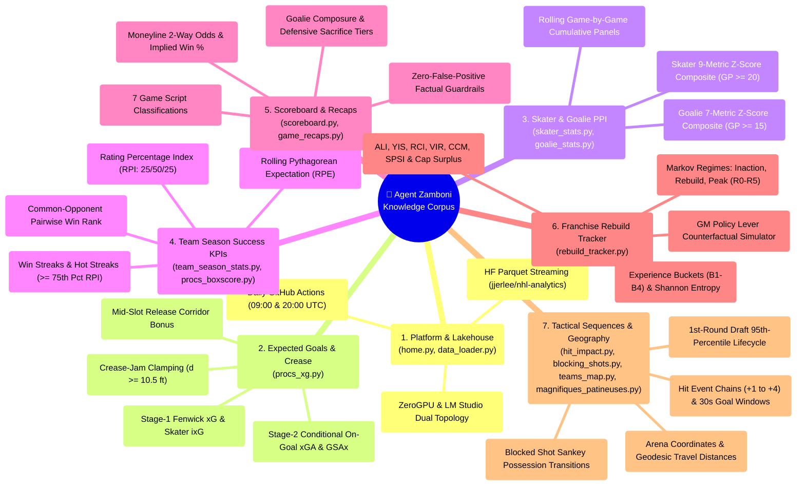
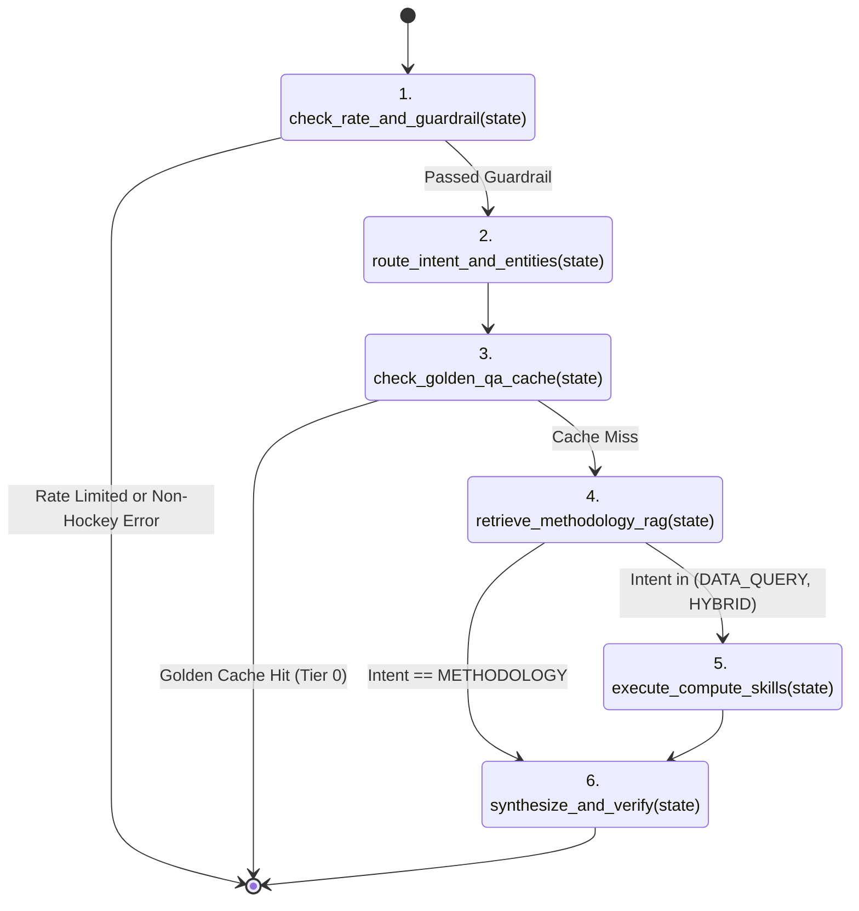
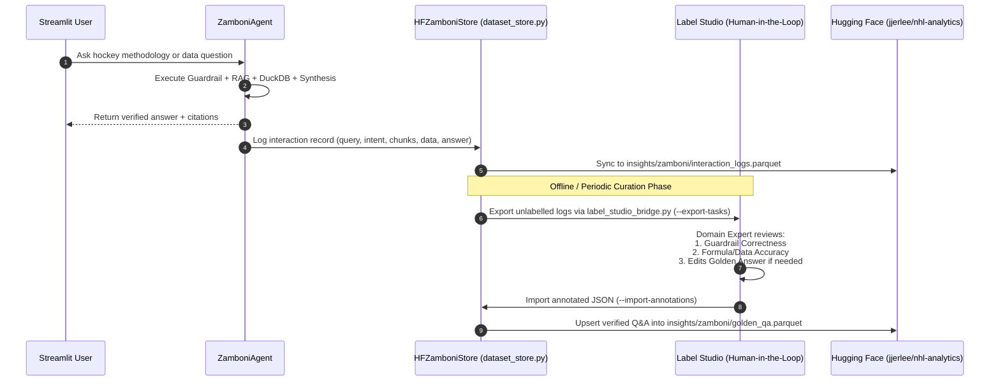

# Agent Zamboni (`dev/zamboni`) — Exhaustive Knowledge Base Reference, Calculation Compendium & LangGraph / Label Studio Pipeline Specification

> Companion specification to [`ZAMBONI_ARCHITECTURE_DESIGN.md`](file:///Users/jjlee/Documents/GitHub/NHL-Analytics/dev/zamboni/ZAMBONI_ARCHITECTURE_DESIGN.md).  
> Details the complete domain knowledge corpus across all Rinklytics pages, exact mathematical derivations, Hugging Face Dataset (`jjerlee/nhl-analytics`) query schemas, LangGraph orchestration nodes, and Label Studio human-in-the-loop (HITL) data labeling workflows.

---

## 1. Complete Rinklytics Knowledge Base & Calculation Compendium

Agent Zamboni's internal knowledge base (`dev/zamboni/knowledge_base.py`) is organized into **12 canonical knowledge domains** corresponding to every page, pipeline, and econometric study in the repository. Each knowledge entry contains:
- `chunk_id`: Unique identifier (e.g., `kb_xg_dual_stage`, `kb_ppi_skater_goalie`, `kb_team_rpe_rpi_pairwise`)
- `title`: Human-readable topic title
- `page_view`: Corresponding Streamlit view in `app/views/`
- `source_files`: Exact repository file paths implementing the calculation
- `hf_dataset_tables`: Exact Parquet tables in `hf://datasets/jjerlee/nhl-analytics`
- `formulas_latex`: Canonical LaTeX equations
- `methodology_explanation`: Detailed explanation of how the calculation works, why it is designed that way, and how to interpret values
- `keywords`: Lexical and semantic tags for hybrid BM25 + TF-IDF retrieval



---

### 1.1 Domain-by-Domain Calculation Reference

#### Domain A: Expected Goals ($xG_F$), Individual Expected Goals ($ixG$), & Goaltender $GSAx$
- **Canonical Implementation**: [`src/data/apinhle/function/procs_xg.py`](file:///Users/jjlee/Documents/GitHub/NHL-Analytics/src/data/apinhle/function/procs_xg.py), [`dev/agent/scoreboard/METRICS_XG_GSAX.md`](file:///Users/jjlee/Documents/GitHub/NHL-Analytics/dev/agent/scoreboard/METRICS_XG_GSAX.md)
- **Hugging Face Tables**:
  - `measurement/player/player_season.parquet`
  - `measurement/player/player_game.parquet`
  - `measurement/box/team_season.parquet`
  - `measurement/box/game_stats.parquet`
- **How Calculations Are Done**:
  1. **Coordinate Normalization**: NHL play-by-play coordinates $(x, y) \in [-100, 100] \times [-42.5, 42.5]$ are normalized using `homeTeamDefendingSide` and `zoneCode` so the attacking net is at $(89, 0)$.
  2. **Euclidean Distance & Shot Angle**:
     $$d = \sqrt{(89 - x_{\text{norm}})^2 + y^2}, \qquad \theta = \arctan2(|y|, \max(89 - x_{\text{norm}}, 1.0)) \cdot \frac{180}{\pi}$$
  3. **Crease-Jam Clamping ($d_{\text{eff}} = \max(d, 10.5\text{ ft})$)**: Empirical conversion peaks in the inner slot ($8\text{–}15\text{ ft}$) and plateaus inside $0\text{–}7\text{ ft}$ due to goalie pad seals and jammed scrambles. Clamping $d$ at $10.5\text{ ft}$ prevents linear log-odds extrapolation from inflating jam-shot probabilities.
  4. **Danger Zone Classification**:
     - **High-Danger ($HD$)**: $d \le 25\text{ ft}$ and $\theta \le 40^\circ$ (or rebound within $d \le 30\text{ ft}$).
     - **Medium-Danger ($MD$)**: Not $HD$, and ($d \le 40\text{ ft}$ and $\theta \le 50^\circ$).
     - **Low-Danger ($LD$)**: Perimeter shots ($d > 40\text{ ft}$ or $\theta > 50^\circ$).
  5. **Stage-1 Fenwick Model (Team $xG$ & Skater $ixG$)**: Evaluated on all unblocked attempts (`shot-on-goal`, `missed-shot`, `goal`):
     $$\eta_F = -1.25 - 0.0395\,d_{\text{eff}} - 0.0135\,\theta + 0.36\,\mathbb{I}_{\text{slot}} + \gamma_{\text{type}} + 0.68\,\mathbb{I}_{\text{reb}} + 0.35\,\mathbb{I}_{\text{rush}} + 3.35\,\mathbb{I}_{\text{EN}}$$
     $$xG_F = \frac{1}{1 + e^{-\eta_F}}$$
     - Skater **Goals Above Expected**: $\text{GAE} = \text{Goals} - ixG$.
  6. **Stage-2 Conditional On-Goal Model (Goalie $xGA_{\text{SOG}}$ & $GSAx$)**: Evaluated exclusively on non-empty-net Shots on Goal (`shot-on-goal`, `goal` with $\mathbb{I}_{\text{EN}} = 0$):
     $$\eta_{\text{SOG}} = -0.82 - 0.0385\,d_{\text{eff}} - 0.0125\,\theta + 0.38\,\mathbb{I}_{\text{slot}} + \gamma_{\text{type}} + 0.62\,\mathbb{I}_{\text{reb}} + 0.32\,\mathbb{I}_{\text{rush}}$$
     $$xGA_{\text{SOG}} = \frac{1}{1 + e^{-\eta_{\text{SOG}}}}$$
     $$\text{GSAx} = \sum_{i \in \text{SOG}_{\text{non-EN}}} xGA_{\text{SOG}, i} - GA_{\text{non-EN}}, \qquad xSV\% = 1 - \frac{xGA_{\text{SOG}}}{SA}, \qquad dSV\% = SV\% - xSV\%$$

---

#### Domain B: Skater & Goalie Player Performance Index ($\text{PPI}$)
- **Canonical Implementation**: [`app/exe/player_stats.py`](file:///Users/jjlee/Documents/GitHub/NHL-Analytics/app/exe/player_stats.py#L300-L370), [`app/views/skater_stats.py`](file:///Users/jjlee/Documents/GitHub/NHL-Analytics/app/views/skater_stats.py), [`app/views/goalie_stats.py`](file:///Users/jjlee/Documents/GitHub/NHL-Analytics/app/views/goalie_stats.py)
- **Hugging Face Tables**: `measurement/player/player_season.parquet`, `measurement/player/player_game.parquet`
- **How Calculations Are Done**:
  - **Skater PPI (`compute_skater_ppi`)**:
    1. Filter to regular season (`idx_season_type == 2`), target `season_year`, and minimum games played $\text{GP} \ge 20$.
    2. For each of the 9 metrics $c \in \{\text{points\_per\_game}, \text{goals\_per\_game}, \text{assists\_per\_game}, \text{plusMinus}, \text{shots\_per\_game}, \text{shootingPctg}, \text{avgTimeOnIcePerGame}, \text{ixg\_per\_game}, \text{goals\_above\_expected}\}$, compute the peer-group z-score:
       $$z_{i, c} = \frac{x_{i, c} - \mu_c}{\sigma_c}$$
    3. Compute the unweighted mean across all valid z-scores:
       $$\text{PPI}_{\text{skater}, i} = \text{round}\left(\frac{1}{|\mathcal{C}|} \sum_{c \in \mathcal{C}} z_{i, c},\; 3\right)$$
  - **Goalie PPI (`compute_goalie_ppi`)**:
    1. Filter to regular season goalies with $\text{GP} \ge 15$.
    2. Invert Goals Against Average ($\text{gaa\_inv} = -\text{goalsAgainstAverage}$) so higher values indicate better goal prevention.
    3. Compute peer-group z-scores across 7 dimensions $c \in \{\text{savePercentage}, \text{gaa\_inv}, \text{wins}, \text{shutouts}, \text{saves\_per\_game}, \text{gsax}, \text{dsave\_pct}\}$ and average them:
       $$\text{PPI}_{\text{goalie}, i} = \text{round}\left(\frac{1}{7} \sum_{c=1}^7 z_{i, c},\; 3\right)$$

---

#### Domain C: Team Season Success KPIs ($RPE$, $RPI$, Pairwise Win Rank, Streaks)
- **Canonical Implementation**: [`src/data/apinhle/function/procs_boxscore.py`](file:///Users/jjlee/Documents/GitHub/NHL-Analytics/src/data/apinhle/function/procs_boxscore.py), [`app/views/team_season_stats.py`](file:///Users/jjlee/Documents/GitHub/NHL-Analytics/app/views/team_season_stats.py)
- **Hugging Face Tables**: `measurement/box/team_season.parquet`, `data/games.parquet`
- **How Calculations Are Done**:
  1. **Standings Points & Win Percentage**:
     $$\text{PTS} = 2W + \text{OTL}, \qquad \text{GP} = W + L + \text{OTL}, \qquad \text{WP} = \frac{W}{\text{GP}}$$
  2. **Rolling Pythagorean Expectation ($RPE$) & Fitted Wins**:
     $$\text{RPE} = \frac{\left(\sum GF\right)^2}{\left(\sum GF\right)^2 + \left(\sum GA\right)^2}, \qquad \text{rwin\_fittedPE} = (0.809623 \cdot \text{RPE} + 0.042901) \times 82$$
     *(In `ScoreboardAgent` season context, exponent $2.15$ is also tracked: $\text{Pyth Win \%} = \frac{GF^{2.15}}{GF^{2.15} + GA^{2.15}}$).*
  3. **Rating Percentage Index ($RPI$)**:
     $$\text{RPI}_i = 0.25 \cdot \text{WP}_{\text{own}, i} + 0.50 \cdot \text{WP}_{\text{opponents}, i} + 0.25 \cdot \text{WP}_{\text{common opponents}, i}$$
  4. **Strength of Record — Common-Opponent Pairwise Win Rank (`pairwise_win`)**:
     - For every pair of teams $(i, j)$, identify the set of common opponents $\mathcal{O}_{i,j}$ both teams have faced.
     - Compare team $i$'s win ratio vs. common opponents against team $j$'s win ratio:
       $$\text{h2h\_win}_{i,j} = \mathbb{I}\left(\frac{W_{i, \mathcal{O}_{i,j}}}{GP_{i, \mathcal{O}_{i,j}}} > \frac{W_{j, \mathcal{O}_{i,j}}}{GP_{j, \mathcal{O}_{i,j}}}\right)$$
     - Sum $\sum_j \text{h2h\_win}_{i,j}$ and rank all 32 teams (`method='min'`, ascending=False so Rank 1 has the most pairwise wins).
  5. **Win Streaks & Hot Streaks**:
     - `idx_WinStreak`: 3 consecutive game wins ($W_t + W_{t-1} + W_{t-2} = 3$).
     - `idx_WinStreak_expected`: A 3-game win streak where at least 2 of the 3 wins were against opponents with lower RPI ($\text{RPI}_{\text{against}} < \text{RPI}_{\text{for}}$).
     - `idx_HotStreak`: A 3-game win streak containing at least 1 win against an elite opponent in the top quartile of league RPI ($\text{RPI}_{\text{against}} > Q_{0.75}(\text{RPI})$).
  6. **Min-Max $[0, 1]$ KPI Normalization (`kpinorm`)**:
     $$\text{kpinorm}(x) = \frac{x - \min(x)}{\max(x) - \min(x)}$$
     Applied to produce `kpi_pe`, `kpi_pairwise` (computed on $-\text{pairwise\_win}$ so Rank 1 = `1.000`), `kpi_wp`, `kpi_xg`, `kpi_hdcf`, and `kpi_gsax`.

---

#### Domain D: Franchise Rebuild Tracker & Equilibrium Regimes (2000–2025)
- **Canonical Implementation**: [`app/views/rebuild_tracker.py`](file:///Users/jjlee/Documents/GitHub/NHL-Analytics/app/views/rebuild_tracker.py), `dev/player_team_success/rebuild/`
- **Data Tables**: `dev/player_team_success/rebuild/data/processed/*` & `results/tables/*`
- **How Calculations Are Done**:
  1. **Markov-Switching Macro Regimes & 6 Sub-States**:
     - **Peak**: `R0_CONTENDER` (Peak contention window)
     - **Inaction**: `R1_SLUMP` (Mediocrity / mild slump without structural teardown)
     - **Rebuild**: `R2_TEARDOWN` (Veteran sell-off), `R3_INCUBATION` (Developing youth core), `R4_EMERGENCE` (Playoff breakout), `R5_PURGATORY` (Stalled rebuild $\ge 5$ years without breaking out).
  2. **Experience Cohort TOI Shares (`B1–B4`) & Shannon Balance**:
     - `s_b1_elc_0_3` (`B1`): Ice-time share of entry-level players (0–3 NHL seasons).
     - `s_b2_prime_4_6` (`B2`): Prime Bridge core (4–6 NHL seasons).
     - `s_b3_peak_7_9` (`B3`): Peak Core (7–9 NHL seasons).
     - `s_b4_vet_10_plus` (`B4`): Greybeard Veterans (10+ NHL seasons).
     - **Shannon Experience Entropy**: $H = -\sum_{k=1}^4 s_{B_k} \ln(s_{B_k})$, measuring roster age balance vs. single-cohort concentration.
     - **Veteran Insulation Ratio (`VIR`)**: Ratio of stabilizing prime/veteran TOI (`B3 + B4`) insulating developing entry-level youth (`B1`).
  3. **Front-Office Structural Indicators**:
     - `ali_score` (**Asset Liquidation Index**): Magnitude of veteran TOI sold off year-over-year.
     - `yis_score` (**Youth Ice-Time Share**): Deployment of young players in meaningful minutes.
     - `rci_score` (**Roster Churn Index**): Year-to-year roster turnover ($1 - \text{CCM}$).
     - `spsi_style_synergy` (**Skill $\times$ Physicality Synergy Index**): Interaction between offensive skill ($xGF\%$) and offensive-zone forecheck physicality (`ozone_hit_pct`).
     - `surplus_value_total` (**Net Cap Surplus, $\$M$**): Sum of player on-ice market value minus actual cap hit ($\sum (\text{MRP}_{\text{est}} - \text{CapHit})$).

---

#### Domain E: Hit on Impact & Shot Blocking Sequential Decision Science
- **Canonical Implementation**: [`app/views/hit_impact.py`](file:///Users/jjlee/Documents/GitHub/NHL-Analytics/app/views/hit_impact.py), [`app/views/blocking_shots.py`](file:///Users/jjlee/Documents/GitHub/NHL-Analytics/app/views/blocking_shots.py)
- **Hugging Face Tables**: `measurement/action/hits/*.parquet` (9 tables), `dev/decision_science/plays_blockingShots/result/table - sequence blocked shot stats.csv`
- **How Calculations Are Done**:
  - **Hit on Impact**:
    - Tracks the exact play-by-play event sequence (`Event +1`, `Event +2`, `Event +3`, `Event +4`) immediately following every recorded hit, plus a **30-second downstream window** (`hit_goal_window_30s`).
    - Computes **Puck Retention / Win Rate** (percentage of hits where the hitting team owns the subsequent possession/shot event vs. the hit team retaining puck control).
    - Highlights the tactical divergence between **Offensive-Zone Forecheck Hits** (which disrupt breakouts and generate high-danger turnovers) vs. **Defensive-Zone Hits** (which often reflect chasing the puck without possession).
  - **Blocking Shots**:
    - Models a 4-stage Sankey Markov chain following a blocked shot:
      1. `blocker_team_lag1_now`: Zone/context prior to block (`Defense`, `Neutral`, `Offense`).
      2. `eventOwnerTeam_sequence`: Whether the next event is `Own action` (blocker's team recovers possession) or `Opponent action` (shooting team retains offensive pressure).
      3. `group`: Macro category of the next event (`Shot`, `Possession`, `Stoppage`, `Penalty`, `Goal`).
      4. `typeDescKey`: Exact NHL PBP event (`shot-on-goal`, `blocked-shot`, `missed-shot`, `hit`, `giveaway`, `takeaway`, `stoppage`, `faceoff`, `goal`).

---

#### Domain F: Scoreboard, Betting Odds, Game Recaps, Draft Lifecycles & Travel Map
- **Scoreboard & Odds** ([`scoreboard.py`](file:///Users/jjlee/Documents/GitHub/NHL-Analytics/app/views/scoreboard.py)): Pulls `data/games.parquet` and `data/odds.parquet` (`MONEY_LINE_2_WAY`, prioritizing `US` then `CAN` feeds). Converts American moneyline odds $M$ to implied probability:
  $$P_{\text{implied}} = \begin{cases} \frac{-M}{-M + 100} & \text{if } M < 0 \\ \frac{100}{M + 100} & \text{if } M > 0 \end{cases}$$
- **Game Recaps** ([`game_recaps.py`](file:///Users/jjlee/Documents/GitHub/NHL-Analytics/app/views/game_recaps.py), [`dev/agent/scoreboard/`](file:///Users/jjlee/Documents/GitHub/NHL-Analytics/dev/agent/scoreboard/AGENT_INFRASTRUCTURE.md)): Classifies games into 7 scripts (`COMEBACK`, `WIRE_TO_WIRE`, `BLOWOUT`, `DEFENSIVE_BATTLE`, `OVERTIME_THRILLER`, `SHOOTOUT_DUEL`, `REGULATION`), audits period flow and goalie composure, and verifies every generated narrative against box score ground truth.
- **Magnifiques Patineuses / Amateur Draft** ([`magnifiques_patineuses.py`](file:///Users/jjlee/Documents/GitHub/NHL-Analytics/app/views/magnifiques_patineuses.py), [`draft_analysis.py`](file:///Users/jjlee/Documents/GitHub/NHL-Analytics/app/exe/draft_analysis.py)): Evaluates 1st-round NHL draftees across their career lifecycle (`year_inNHL`), defining an **Exceptional Season** as performing $\ge 95\text{th}$ percentile in points production relative to draft peers, and contrasting multi-exceptional stars against 1st-round picks who failed to stick in the NHL.
- **Teams Map** ([`teams_map.py`](file:///Users/jjlee/Documents/GitHub/NHL-Analytics/app/views/teams_map.py), [`map_utils.py`](file:///Users/jjlee/Documents/GitHub/NHL-Analytics/app/exe/map_utils.py)): Computes exact geodesic arena-to-arena distances in meters/kilometers/miles from `teamlist_locations_distance_meters.csv`.

---

## 2. LangGraph & Label Studio Pipeline Specification

### 2.1 LangGraph State Graph Architecture (`dev/zamboni/agent.py`)
The `ZamboniAgent` orchestrator is structured as a 6-node directed state graph. If `langgraph` is installed in the environment, it compiles a native `langgraph.graph.StateGraph(ZamboniState)`; if running in a minimal container without `langgraph`, it executes the exact same 6 node functions deterministically via `LightweightStateGraph`:



### 2.2 Label Studio Data Labeling & Continuous Improvement Workflow (`dev/zamboni/label_studio_bridge.py`)



#### Label Studio XML Configuration Template (Embedded in `label_studio_bridge.py`)
```xml
<View>
  <Header value="🚜 Agent Zamboni — Hockey Analytics Q&amp;A Verification &amp; Golden Curation"/>
  <View style="background: #f8f9fa; padding: 12px; border-radius: 6px; margin-bottom: 10px;">
    <Text name="user_query" value="User Question: $query"/>
    <Text name="detected_intent" value="Detected Intent: $intent | Domains: $domains | Engine: $generator_model"/>
    <Text name="computed_evidence" value="Computed Evidence / Citations: $evidence_summary"/>
  </View>
  <Header value="1. Domain Guardrail Evaluation"/>
  <Choices name="guardrail_label" toName="user_query" choice="single" showInline="true">
    <Choice value="VALID_HOCKEY" alias="Valid Hockey / Rinklytics Query"/>
    <Choice value="REJECT_NON_HOCKEY" alias="Should Reject (Non-Hockey / Off-Topic)"/>
  </Choices>
  <Header value="2. Response Quality &amp; Mathematical Fidelity"/>
  <Choices name="quality_rating" toName="user_query" choice="single" showInline="true">
    <Choice value="GOLD_VERIFIED" alias="100% Accurate (Promote to Golden Cache)"/>
    <Choice value="NEEDS_EDIT" alias="Minor Edit Needed"/>
    <Choice value="HALLUCINATION" alias="Factual / Math Error"/>
  </Choices>
  <Header value="3. Canonical Golden Response (Markdown)"/>
  <TextArea name="golden_answer" toName="user_query" editable="true" maxSubmissions="1" rows="8" transcription="true" defaultValue="$answer_markdown"/>
</View>
```

---

## 3. Implementation Checklist & Build Plan

- [x] **Step 1: Exhaustive System Architecture & Knowledge Specification**
  - [`dev/zamboni/ZAMBONI_ARCHITECTURE_DESIGN.md`](file:///Users/jjlee/Documents/GitHub/NHL-Analytics/dev/zamboni/ZAMBONI_ARCHITECTURE_DESIGN.md)
  - [`dev/zamboni/KNOWLEDGE_AND_PIPELINE_SPEC.md`](file:///Users/jjlee/Documents/GitHub/NHL-Analytics/dev/zamboni/KNOWLEDGE_AND_PIPELINE_SPEC.md)
- [ ] **Step 2: Core Configuration, Environment & Global 1-Req/Sec Rate Limiter**
  - `dev/zamboni/config.py`, `dev/zamboni/env_utils.py`, `dev/zamboni/rate_limiter.py`, `dev/zamboni/models.py`
- [ ] **Step 3: Strict Hockey-Only Domain Guardrail Engine**
  - `dev/zamboni/guardrails.py` (3-layer rejection of non-hockey queries + output fact checker)
- [ ] **Step 4: Comprehensive Knowledge Base & Hybrid RAG Retriever**
  - `dev/zamboni/knowledge_base.py` (all 11 application pages, formulas, code citations) & `dev/zamboni/knowledge_rag.py`
- [ ] **Step 5: Deterministic DuckDB/Pandas Compute Engine over Hugging Face Datasets**
  - `dev/zamboni/compute_engine.py` & `dev/zamboni/router.py`
- [ ] **Step 6: Multi-Tier Synthesizer, Orchestrator Agent, Lakehouse Store & Label Studio Bridge**
  - `dev/zamboni/synthesizer.py`, `dev/zamboni/dataset_store.py`, `dev/zamboni/label_studio_bridge.py`, `dev/zamboni/agent.py`, `dev/zamboni/cli.py`
- [ ] **Step 7: Streamlit Page (`app/views/zamboni.py`) Right Below "Home" + Docker Verification**
  - Register `ZAMBONI` in `app/app.py` right below `HOME`, add bilingual `app/i18n.py` keys, build `app/views/zamboni.py`, test via `uv run python`, and rebuild local Docker (`docker compose -f deploy/local/docker-compose.yml up -d --build`).
