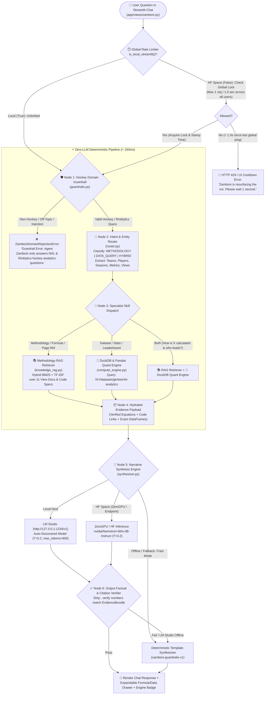
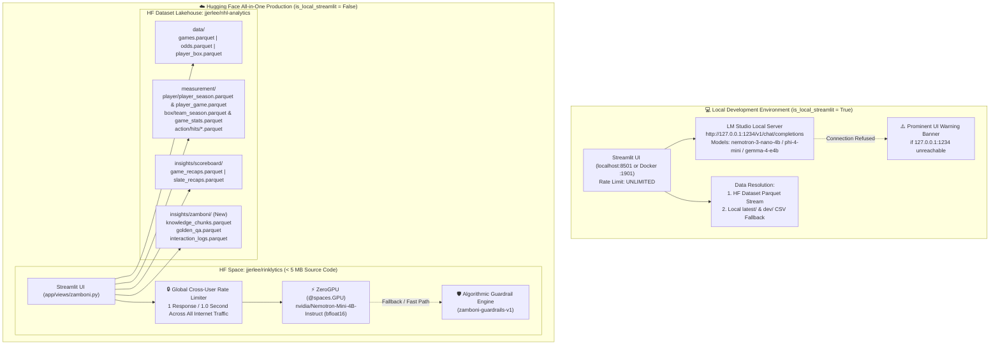
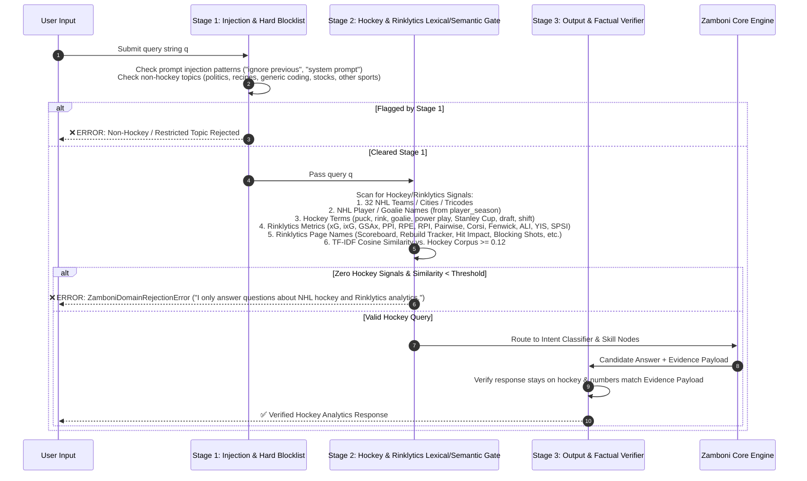
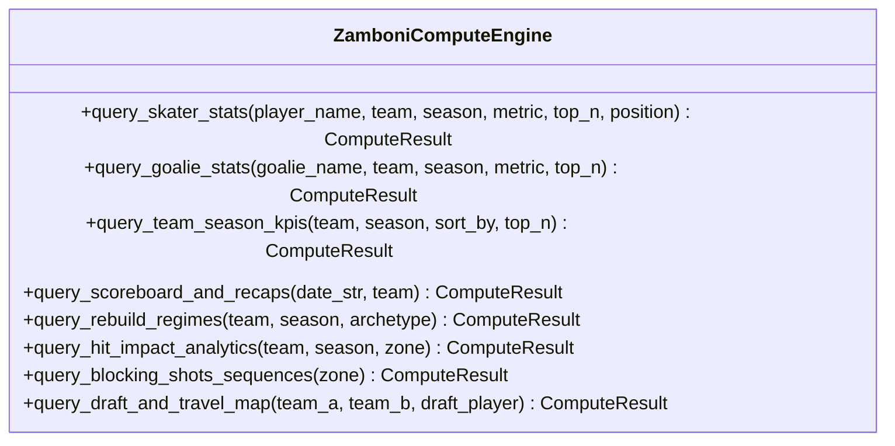
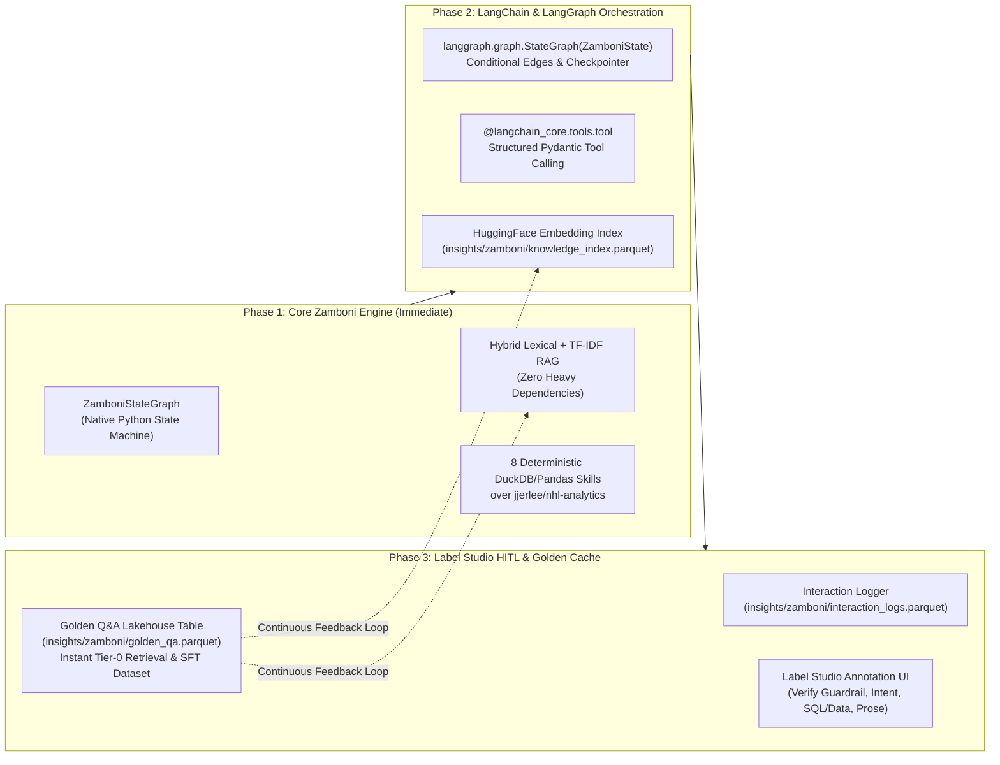
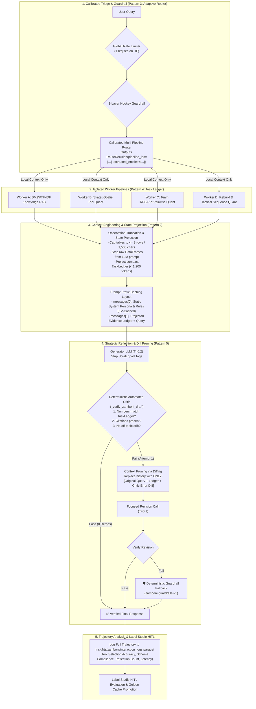

# Agent Zamboni (`dev/zamboni`) — Comprehensive System Architecture, Knowledge Base & Engineering Design

> **Codename**: `Zamboni` (Persona Aliases: *Agent Zamboni* — The Ice-Smoothing Methodological & Data Architect; *Gordie* — The Tactical & Historical Hockey Analyst)  
> **Location**: `/Users/jjlee/Documents/GitHub/NHL-Analytics/dev/zamboni/`  
> **UI Entry Point**: `app/views/zamboni.py` (Navigation: Right below **Home** in `app/app.py`)  
> **Cloud Lakehouse**: [`hf://datasets/jjerlee/nhl-analytics`](https://huggingface.co/datasets/jjerlee/nhl-analytics)  
> **Cloud Runtime**: [`hf://spaces/jjerlee/rinklytics`](https://huggingface.co/spaces/jjerlee/rinklytics)

---

## 1. Executive Summary & Mission Scoping

### 1.1 Why "Agent Zamboni"?
In hockey, the **Zamboni** resurfaces rough, scarred ice into a clean, transparent sheet between periods. Within **Rinklytics (NHL Analytics)**, **Agent Zamboni** serves the exact same role for hockey data science: it takes complex spatial econometrics, longitudinal panel datasets, Markov sequence models, and live NHL telemetry, and smooths them into **transparent, mathematically verified, citation-backed answers** for users.

*(Note: The architecture supports configurable persona profiles so the agent can be surfaced as **Agent Zamboni** by default, or toggled to **Gordie** for tactical/historical storytelling or **Zambia** in config).*

### 1.2 Core Objectives
1. **Methodological Reference Authority**: Explain *how* every metric, model, and visualization in Rinklytics is formulated, calibrated, and interpreted—citing exact mathematical equations, thresholds, and canonical source code (`procs_xg.py`, `procs_boxscore.py`, `player_stats.py`, `rebuild_tracker.py`, etc.).
2. **Live Hugging Face Lakehouse Quantitative Analyst**: Answer empirical hockey questions (player stats, goalie $GSAx$, team $xG\%$, Pythagorean expectation, draft lifecycles, rebuild regimes, hit sequences, shot blocking transitions, and scoreboard recaps) by executing deterministic **Python / DuckDB / Pandas** queries against [`jjerlee/nhl-analytics`](https://huggingface.co/datasets/jjerlee/nhl-analytics) rather than relying on LLM parametric memory.
3. **Strict Hockey-Only Domain Guardrail**: Enforce a multi-layer defense-in-depth guardrail that **strictly rejects** any non-hockey, off-topic, or adversarial prompt with a structured error before consuming LLM compute.
4. **Controlled Multi-Tier Compute & Global Rate Limiting**:
   - **Local Environment (`is_local_streamlit() == True`)**: Unlimited rate, powered by local **LM Studio** (`http://127.0.0.1:1234/v1`) + local/HF DuckDB compute, with an immediate alarm banner and deterministic fallback (`zamboni-guardrails-v1`) if LM Studio is offline.
   - **Production Environment (`is_local_streamlit() == False` on Hugging Face Spaces)**: Protected by a **strict global cross-user rate limit of `1 response / 1.0 second` across all internet users**, bounded token budgets, and a compute-first retrieval cascade hosted entirely on Hugging Face.
5. **Ever-Growing Capabilities (LangGraph + RAG + Label Studio)**: Designed with a modular skill-graph architecture ready for **LangChain / LangGraph** stateful orchestration and a **Label Studio** human-in-the-loop (HITL) annotation pipeline that turns production user questions into verified golden Q&A pairs stored in `jjerlee/nhl-analytics`.

---

## 2. System Constraints & Architectural Principles

| Constraint Dimension | Design Mandate | Concrete Engineering Implementation |
| :--- | :--- | :--- |
| **100% Open-Source Stack** | No proprietary paid API lock-in; fully self-contained and reproducible. | Python 3.12/3.13, Streamlit, DuckDB, Pandas, NumPy, Scikit-Learn (BM25/TF-IDF), Hugging Face Hub, LM Studio (local), ZeroGPU `Nemotron-Mini-4B-Instruct` (cloud), LangGraph/LangChain, Label Studio. |
| **Controlled LLM Footprint** | Avoid LLM abuse, runaway token costs, or open-ended chat drift. | LLM is **never** used as an open-ended chatbot or calculator. It is only invoked as a **grounded synthesizer** over pre-retrieved markdown knowledge chunks and pre-computed DuckDB/Pandas tables, capped at `max_new_tokens=600` and `temperature=0.2`. |
| **Strict Hockey Guardrail** | Reject non-hockey questions immediately with an error. | 3-stage input gate: (1) Lexical/Regex entity & injection check, (2) Domain intent classifier, (3) System prompt & output verification. Non-hockey queries fail fast in `<2ms` with zero GPU usage. |
| **Global HF Rate Limit** | Limit Hugging Face Spaces to **1 response per second across all internet users**. | Process-wide `@st.cache_resource` thread-safe `GlobalRateLimiter` (`threading.Lock` + monotonic clock + `/tmp/zamboni_global_rate.lock`) enforcing a minimum `1.0s` interval between any two requests globally. |
| **All-in-One Hosting (Hugging Face)** | Host code, model inference, RAG knowledge index, and datasets in one ecosystem. | App & ZeroGPU hosted in Space `jjerlee/rinklytics` (<5 MB source code mandate); Parquet telemetry, RAG index, interaction logs, and Label Studio golden Q&A hosted in Dataset `jjerlee/nhl-analytics`. |
| **Zero Mental Math by LLMs** | Small 4B models hallucinate arithmetic and rankings. | All aggregations, rankings, z-scores, percentiles, and comparisons are computed in Python (`DuckDB` / `Pandas`) first and injected as an immutable `ComputedEvidencePayload`. |

---

## 3. Single Agent vs. Multi-Agent Trade-Off Analysis

A central design question is: **Should Zamboni be a single agent or a multi-agent swarm, given our small-model (4B) and 1 req/sec production constraints?**

### 3.1 Why Naive Multi-Agent LLM Swarms Fail Under Our Constraints
In standard multi-agent frameworks where every specialist agent makes its own LLM call (e.g., *Supervisor LLM* $\to$ *SQL Generator LLM* $\to$ *Methodology Retriever LLM* $\to$ *Critic LLM*):
1. **Latency Multiplication**: 4 sequential LLM calls at ~2.5s each = **10–15 seconds per user question**.
2. **Global Rate Limit Exhaustion**: If 1 user question triggers 4 internal LLM calls, a 1 req/sec global limit is immediately bottlenecked.
3. **Small-Model Error Compounding**: A 4B parameter model (`Nemotron-Mini-4B` or `Phi-4-Mini`) writing raw ad-hoc SQL from scratch across 15 Parquet schemas has a high syntax/column-name failure rate.

### 3.2 Our Solution: **Single Orchestrator Agent with Deterministic Specialist Sub-Agents (Skill Nodes)**
We adopt a **Hybrid LangGraph State-Machine Pattern**:
- **Externally & Logically**: Zamboni is a **Coordinator Agent** backed by **6 Specialist Analytical Skill Sub-Units** (*Domain Guardrail Gatekeeper*, *Methodology Librarian*, *Player & Goalie Quant*, *Team & Standings Economist*, *Franchise Rebuild Strategist*, and *Spatial & Sequence Tactician*).
- **Computationally**: Steps 1 through 5 (Guardrail, Intent Routing, Entity Resolution, Knowledge RAG Retrieval, and DuckDB/Pandas Data Computation) execute in **deterministic Python (<150ms total, 0 LLM calls)**.
- **Single Controlled LLM Synthesis Call**: The LLM is invoked **at most once** at the final step to synthesize the retrieved methodology citations and computed data table into a concise, human-readable response—or **zero times** if the user asks a pure reference/formula lookup or if the deterministic engine (`zamboni-guardrails-v1`) is selected.



---

## 4. End-to-End Multi-Tier Infrastructure Topology (Local vs. Production)

Agent Zamboni mirrors and extends the proven [`dev/agent/scoreboard/`](file:///Users/jjlee/Documents/GitHub/NHL-Analytics/dev/agent/scoreboard/AGENT_INFRASTRUCTURE.md) topology across Local Development and Hugging Face Spaces Production:



### 4.1 Global Cross-User Rate Limiter Specification (Hugging Face Production Guardrail)
To satisfy the critical requirement:
> *"Locally I would not have limitation, in HuggingFace, there should be some guardrail on limitations. For now, if it is hugging face, limit the ping to 1 response per second across all user.internet."*

We implement `GlobalRateLimiter` in `dev/zamboni/rate_limiter.py`:
1. **Environment Bypass**: Checks `is_local_streamlit()`. If `True`, `acquire()` immediately returns `(True, 0.0)` with zero throttling.
2. **Cross-Session Singleton in Streamlit (`@st.cache_resource`)**: In Streamlit, `st.session_state` is per-browser-tab, whereas `@st.cache_resource` is shared **globally across all connected internet users** within the container process.
3. **Cross-Process File Lock (`/tmp/zamboni_ratelimit.state`)**: In case the container spawns multiple workers, the limiter also atomically checks and updates a high-precision monotonic timestamp in `/tmp/zamboni_ratelimit.state` using `fcntl.flock` on POSIX combined with a `threading.Lock()`.
4. **Strict 1.0-Second Enforcement**:
   ```python
   class GlobalRateLimiter:
       def __init__(self, min_interval_sec: float = 1.0):
           self.min_interval_sec = min_interval_sec
           self._lock = threading.Lock()
           self._last_ping_monotonic: float = 0.0

       def try_acquire(self, is_local: bool = False) -> tuple[bool, float]:
           """
           Returns (allowed: bool, retry_after_seconds: float).
           In local mode (is_local=True), always returns (True, 0.0).
           In Hugging Face mode (is_local=False), enforces 1 response / 1.0s globally.
           """
           if is_local:
               return True, 0.0
           with self._lock:
               now = time.monotonic()
               elapsed = now - self._last_ping_monotonic
               if elapsed < self.min_interval_sec:
                   return False, round(self.min_interval_sec - elapsed, 3)
               self._last_ping_monotonic = now
               return True, 0.0
   ```
5. **User Experience on Rate Limit Hit**: If two internet users submit a question within the same 1.0-second window, the second request is immediately blocked before running DuckDB or LLM inference and displays a clear warning banner:  
   `⏱️ Global Rate Limit Active (Hugging Face Protection): Agent Zamboni is limited to 1 response per second across all internet users. Please retry in {retry_after:.2f}s.`

---

## 5. Defense-in-Depth Hockey Domain Guardrail (`dev/zamboni/guardrails.py`)

To satisfy the requirement:
> *"Putting guardrail so that you only answer hockey questions - reject with error."*

Agent Zamboni implements a **3-Stage Domain Verification Gate** that executes **before** any RAG search, database query, or LLM call:



### 5.1 Error Contract When Rejected
When a user asks an off-topic question (e.g., *"Write a Python script to scrape Amazon"*, *"Who won the NBA finals?"*, *"What is the capital of France?"*, or *"Give me a pancake recipe"*), `guardrails.py` returns a structured `GuardrailDecision(allowed=False, error_code="NON_HOCKEY_QUERY", reason=...)` and the Streamlit UI renders an explicit `st.error` box:
> **🚨 Guardrail Error (`NON_HOCKEY_QUERY`)**: Agent Zamboni is strictly scoped to **NHL Hockey** and the **Rinklytics Analytics Infrastructure** (metrics, methodology, teams, players, draft lifecycles, franchise rebuilds, and Hugging Face datasets). Non-hockey questions are rejected.

---

## 6. Exhaustive Breakdown of the Analytics Framework (As Modular Skillsets)

To ensure Agent Zamboni covers **every single application page, calculation approach, and data pipeline** in Rinklytics, the knowledge base and compute tools are decomposed into **6 Domain Skill Modules** mapped directly to the **11 Streamlit Views** and **Hugging Face Dataset tables**:

### 6.1 Complete Page-to-Knowledge & Dataset Mapping Matrix

| # | Application View (`app/views/`) | Core Engine / Code Reference | Primary HF Dataset (`jjerlee/nhl-analytics`) & Local Fallback | Key Metrics, Formulas & Analytical Concepts Covered by Zamboni |
| :--- | :--- | :--- | :--- | :--- |
| **1** | **Home**<br/>[`home.py`](file:///Users/jjlee/Documents/GitHub/NHL-Analytics/app/views/home.py) | [`app/app.py`](file:///Users/jjlee/Documents/GitHub/NHL-Analytics/app/app.py), [`data_loader.py`](file:///Users/jjlee/Documents/GitHub/NHL-Analytics/app/exe/data_loader.py) | All `data/*`, `measurement/*`, `insights/*` | Architecture of Rinklytics, Data-as-Code daily GitHub Actions (09:00 UTC stats, 20:00 UTC odds), Dual-stage HF Parquet streaming with local/GitHub CSV fallback, bilingual EN/FR (`i18n.py`). |
| **2** | **Agent Zamboni (New)**<br/>`zamboni.py` | `dev/zamboni/*` | `insights/zamboni/*` + all `measurement/*` & `data/*` | Interactive methodology & data Q&A, how Zamboni works, rate limits, guardrails, citations. |
| **3** | **Scoreboard**<br/>[`scoreboard.py`](file:///Users/jjlee/Documents/GitHub/NHL-Analytics/app/views/scoreboard.py) | [`app/exe/team_stats.py`](file:///Users/jjlee/Documents/GitHub/NHL-Analytics/app/exe/team_stats.py), [`data_pull_box_odds.py`](file:///Users/jjlee/Documents/GitHub/NHL-Analytics/src/data/apinhle/data_pull_box_odds.py) | `data/games.parquet`, `data/odds.parquet` (Fallback: `latest/box/*box.csv`, `*odds.csv`) | Game scores, regulation vs. OT/SO endings, 2-way Moneyline closing odds (`MONEY_LINE_2_WAY`), US vs. CAN market prioritization, American odds to implied win probability conversion. |
| **4** | **Game Recaps (Beta)**<br/>[`game_recaps.py`](file:///Users/jjlee/Documents/GitHub/NHL-Analytics/app/views/game_recaps.py) | [`dev/agent/scoreboard/`](file:///Users/jjlee/Documents/GitHub/NHL-Analytics/dev/agent/scoreboard/AGENT_INFRASTRUCTURE.md) (`analyzer.py`, `narrator.py`, `skills.py`) | `insights/scoreboard/game_recaps.parquet`, `slate_recaps.parquet` | 7 Game Script classifications (`COMEBACK`, `WIRE_TO_WIRE`, `BLOWOUT`, `DEFENSIVE_BATTLE`, `OVERTIME_THRILLER`, `SHOOTOUT_DUEL`, `REGULATION`), Goalie Composure Tiers (`ELITE_STEAL`, `SOLID_ANCHOR`, etc.), Turnover Ratio ($\frac{TK}{TK+GV}$), L5 rolling trends, Playmaker vs. Offensive Catalyst taxonomy, Factual Verification Guardrails, Model Priority Hierarchy (Tier 2 LLM > Tier 1 Algorithmic). |
| **5** | **Teams Map**<br/>[`teams_map.py`](file:///Users/jjlee/Documents/GitHub/NHL-Analytics/app/views/teams_map.py) | [`app/exe/map_utils.py`](file:///Users/jjlee/Documents/GitHub/NHL-Analytics/app/exe/map_utils.py) | `app/data/teamlist_locations_distance_meters.csv`, `teamlist.csv` | NHL arena latitude/longitude coordinates, inter-arena geodesic travel distance matrix (meters/km/miles), travel burden between any two franchises. |
| **6** | **Team Season Stats**<br/>[`team_season_stats.py`](file:///Users/jjlee/Documents/GitHub/NHL-Analytics/app/views/team_season_stats.py) | [`procs_boxscore.py`](file:///Users/jjlee/Documents/GitHub/NHL-Analytics/src/data/apinhle/function/procs_boxscore.py), [`procs_xg.py`](file:///Users/jjlee/Documents/GitHub/NHL-Analytics/src/data/apinhle/function/procs_xg.py) | `measurement/box/team_season.parquet`, `data/games.parquet` | Standings (`W`, `L`, `OTL`, `PTS = 2W + OTL`), Win % (`wp`), Rolling Pythagorean Expectation (`rpe`), Fitted Wins (`rwin_fittedPE`), Rating Percentage Index (`rpi`), Common-Opponent Pairwise Win Rank (`pairwise_win`), Win Streaks & Hot Streaks (`idx_HotStreak`), Min-Max $[0,1]$ KPI normalization (`kpinorm`), Team $xG_F$, $xGA_F$, $xG\%$, $HDCF\%$, Team $GSAx$. |
| **7** | **Rebuild Tracker**<br/>[`rebuild_tracker.py`](file:///Users/jjlee/Documents/GitHub/NHL-Analytics/app/views/rebuild_tracker.py) | `dev/player_team_success/rebuild/` | `dev/player_team_success/rebuild/data/processed/*` & `results/tables/*` | 25-Year Franchise Rebuild Study (2000–2025): 3 Macro Regimes (`Inaction`, `Rebuild`, `Peak`), 6 Sub-States (`R0_CONTENDER` to `R5_PURGATORY`), 3 Archetypes (`SCORCHED_EARTH_DRAFT`, `HYBRID_REBUILD`, `COMPOSITIONAL_RETOOL`), `ALI` (Veteran Sell-Off), `YIS` (Youth Ice-Time Share), `RCI` (Roster Churn), Experience Buckets `B1–B4`, Shannon Experience Entropy, `VIR` (Veteran Insulation Ratio), `CCM` (Core Continuity), `SPSI` (Skill $\times$ Physicality Synergy), Net Cap Surplus (`mrp_est - cap_hit`), GM Policy Lever Simulator. |
| **8** | **Skater Stats**<br/>[`skater_stats.py`](file:///Users/jjlee/Documents/GitHub/NHL-Analytics/app/views/skater_stats.py) | [`app/exe/player_stats.py`](file:///Users/jjlee/Documents/GitHub/NHL-Analytics/app/exe/player_stats.py), [`procs_xg.py`](file:///Users/jjlee/Documents/GitHub/NHL-Analytics/src/data/apinhle/function/procs_xg.py) | `measurement/player/player_season.parquet`, `player_game.parquet` | Stage-1 Fenwick Individual Expected Goals ($ixG$), Crease-Jam Clamping ($d_{\text{eff}} = \max(d, 10.5\text{ ft})$), Mid-Slot Corridor Bonus, Goals Above Expected ($G - ixG$), High/Medium/Low-Danger shots (`hd_shots`, `md_shots`, `ld_shots`), Rebound & Rush shots, **Skater PPI** (mean z-score across 9 metrics, $\ge 20$ GP), weekly game logs. |
| **9** | **Goalie Stats**<br/>[`goalie_stats.py`](file:///Users/jjlee/Documents/GitHub/NHL-Analytics/app/views/goalie_stats.py) | [`app/exe/player_stats.py`](file:///Users/jjlee/Documents/GitHub/NHL-Analytics/app/exe/player_stats.py), [`procs_xg.py`](file:///Users/jjlee/Documents/GitHub/NHL-Analytics/src/data/apinhle/function/procs_xg.py) | `measurement/player/player_season.parquet`, `player_game.parquet` | Stage-2 Conditional On-Goal Expected Goals Against ($xGA_{\text{SOG}}$), Goals Saved Above Expected ($GSAx = xGA_{\text{SOG}} - GA_{\text{non-EN}}$), Expected Save % ($xSV\%$), Save % Above Expected ($dSV\% = SV\% - xSV\%$), High-Danger Save % ($HDSV\%$), **Goalie PPI** (mean z-score across 7 metrics, $\ge 15$ GP). |
| **10** | **Magnifiques Patineuses**<br/>[`magnifiques_patineuses.py`](file:///Users/jjlee/Documents/GitHub/NHL-Analytics/app/views/magnifiques_patineuses.py) | [`app/exe/draft_analysis.py`](file:///Users/jjlee/Documents/GitHub/NHL-Analytics/app/exe/draft_analysis.py) | `dev/player/player_draft/draftee_lifecycle/results/*`, `merged_draft_player_stats.csv` | 1st-Round Draft Pick Lifecycle: "Exceptional Skaters" (multiple seasons $\ge 95\text{th}$ percentile in peer points production), career progression curves by `year_inNHL`, "Not-So-Magnificent" 1st-round busts and survival attrition. |
| **11** | **Blocking Shots**<br/>[`blocking_shots.py`](file:///Users/jjlee/Documents/GitHub/NHL-Analytics/app/views/blocking_shots.py) | `dev/decision_science/plays_blockingShots/` | `dev/decision_science/plays_blockingShots/result/table - sequence blocked shot stats.csv` | Sequential decision science of blocked shots: Sankey Markov flow from `blocker_team_lag1_now` (Defense/Neutral/Offense) $\to$ `eventOwnerTeam_sequence` (Own vs. Opponent possession recovery) $\to$ `group` (Shot, Possession, Stoppage, Penalty, Goal) $\to$ `typeDescKey`. |
| **12** | **Hit on Impact**<br/>[`hit_impact.py`](file:///Users/jjlee/Documents/GitHub/NHL-Analytics/app/views/hit_impact.py) | [`app/views/hit_impact.py`](file:///Users/jjlee/Documents/GitHub/NHL-Analytics/app/views/hit_impact.py), [`rink_utils.py`](file:///Users/jjlee/Documents/GitHub/NHL-Analytics/app/exe/rink_utils.py) | `measurement/action/hits/*.parquet` (9 tables: `hit_zone_summary_kpi`, `tabulated_hit_sequences`, `hit_goal_window_30s`, `rink_grid_hit_sequences`, `team_season_hit_kpi`, etc.) | Sequential play-by-play impact of physical hits: downstream event chains (`Event +1` to `+4`), Puck Retention Win Rate after delivering a hit, 30-second window net shots & goals (`hit_goal_window_30s`), spatial $(x,y)$ rink grid heatmaps, offensive-zone forecheck hits vs. defensive-zone chasing hits. |

---

### 6.2 Canonical Mathematical Formulations Embedded in Zamboni's Knowledge Base

Agent Zamboni stores exact LaTeX and plain-text formulations for every Rinklytics metric so it never guesses or approximates how our infrastructure computes a number:

1. **Dual-Stage Conditional Logistic Expected Goals ($xG_F$ and $xGA_{\text{SOG}}$)** ([`src/data/apinhle/function/procs_xg.py`](file:///Users/jjlee/Documents/GitHub/NHL-Analytics/src/data/apinhle/function/procs_xg.py)):
   - **Why Dual-Stage?**: About 34.8% of unblocked Fenwick attempts (`shot-on-goal`, `missed-shot`, `goal`) miss the net. A single model calibrated to Fenwick (~6.82% conversion) under-predicts goalie on-target $xGA$ by `-20.8%`, whereas calibrating to SOG (~10.21%) over-predicts team Fenwick $xG$ by `+22.8%`.
   - **Spatial Geometry**:
     $$d = \sqrt{(89 - x_{\text{norm}})^2 + y^2}, \qquad d_{\text{eff}} = \max(d, 10.5\text{ ft}), \qquad \theta = \arctan2(|y|, \max(89 - x_{\text{norm}}, 1.0)) \cdot \frac{180}{\pi}$$
   - **Stage 1 (Team $xG$ & Skater $ixG$ across all Fenwick attempts)**:
     $$xG_F = \frac{1}{1 + \exp\left(-\left(-1.25 - 0.0395\,d_{\text{eff}} - 0.0135\,\theta + 0.36\,\mathbb{I}_{\text{slot}} + \gamma_{\text{type}} + 0.68\,\mathbb{I}_{\text{reb}} + 0.35\,\mathbb{I}_{\text{rush}} + 3.35\,\mathbb{I}_{\text{EN}}\right)\right)}$$
   - **Stage 2 (Goalie $xGA_{\text{SOG}}$ & $GSAx$ across non-empty-net Shots on Goal)**:
     $$xGA_{\text{SOG}} = \frac{1}{1 + \exp\left(-\left(-0.82 - 0.0385\,d_{\text{eff}} - 0.0125\,\theta + 0.38\,\mathbb{I}_{\text{slot}} + \gamma_{\text{type}} + 0.62\,\mathbb{I}_{\text{reb}} + 0.32\,\mathbb{I}_{\text{rush}}\right)\right)}$$
     $$\text{GSAx} = \sum_{i \in \text{SOG}_{\text{non-EN}}} xGA_{\text{SOG}, i} - GA_{\text{non-EN}}, \qquad xSV\% = 1 - \frac{xGA_{\text{SOG}}}{SA}, \qquad dSV\% = SV\% - xSV\%$$

2. **Skater & Goalie Player Performance Index ($\text{PPI}$)** ([`app/exe/player_stats.py`](file:///Users/jjlee/Documents/GitHub/NHL-Analytics/app/exe/player_stats.py#L300-L370)):
   - **Skater PPI** (Filtered to regular season skaters with $\text{GP} \ge 20$):
     $$\text{PPI}_{\text{skater}} = \frac{1}{9} \sum_{m \in \mathcal{M}_S} \frac{m - \mu_m}{\sigma_m}, \quad \mathcal{M}_S = \left\{\frac{P}{GP}, \frac{G}{GP}, \frac{A}{GP}, +/-, \frac{SOG}{GP}, Sh\%, \frac{TOI}{GP}, \frac{ixG}{GP}, (G - ixG)\right\}$$
   - **Goalie PPI** (Filtered to regular season goalies with $\text{GP} \ge 15$):
     $$\text{PPI}_{\text{goalie}} = \frac{1}{7} \sum_{m \in \mathcal{M}_G} \frac{m - \mu_m}{\sigma_m}, \quad \mathcal{M}_G = \left\{SV\%, -\text{GAA}, W, SO, \frac{\text{Saves}}{GS}, \text{GSAx}, dSV\%\right\}$$

3. **Team Success KPIs: Pythagorean Expectation ($RPE$), $RPI$, Pairwise Rank, & Normalization** ([`src/data/apinhle/function/procs_boxscore.py`](file:///Users/jjlee/Documents/GitHub/NHL-Analytics/src/data/apinhle/function/procs_boxscore.py)):
   - **Rolling Pythagorean Expectation ($RPE$)**:
     $$\text{RPE}_{\text{box}} = \frac{GF^2}{GF^2 + GA^2}, \qquad \text{Fitted Wins} = \left(0.809623 \cdot \text{RPE} + 0.042901\right) \times 82$$
     *(In `ScoreboardAgent` season context, the hockey exponent $2.15$ is also computed: $\text{Pyth Win \%} = \frac{GF^{2.15}}{GF^{2.15} + GA^{2.15}}$).*
   - **Rating Percentage Index ($RPI$)**:
     $$\text{RPI} = 0.25 \cdot WP_{\text{own}} + 0.50 \cdot WP_{\text{opponents}} + 0.25 \cdot WP_{\text{common opponents}}$$
   - **Pairwise Common-Opponent Win Rank (`pairwise_win`)**: For every pair of teams $(i, j)$, compares their head-to-head win rates across all common opponents (`h2h_win`), counts how many clubs team $i$ outperforms, and ranks teams $1 \dots 32$.
   - **Min-Max $[0, 1]$ KPI Normalization (`kpinorm`)**:
     $$\text{KPI}(x) = \frac{x - \min(x)}{\max(x) - \min(x)}$$
     *(For `pairwise_win`, the rank is negated before `kpinorm` so Rank 1 maps to `1.000`).*

4. **Franchise Rebuild Econometrics (2000–2025)** ([`app/views/rebuild_tracker.py`](file:///Users/jjlee/Documents/GitHub/NHL-Analytics/app/views/rebuild_tracker.py)):
   - **Macro Regimes & Granular States**: Markov-switching classification into `Inaction` (`R1_SLUMP`), `Rebuild` (`R2_TEARDOWN`, `R3_INCUBATION`, `R4_EMERGENCE`, `R5_PURGATORY`), and `Peak` (`R0_CONTENDER`).
   - **Roster Composition & Experience Buckets**:
     - `B1` (`s_b1_elc_0_3`): Entry-Level Youth TOI share (0–3 NHL years)
     - `B2` (`s_b2_prime_4_6`): Prime Bridge TOI share (4–6 NHL years)
     - `B3` (`s_b3_peak_7_9`): Peak Core TOI share (7–9 NHL years)
     - `B4` (`s_b4_vet_10_plus`): Veteran TOI share (10+ NHL years)
   - **Structural Levers**: Asset Liquidation Index (`ali_score`), Youth Ice-Time Share (`yis_score`), Roster Churn (`rci_score`), Shannon Experience Entropy (`shannon_exp_entropy`), Veteran Insulation Ratio (`vet_insulation_ratio`), Core Continuity (`ccm_to_prior_year`), Skill $\times$ Physicality Synergy (`spsi_style_synergy`), and Net Cap Surplus (`surplus_value_total = mrp_est - cap_hit`).

---

## 7. Directory & Module Architecture (`dev/zamboni/`)

We structure `/Users/jjlee/Documents/GitHub/NHL-Analytics/dev/zamboni/` cleanly following the conventions of `dev/agent/scoreboard/`:

```
dev/zamboni/
├── __init__.py                     # Package exports (ZamboniAgent, GuardrailDecision, etc.)
├── ZAMBONI_ARCHITECTURE_DESIGN.md  # This exhaustive technical design & architecture blueprint
├── README.md                       # Quickstart, CLI usage, and developer guide
├── config.py                       # Constants, personas (Zamboni/Gordie/Zambia), thresholds, HF paths
├── env_utils.py                    # Local vs. HF Space detection, LM Studio discovery, HF token resolution
├── rate_limiter.py                 # Process-wide + file-locked 1 req/sec global HF rate limiter
├── models.py                       # Pydantic / dataclass contracts (ZamboniQuery, EvidencePayload, ZamboniResponse)
├── guardrails.py                   # 3-layer Hockey-Only Domain Guardrail & Output Fact Verifier
├── router.py                       # Deterministic Intent Classifier & Entity Extractor (Teams, Players, Seasons, Metrics)
├── knowledge_base.py               # Structured Markdown/JSON corpus covering all 11 views, formulas, and code citations
├── knowledge_rag.py                # Hybrid BM25 + TF-IDF Cosine Retriever over knowledge chunks
├── compute_engine.py               # Deterministic DuckDB & Pandas query skills over Hugging Face datasets
├── synthesizer.py                  # Multi-tier response generator (LM Studio -> ZeroGPU -> zamboni-guardrails-v1)
├── dataset_store.py                # HF Lakehouse sync for golden_qa.parquet & interaction_logs.parquet
├── label_studio_bridge.py          # Export logs to Label Studio tasks & import human-verified golden Q&A
├── agent.py                        # Main ZamboniAgent orchestrator (LangGraph-compatible state machine)
└── cli.py                          # CLI runner & diagnostic health check tool
```

And in the Streamlit application (`app/`):
```
app/
├── app.py                          # Registers ZAMBONI page right below HOME under t("nav_bienvenue")
├── i18n.py                         # Bilingual EN/FR strings for Agent Zamboni UI
└── views/
    └── zamboni.py                  # Interactive Chat View + Quick Starters + Evidence/Formula Drawer + Telemetry Banner
```

---

## 8. Detailed Component Workflows & State Machine Design

### 8.1 LangGraph-Ready State Machine (`ZamboniState`)
To support immediate deterministic execution today while seamlessly upgrading into full **LangGraph (`langgraph.graph.StateGraph`)** and **LangChain** pipelines:

```python
class ZamboniState(TypedDict):
    # 1. Input & Session Context
    query: str
    lang: str                                  # "EN" or "FR"
    persona: str                               # "zamboni" | "gordie" | "zambia"
    is_local: bool
    chat_history: List[Dict[str, str]]
    
    # 2. Rate Limit & Guardrail Status
    rate_limit_allowed: bool
    rate_limit_retry_after: float
    guardrail_passed: bool
    guardrail_error_code: Optional[str]
    guardrail_error_message: Optional[str]
    
    # 3. Routing & Extracted Entities
    intent: str                                # "METHODOLOGY" | "DATA_QUERY" | "HYBRID" | "PLATFORM_NAV"
    target_domains: List[str]                  # e.g., ["xg_gsax", "player_ppi", "rebuild", "hits"]
    entities: Dict[str, Any]                   # teams, players, season_year, top_n, position, game_date
    
    # 4. Retrieved Knowledge & Computed Data
    retrieved_chunks: List[Dict[str, Any]]     # Top-k markdown methodology chunks with file/formula citations
    computed_tables: List[Dict[str, Any]]      # Executed DuckDB/Pandas results (summary text + DataFrame records)
    golden_cache_hit: Optional[Dict[str, Any]] # Pre-verified Label Studio Q&A match if similarity >= 0.92
    
    # 5. Synthesis & Verification Output
    answer_markdown: str
    generator_model: str                       # e.g., "lm-studio/...", "hf-space/...", "zamboni-guardrails-v1"
    verification_passed: bool
    latency_ms: float
```

### 8.2 Deterministic Compute Skills (`dev/zamboni/compute_engine.py`)
Rather than letting a 4B LLM hallucinate numbers or write unsafe arbitrary code, `compute_engine.py` provides **8 parameterized, deterministic Python/DuckDB analytical tools** backed by [`app/exe/data_loader.py`](file:///Users/jjlee/Documents/GitHub/NHL-Analytics/app/exe/data_loader.py) and `hf://datasets/jjerlee/nhl-analytics`:



1. **`skill_skater_analytics`**: Loads `measurement/player/player_season.parquet` & `player_game.parquet`, computes live **Skater PPI** (`compute_skater_ppi`), ranks leaders by `PPI`, `ixg`, `goals_above_expected`, `hd_shots`, `points`, or `goals`, and pulls individual player season profiles.
2. **`skill_goalie_analytics`**: Loads goalie season & game panels, computes live **Goalie PPI** (`compute_goalie_ppi`), ranks leaders by `PPI`, `gsax`, `dsave_pct`, `xsave_pct`, `hd_save_pct`, or `savePercentage`, and pulls individual goalie profiles.
3. **`skill_team_season_kpis`**: Loads `measurement/box/team_season.parquet` & `data/games.parquet`, returns team `PTS`, `wp`, `rpe` (Pythagorean Expectation), `rwin_fittedPE`, `rpi`, `pairwise_win`, `xg_pct`, `hdcf_pct`, `gsax`, and normalized KPIs (`kpi_pe`, `kpi_pairwise`, `kpi_xg`, `kpi_gsax`).
4. **`skill_scoreboard_and_odds`**: Queries `data/games.parquet`, `data/odds.parquet`, and `insights/scoreboard/game_recaps.parquet` for recent scores, moneyline odds, and verified game recaps.
5. **`skill_rebuild_econometrics`**: Queries `dev/player_team_success/rebuild/` tables for any franchise's macro regime (`Inaction`, `Rebuild`, `Peak`), granular state (`R0–R5`), `ALI`, `YIS`, `SPSI`, net cap surplus, and GM policy levers.
6. **`skill_hit_impact`**: Queries `measurement/action/hits/*.parquet` for zone hit KPIs, puck retention win rates, 30s goal windows, and team spatial hit profiles.
7. **`skill_blocking_shots`**: Queries `table - sequence blocked shot stats.csv` for downstream possession recovery vs. opponent continuation probabilities by zone.
8. **`skill_map_and_draft`**: Queries inter-arena travel distances (`teamlist_locations_distance_meters.csv`) and 1st-round exceptional draft lifecycles (`multi_exceptional_players.csv`).

---

## 9. LangChain, LangGraph & Label Studio Data Pipeline Architecture

### 9.1 Evolution Roadmap: From Deterministic Graph to LangGraph & Label Studio HITL



### 9.2 Label Studio Integration (`dev/zamboni/label_studio_bridge.py`)
Why is **Label Studio** uniquely valuable for Agent Zamboni?
Because we operate with **small open-source models (4B)** and **strict domain constraints**, human-curated evaluation data is the highest-leverage way to improve accuracy without increasing model size:
1. **Interaction Logging**: Every question asked to Zamboni (along with the guardrail decision, detected intent, retrieved methodology chunks, computed DuckDB values, and synthesized response) can be logged to `~/.cache/rinklytics/insights/zamboni/interaction_logs.parquet` and synced to `hf://datasets/jjerlee/nhl-analytics/insights/zamboni/`.
2. **Label Studio Task Export (`export_to_label_studio_json()`)**: Converts logged interactions into Label Studio JSON tasks with a pre-configured **Label Studio XML Labeling Interface** allowing the maintainer to grade 4 dimensions:
   - **`guardrail_validity`**: `Valid Hockey` vs. `Should Reject (Non-Hockey)`
   - **`intent_routing`**: `Methodology` | `Data Query` | `Hybrid`
   - **`factual_accuracy`**: `100% Verified` | `Minor Drift` | `Hallucination`
   - **`golden_response`**: Editable text box for the canonical "Gold Standard" answer.
3. **Golden Q&A Lakehouse Promotion (`import_from_label_studio_json()`)**: Verified annotations are imported into `insights/zamboni/golden_qa.parquet`. Before invoking any LLM on Hugging Face Spaces, Zamboni checks `golden_qa.parquet`—if a user asks a question matching a human-verified golden entry, it serves the verified answer in `<10ms` with zero GPU usage!

---

## 10. Streamlit Frontend Specification (`app/views/zamboni.py`)

### 10.1 Navigation Placement in `app/app.py`
Per user specification:
> *"There should be page called Agent Zamboni right below 'Home' that has chat view that user can engage."*

In [`app/app.py`](file:///Users/jjlee/Documents/GitHub/NHL-Analytics/app/app.py):
```python
HOME = st.Page(page="views/home.py", title=t("nav_home"), url_path="home", default=True)
ZAMBONI = st.Page(page="views/zamboni.py", title=t("nav_zamboni"), url_path="agent-zamboni")
...
pages = {
    t("nav_bienvenue"): [HOME, ZAMBONI],
    t("nav_team"): [SCOREBOARD, GAME_RECAPS, TEAM_MAP, TEAM_SEASON_STATS, REBUILD_TRACKER],
    t("nav_skaters"): [SKATER_STATS, GOALIE_STATS, SKATERS],
    t("nav_action"): [BLOCKING_SHOTS, HIT_IMPACT],
}
```

### 10.2 Chat Interface & Interactive Features
1. **Status & Guardrail Header Banner**:
   - Displays active persona (**Agent Zamboni 🚜** / **Gordie 🏒**), active compute engine badge (`LM Studio (local)` vs. `Hugging Face Space (ZeroGPU)` vs. `Algorithmic Reference Engine (zamboni-guardrails-v1)`), and rate limit mode (`Local: Unlimited` vs. `HF Cloud Guardrail: 1 req/sec global`).
   - If running locally and LM Studio (`127.0.0.1:1234`) is offline, renders a prominent **🚨 Local LM Studio Server Offline Warning Banner** and automatically falls back to `zamboni-guardrails-v1`.
2. **Quick-Starter Category Pills**:
   - *📐 Methodology & Formulas*: *"How are xG and goalie GSAx calculated using the Dual-Stage Logistic model?"*, *"How is Skater and Goalie PPI calculated?"*, *"Explain RPE, RPI, and Pairwise Win Rank in Team Season Stats."*
   - *📊 Live Hugging Face Dataset Queries*: *"Who are the top 5 skaters by PPI and ixG in 2025-26?"*, *"Which goalies lead the league in GSAx?"*, *"How does Montréal compare to Chicago in the Rebuild Tracker?"*
   - *💥 Tactical & Sequence Science*: *"What happens in the 30 seconds after a hit in Hit on Impact?"*, *"Does blocking shots actually recover puck possession?"*
3. **Chat Transcript (`st.chat_message`) + Expandable Evidence Drawer**:
   - Every assistant message includes an expandable **`🔬 View Methodology Citations, Formulas & Hugging Face Data Query`** drawer displaying:
     - Exact LaTeX formulas & source code links (`src/data/apinhle/function/procs_xg.py`, etc.)
     - Live DataFrame slice retrieved from `jjerlee/nhl-analytics`
     - Guardrail & telemetry metadata (`Intent`, `Skills Invoked`, `Generator Model`, `Latency ms`).
4. **Sidebar Controls**:
   - Persona selector (`Agent Zamboni` vs. `Gordie`), Synthesis Mode (`Auto (LLM + Guardrails)` vs. `Deterministic Reference Only (zamboni-guardrails-v1)`), and `Clear Conversation` button.

---

## 11. Practitioner Pattern Mapping: Applying the 6 Advanced Agentic Patterns & Context Engineering

Integrating insights from *Agentic Systems: A Practitioner's Guide to 6 Advanced Architectural Patterns (Sarkar, 2026)*, Agent Zamboni's architecture is explicitly engineered as a **Composite Architecture** combining **Pattern 3 (Adaptive Multi-Pipeline Router)**, **Pattern 2 (Sequential State-Graph with State Projection)**, and **Pattern 5 (Strategic Deterministic Reflection with Context Pruning)**, while deliberately rejecting **Pattern 1 (Open ReAct Loops)** and **Pattern 6 (Autonomous Swarms)** for user-facing production chat.

### 11.1 Architectural Pattern Evaluation Matrix for Rinklytics Constraints

| Pattern | Verdict in Agent Zamboni | Engineering Rationale under Rinklytics Constraints (4B Models + 1 req/sec HF Limit) |
| :--- | :--- | :--- |
| **Pattern 1: Standard ReAct Loop** | ❌ **Rejected for Production Chat** | Open-ended `while` loops require 3–10 sequential LLM calls per question, violating our **1 req/sec global Hugging Face rate limit**, inflating latency to >15s, and causing 4B models to drift or hallucinate tool arguments. |
| **Pattern 2: Sequential Multi-Agent Workflow** | ✅ **Adopted (Core Backbone)** | Implemented as our 6-Node State Graph (`Guardrail -> Router -> RAG -> Compute -> Critic/Synthesizer`). Uses **State Projection** so the Synthesizer only receives distilled formulas and truncated top-N tables, preventing *"Lost in the Middle"* degradation. |
| **Pattern 3: Adaptive Router Agent** | ✅ **Adopted (Front-Door Triage)** | Implemented via `RouteDecision` in [`router.py`](file:///Users/jjlee/Documents/GitHub/NHL-Analytics/dev/zamboni/router.py). Uses a zero-latency calibrated non-autoregressive/deterministic classifier that outputs a **list of `pipeline_ids`** (`List[Literal[...]]`) to handle **mixed-intent queries** in parallel (e.g., comparing Skater PPI and Franchise Rebuild regimes simultaneously). |
| **Pattern 4: Supervisor-Worker (Hierarchical)** | ⚡ **Adopted for Parallel Skill Dispatch** | For mixed queries spanning multiple domains, the orchestrator dispatches isolated `Local Context` (`entities`) to multiple deterministic Worker Skills (`skill_skater_analytics`, `skill_rebuild_econometrics`, etc.) and merges their outputs into a unified `TaskLedger` without polluting worker contexts. |
| **Pattern 5: Strategic Reflection & Self-Correction** | ✅ **Adopted (Deterministic Critic + Pruned Retry)** | Instead of an expensive LLM Critic on every node, we use **Strategic Deterministic Reflection** (`_verify_zamboni_draft()`): a fast automated test checks numerical fidelity against the computed table, hockey domain compliance, and code citations. If it fails, a single retry ($T=0.1$) is executed using **Context Pruning via Diffing** (passing *only* the task, broken draft, and specific critique error) before falling back to `zamboni-guardrails-v1`. |
| **Pattern 6: Autonomous Swarm** | ❌ **Rejected** | Unpredictable turn-taking and event-bus chat loops risk infinite token consumption and violate strict enterprise/scientific reproducibility. |

---

### 11.2 Composite Architecture & Context Engineering Data Flow



---

### 11.3 Five Context Engineering Pillars Implemented in Code

1. **State Projection (`_project_state_for_llm` in `synthesizer.py`)**:
   - Raw Pandas DataFrames (which can contain thousands of rows and 40+ columns) are held in `ZamboniState` for rendering in the Streamlit UI drawer, but **never** dumped raw into the LLM prompt. Only a projected markdown ledger (`max_rows=8`, `max_chars=1500` per skill) and the top-2 `KnowledgeChunk` specifications are projected into the active prompt window.
2. **Observation Truncation (`truncate_observation` in `synthesizer.py`)**:
   - Hard-caps any single tool observation string at `1,500` characters with an explicit `[...Truncated to top records for context efficiency]` marker so a multi-table query never overwhelms the 4B model's attention window.
3. **Prompt Prefix Caching (Static Prefix Ordering)**:
   - The `system` message is 100% static per persona (`AGENT_PERSONAS[persona]["system_voice"]` + invariant operating rules). Because it never mutates across turns, local **LM Studio** (`llama.cpp` / `MLX` prompt cache) and cloud inference engines reuse the precomputed Key-Value (KV) attention states.
4. **Structured Scratchpad Filtering (`clean_zamboni_prose` in `guardrails.py`)**:
   - Automatically parses and strips `<think>...</think>`, `<thought>...</thought>`, and reasoning preambles after generation so intermediate scratchpad tokens are never stored in `st.session_state.zamboni_messages` or re-sent in subsequent turns.
5. **Strategic Deterministic Reflection with Context Pruning (`_verify_zamboni_draft` in `synthesizer.py`)**:
   - Rather than running a slow second LLM as Critic on intermediate steps, Agent Zamboni runs a deterministic Python critic on the generated draft:
     - Checks that required numeric anchors from `ComputeSkillResult` appear accurately without fabrication.
     - Checks that canonical Rinklytics source files (`procs_xg.py`, `player_stats.py`, etc.) or dataset tables are cited.
     - If verification fails, it executes **Context Pruning via Diffing**—discarding prior chat noise and passing only `[Original Task + Projected Evidence + Specific Critic Error]` at cooled temperature $T=0.10$.

---

### 11.4 Trajectory Analysis & Evaluation Metrics (`interaction_logs.parquet` & Label Studio)

Following the article's **Evaluating Agentic Systems (Trajectory Analysis)** framework, Agent Zamboni logs and evaluates four trajectory-level metrics beyond simple final-answer grading:
1. **`pipeline_ids` (Tool Selection Accuracy)**: Tracks the exact list of specialist pipelines triggered by `RouteDecision` so reviewers in Label Studio can grade whether the Router chose the optimal tools.
2. **`projected_context_chars` / `projected_tokens_est` (Context Efficiency)**: Monitors the exact size of the projected context window sent to the LLM.
3. **`reflection_attempts` & `critic_passed` (Self-Correction Telemetry)**: Tracks how often zero-shot synthesis passes the deterministic critic vs. requiring a pruned reflection retry or algorithmic fallback.
4. **`schema_compliant` (Structured Output Integrity)**: Tracks 100% adherence to `RouteDecision` and `ZamboniResponse` contracts.

