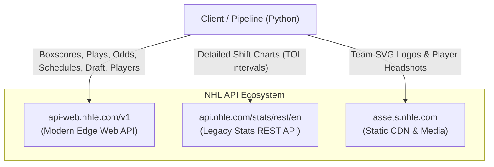

# NHL API Capabilities & Availability Overview

## 1. Executive Summary

The National Hockey League (NHL) provides a rich, public-facing RESTful API infrastructure that powers official platforms (NHL.com, NHL Edge, and team apps). Unlike many major sports leagues that strictly gate their telemetry data behind expensive enterprise paywalls (e.g., NFL Next Gen Stats, MLB Statcast), the NHL exposes comprehensive event-level, spatial, shift, roster, and betting telemetry publicly.

This document outlines the **architectural landscape, data domains, temporal availability, and operational characteristics** of the NHL API ecosystem as utilized across the Rinklytics platform.

---

## 2. API Ecosystem & Domain Routing

The NHL's backend consists of three distinct service layers:

### 1. `https://api-web.nhle.com/v1` (Modern Edge Web API)
The primary endpoint introduced in late 2023. It serves JSON data powering the revamped NHL.com and mobile applications. It replaces the legacy `statsapi.web.nhl.com` service and delivers:
* Team schedules and game calendar states.
* Gamecenter box scores and period scoring summaries.
* Micro-level play-by-play events with ice coordinates $(x, y)$.
* Player landing pages, career splits, and draft summaries.
* Real-time betting odds (partner-game feed).
* Entry draft pick history.

### 2. `https://api.nhle.com/stats/rest/en` (Stats REST API)
A high-throughput backend using the Cayenne query syntax (`?cayenneExp=...`). In this repository, this service is specifically utilized for:
* **Shift Charts (`/shiftcharts`):** Exact player-by-player on-ice start and end times per period.

### 3. `https://assets.nhle.com` (Static Asset CDN)
Global CDN hosting media assets:
* Official vector franchise logos (`/logos/nhl/svg/{TRICODE}_light.svg`).
* Player headshots (`/mugs/nhl/latest/{playerId}.png`).

---

## 3. Core Data Capabilities

| Data Domain | Description | Temporal Horizon | Granularity | Key Endpoints |
| :--- | :--- | :--- | :--- | :--- |
| **Schedule & Calendars** | Team and league game calendars, game state (`FUT`, `LIVE`, `FINAL`, `OFF`). | 1917 – Present | Game-level | `/club-schedule-season/{team}/{season}` |
| **Box Scores** | Game-level outcomes, period linescores, team totals (shots, PIM, hits, faceoffs). | 1917 – Present (Full boxscores ~1990s+) | Team / Game | `/gamecenter/{gameId}/boxscore` |
| **Play-by-Play Telemetry** | Every distinct on-ice event (shot, hit, goal, block, faceoff, giveaway, takeaway, penalty). | ~2005 – Present | Event-level (~300–400 events/game) | `/gamecenter/{gameId}/play-by-play` |
| **Spatial Coordinates** | Exact ice rink coordinates $(x, y)$ associated with shot attempts, hits, and goals. | 2010 – Present | Event $(x,y)$ | Included in `/play-by-play` |
| **Shift Charts** | Shift duration, on-ice intervals, and player line rotations. | 2007 – Present | Shift interval (~700 shifts/game) | `/shiftcharts?cayenneExp=gameId={gameId}` |
| **Player Roster & Bio** | Historical skater/goalie stats, amateur draft history, international splits, physical traits. | 1917 – Present | Player / Career | `/player/{playerId}/landing`, `/club-stats/...` |
| **Entry Draft Archives** | All amateur draft picks by year, round, selection, amateur club, and league. | 1963 – Present | Draft pick | `/draft/picks/{year}/all` |
| **Betting Market Odds** | Live 2-way / 3-way moneyline, puck line, and totals from licensed sportsbooks (DraftKings, FanDuel). | Real-time active season | Pre-game snapshot | `/partner-game/{country}/now` |
| **Franchise Media** | Light/dark vector SVG emblems for all active and historical franchises. | All franchises | Vector SVG | `assets.nhle.com/logos/nhl/svg/...` |

---

## 4. Key Architectural Considerations & Limitations

### Authentication
* **Zero API Key Requirement:** The modern NHL API endpoints are open and public. No bearer tokens or API keys are required for general read operations.
* **Headers:** It is recommended to send standard HTTP headers (`User-Agent: NHL-Analytics/1.0`, `Accept: application/json`) to prevent throttling by Cloudflare or Akamai edge nodes.

### Rate Limits & Resiliency
* While no strict published rate limit is officially enforced, bursts exceeding **5–10 requests per second** can trigger transient HTTP `429 (Too Many Requests)` or connection resets.
* **Platform Practice:**
  * Every pipeline script implements a `safe_get(url, max_retries=5, timeout=15)` helper with exponential backoff (`time.sleep(2 * attempt)`).
  * Batch processing incorporates deliberate delays (`time.sleep(0.3)` to `time.sleep(0.5)`) between consecutive game fetches.

### Temporal Availability & Ingestion Strategy
1. **Odds Must Be Collected in Real Time:**
   * The `/partner-game/{country}/now` endpoint **only** reflects active, upcoming games. Once a game begins or concludes, the pre-game betting lines disappear from the feed. Historical betting odds are not archived by the NHL API.
   * *Solution:* Our automated workflow runs daily at **20:00 UTC (afternoon Central Time)** to capture mature lines and append them to persistent storage ([`latest/box/*_odds_*.csv`](../../latest/box/)).
2. **Game Finalization Lag:**
   * Boxscores transition through game states: `FUT` (Future) $\rightarrow$ `PRE` (Pre-game) $\rightarrow$ `LIVE` (In-progress) $\rightarrow$ `FINAL` $\rightarrow$ `OFF` (Official).
   * Official statistical audits and play-by-play coordinate reconciliations occasionally complete 1–2 hours after puck drop on the West Coast.
   * *Solution:* The game-level ingestion pipeline runs daily at **09:00 UTC (3:00 AM CST / 4:00 AM CDT)**, guaranteeing that all evening and Pacific games have attained status `OFF`.

---

## 5. Navigation & Next Steps

* **[Data Views & Availability Matrix](data_views_and_capabilities.md):** Structural view of all data views, granularities, real-time vs. historical horizons, and NHL Edge tracking telemetry.
* **[Endpoints Reference](endpoints_reference.md):** Complete catalog of URLs, request parameters, JSON schemas, and response samples.
* **[Coordinate Systems & Data Dictionary](data_dictionary_and_coords.md):** Specification of rink coordinates, spatial transformations, Game ID encoding, and event taxonomy.
* **[Ingestion Pipelines](ingestion_pipelines.md):** Step-by-step description of how repository scripts transform raw API JSON into curated CSVs and Databricks tables.
