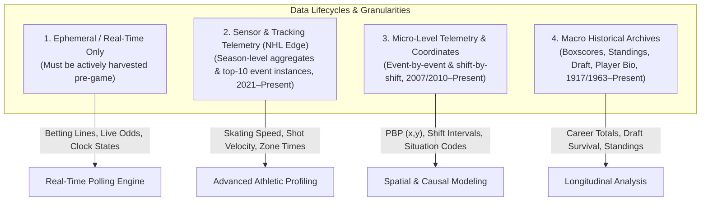

# Structural View of NHL API Data Views, Capabilities & Availability

## 1. Executive Summary & Taxonomy

To build advanced analytics, predictive models, and interactive visualizations, understanding **how data is structured, its level of granularity, and its temporal availability** is paramount.

The NHL API data architecture spans four distinct temporal and operational paradigms:



---

## 2. Master Data Availability Matrix

| Data Domain | Specific View / Metric | Endpoint Pattern | Granularity | Temporal Availability | Storage & Lifespan |
| :--- | :--- | :--- | :--- | :--- | :--- |
| **Betting Market** | Moneyline 2-way / 3-way, Puck Line, Totals | `/v1/partner-game/{market}/now` | Game-level odds snapshot | **Real-Time Only** (Active day only) | **Ephemeral:** Must be polled and persisted before puck drop; purged post-game. |
| **Live Game State** | Live clock, period state, in-game scores | `/v1/gamecenter/{id}/landing` | Second-by-second | **Real-Time Only** (Live games) | Transitions to static final once game reaches `OFF`. |
| **NHL Edge (Speed)** | Max skating speed, 18–20, 20–22, 22+ mph bursts | `/v1/edge/skater-skating-speed-detail/{id}/{season}/{type}` | Player / Season Aggregate + Peak Top-10 instances | **2021–2022 to Present** (HTTP 404 prior to 2021) | Static once season concludes. |
| **NHL Edge (Shots)** | Top shot speed, avg shot speed, 70–80, 80–90, 90–100, 100+ mph attempts | `/v1/edge/skater-shot-speed-detail/{id}/{season}/{type}` | Player / Season Aggregate + Peak Top-10 hardest shots | **2021–2022 to Present** | Static once season concludes. |
| **NHL Edge (Workload)**| Total skating distance, distance/60, distance by strength (EV, PP, PK) | `/v1/edge/skater-skating-distance-detail/{id}/{season}/{type}` | Player / Season Aggregate + Last 10 games trend | **2021–2022 to Present** | Static once season concludes. |
| **NHL Edge (Zone Time)**| Offensive, neutral, defensive zone time % by strength (EV, PP, PK); Zone start % | `/v1/edge/skater-zone-time/{id}/{season}/{type}`, `.../team-zone-time-details/...` | Player or Team / Season Aggregate | **2021–2022 to Present** | Static once season concludes. |
| **NHL Edge (Location)**| Shot attempts & shooting % by danger zone (High, Mid, Long) & rink area | `/v1/edge/skater-shot-location-detail/{id}/{season}/{type}` | Player or Team / Season Aggregate | **2021–2022 to Present** | Static once season concludes. |
| **NHL Edge (Goalie)** | 5v5 save %, High-danger save %, save % by zone | `/v1/edge/goalie-save-percentage-detail/{id}/{season}/{type}` | Goalie / Season Aggregate + Last 10 games | **2021–2022 to Present** | Static once season concludes. |
| **Spatial Events (PBP)**| Ice coordinates $(x, y)$, shot types, faceoffs, hits, giveaways, takeaways | `/v1/gamecenter/{id}/play-by-play` | Discrete event (~350 events/game) | **2010–2011 to Present** (Coordinates); ~2005+ (Events) | **Permanent / Immutable** post-audit. |
| **Shift Telemetry** | Shift start/stop seconds, duration, on-ice skaters | `/stats/rest/en/shiftcharts?cayenneExp=gameId={id}` | Discrete shift (~700 shifts/game) | **2007–2008 to Present** | **Permanent / Immutable**. |
| **Boxscores** | Goals, assists, shots, hits, blocks, PIM, TOI | `/v1/gamecenter/{id}/boxscore` | Player / Game & Team / Game | **1917 to Present** (Modern box depth ~1990s) | **Permanent / Immutable**. |
| **Player Chronicles** | Career year-by-year splits, draft info, biographical traits | `/v1/player/{id}/landing` | Player / Career History | **1917 to Present** | Updated after each active game. |
| **Entry Draft** | Drafted players, round, pick, amateur league & team | `/v1/draft/picks/{year}/all` | Draft pick | **1963 to Present** | **Permanent / Immutable**. |
| **Standings & Records** | Points, W/L/OTL, goal differential, streak | `/v1/standings/{date}`, `/v1/standings-season` | Team / Date snapshot | **1917 to Present** | **Permanent / Immutable**. |

---

## 3. Deep Dive into Data Structures & Payload Schemas

### 3.1. Real-Time Ephemeral Data: Sports Betting Odds
* **Availability:** **Real-time only.** The NHL API does **not** maintain historical odds archives.
* **Why it matters:** Odds must be ingested prior to game time (scheduled daily at 20:00 UTC / 3 PM Central in our repo).
* **Basic Data Structure:**
```json
{
  "currentOddsDate": "2026-10-06",
  "lastUpdatedUTC": "2026-10-06T20:00:38Z",
  "bettingPartner": { "name": "DraftKings" },
  "games": [
    {
      "gameId": 2026020001,
      "gameType": 2,
      "startTimeUTC": "2026-10-07T21:00:00Z",
      "homeTeam": {
        "id": 13,
        "abbrev": "FLA",
        "odds": [
          { "description": "MONEY_LINE_2_WAY", "value": -290.0 },
          { "description": "PUCK_LINE", "value": -108.0 },
          { "description": "OVER_UNDER", "value": -118.0 }
        ]
      },
      "awayTeam": {
        "id": 16,
        "abbrev": "CHI",
        "odds": [
          { "description": "MONEY_LINE_2_WAY", "value": 235.0 },
          { "description": "PUCK_LINE", "value": -112.0 },
          { "description": "OVER_UNDER", "value": -102.0 }
        ]
      }
    }
  ]
}
```

---

### 3.2. NHL Edge Telemetry (SMT Puck & Player Tracking)
* **Availability:** **2021–2022 season through Present.** Querying prior seasons (e.g., `20202021`) returns HTTP `404 Not Found`.
* **Granularity Limitation:** The NHL does **not** expose the raw 60 Hz coordinate point-cloud streams publicly. Instead, the API exposes **pre-aggregated athletic indices** and **top-10 peak instances**.

#### A. Skater Speed & Bursts Structure
`GET /v1/edge/skater-skating-speed-detail/{playerId}/{season}/{gameType}`
```json
{
  "topSkatingSpeeds": [
    {
      "gameCenterLink": "/gamecenter/col-vs-edm/2024/04/05/2023021214",
      "gameDate": "2024-04-05",
      "periodDescriptor": { "number": 1, "periodType": "REG" },
      "timeInPeriod": "19:17",
      "skatingSpeed": { "imperial": 24.1913, "metric": 38.9321 },
      "playerOnHomeTeam": true,
      "homeTeam": { "abbrev": "EDM" },
      "awayTeam": { "abbrev": "COL" }
    }
  ],
  "skatingSpeedDetails": {
    "maxSkatingSpeed": {
      "imperial": 24.191,
      "metric": 38.932,
      "percentile": 0.9984,
      "leagueAvg": { "imperial": 22.09, "metric": 35.55 }
    },
    "burstsOver22": { "value": 66, "percentile": 0.9984, "leagueAvg": 3.48 },
    "bursts20To22": { "value": 390, "percentile": 0.9967, "leagueAvg": 69.69 },
    "bursts18To20": { "value": 751, "percentile": 0.9786, "leagueAvg": 315.84 }
  }
}
```

#### B. Shot Speed & Velocity Buckets Structure
`GET /v1/edge/skater-shot-speed-detail/{playerId}/{season}/{gameType}`
```json
{
  "hardestShots": [
    {
      "gameDate": "2024-03-16",
      "timeInPeriod": "08:04",
      "shotSpeed": { "imperial": 87.05, "metric": 140.09 }
    }
  ],
  "shotSpeedDetails": {
    "topShotSpeed": { "imperial": 87.05, "percentile": 0.519, "leagueAvg": { "imperial": 84.52 } },
    "avgShotSpeed": { "imperial": 47.93, "percentile": 0.280, "leagueAvg": { "imperial": 52.72 } },
    "shotAttemptsOver100": { "value": 0, "percentile": 0.007, "leagueAvg": 0.01 },
    "shotAttempts90To100": { "value": 0, "percentile": 0.007, "leagueAvg": 1.24 },
    "shotAttempts80To90":  { "value": 16, "percentile": 0.749, "leagueAvg": 12.61 },
    "shotAttempts70To80":  { "value": 72, "percentile": 0.900, "leagueAvg": 30.55 }
  }
}
```

#### C. Zone Time & Possession Splits Structure
`GET /v1/edge/skater-zone-time/{playerId}/{season}/{gameType}`
```json
{
  "zoneTimeDetails": [
    {
      "strengthCode": "es",
      "offensiveZonePctg": 0.4670,
      "offensiveZonePercentile": 0.9903,
      "offensiveZoneLeagueAvg": 0.4126,
      "neutralZonePctg": 0.1785,
      "neutralZoneLeagueAvg": 0.1853,
      "defensiveZonePctg": 0.3545,
      "defensiveZonePercentile": 0.9638,
      "defensiveZoneLeagueAvg": 0.4021
    },
    {
      "strengthCode": "pp",
      "offensiveZonePctg": 0.6606,
      "offensiveZonePercentile": 0.9808,
      "offensiveZoneLeagueAvg": 0.5898,
      "neutralZonePctg": 0.1339,
      "defensiveZonePctg": 0.2056
    }
  ],
  "zoneStarts": {
    "offensiveZoneStartsPctg": 0.4413,
    "offensiveZoneStartsPctgPercentile": 0.9781,
    "neutralZoneStartsPctg": 0.2924,
    "defensiveZoneStartsPctg": 0.2663
  }
}
```

#### D. Shot Location & Danger Zones Structure
`GET /v1/edge/skater-shot-location-detail/{playerId}/{season}/{gameType}`
```json
{
  "shotLocationDetails": [
    { "area": "Behind the Net", "sog": 9, "goals": 0, "shootingPctg": 0.0, "sogPercentile": 0.9967 },
    { "area": "Slot", "sog": 64, "goals": 14, "shootingPctg": 0.2188, "sogPercentile": 0.9650 }
  ],
  "shotLocationTotals": [
    { "locationCode": "high", "sog": 85, "goals": 19, "shootingPctg": 0.2235, "sogLeagueAvg": 32.77, "goalsLeagueAvg": 6.41 },
    { "locationCode": "mid",  "sog": 87, "goals": 9,  "shootingPctg": 0.1034, "sogLeagueAvg": 29.11, "goalsLeagueAvg": 3.24 },
    { "locationCode": "long", "sog": 11, "goals": 0,  "shootingPctg": 0.0000, "sogLeagueAvg": 9.80,  "goalsLeagueAvg": 0.32 }
  ]
}
```

---

### 3.3. Micro-Level Spatial & Event Telemetry
* **Play-by-Play:** `/v1/gamecenter/{id}/play-by-play`
  * Granularity: Event-level (every shot, hit, block, faceoff, goal).
  * Coordinates: Exact $x, y$ coordinates available from **2010–11 onwards**.
  * Situation Codes: 4-digit code (`1551`, `1541`, `1451`) detailing goalie in net and skater counts.
* **Shift Charts:** `api.nhle.com/stats/rest/en/shiftcharts?cayenneExp=gameId={id}`
  * Granularity: Shift intervals per player.
  * Availability: **2007–2008 onwards**.
  * Enables on-ice forward line combinations and defensive pairings extraction.

---

### 3.4. Macro Historical Archives
* **Amateur Entry Draft:** `/v1/draft/picks/{year}/all`
  * Historical Horizon: **1963 to Present**.
  * Granularity: Draft pick (Round, Overall Pick, Amateur Club, Amateur League).
  * Enables survival analysis and developmental progression tracking.
* **Player Career Landing:** `/v1/player/{playerId}/landing`
  * Complete season-by-season totals across NHL, AHL, collegiate, European, and junior leagues.
* **Game Boxscores:** `/v1/gamecenter/{id}/boxscore`
  * Historical Horizon: **1917 to Present** (comprehensive player game-by-game stats available from ~1990s).

---

## 4. Analytical Opportunities for Platform Expansion

With these structural capabilities mapped, the **NHL-Analytics** platform can implement:

1. **Player Card Physicality & Speed Badges:**
   * Ingest `/v1/edge/skater-skating-speed-detail` to rank players by top skating speed and speed burst frequency ($\ge 20$ mph).
2. **Shot Quality & Velocity Adjustments:**
   * Augment Expected Goals ($xG$) models by combining spatial coordinates ($x, y$) from `/play-by-play` with shot speed distribution buckets ($\ge 90$ mph) from `/edge/skater-shot-speed-detail`.
3. **Territorial Possession Profiling:**
   * Ingest `/v1/edge/team-zone-time-details` to chart empirical offensive-zone dominance vs. neutral-zone transitional velocity across teams.
4. **Historical Line Value & Odds Settlement:**
   * Correlate mature pre-game betting lines ([`latest/box/*_odds_*.csv`](../../latest/box/)) with final score differentials to detect systematic market biases.
