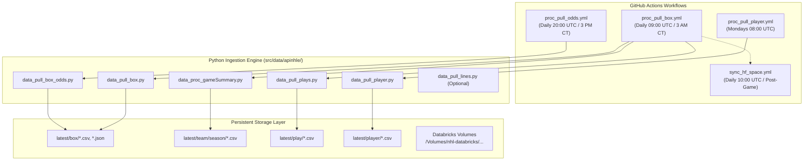

# NHL API Ingestion Pipelines & Data Persistence

This document outlines how the **NHL-Analytics** ingestion pipelines interface with the NHL API endpoints, execute ETL transformations, and persist curated datasets to local storage and Databricks Unity Catalog volumes.

---

## 1. Pipeline Architecture & Orchestration

The platform follows a **Data-as-Code** pattern where automated jobs execute on schedule, update version-controlled CSV/JSON files in the `latest/` directory, and sync downstream artifacts to Hugging Face Spaces and Databricks.



---

## 2. Ingestion Script Catalog

### 2.1. Betting Odds Pipeline
* **Script:** [`src/data/apinhle/data_pull_box_odds.py`](../../src/data/apinhle/data_pull_box_odds.py)
* **Schedule:** Daily at **20:00 UTC** (3:00 PM CDT / 2:00 PM CST).
* **Rationale:** Sportsbook odds fluctuate significantly leading up to puck drop. Capturing odds in the afternoon ensures lines are fully formed and liquid without missing early East Coast starts.
* **Outputs:**
  * `latest/box/{YYYY}_odds_US.csv` & `.json` (DraftKings US lines).
  * `latest/box/{YYYY}_odds_CA.csv` & `.json` (FanDuel Canadian lines).

### 2.2. Game Box Scores & Schedules
* **Script:** [`src/data/apinhle/data_pull_box.py`](../../src/data/apinhle/data_pull_box.py)
* **Schedule:** Daily at **09:00 UTC** (3:00 AM CST / 4:00 AM CDT).
* **Rationale:** Guarantees all late-night Pacific Coast games have finalized and statistics have transitioned to official audited state (`gameState == "OFF"`).
* **Outputs:**
  * `latest/box/{YYYY}_box.csv` (Game results, scores, home/away IDs).
  * `latest/box/{YYYY}_box_team.csv` (Team aggregate statistics: SOG, hits, PIM, faceoffs).
  * `latest/box/{YYYY}_box_player.csv` (Player individual game stats: goals, assists, TOI).
  * `latest/box/{YYYY}_gamelist_raw.csv` (Raw schedule records).

### 2.3. Game Summary & Season Team KPIs
* **Script:** [`src/data/apinhle/data_proc_gameSummary.py`](../../src/data/apinhle/data_proc_gameSummary.py)
* **Execution:** Runs sequentially following `data_pull_box.py`.
* **Transformations:** Computes rolling standings points, win/loss percentages, goal differentials, and cumulative season KPIs.
* **Outputs:**
  * `latest/box/{YYYY}_box_gameStats.csv`
  * `latest/team/season/{YYYY}_team_season.csv`

### 2.4. Play-by-Play & Spatial Telemetry
* **Script:** [`src/data/apinhle/data_pull_plays.py`](../../src/data/apinhle/data_pull_plays.py)
* **Execution:** Runs following game summary processing.
* **Transformations:** Parses the nested `plays` array, extracts spatial coordinates $(x, y)$, shot types, player interaction IDs, and normalizes roster spot names.
* **Outputs:**
  * `latest/play/{YYYY}_playbyplay.csv` (All micro-events and coordinates).
  * `latest/play/{YYYY}_playbyplay_player.csv` (Player game roster mapping).

### 2.5. Player Season Statistics
* **Script:** [`src/data/apinhle/data_pull_player.py`](../../src/data/apinhle/data_pull_player.py)
* **Schedule:** Weekly on Mondays at **08:00 UTC**.
* **Outputs:**
  * `latest/player/{YYYY}_player.csv` (Full league skater and goalie statistics).

### 2.6. Shift Charts (Optional Deep Telemetry)
* **Script:** [`src/data/apinhle/data_pull_lines.py`](../../src/data/apinhle/data_pull_lines.py)
* **Outputs:**
  * `latest/play/{YYYY}_playbyplay_shift.csv` (On-ice shift intervals, start/stop seconds).

---

## 3. Incremental Caching & Performance Optimization

To minimize load on NHL API servers and ensure fast CI/CD execution:
1. **Existing Game Skipping:** Ingestion scripts load previously generated CSV files and extract existing `gameid` values. Only newly completed games are requested over HTTP.
2. **Historical Season Freezing:** For past seasons, scripts check if the seasonal CSV already exists (e.g., `2023_box.csv`). If present, the season is skipped entirely.
3. **Draft Archive Caching:** The amateur draft ingestion pipeline (`dev/player/player_draft/data/dataproc.py`) locally caches completed historical drafts, ensuring API calls are only issued for missing years.

---

## 4. Multi-Environment Storage Abstraction

All ingestion scripts utilize the environment abstraction defined in [`src/data/apinhle/config.py`](../../src/data/apinhle/config.py):

```python
IS_DATABRICKS = "DATABRICKS_RUNTIME_VERSION" in os.environ

if IS_DATABRICKS:
    BOX_DIR = "/Volumes/nhl-databricks/data/box"
    TEAM_DIR = "/Volumes/nhl-databricks/data/team"
    PLAY_DIR = "/Volumes/nhl-databricks/data/play"
    BETTING_DIR = "/Volumes/nhl-databricks/data/betting"
    PLAYER_DIR = "/Volumes/nhl-databricks/data/player"
else:
    BOX_DIR = "./latest/box"
    TEAM_DIR = "./latest/team"
    PLAY_DIR = "./latest/play"
    BETTING_DIR = "./latest/box"
    PLAYER_DIR = "./latest/player"
```

This guarantees seamless portability between local developer machines, GitHub Actions CI runners, and enterprise Databricks Unity Catalog volumes without altering source code.
