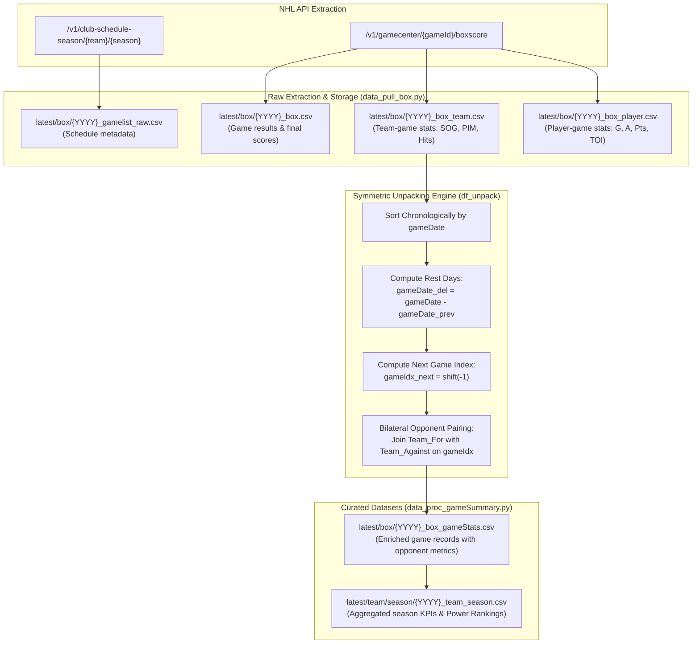

# Box Score ETL Architecture & Opponent Pairing

## 1. Overview & Pipeline Philosophy

In hockey analytics, a game is fundamentally a zero-sum, bilateral interaction between two competing teams: **Team For** (the reference team) and **Team Against** (the opponent).

While the raw NHL API delivers game data either at the game level (both teams in a single JSON payload) or from the perspective of an individual club schedule, analytical modeling requires **decoupling, symmetric unpacking, and reciprocal opponent pairing**.

This document outlines the **Box Score ETL architecture**, showing how raw game feeds are extracted, normalized, matched with opponent features, and enriched with temporal context across the **NHL-Analytics** platform.

---

## 2. End-to-End Box Processing Workflow

The ingestion and unpacking pipeline is implemented across [`src/data/apinhle/data_pull_box.py`](../../src/data/apinhle/data_pull_box.py), [`src/data/apinhle/data_proc_gameSummary.py`](../../src/data/apinhle/data_proc_gameSummary.py), and [`src/data/apinhle/function/procs_boxscore.py`](../../src/data/apinhle/function/procs_boxscore.py).



---

## 3. The Bilateral Opponent Pairing Engine (`df_unpack`)

When analyzing team success, observing a team's shots or goals in isolation is insufficient; metrics must be contextualized by who the opponent was and what the opponent achieved in that same contest.

The function `df_unpack` in [`procs_boxscore.py`](../../src/data/apinhle/function/procs_boxscore.py#L198-L234) executes this bilateral transformation:

### 3.1. Mathematical & Structural Mechanics

1. **Chronological Sorting & Rest Delta Calculation:**
   Games for each team are sorted by `gameDate`. A backward shift captures the previous game's date to measure physical fatigue and rest advantage:
   $$\Delta t_{\text{rest}} = \text{gameDate}_t - \text{gameDate}_{t-1}$$
   * If $\Delta t_{\text{rest}} = 1$: Back-to-back game (fatigue penalty).
   * If $\Delta t_{\text{rest}} \ge 3$: Well-rested team.

2. **Next-Game Index Tracking (`gameIdx_next`):**
   A forward shift of $-1$ captures the subsequent contest index, enabling predictive models to map features from game $t$ directly to outcomes in game $t+1$:
   $$\text{gameIdx}_{\text{next}} = \text{shift}_{-1}(\text{gameIdx})$$

3. **Bilateral Cross-Join on `gameIdx`:**
   For every team $T \in \mathcal{T}$ in game $G$, the engine splits the dataset into:
   * $\mathcal{D}_{\text{for}} = \{ \text{row} \in G \mid \text{team} = T \}$
   * $\mathcal{D}_{\text{against}} = \{ \text{row} \in G \mid \text{team} \neq T \}$
   
   It then joins them on the shared unique `gameIdx`, appending suffixes `_for` and `_against`:

$$\text{Record}_G(T) = \Big( \mathbf{X}_{T, G}^{(\text{for})}, \mathbf{X}_{T', G}^{(\text{against})} \Big)$$

```python
def oppo_match(df, str_team_to_eval):
    df_box_team_oppo = df.loc[df['team_tri'] == str_team_to_eval, :]
    df_box_team_excl = df.loc[df['team_tri'] != str_team_to_eval, :]
    
    # Left join opponent metrics on gameIdx
    return df_box_team_oppo.join(
        df_box_team_excl, 
        on='gameIdx',
        how='left', 
        lsuffix='_for',
        rsuffix='_against'
    )
```

This transforms $N$ games played into $2N$ team-perspective records, allowing symmetrical analysis from both teams' vantage points.

---

## 4. Dataset Schemas & Artifact Catalog

### 4.1. Raw Schedule Records (`latest/box/{YYYY}_gamelist_raw.csv`)
* **Source:** Extracted from `/v1/club-schedule-season/{team}/{season}`.
* **Fields:**
  * `id`: 10-digit unique NHL Game ID (e.g., `2024020001`).
  * `season`: 8-digit season (e.g., `20242025`).
  * `gameType`: `2` (Regular Season) or `3` (Playoffs).
  * `gameDate`: Calendar date of puck drop (`YYYY-MM-DD`).
  * `gameState`: `OFF` (Official/Finalized), `FINAL`, `LIVE`, `FUT`.
  * `homeTeam.abbrev` & `awayTeam.abbrev`: Competing franchise tricodes.
  * `homeTeam.score` & `awayTeam.score`: Final goals scored.

### 4.2. Game Box Outcomes (`latest/box/{YYYY}_box.csv`)
* **Source:** Derived from game schedule and gamecenter summary.
* **Granularity:** 1 row per completed game.
* **Purpose:** Powers the interactive live scoreboard and quick calendar lookups.
* **Key Columns:**
  * `gameid`: Integer Game ID.
  * `date`: Game date.
  * `tricode_for`: Home team tricode.
  * `tricode_against`: Away team tricode.
  * `metric_score_for`: Home team final goals.
  * `metric_score_against`: Away team final goals.
  * `period_ending`: Game outcome state (`Final`, `Final OT`, `Final SO`).

### 4.3. Team Box Scores (`latest/box/{YYYY}_box_team.csv`)
* **Source:** Extracted from `/v1/gamecenter/{gameId}/boxscore`.
* **Granularity:** 2 rows per game (1 row per team).
* **Key Columns:**
  * `gameid`: 10-digit game identifier.
  * `teamloc`: `"home"` or `"away"`.
  * `abbrev`: Team tricode (e.g., `EDM`).
  * `sog`: Official Shots on Goal.
  * `faceoffWinningPctg`: Faceoff win percentage ($[0.0, 1.0]$).
  * `powerPlayConversion`: Power play efficiency string (e.g., `"1/3"`).
  * `pim`: Penalty Infraction Minutes.
  * `hits`: Total body checks credited.
  * `blocks`: Total opposing shot attempts blocked.

### 4.4. Player Box Scores (`latest/box/{YYYY}_box_player.csv`)
* **Source:** Extracted from `/v1/gamecenter/{gameId}/boxscore` (`playerByGameStats`).
* **Granularity:** ~40 rows per game (all rostered skaters and goalies dressed).
* **Key Columns:**
  * `playerId`: Unique NHL player ID.
  * `name.default`: Full player name.
  * `position`: Position code (`C`, `L`, `R`, `D`, `G`).
  * `goals`, `assists`, `points`: Scoring production.
  * `plusMinus`: Plus/minus goal differential while on-ice.
  * `sog`: Individual shots on goal.
  * `hits`, `blockedShots`: Physical engagement.
  * `toi`, `powerPlayToi`, `shorthandedToi`: Time on ice strings (`MM:SS`).
  * `savePctg`, `saves`, `goalsAgainst`: Goalie performance metrics.

### 4.5. Enriched Box Game Stats (`latest/box/{YYYY}_box_gameStats.csv`)
* **Generated By:** [`src/data/apinhle/data_proc_gameSummary.py`](../../src/data/apinhle/data_proc_gameSummary.py).
* **Granularity:** 2 rows per game with bilateral paired metrics.
* **Enriched Features:**
  * Cumulative running metrics: `rgoals_for`, `rgoals_against`, `rwin`, `rgame`.
  * Rolling Pythagorean expectation: `rpe` (season cumulative) and `rpe_10` (last 10 games).
  * Shot quality & attempt differentials: `corsi_for`, `corsi_against`, `corsi_lvl`, `fenwick_lvl`.
  * Opponent strength context: `rpi_against`, `pairwise_win_against`.
  * Win streak indicators: `idx_WinStreak`, `idx_WinStreak_expected`, `idx_HotStreak`.
