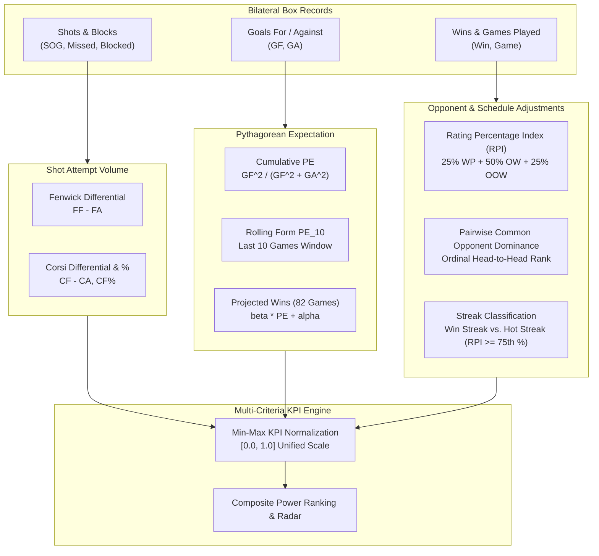
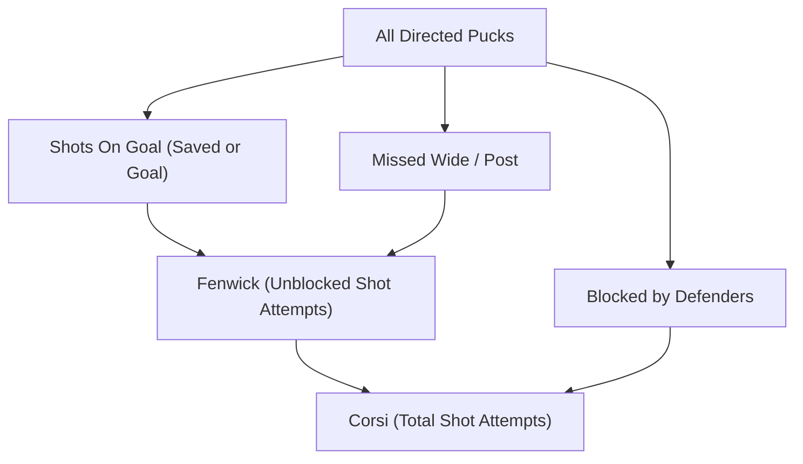
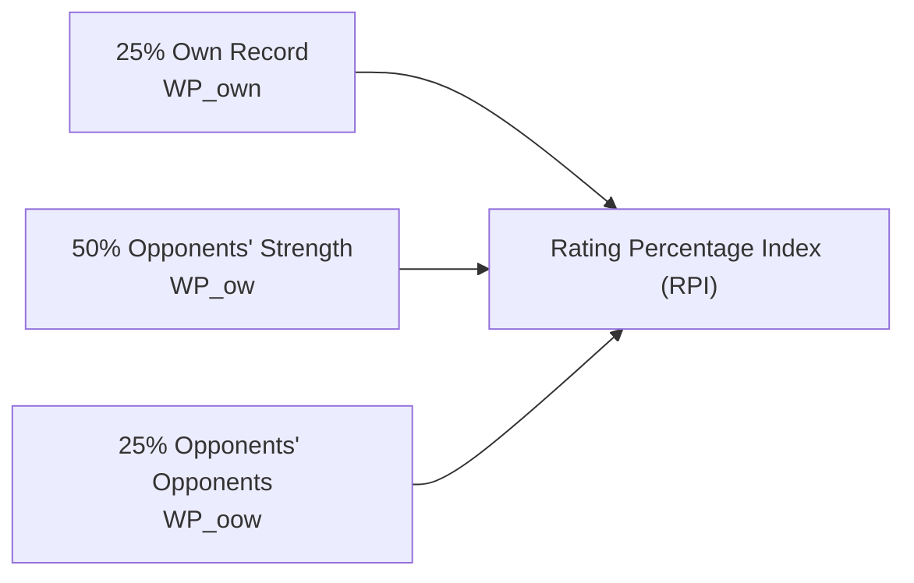
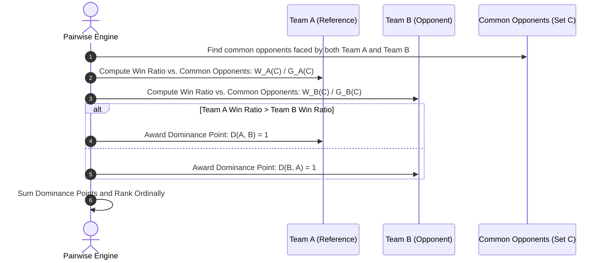
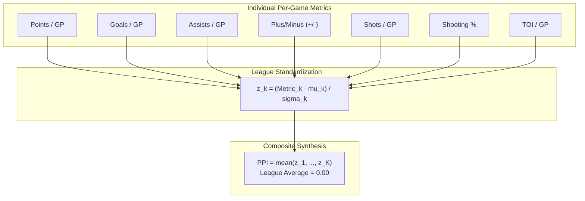

# Analytical Measurements, Advanced Metrics & Mathematical Modeling

## 1. Executive Summary

Traditional box score statistics (raw goals, assists, wins, losses) in hockey often confound **process** with **outcome**, obscuring team quality behind high-variance phenomena such as shooting percentage benders, goaltender hot streaks, and unequal schedule strength.

The **NHL-Analytics (Rinklytics)** measurement framework elevates raw event and box records into **rigorous analytical constructs**:
1. **Underlying Process Measures:** Shot generation and suppression proxies (Corsi, Fenwick).
2. **Quality & Regression Models:** Pythagorean Expectation ($PE$), rolling form ($PE_{10}$), and empirical 82-game win projections.
3. **Schedule-Adjusted Ratings:** Collegiate-style Rating Percentage Index ($RPI$) and Head-to-Head Pairwise Common Opponent Dominance.
4. **Quality-Adjusted Streaks:** Disentangling true "Hot Streaks" against elite opposition from "Expected Streaks" over cellar-dwellers.
5. **Individual Composite Impact:** Player Performance Index ($\text{PPI}$) for skaters and goaltenders.

---

## 2. Team Measurement Architecture

---

## 3. Mathematical Formulations & Measurement Logic

### 3.1. Pythagorean Expectation ($PE$) & Win Projections

Developed by Bill James for baseball and adapted for professional hockey, Pythagorean Expectation estimates a team's true talent win percentage based on goal production and goal prevention rather than nominal win-loss records.

#### A. Cumulative Season Expectation
$$\text{PE} = \frac{\text{GF}^2}{\text{GF}^2 + \text{GA}^2}$$
* Where $\text{GF}$ is cumulative Goals For and $\text{GA}$ is cumulative Goals Against.
* In hockey, an exponent of $k = 2.0$ provides the ideal empirical calibration for the point-spread variance in low-scoring games.

#### B. Rolling Form ($PE_{10}$)
To isolate recent momentum from season-long baseline, the engine computes a 10-game rolling window:
$$\text{PE}_{10}(t) = \frac{\left(\sum_{k=0}^{9} \text{GF}_{t-k}\right)^2}{\left(\sum_{k=0}^{9} \text{GF}_{t-k}\right)^2 + \left(\sum_{k=0}^{9} \text{GA}_{t-k}\right)^2}$$

#### C. Empirical 82-Game Win Projection
Using linear regression coefficients calibrated across historical regular seasons in [`procs_boxscore.py`](../../src/data/apinhle/function/procs_boxscore.py#L43-L50):
$$\mathbb{E}[\text{Wins}_{82}] = \left(\beta_{\text{pyth}} \cdot \text{PE} + \alpha_{\text{pyth}}\right) \times 82$$
$$\text{where } \beta_{\text{pyth}} = 0.809623, \quad \alpha_{\text{pyth}} = 0.042901$$

* **Equilibrium Analysis:**
  $$\Delta \text{Win} = \text{Actual Win } \% - \text{PE}$$
  * $\Delta \text{Win} > 0$: Team is **overperforming** their goal differential (benefiting from puck luck or high overtime/shootout conversion). Regression toward the mean is expected.
  * $\Delta \text{Win} < 0$: Team is **underperforming** (unlucky in one-goal games). Positive mean reversion expected.

---

### 3.2. Shot Attempt Metrics: Corsi & Fenwick

Goals are rare and noisy ($~3$ per team per game), whereas shot attempts occur at $\sim 60$ events per game, offering a much more stable sample size to measure puck possession and offensive zone pressure.

#### A. Fenwick (Unblocked Shot Attempts)
Counts all shot attempts directed at the net that were not blocked by a defending skater:
$$\text{FF} = \text{SOG}_{\text{for}} + \text{Missed}_{\text{for}}$$
$$\text{FA} = \text{SOG}_{\text{against}} + \text{Missed}_{\text{against}}$$
$$\text{Fenwick Differential} = \text{FF} - \text{FA}$$

#### B. Corsi (Total Shot Attempts)
Counts all shot attempts, including blocked shots:
$$\text{CF} = \text{FF} + \text{Blocked}_{\text{for}}$$
$$\text{CA} = \text{FA} + \text{Blocked}_{\text{against}}$$
$$\text{Corsi Differential} = \text{CF} - \text{CA}$$
$$\text{Corsi } \% = \frac{\text{CF}}{\text{CF} + \text{CA}} \times 100\%$$

* **Analytical Interpretation:**
  * $\text{Corsi } \% > 50\%$: Team controls puck possession and territorially out-chances opponents.
  * $\text{Corsi } \% < 50\%$: Team spends majority of time in their defensive zone defending shot volume.

---

### 3.3. Rating Percentage Index ($RPI$) & Schedule Strength

Winning against elite opponents provides substantially more predictive signal than running up the score against lottery contenders.

The collegiate **Rating Percentage Index ($RPI$)** adapts a 3-tier weighted hierarchy to adjust for schedule difficulty:

$$\text{RPI} = 0.25 \cdot \text{WP}_{\text{own}} + 0.50 \cdot \text{WP}_{\text{ow}} + 0.25 \cdot \text{WP}_{\text{oow}}$$

#### Component Definitions:
1. **$\text{WP}_{\text{own}}$ (Team's Own Win Percentage):**
   $$\text{WP}_{\text{own}} = \frac{\text{Wins}_{\text{team}}}{\text{Games}_{\text{team}}}$$
2. **$\text{WP}_{\text{ow}}$ (Opponents' Win Percentage - Direct SOS):**
   Evaluates the average record of all opponents faced by the team:
   $$\text{WP}_{\text{ow}} = \frac{\sum_{i \in \text{Opponents}} \text{Wins}_i}{\sum_{i \in \text{Opponents}} \text{Games}_i}$$
3. **$\text{WP}_{\text{oow}}$ (Opponents' Opponents' Win Percentage - Indirect SOS):**
   Evaluates the strength of schedule of the opponents faced, calculated over common opponents:
   $$\text{WP}_{\text{oow}} = \frac{\sum_{j \in \text{Common Opponents}} \text{Wins}_j}{\sum_{j \in \text{Common Opponents}} \text{Games}_j}$$

---

### 3.4. Pairwise Comparison & Head-to-Head Common Opponent Dominance

In [`pairwise_h2h` in `procs_boxscore.py`](../../src/data/apinhle/function/procs_boxscore.py#L419-L477), the platform implements an NCAA Selection Committee-style **Pairwise Comparison Ranking**.

#### Mathematical Logic:
1. For every pair of teams $(A, B)$, extract the set of shared common opponents up to date $t$:
   $$\mathcal{C}_{AB} = \text{Opponents}(A) \cap \text{Opponents}(B) \setminus \{A, B\}$$
2. Compute the win ratio against those common opponents:
   $$R_A = \frac{\sum_{k \in \mathcal{C}_{AB}} \text{Wins}_{A, k}}{\sum_{k \in \mathcal{C}_{AB}} \text{Games}_{A, k}}, \quad R_B = \frac{\sum_{k \in \mathcal{C}_{AB}} \text{Wins}_{B, k}}{\sum_{k \in \mathcal{C}_{AB}} \text{Games}_{B, k}}$$
3. Assign a dominance binary indicator:
   $$\mathbb{I}_{\text{Dominance}}(A, B) = \begin{cases} 1 & \text{if } R_A > R_B \\ 0 & \text{otherwise} \end{cases}$$
4. Aggregate pairwise wins for each team and rank ordinally:
   $$\text{Score}(A) = \sum_{B \neq A} \mathbb{I}_{\text{Dominance}}(A, B)$$
   $$\text{Pairwise Rank}(A) = \text{rank}_{\text{descending}}\big(\text{Score}(A)\big)$$

---

### 3.5. Win Streak Classification: Quality vs. Schedule Bias

A 3-game win streak achieved against bottom-tier lottery teams differs fundamentally from a 3-game streak beating playoff contenders. The engine categorizes every rolling 3-game sequence into three distinct buckets:

| Streak Category | Indicator in Pipeline | Formal Mathematical Condition |
| :--- | :--- | :--- |
| **Standard Win Streak** | `idx_WinStreak == 1` | $\sum_{k=0}^{2} W_{t-k} = 3$ (Three consecutive victories). |
| **Expected Streak** | `idx_WinStreak_expected == 1` | `idx_WinStreak == 1` $\land \sum_{k=0}^{2} \mathbb{I}\left(\text{RPI}_{\text{opp}, t-k} < \text{RPI}_{\text{team}}\right) \ge 2$ *(At least 2 wins were against demonstrably weaker opponents).* |
| **Hot Streak (Quality-Adjusted)** | `idx_HotStreak == 1` | `idx_WinStreak == 1` $\land \sum_{k=0}^{2} \mathbb{I}\left(\text{RPI}_{\text{opp}, t-k} \ge Q_{0.75}(\text{RPI})\right) \ge 1$ *(At least one victory was against an elite top-quartile team).* |

---

### 3.6. Multi-Criteria Min-Max KPI Normalization

To combine disparate metrics (shots, goal expectations, win percentages, ordinal ranks) into unified radar charts and composite power rankings, the pipeline normalizes metrics to the closed interval $[0.0, 1.0]$:

$$\text{KPI}(X) = \frac{X - \min(X)}{\max(X) - \min(X)}$$

For ordinal ranking metrics (such as `pairwise_win`), where lower rank denotes superior performance (Rank 1 is best), the transformation is inverted:
$$\text{KPI}_{\text{rank}}(R) = \frac{\max(R) - R}{\max(R) - \min(R)}$$
This guarantees that **Rank 1 yields a KPI score of $1.0$**, while the lowest-ranked team yields $0.0$.

---

## 4. Individual Player Measurement: Player Performance Index ($\text{PPI}$)

Implemented in [`app/exe/player_stats.py`](../../app/exe/player_stats.py#L252-L320), the **Player Performance Index ($\text{PPI}$)** standardizes multi-dimensional skater and goaltender performance into a single composite z-score.

### 4.1. Skater $\text{PPI}$ Formulation

For any skater $i$ with minimum sample size $G_i \ge 20$ games:
$$\text{PPI}_{\text{skater}}(i) = \frac{1}{K} \sum_{k=1}^K \left(\frac{x_{ik} - \mu_k}{\sigma_k}\right)$$

Where $K = 7$ standardized dimensions:
1. Points per Game: $\frac{\text{Points}}{\text{GP}}$
2. Goals per Game: $\frac{\text{Goals}}{\text{GP}}$
3. Assists per Game: $\frac{\text{Assists}}{\text{GP}}$
4. Plus/Minus: $+/-$
5. Shots on Goal per Game: $\frac{\text{SOG}}{\text{GP}}$
6. Individual Shooting Percentage: $\text{Sh} \% = \frac{\text{Goals}}{\text{SOG}}$
7. Average Time on Ice per Game: $\text{TOI}_{\text{GP}}$ (seconds)

* **Baseline Interpretation:**
  * $\text{PPI} = 0.00$: Exactly league average.
  * $\text{PPI} > +1.50$: Elite top-tier star (e.g., McDavid, MacKinnon, Matthews).
  * $\text{PPI} < -1.00$: Replacement-level depth skater.

---

### 4.2. Goaltender $\text{PPI}$ Formulation

Goaltenders are evaluated across five key efficiency, workload, and volume metrics with minimum sample size $G_i \ge 15$ games:

$$\text{PPI}_{\text{goalie}}(i) = \frac{1}{5} \sum_{m=1}^5 \left(\frac{y_{im} - \mu_m}{\sigma_m}\right)$$

Where the 5 dimensions are:
1. **Save Percentage ($\text{SV} \%$):** $\frac{\text{Saves}}{\text{Shots Against}}$.
2. **Inverted Goals Against Average ($-\text{GAA}$):** Since lower GAA is superior, it is inverted ($-\text{GAA}$) so higher standardized values represent better shot suppression.
3. **Total Wins ($W$):** Game outcome contribution.
4. **Shutouts ($\text{SO}$):** Perfect defensive performances.
5. **Saves per Game ($\frac{\text{Saves}}{\text{GP}}$):** Workload and shot suppression volume.
